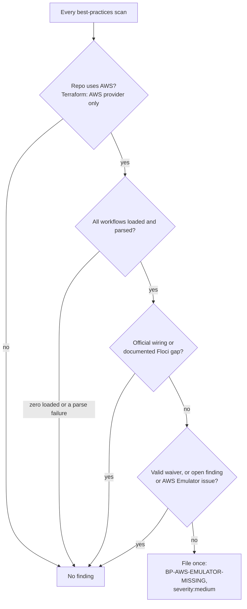
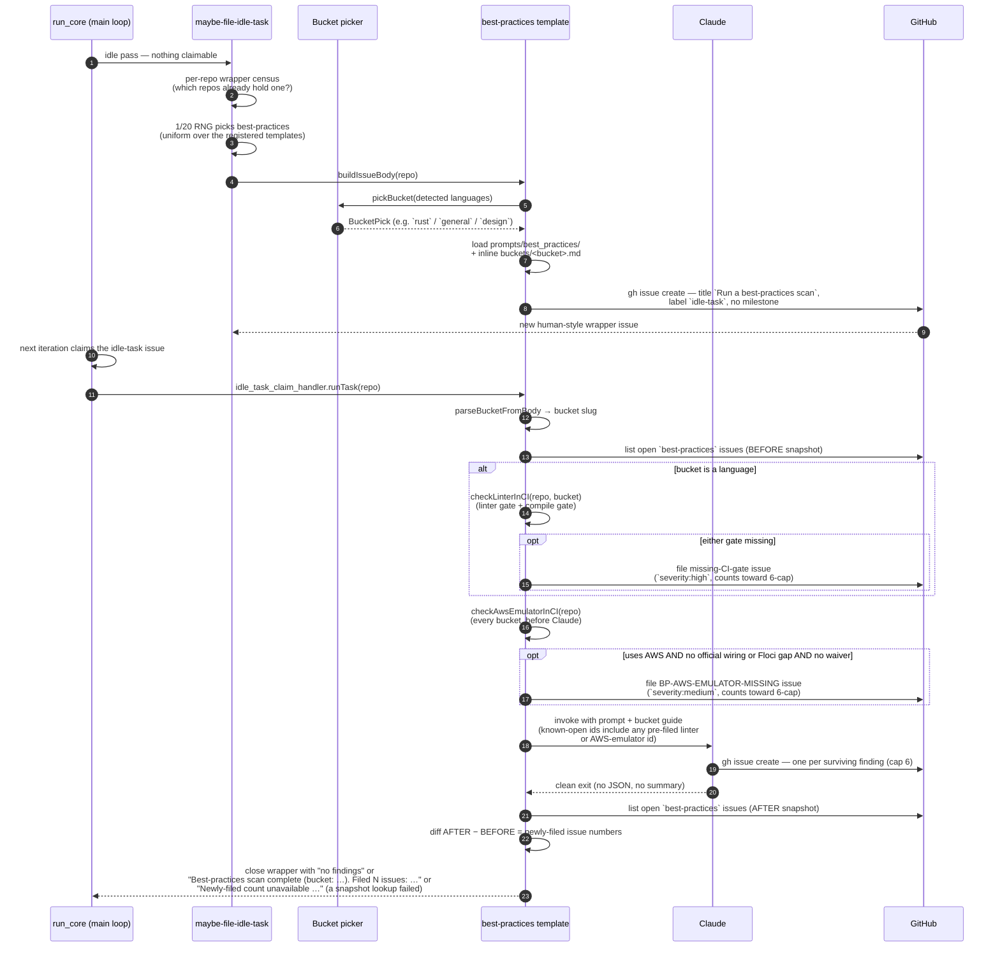
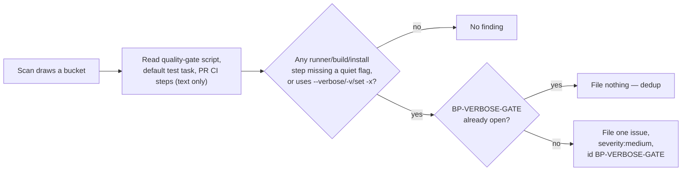

# 📐 Best-Practices Scans — Operator Manual

This document is the operator-facing reference for the Vibe Coder's LLM-driven
best-practices review. The intent is documented in the parent issue and the
sub-issues that built it: bucket picker, linter-in-CI check extended by to also
enforce a compile/syntax gate , prompt + bucket guides, template, 50/50 dispatch
, and this manual.

The best-practices scan is **template #2 of the idle-task framework** — the
generic mechanism for "things the worker does when no claimable work exists".
The framework owns filing, dedup, label discipline, and claim routing; this
document covers the best-practices-specific behaviour layered on top. See
[`docs/IDLE-TASK-FRAMEWORK.md`](IDLE-TASK-FRAMEWORK.md) for the framework manual
and the lifecycle diagram common to every template, and
[`docs/SECURITY-SCAN.md`](SECURITY-SCAN.md) for the sibling template that this
manual mirrors structurally.

For the **agent-facing** rules (label policy, suppression syntax, trigger
summary) see
[DESIGN-PRINCIPLES.md → Idle-task scans](../DESIGN-PRINCIPLES.md#security-scans).

## Design intent — LLM-only review of code

The best-practices scan is an **evidence-backed static review** performed
entirely by Claude. The orchestrating prompt at
[`prompts/best_practices/`](../prompts/best_practices/) instructs Claude to read
the source tree, apply the per-bucket checklist, and file each surviving finding
as its own GitHub issue.

**The scan runs no compiler or linter.** The best-practices scan is an
evidence-backed static review: it reads source and manifests, and every finding
cites its own file and line. No bucket guide may nominate a tool for the scan to
run, and repo logic (`cargo run`, `cargo test`, `npm test`, `bash`, …) stays
forbidden. Build and analyser tools are forbidden too, including `cargo check`,
`cargo clippy`, and `cargo
build`. They run build scripts (`build.rs`) and
procedural macros, including those supplied by transitive dependencies, and they
write build artefacts. `--offline` only limits registry access. It does not
sandbox a build script's network or filesystem use, so offline mode does not
make a build read-only.

The scan session refuses Rust build-tool commands in two layers, both defined in
`worker/deno/lib/static_scan_guard.ts`. Every provider gets the `Bash(<tool>:*)`
deny rules. On a provider that runs hooks (Claude), the session also installs a
`PreToolUse` hook on Bash, with its command-line entry point in
`worker/deno/lib/static_scan_guard_cli.ts`, which reads compound commands the
prefix rules cannot. The DeepSeek provider drops session hooks
(`worker/deno/lib/agent_provider.ts`), so there only the deny rules apply. Both
layers classify command text on a best-effort basis. Neither is an OS sandbox or
a security boundary. Normal implementation and CI `cargo` use is unaffected:
only this scan's session carries them.

Missing compiler or linter corroboration never blocks a valid static finding.
Where a finding would normally want that corroboration, the issue body says it
was "not checked (static scan)". An unavailable or skipped tool is never
reported as a clean result.

The CI-gate check (described below) is a _configuration_ check — it inspects
`.github/workflows/*.yml` to see whether the standard linter and the standard
compile/syntax gate for the chosen language are wired up. It does not actually
run either tool. A repository with a perfectly configured Clippy + `cargo check`
pipeline will still be reviewed for ownership, lifetimes, and error-handling
discipline by the LLM; conversely, a repository missing either gate will get a
high-severity finding pointing that out, regardless of how clean the code itself
is.

This split keeps the scan complementary to existing CI infrastructure: linters
catch mechanical regressions on every push, and the LLM scan surfaces the
_judgement calls_ (architectural smells, missing abstractions, weak error
handling) that linters cannot see.

The CI-gate check reads the workflow files from the repo's **checked-out root**
— `${workDir}/${repoName}`, where `workDir` is the parent directory that holds
every clone. Passing the parent `workDir` directly made the check read a
non-existent `.github/workflows`, load zero workflows, and file a false
`BP-LINTER-<bucket>` finding even when the repo's workflows ran both gates. The
call site now derives the checkout path via `repoCheckoutPath()`, and
`loadWorkflows()` logs a `[linter-in-ci] loaded 0 workflows …` diagnostic
distinguishing a missing directory from a genuinely workflow-free repo.

The two cross-bucket checks added from v3 onward — **dead dependencies** and
**deprecated config on framework bump** — are also **static-evidence only**. The
scanner reads manifests (`package.json`, `Cargo.toml`, `pom.xml`,
`build.gradle`, `deno.json`, `next.config.*`, `tsconfig.json`) and greps the
source tree for the relevant import / use sites; it does **not** invoke `cargo`,
`npm`, `pnpm`, `yarn`, `tsc`, `next`, `gradle`, or `mvn`. Findings without both
a manifest citation and a "where imports were searched" citation are dropped at
Phase 3 triage.

From v8 onward the prompt opens with the shared
[Phase 0 — Adapt to the project](IDLE-TASK-FRAMEWORK.md#phase-0--adapt-to-the-project)
stanza: the scan reads the target repo's `README.md`, agent instructions,
`CONTRIBUTING.md`, and `docs/` style guide first, and a **documented** project
convention beats a check below — so the header-policy and unsigned-commit escape
clauses in the `general` bucket finally have a policy to read. An unsafe
convention is still filed as a finding against the convention itself.

## Check coverage

The orchestrating prompt (`prompts/best_practices/`, from v3 onward) frames four
cross-bucket concerns at the orchestrator level. Each is named once in the
prompt; the per-language detection sits in the matching bucket guide under
[`prompts/best_practices/buckets/`](../prompts/best_practices/buckets/).

- **Supply-chain hardening.** Pin-to-immutable-artefact hygiene, install-time
  hardening (`--ignore-scripts`-by-default), quarantine of external deps,
  anomalous-publish detection, provenance-as-defence-in-depth, workflow scope
  minimisation, and the "treat coding-agent tool calls as build-time code
  execution" rule. Per-language detection lives in the `typescript`, `rust`,
  `java`, `react`, `aws-cloudformation`, and `terraform` bucket guides, which
  carry lockfile-pinning and lifecycle-script allowlisting. The GitHub Actions
  side of supply-chain hardening (40-character SHA pinning, per-job
  `permissions:` minimisation, `pull_request_target` justification) moved to the
  weekly [`github-actions-audit`](GITHUB-ACTIONS-AUDIT-SCAN.md) scan and is no
  longer a best-practices bucket.
- **Dead dependencies.** Declared dependencies with no source-import reference
  are flagged so the manifest stays an honest record of what the code actually
  uses. The check is static-evidence only (manifest line + import-grep cite) and
  clamped to `severity:low`/`medium`. Detection lives in
  [`buckets/typescript.md`](../prompts/best_practices/buckets/typescript.md),
  [`buckets/rust.md`](../prompts/best_practices/buckets/rust.md), and
  [`buckets/java.md`](../prompts/best_practices/buckets/java.md). The
  `github-actions` bucket is deliberately out of scope — workflow-dep hygiene is
  owned by the github-actions-audit work.
- **Deprecated config on framework bump.** Config fields that became no-ops or
  removed-option warnings after a framework bump (TypeScript, Next.js, React,
  Spring Boot, Gradle, Maven) are flagged at `severity:medium`. The check reads
  the framework version from the manifest first — a field is not "deprecated" in
  the abstract, only against a specific version. Per-bucket catalogues live in
  [`buckets/typescript.md`](../prompts/best_practices/buckets/typescript.md) (TS
  5.x `compilerOptions` removals),
  [`buckets/react.md`](../prompts/best_practices/buckets/react.md) (Next.js
  14/15 and React 18/19 removals), and
  [`buckets/java.md`](../prompts/best_practices/buckets/java.md) (Gradle 7+,
  Spring Boot 3.x, unversioned Maven plug-ins). The `github-actions` bucket is
  again out of scope; workflow-config deprecations are owned by the
  github-actions-audit scan.
- **Verbose gate output.** The quality gate and the pull-request CI's
  test/build/install steps must be quiet when green and complete when red — see
  [`### Cross-bucket: verbose gate output`](#cross-bucket-verbose-gate-output-check)
  below for the fixed id, the flag table, and the filing rule.

### Behavioural security-test coverage

A narrow static check, using the capability guidance, looks at four contracts
only: resource or tenant authorisation, a sensitive-field update, redaction at a
log or outbound sink, and the recovery boundary. The recovery boundary applies
when a retry, restart, recovery, fallback, relaunch or reconnect line sits
within 25 lines of an authority line, in either order.

Trigger lines are read as code. Comments are removed with the shared
`stripLineAndBlockComments` helper: `/* ... */` blocks, including ones that span
lines, and a trailing `// ...`. `#` is not a comment marker, so a TypeScript
private field such as `#token = ...` is code. The words of a line are read with
string-literal contents blanked (`"..."`, `'...'` and template literals), so
prose in a logger message does not trigger. Flags are the exception: they are
read inside string literals, because argv flags are written as literals. Camel
case is split before the word rules, so `swapCredential` reads as
`swap Credential` and `retryWithBackoff` as `retry With Backoff`.

The recovery words, matched whole-word and case-insensitively, are: retry,
retries, retrying; restart, restarts, restarted, restarting; recover, recovery,
recoveries, recovered, recovering, recovers; fall back, fall-back or fallback,
but not `fallback=` or `fallback:` (a UI prop); relaunch, relaunches,
relaunched, relaunching; reconnect, reconnects, reconnected, reconnecting.

An authority line is one of two things:

- A launch or identity flag, matched in the literal text: `--volume`, `--mount`,
  `--user` when not followed by a hyphen or word character (so `--user-agent` is
  not a flag), `--network`, `--privileged`, `--uid`, `--gid`, `runArgs`,
  `setuid`, `setgid`, `sudo` as a whole word, and `su -` with `su` as a whole
  word. `user.uid` is not a flag.
- A noun with an alteration verb on the same line. The nouns, matched
  whole-word, are `credential` or `credentials`, `token` or `tokens`, and
  `mount` or `mounts`, or `allowed`, an optional space, underscore or hyphen,
  then `repositories`, `repos` or `scope`. The verbs, matched whole-word and
  case-insensitively, with the regular endings `e`, `es`, `ed`, `ing` or `s`,
  are: swap (also `swapped` and `swapping`), rotate, replace, switch, refresh,
  reload, reread or re-read, remount or re-mount, append, push, override,
  escalate, elevate, widen, broaden and broader. Two phrases also count:
  `fall back to`, and `use a`, `use the`, `uses a` or `uses the` followed by
  `different`, `other` or `broader`.

The verb does not count in these look-alikes:

- A method call on a token or credential, such as `tokens.push(x)` or
  `token.replace("Bearer ", "")`, including the indexed form `tokens[0].push(`.
  A method on a mount list, such as `mounts.push("/")`, still counts.
- `switch (`, which is the keyword rather than the verb.

An ordinary authenticated HTTP retry that only sends a token in a header does
not apply. Its contract is that after a denial, authentication refresh or
proxy/startup failure, the retry or restart keeps the configured repositories,
credential scope, mounts and network guarantee (no broader), and a permitted
operation still succeeds on the recovered run. A test counts as covering it only
when the related tests together show each of the three groups on some line: a
failure (a line containing denied, denial, fail, fails, failure or injected);
non-widening (a line containing no broader, not broaden, not widen, never widen,
within the configured, same scope, scope unchanged, does not widen, or preserve
the configured, same or existing, or preserves the configured, same or
existing); and resumption (a line containing succeed, resum, completes,
permitted operation or runs the worker). Generic words such as retry, restart,
recover or succeed do not count as a failure.

A file that carries the marker `recovery-scope-change: authorised` inside a `//`
or `/* */` comment is exempt. The same text inside a string literal, or outside
any comment, does not exempt it. A gap is a best-practices finding. It cites the
production path, the tests inspected, and the uncovered contract. It is not
proof of an exploit; the security scan keeps those. A missing file named
security is not missing coverage. A test that was not executed is not a pass. A
read failure is unknown, never a clean scan. An open security-scan issue for the
same path is not filed again. The finding id is `BP-` plus a stable hash, the
severity is low, and the usual cap and `best-practice-ignore:` marker apply.

### Rust bug-class checks

[`buckets/rust.md`](../prompts/best_practices/buckets/rust.md) carries the nine
original idiom/hygiene checks plus fifteen **bug-class clusters** distilled from
the shapes that recur across the ~1,078 RustSec advisories: unsafe boundary,
memory safety, panic DoS, recursion DoS, error-handling flow, logic correctness,
concurrency (locking, data races and busy-wait polling), async runtime, FFI
boundary, type layout, path/TOCTOU, resource and destructor handling, pointer
exposure, and static hygiene.

The busy-wait cluster is the CPU-exhaustion sibling of the locking one: a
consumer that spins on `ready.load(...)` instead of waiting on a `Condvar`, a
channel `recv()`, or `thread::park` burns a whole core for the length of the
wait. Deliberate spinning — `hint::spin_loop()` in a lock-free retry, or a
backoff that sleeps between attempts — is explicitly not a finding.

Each cluster is **capability-gated** — `has_unsafe`, `has_ffi`,
`has_concurrency`, `has_async`, `has_packed_repr`, `has_fs_io` — so a cluster
whose pattern is absent from the crate produces zero findings and the scan never
speculates about code that is not there. The FFI cluster is additionally
boundary-scoped: it applies only to `extern` items, `extern "C"` functions,
`#[no_mangle]` exports, and their direct helpers — never repo-wide. The wording
is our own; no external review plugin is vendored, installed, or invoked.

### Rust build profiles

[`buckets/rust.md`](../prompts/best_practices/buckets/rust.md) also carries
three **build-profile** checks, so a Rust repo compiles as fast as possible in
development and produces the fastest possible artefact on release:

- `[profile.dev]` sets `debug = "line-tables-only"` and keeps the default
  `opt-level = 0` + incremental compilation — anything that slows a rebuild
  without a written justification is flagged;
- `[profile.release]` sets `opt-level = 3`, `lto = "fat"`, and
  `codegen-units = 1` at the **workspace root** (`lto = true` is the same
  setting; `lto = "thin"` is not);
- `-C target-cpu=native` for binaries built and run on the same host, via a
  target-scoped `.cargo/config.toml` `rustflags` entry or the build's
  `RUSTFLAGS` — never for published crates, libraries consumed elsewhere,
  `wasm32` targets, or artefacts copied to another machine.

The guidance is **stable-Rust only**: the nightly parallel front-end
(`-Zthreads`) and the Cranelift backend are named as out of scope so the scan
cannot file a finding that would break a repo's pinned toolchain. Findings are
`severity:low`, one per manifest. `.cargo/config.toml` joins `*.rs` and
`Cargo.toml` in the bucket's file scope for this check; per repo isolation the
manifest edits themselves ride each repo's own PR.

### Rust style-guide checks

[`buckets/rust.md`](../prompts/best_practices/buckets/rust.md) also carries a
`## Google Rust Style Guide learnings` section (checks 43-51), mined from the
Google Rust Style Guide and written in our own words. The checks are
static-evidence only and every finding is `severity:low`. They cover glob
imports, missing `#[must_use]`, public enums without `#[non_exhaustive]`, many
`bool` parameters, check-then-unwrap, assertions with no message, the `Mutex`
poisoning policy, `catch_unwind` outside FFI, and another crate's
`#[doc(hidden)]` items.

### Cost, speed and reliability

The owner's goal for every repo is cheaper, faster and more reliable, so seven
guides (`aws-cloudformation`, `terraform`, `rust`, `typescript`, `react`,
`java`, `general`) carry a `## Cost, speed and reliability` section
([#2579](https://github.com/stSoftwareAU/VibeCoder/issues/2579)). The checks are
concrete and cite a file and line: Lambda architecture, memory and timeout
sizing, log retention, provisioned capacity, always-on non-production resources,
S3 lifecycle rules and missing failure alarms for the infrastructure guides;
serial awaits, N+1 fetches, missing timeouts and unsafe retries, unbounded
caches and bundle size for the code guides; the Lambda release profile for Rust;
polling and per-request repeated work for `general`.

Every such finding states an **Estimated effect** (marked estimated, e.g.
"arm64: about 20% lower compute price") and the **Risk** of the change, so
cheaper never quietly means less reliable; the Phase 4 body template shows both.
The findings are `severity:low` or `severity:medium`, never `severity:high`, and
one of them can take the reserved slot described under
[6-issue cap and priority order](#6-issue-cap-and-priority-order).

Two of the CloudFormation checks are mechanical, so an `aws-cloudformation` run
also walks the checkout with
[`cfn_cost_checks.ts`](../worker/deno/lib/cfn_cost_checks.ts) and lists each
Lambda without `Architectures: [arm64]` or without a retained log group under
`## Deterministic pre-scan candidates` in the prompt. They are candidates, not
findings: the scan confirms and triages each one.

### AWS emulator in CI (`BP-AWS-EMULATOR-MISSING`)

A second deterministic pre-filer runs on **every** best-practices scan, whatever
bucket the SLOC-weighted draw picked, before Claude runs. It calls
`checkAwsEmulatorInCI()` in
[`worker/deno/lib/aws_emulator_in_ci_check.ts`](../worker/deno/lib/aws_emulator_in_ci_check.ts)
against the repo's checkout — mirroring the linter-in-CI pre-filer below rather
than the LLM-only checks above. It checks the static test wiring of the repo's
CI and files a migration finding where that wiring is missing.

**Trigger.** The repo uses AWS: an `aws-sdk`/`@aws-sdk/*` dependency in
`package.json`, `aws-config`/`aws-sdk-*` in `Cargo.toml`,
`software.amazon.awssdk`/`com.amazonaws` in `pom.xml`,
`boto3`/`botocore`/`aiobotocore` in `requirements*.txt`, or a CloudFormation
template. Terraform counts only with AWS evidence: a `provider "aws"` block, a
`resource` or `data` block whose type is `"aws_…"`, a `required_providers` entry
`aws = {`, a provider source ending `/aws`, or a module source
`<namespace>/<name>/aws` or one containing `terraform-aws-modules/`. Comments
are ignored, and Terraform for other providers does not trigger the check. The
walk skips `.git`, `node_modules`, `target`, `vendor`, `.terraform`,
`.terragrunt-cache`, `cdk.out` and `.aws-sam`. Each file the walk reads is
capped at 1 MiB, and a larger file is skipped unread, so it is not evidence.

**Pass condition.** The check is static: it reads workflow and script text and
credits a repo whose CI is wired to run the official AWS Emulator, or a
documented Floci gap. It does not observe a CI run. Official server mode needs
all of the following:

- a reachable `run:` command in the helper's test form,
  `aws-emulator-run [--ready-timeout N] [--timeout N] -- COMMAND`, where COMMAND
  is the repository's test (see **Test COMMAND** below). The step may run the
  command directly, or run a repository script that invokes it: one level of
  indirection, with the script read from the checkout and confined to it
  (absolute paths, `..`, `$` expansions and symlinks out of the repo do not
  count);
- the workflow runs on `pull_request`, or it is a `workflow_call` workflow that
  a `pull_request` workflow calls via `uses: ./.github/workflows/<file>`,
  transitively;
- neither the job nor the step sets `continue-on-error` (other than `false`),
  and neither `if:` excludes pull requests: an `if:` that reads
  `github.event_name`, `github.ref`, `github.ref_name` or `github.ref_type` is
  read as an `||` of `&&` terms of the form `github.event_name == 'E'` /
  `!= 'E'`, `github.ref` or `github.ref_name` `==` / `!=` a literal,
  `github.ref_type == 'tag'` / `'branch'`, or `startsWith(github.ref, '…')`
  (optionally negated). It earns no credit when every term group is false on a
  pull request (`github.event_name == 'push'`,
  `github.ref == 'refs/heads/main'`, `startsWith(github.ref, 'refs/tags/')`: on
  a pull request the ref is `refs/pull/<n>/merge`), or when it reads them in any
  other form (other parentheses, `contains(...)`);
- the step's shell runs the body; and
- the invocation's failure is preserved, in the workflow and in the script. A
  runner command, or the call to the script that runs it, is preserved when it
  is not in a condition, not behind `!`, not followed by `||`, `|` or `&`, not
  inside a `{ }` group, `( )` subshell or compound (`if`/`fi`, a loop, `case`)
  whose closing word is followed by `||`, `|` or `&` (`{ runner; } || true`,
  `if x; then runner; fi || true`, `( cd infra; runner; cd .. ) | tee log`; a
  `)` attached to a word, quoted or not, closes a subshell when the command
  holds one more unquoted `)` than `(`, so `cd $(git rev-parse --show-toplevel)`
  or `args=(--foo bar)` does not; redirections after the `)` belong to the
  subshell, so `( runner; echo done ) 2>&1 | tee log` is swallowed too; a `$(`
  or `(` left open at a line end, such as `VERSION=$(`, is closed by the `)`
  that balances it, not by the subshell's, even when the line ends in a keyword
  (`X=$(for d in a b; do`); the balance is carried across one line, so a
  one-line `$(ls | wc -l)` opens nothing; a backtick substitution may span
  lines, and every command up to its closing backtick is inside it; a command
  inside such a one-line parenthesis or backtick substitution, the first one
  included (`X=$( runner; echo done )`, `time ( runner )`, `! ( runner )`), or
  after `time (`, `! (` or `X=$(` on its line, is never credited, because its
  status is an argument, a negation or the substitution's, and a `set -e` inside
  one does not turn errexit on outside it; `fi)`, `done)`, `esac)` and `})`
  close the compound and then a `( )` subshell, as `fi )` does, only when that
  compound is the innermost one open, a tracked subshell is open around it and
  no parenthesis opened earlier on the line is still open. A compound inside a
  `$( … )` the walk tracks no frame for (`X=$(for d in a b; do echo $d; done)`,
  `X=$( for …; done )`, `OUT=$( { echo a; echo b; } )`,
  `X=$(cd a; if true; then echo y; fi )`) has no effect on what the walk tracks:
  its `if`, `for`, `{` and `do` open nothing, and its `fi`, `done`, `esac` and
  `}` close only a compound of their own kind that the walk opened, so the `)`
  after one, attached or spaced, closes the substitution and the line leaves the
  runner's credit alone, whether the runner comes after it, in the same group or
  after an `exit`; a `$(` or backtick in a `for` or `select` header
  (`for f in $(ls | sort)`, `for ((i=0; i<3; i++))`) still counts for the
  substitution's parenthesis balance, a `case` arm's pattern `)` does not, and
  an `exit` or `set -n` inside the substitution ends only that substitution, not
  the body), not in a group or subshell that is itself an `if` or `while` test
  (`if ( runner ); then …`), nor by `&&` with more of the body after that chain,
  and one of the following. Bash ignores errexit inside a compound on the left
  of `&&`, so a command there is judged with errexit off:
  `{ runner; } && echo ok` at the end of the body is credited, but
  `{ runner; echo done; } && echo ok` is not. A runner in a `for`, `while`,
  `until` or `select` body is never kept by being the last command, because the
  loop returns its last pass's status; it needs errexit, `exec` or an explicit
  failing exit (inside a `( )` subshell, the subshell must also fail the body:
  see Errexit below). The rules are: it runs via `exec`; it is the last command
  (or the rest of the body is an `&&` chain to the end); or errexit is on at
  that point and it is not followed by `&&`. Two explicit-exit idioms are also
  preserved, whatever errexit is (inside a `( )` subshell they end only the
  subshell, so the Errexit rule below must also hold; a one-line subshell's own
  `(` and `)`, as in `( cd infra; runner || exit 1 )` or
  `(cd infra && runner || exit 1)`, are not part of the idiom's words, but only
  when that `)` closes the `( )` subshell around the runner: an exit whose `)`
  ends a nested `( … )` or `$( … )`, or a `(` or `$(` opened in the `then`
  branch that is still open when the `exit` is read, as in
  `then (echo bad; exit 1)` or `then MSG=$(echo bad; exit 1)`, or a backtick
  substitution still open then, as in
  `` then echo `echo bad; exit 1; echo x` ``, is not the idiom; a parenthesis
  that closes before the `exit`, as in `then echo "failed at $(date)"; exit 1`,
  leaves it intact): `runner || exit N` (N not 0, or a bare `exit`; not after a
  negated `! runner`, whose `!` turns a failure into success before the `||`)
  and `if ! runner; then ...; exit N; fi` (N not 0, in a flat `then` branch).
  Neither counts inside a group swallowed one level out. After a `trap` whose
  `EXIT` (or `0`) or `ERR` handler may run `exit 0` (in the handler itself, or
  in a function the body defines and the handler calls), only a runner run via
  `exec` is preserved: the handler's `exit 0` replaces the failing status,
  `runner || exit 1` included, while `exec` replaces the shell before the
  handler runs. A handler that tidies up, or exits bare, with `$?` or with a
  saved status (`exit $rc`), keeps the failure, and `trap - EXIT` or
  `trap '' EXIT` clears the condition it names. An `&` inside a redirection
  (`2>&1`, `>&2`, `&>log`) is not a background `&`, so `runner > log 2>&1` is
  preserved, while `runner |& tee log` is a pipe. As a backstop, nothing inside
  a subshell that never closes is credited, and nothing in a body with a `)`
  that closes no subshell or `case` pattern.

**Errexit.** Errexit is on for a workflow step whose shell is unset or exactly
`bash` or `sh` (GitHub adds `-e`), or whose custom shell sets `-e` or
`-o errexit`, and off at the start of a repository script. `set -e` or
`set -o errexit` turn it on only when it is certain to run, and `set +e` turns
it off wherever it is reachable, at the point each appears. A `set -e` in an
`if`/`elif`/`else` branch or loop body decided at run time, or behind a run-time
`&&` or `||` (`[ -n "$STRICT" ] && set -e`), is not certain, because errexit is
still off when the condition is false; neither is a `set -e` on either side of a
`|` or before a `&` (`set -e | cat`, `set -e &`), which runs in a subshell, nor
an `elif` or `else` branch after an earlier test decided at run time
(`if [ -n "$A" ]; then …; elif true; then set -e; fi`); a `set -e` after a
backgrounded command (`sleep 30 & set -e`) runs in the current shell and is
certain, as are `if true; then set -e; fi` and an `else` after a test that is
statically false; inside a `( )` subshell the change lasts only until the
subshell closes, so `( set -e; make build )` leaves errexit off for the lines
after it. A command inside a `( )` subshell is kept, by whatever route fails the
subshell (errexit inside it, `runner || exit 1`,
`if ! runner; then …; exit 1;
fi` or `exec`), only when the subshell's own
failure fails the body: errexit is on outside it, or the subshell is the last
command or has an `&&` chain to the end after it and does not itself sit in a
loop body. A subshell opened as an `if`, `elif`, `while` or `until` test is
never kept, whatever errexit is outside it, because its exit only makes the test
false and errexit is ignored in a test:
`if ( cd infra && runner || exit 1 ); then …` earns no credit, while
`if { runner || exit 1; }; then …` does, since that exit ends the shell, and so
does a test inside the subshell, `( if ! runner; then exit 1; fi )`. So
`( set -e; runner; echo done )` then `echo after`, `( cd infra && exec runner )`
then `echo after`, and `for d in a b; do ( set -e; cd "$d"; runner ); done`, in
a script without a top-level `set -e`, earn no credit. A loop inside the
subshell is judged by the rules above, so
`( set -e; for d in a b; do runner;
done )` as the last command is credited:
errexit inside the subshell ends it on the first failing pass.

The command word, once shell reserved words, `sudo`/`env`/`exec`, `VAR=value`
(with an unquoted name; after `env`, every operand containing `=` once quotes
are removed, so `env "X"=1 aws-emulator-run …` counts and
`aws-emulator-run -- env "X"=./pytest` runs no test; an `env` option such as
`-i` or `--split-string=echo` ends that scan and stays the command word, so it
earns no credit; a `VAR=value` whose unquoted `$( … )` or backtick value holds
a blank, but no `;`, `|`, `&` or line break, as in
`X=$(cat v) aws-emulator-run …`, is skipped whole) and the
`time`/`nice`/`timeout`/`command` wrappers are skipped and quotes are
stripped, must be `aws-emulator-run` or a path ending `/aws-emulator-run`. The
invocation must also be able to run: a job or step
whose `if:` is statically false (`false`, `${{ false }}`, `0`) earns no credit,
nor does a command after an unconditional `exit`, behind `false &&` or
`true ||`, in an `if`/`elif`/`else` branch or `while`/`until` body whose
condition is statically false (`false`, `! true`, `:`, `true`), in a function
body, or in a here-document. This applies in the workflow and in the repository
script alike (the helpers are in
[`worker/deno/lib/shell_command_words.ts`](../worker/deno/lib/shell_command_words.ts)).
A condition decided at run time (`[ -n "$X" ]`,
`github.actor != 'dependabot[bot]'`) keeps its credit. Merely installing the
emulator (`container/toolchains/aws-emulator.sh`, or
`install ... /usr/local/bin/aws-emulator-run`) is not coverage. An
`echo aws-emulator-run`, `command -v aws-emulator-run`, a comment, or a mention
in a string does not count. Nor does an invocation that runs no repository test:
the helper's own `--smoke` self-check, `--smoke-client`, `-h`/`--help`, a bare
`--`, `-- true`, or a COMMAND without `--` (which the helper rejects).

**Test COMMAND.** The COMMAND after `--` earns official-server credit only when
it is the repository's test, in one of three forms:

- (a) a recognised test command, the same matcher the Floci gap rule below uses:
  a test runner such as `pytest` or `jest`, a test subcommand such as
  `cargo test`, `go test`, `deno test`, `deno task <test-named task>`,
  `npm test` or `npm run test:aws`, `make <test-named target>`, a Maven or
  Gradle test goal, or a repository script whose file name names a test
  (`./scripts/run-tests.sh`). A test-named repository script must exist in the
  checkout (an absent or out-of-checkout relative script path earns nothing; an
  absolute tool path such as `/usr/local/bin/pytest` is judged as a command) and
  is credited by its name; the scan does not read it to judge test adequacy.
  Probes such as `pytest --version` and install steps never count;
- (b) a repository script that itself has a test command of that kind whose
  failure fails the script, one level only (`aws-emulator-run -- ./ci/run.sh`,
  where `run.sh` runs `deno task test` under `set -euo pipefail`). It is
  followed only when the runner is in the step itself: one script is read per
  step, so a step script whose own runner COMMAND is another script does not
  follow that script; or
- (c) a test-named script the step ran that re-executes itself under the runner
  (`exec aws-emulator-run -- "$0"`, or a variable). The variable's last
  assignment in the script must be exactly the script's own path: `$0`,
  `${BASH_SOURCE[0]}`, a `$DIR/${BASH_SOURCE[0]##*/}` form (one `$DIR/` or
  `${DIR}/` directory), or the `realpath` / `readlink -f` of one of those.
  `V="echo $0"`, or a variable reassigned afterwards, earns nothing. VibeCoder's
  own `infra/cloudformation/test-aws-emulator.sh` does this.

Anything else earns no credit: `echo ok`, `aws --version`, a `curl` health
probe, `sleep`, `sh -c 'exit 0'`, or `bash -c '… || true'` (a `-c` command
string is never followed). The finding's diagnostics then say
``… runs `<COMMAND>` through aws-emulator-run, which is not a
recognised repository test command``
(or, when the runner is inside a script the step ran,
``… runs `<COMMAND>` through aws-emulator-run in
`<script path>`, which is not a recognised repository test command``).
A no-op COMMAND (`true`, `:`) is not recognised as a runner invocation at all,
so it earns no credit and adds no diagnostic.

**Embedded mode (Rust only).** Where `Cargo.toml` is AWS evidence, a credited
step may instead use the embedded emulator. Its `run:` carries a comment
`# aws-emulator-embedded: version=<X.Y.Z>; justification=<text>` (an exact
version pin and a non-empty justification) and a status-preserving `cargo test`
or `cargo nextest` command. Installation alone, an `echo`, a comment, a health
or version probe, an unused service image, a disabled job and an ignored failure
do not count.

**Floci.** Floci never counts as the official emulator. A workflow that runs
`floci/floci` (as a service container, a job container, a `docker://` step or a
`docker run` step) passes only with a documented gap record: a YAML comment line
in that workflow of the form

`# aws-emulator-gap: version=<v>; behaviour=<…>; evidence=<…>; alternative=<…>; recheck=<…>`

All five keys must be non-empty, and the version must contain a digit. A gap
record counts only in a workflow that applies to `pull_request` (by the same
rule as official wiring) whose Floci job is not statically disabled, has no
`continue-on-error`, has no `if:` that excludes pull requests, and runs a test
step: an enabled `run:` step without `continue-on-error` whose reachable,
failure-preserving commands include a test run, read on whole command words and
subcommands, never substrings: a test runner (`pytest`, `jest`, `mocha`,
`vitest`, `tox`, `nox`, `ctest`, `phpunit`, `rspec`, `bats`); a tool's test
subcommand (`cargo test`, a `+toolchain` word skipped, `go test`, `deno test`,
`deno task <name>` naming a test, `python -m pytest`, `npx jest`); a Maven goal
list or Gradle task list holding a phase or task that runs the tests
(`mvn -B clean verify`, `mvn package`, `./gradlew build`), unless it skips them
(`-DskipTests`, `-x test`); `npm test` / `yarn test` / `pnpm test` (options with
values such as `--prefix app` skipped), or `npm run <script>` whose script names
a test (`test:aws`); `make <target>` naming a test (`make check`,
`make -C infra test`); a repository script whose file name names a test
(`./scripts/run-tests.sh`); or any of these behind `poetry run`, `uv run`,
`pipenv run`, `pdm run`, `hatch run` or `bundle exec`. A name that also says
install, setup, deps or bootstrap (`make install-test-deps`,
`./scripts/check-install.sh`), a version or help probe (`--version`, `--help`,
or a short option where the tool reads it as one: `pytest -V`, but not Maven's
`-V`, which is `--show-version`, or CTest's `-V`, `--verbose`), and an install
step (`pip install pytest`, `npm install --save-dev jest`,
`npm install typescript@latest`) are not test runs. An unused Floci image beside
a gap record earns nothing. Floci without a valid record ("Floci-only") gets the
migration finding.

**What the scan establishes.** This scan records _static wiring evidence_: the
configured execution in workflow and script text. It does not establish CI test
results, which come from the repository's own CI run. It does not establish
reviewed behavioural coverage either, which comes from code review against the
canonical policy in
[`CODING-STANDARDS.md`](../CODING-STANDARDS.md#aws-integration-testing). A
credited repo therefore gets no finding, but the scan has not seen its tests
pass and has not judged whether they cover the behaviour that matters.

**No finding is filed** when:

- the repo does not use AWS;
- no workflow loaded (status unknown, the same fail-safe reasoning as the
  [zero-workflows rule](#fail-safe--zero-workflows-loaded) for
  `BP-LINTER-<bucket>`);
- any workflow failed to parse (status unknown, not a missing-gate claim; the
  next scheduled scan retries it, the same fail-safe spirit as Issue #5009's
  incomplete-read handling);
- official server or embedded wiring is found, or a Floci documented gap is
  found (logged as static wiring evidence, with no CI result observed);
- a valid waiver exists;
- an open fleet-authored issue already carries the finding id, through the
  `fileFindingOnce` dedup; or
- an open fleet-authored issue has a title containing "AWS Emulator", a
  hand-written equivalent. Only fleet-authored issues count, because titles are
  attacker-writable (Issue #1243). When that issue's body opens with this
  finding's `finding-id` marker on its first line (an older finding such as "No
  AWS emulator (Floci) in CI") and the body, with its machine-owned worker
  record block set aside, differs from the current finding, the current finding
  is posted on it as **one comment**, so an old body that still says to run
  Floci is answered rather than left standing. The title and body are never
  edited: an edit would replace an owner's added text and the `Deferred until` /
  `Depends on` record that discovery reads, and on an issue already approved
  with `work-on` it would be a service-account change to approved content, which
  the content-integrity gate escalates to `needs-human`. The comment opens with
  a `finding-update` marker holding the finding body's SHA-256, so the same
  finding is commented once; it carries no `finding-id` marker, so it is never
  read as a second finding. An issue whose marker is anywhere but the first line
  (quoted in a code span, or under an owner's paragraph) is left alone.

A `gh` failure in that lookup, or in reading the issue's comments or posting
that comment, fails the scan run rather than filing. Each skip is logged with
its reason.

**Otherwise** the template files **one** issue with the fixed id
`BP-AWS-EMULATOR-MISSING` at `severity:medium`, labelled `best-practices` + the
drawn bucket's `lang:` label + `severity:medium`, through the same open-issue
finding-id dedup (`fileFindingOnce`) that `BP-LINTER-<bucket>` uses, so an
already-open issue is not filed again. The id joins the known-open list passed
to Claude so the LLM does not re-file it. The title is "🟡 No AWS Emulator test
wiring in CI", or "🟡 Migrate Floci-only AWS tests to AWS Emulator" for a
Floci-only repo.

The issue body lists the AWS evidence files the walk collected and the scan's
diagnostics, for example a step with `continue-on-error`, a workflow not run on
`pull_request`, or a gap record missing a key. It states that the scan checked
configured execution from workflow and script text only: not an observed green
CI run, and not a review of test adequacy. Its Suggested fix gives the per-repo
contract:

- install the pinned emulator without starting it;
- run the repository's own test command so that its AWS integration tests go
  through `aws-emulator-run … -- <test command>` from a `pull_request` job, with
  failures propagated;
- drive the repo's own production AWS code with deterministic fixtures, unique
  per-run resources and supported error cases, for new or changed AWS components
  (not a rewrite of the whole suite);
- Rust may use embedded mode with the `aws-emulator-embedded` marker;
- record unsupported operations (HTTP 501), skips and stubbed resources as gaps,
  never passes;
- keep IAM, security and deployment checks on the authorised real-AWS path; and
- link the canonical
  [`CODING-STANDARDS.md#aws-integration-testing`](../CODING-STANDARDS.md#aws-integration-testing).

The fix is each repo's own workflow, never a shared reusable Action.

Migration happens through the ordinary scheduled best-practices scan: one
finding per repo, fixed by per-repo pull requests under the existing caps and
WIP limits. There is no separate campaign.

**Waiver.** A
`best-practice-ignore: BP-AWS-EMULATOR-MISSING — author=<login> expires=<YYYY-MM-DD> <reason>`
marker in a `#`, `//` or `/* */` comment in any workflow file or any of the
evidence files is parsed by
[`worker/deno/lib/suppression_comments.ts`](../worker/deno/lib/suppression_comments.ts)
under the same governance as every other marker (see
[Suppression-comment syntax](#suppression-comment-syntax)). An expired or
malformed marker does not suppress. Unlike line-scoped findings, the marker can
sit anywhere in those files. JSON files (`package.json`, JSON templates) carry
no comments, so when the evidence is only JSON the waiver goes in a workflow
file instead — a finding only files when at least one workflow loaded (the
fail-safe above), so a workflow file always exists to carry it.

A throw from the detector **fails the scan run** — it is never read as "no
finding".



## Idle trigger



The flowchart below summarises the same flow as a decision tree.

```mermaid
flowchart TD
    classDef gate fill:#fef3c7,stroke:#b45309,color:#1f2937;
    classDef phase fill:#dbeafe,stroke:#1d4ed8,color:#1f2937;
    classDef output fill:#dcfce7,stroke:#15803d,color:#1f2937;
    classDef skip fill:#fee2e2,stroke:#b91c1c,color:#1f2937;

    Idle[Idle trigger<br/>run_core: nothing claimable]

    Idle --> Pick{1/20 RNG over the<br/>registered idle-task templates}
    Pick -- best-practices --> Bucket[pickBucket — SLOC-weighted<br/>across detected languages<br/>+ general and design at dominant weight]
    Bucket --> FileWrapper[File wrapper issue<br/>title: 'Run a best-practices scan'<br/>label: idle-task<br/>no milestone — skipMilestone: true]:::output
    FileWrapper --> Claim[Next iteration<br/>claims the idle-task issue]
    Claim --> Before[Snapshot 1 — list open<br/>`best-practices` issues BEFORE]:::phase
    Before --> Lang{bucket is a language?}
    class Pick,Lang,CIGate,AwsCheck gate;
    Lang -- general / design --> AwsCheck{AWS emulator check:<br/>uses AWS AND no official wiring<br/>or Floci gap AND no waiver?<br/>runs every bucket}
    Lang -- language --> CIGate{CI-gate check:<br/>linter AND compile gates<br/>both invoked in CI?}
    CIGate -- both present --> AwsCheck
    CIGate -- either missing --> FileLinter[File missing-CI-gate issue<br/>severity:high — names which gate(s)<br/>missing — counts to 6-cap]:::output
    FileLinter --> AwsCheck
    AwsCheck -- yes --> FileAws[File BP-AWS-EMULATOR-MISSING issue<br/>severity:medium — counts to 6-cap]:::output
    FileAws --> Run[Invoke Claude<br/>read-only static review]:::phase
    AwsCheck -- no --> Run
    Run --> Cap[Triage — drop unbacked,<br/>dedup, suppress, cap at 6<br/>missing-linter > high > medium > low]:::phase
    Cap --> FileFindings[Phase 4 — gh issue create<br/>labels: best-practices, lang:&lt;bucket&gt;, severity:&lt;level&gt;]:::phase
    FileFindings --> After[Snapshot 2 — list open<br/>`best-practices` issues AFTER]:::phase
    After --> Diff[Template diff:<br/>AFTER − BEFORE = newly filed]:::output
    Diff --> Close[Close wrapper with summary<br/>'no findings' OR<br/>'Best-practices scan complete (bucket: X). Filed N issues: …' OR<br/>'Newly-filed count unavailable …'<br/>never raises a PR]:::output
```

## Wrapper issue layout

The wrapper issue is **human-style** — no hidden marker, no parameters block.
Anyone can paste the same prompt into a fresh issue with the `idle-task` label
and the worker will run it identically.

- **Title:** the literal string `Run a best-practices scan`. Dispatch matches
  the title to
  [`bestPracticesTemplate.buildIssueTitle(repo)`](../worker/deno/lib/idle_task_templates/best_practices_template.ts).
- **Body:** the `prompts/best_practices/prompt.md` template with the four
  placeholders substituted at file time — `{{BUCKET}}`, `{{SUPPRESSED_IDS}}`,
  `{{KNOWN_OPEN_FINDING_IDS}}` and `{{OPEN_ISSUE_TITLES}}` (the two dedup lists
  render as `(none)` on the wrapper itself and are rebuilt from live issues at
  claim time, **repo-wide and label-blind** — see
  [Cross-label dedup](IDLE-TASK-FRAMEWORK.md#cross-label-dedup--the-open-issue-title-list)
  for the bounds, the loud `TRUNCATED` log, and the silent-skip rule) — plus the
  matching `prompts/best_practices/buckets/<bucket>.md` guide inlined under a
  `## Bucket Guide — <bucket> (inlined)` section so the wrapper is fully
  self-contained.
- **Bucket marker line:** a single `**Bucket:**`<bucket>`` line at the top of
  the body. `runTask()` recovers the bucket from this line on claim
  (`parseBucketFromBody` in
  [`best_practices_template.ts`](../worker/deno/lib/idle_task_templates/best_practices_template.ts)).
- **Label:** the canonical `idle-task` label. No workflow labels; no `lang:*` or
  `severity:*` labels on the wrapper itself.
- **No milestone** — the template sets `skipMilestone: true`, so the wrapper
  never gates a milestone-merge PR.

## Bucket-pick algorithm

`pickBucket()` in
[`worker/deno/lib/best_practices_bucket_picker.ts`](../worker/deno/lib/best_practices_bucket_picker.ts)
chooses the bucket at file time using a SLOC-weighted random pick:

1. **Detect languages** for the target repo via the GitHub Languages API plus
   marker-file byte counts for buckets the Languages API does not surface
   (GitHub Actions YAML, CloudFormation, Terraform, React markers).
2. **Weight each detected supported bucket** by its byte count from
   `RepoLanguages.raw` (a KISS SLOC proxy — bytes correlate strongly with SLOC
   within a single ecosystem).
3. **Add `general` and `design`** — the two language-agnostic buckets — each as
   a single bucket whose weight equals the dominant detected language's weight,
   so both compete on par with the largest language present. Because neither
   names a language, a repo written entirely in languages the scan has no bucket
   for still draws one of them: its dominant raw byte count supplies the weight.
   A repo with no detected code at all has nothing to design-review, so it falls
   back to `general` alone.
4. **Draw uniformly** over the cumulative weight to pick the bucket.

The TypeScript vs React decision is mutually exclusive: the bucket is `react`
only when `package.json` declares a React dependency AND at least one
`.jsx`/`.tsx` file is present; otherwise the TypeScript byte count flows to the
`typescript` bucket.

The RNG is injectable so tests can drive a deterministic distribution.
Production uses `Math.random`.

## Buckets — per-language scope

> **GitHub Actions has its own weekly scan.** Workflow and composite-action
> review is **not** a best-practices bucket. It moved to the dedicated weekly
> [`github-actions-audit`](GITHUB-ACTIONS-AUDIT-SCAN.md) template , so the
> buckets below cover application and infrastructure code only.

Each bucket has a dedicated guide under
[`prompts/best_practices/buckets/`](../prompts/best_practices/buckets/) that
names the canonical references (linked, never restated) and lists the per-bucket
checks. The LLM is constrained to review only that bucket's material on a given
run; out-of-bucket concerns belong to that bucket's own run.

| Bucket               | Targets                                                                                 | Canonical guides                                                                                                                                                                                                                                        | Inline checklist                                                                         |
| -------------------- | --------------------------------------------------------------------------------------- | ------------------------------------------------------------------------------------------------------------------------------------------------------------------------------------------------------------------------------------------------------- | ---------------------------------------------------------------------------------------- |
| `rust`               | `*.rs`, `Cargo.toml`, `.cargo/config.toml`                                              | [The Rust Book](https://doc.rust-lang.org/book/), [Rust API Guidelines](https://rust-lang.github.io/api-guidelines/), [Rustonomicon](https://doc.rust-lang.org/nomicon/), [Google Rust Style Guide](https://google.github.io/styleguide/rustguide.html) | [buckets/rust.md](../prompts/best_practices/buckets/rust.md)                             |
| `typescript`         | `*.ts`, `tsconfig*.json` (excludes `.tsx`)                                              | [TypeScript Handbook](https://www.typescriptlang.org/docs/handbook/intro.html), [`tsconfig` reference](https://www.typescriptlang.org/tsconfig), [`typescript-eslint` rules](https://typescript-eslint.io/rules/)                                       | [buckets/typescript.md](../prompts/best_practices/buckets/typescript.md)                 |
| `react`              | `*.tsx`/`*.jsx` importing `react`                                                       | [React docs](https://react.dev/), [Rules of Hooks](https://react.dev/reference/rules/rules-of-hooks)                                                                                                                                                    | [buckets/react.md](../prompts/best_practices/buckets/react.md)                           |
| `java`               | `*.java`, `pom.xml`, `build.gradle`                                                     | Effective Java, Google Java Style                                                                                                                                                                                                                       | [buckets/java.md](../prompts/best_practices/buckets/java.md)                             |
| `html`               | `*.html`, HTML literals, and the stylesheets a page loads (visual design anti-patterns) | WAI-ARIA, WCAG, HTML living standard, web.dev CLS                                                                                                                                                                                                       | [buckets/html.md](../prompts/best_practices/buckets/html.md)                             |
| `aws-cloudformation` | CFN templates (YAML/JSON with `AWSTemplateFormatVersion`)                               | [cfn-lint](https://github.com/aws-cloudformation/cfn-lint), [Checkov](https://github.com/bridgecrewio/checkov), [AWS CFN user guide](https://docs.aws.amazon.com/AWSCloudFormation/)                                                                    | [buckets/aws-cloudformation.md](../prompts/best_practices/buckets/aws-cloudformation.md) |
| `terraform`          | `*.tf`, `*.tfvars`                                                                      | [Terraform docs](https://developer.hashicorp.com/terraform/docs), [tflint](https://github.com/terraform-linters/tflint)                                                                                                                                 | [buckets/terraform.md](../prompts/best_practices/buckets/terraform.md)                   |
| `general`            | Repo-level hygiene (no language-specific code)                                          | [Open Source Guides](https://opensource.guide/), [Keep a Changelog](https://keepachangelog.com/), [SemVer](https://semver.org/), [SPDX](https://spdx.org/licenses/), [SLSA](https://slsa.dev/)                                                          | [buckets/general.md](../prompts/best_practices/buckets/general.md)                       |
| `design`             | Design smells in any language (no language idioms, no repo hygiene)                     | [Refactoring, ch. 3](https://martinfowler.com/books/refactoring.html), [Refactoring catalogue](https://refactoring.guru/refactoring/smells)                                                                                                             | [buckets/design.md](../prompts/best_practices/buckets/design.md)                         |

The `aws-cloudformation` and `terraform` buckets keep IaC hygiene only.
Cross-policy permission chains — an AssumeRole escalation, a PassRole launch
through compute, or an SSM SendCommand into a more privileged instance role —
are owned by the
[security scan](SECURITY-SCAN.md#cloud-permission-chains-aws-iac).
Best-practices files nothing for a chain the security scan covers.

The `general` bucket is repo-level hygiene only — README, licence, CI/CD
presence, dependency tooling, SBOM/lockfile pinning, repo structure, **runtime
unambiguity** (a mixed Deno+Node repo earns a single `severity:medium` "choose
one runtime or document the split" finding), **GitHub-native security scanning**
(a security-sensitive repo with no code scanning earns a single
`severity:medium` "enable CodeQL / Dependabot security updates" finding — see
below), **branch-protection / CODEOWNERS depth** (a repo with privileged
workflows but no CODEOWNERS coverage on `.github/workflows/`, or unsigned recent
commits, earns a single finding — `severity:high` for the CODEOWNERS gap on a
privileged-workflow repo, otherwise `severity:medium` — see below), and
**vulnerability-disclosure policy** (a repo with no `SECURITY.md` in any of the
three GitHub-recognised locations earns a single finding — `severity:low` by
default, `severity:medium` for a repo that publishes a library or service
consumed externally — see below), and **hardcoded success in a production code
path** (a production function that returns a canned success value or fixture
data instead of doing the work earns a finding — `severity:high` when its result
gates a decision, otherwise `severity:medium` — see below). It does **not**
review language-specific code quality; that belongs to the per-language buckets.

### The `design` bucket — a named baseline of design smells

The `design` bucket is the second language-agnostic bucket. It carries a fixed
baseline of the twelve named smells from _Refactoring_ ch. 3 — mysterious name,
duplicated code, feature envy, data clumps, primitive obsession, repeated
switches, shotgun surgery, divergent change, speculative generality, message
chains, middle man, refused bequest — each written as _what it is_ → _how to fix
it_. It scores the shape of the code (naming, coupling, cohesion, delegation),
never a language's idioms and never repo hygiene, so it applies to a repo in a
language with no bucket of its own.

Three limits keep it from becoming noise — the guide's two binding rules and its
own finding cap — all set in
[buckets/design.md](../prompts/best_practices/buckets/design.md):

- **The repo overrides the baseline.** A convention the repository documents
  wins; where a documented standard endorses the shape a smell would flag, the
  candidate is dropped.
- **Every smell is a judgement call.** Findings are titled and phrased as
  possibilities ("Possible Feature Envy in …"), never as violations, and
  anything the repo's own tooling already enforces is skipped.
- **Tighter caps than the other buckets.** At most **three** findings per run
  (against the orchestrator's six), severity floor `low` and ceiling `medium` —
  a design smell is a maintainability judgement, never `severity:high`.

Two of the twelve overlap sibling scans, so the guide hands each shape to one
owner: duplicated code belongs to the `duplicated_knowledge` scan, and
unreferenced code — the dead half of speculative generality — belongs to the
`dead_code` scan. The `design` bucket files only the design-shaped remainder
(for speculative generality: the seam that _is_ used, by one caller, built for a
hypothetical second case). The object-oriented smells — middle man and refused
bequest — apply only where the repo actually uses delegation or an inheritance
hierarchy, and are silent on a procedural or declarative repo such as Bash or
Terraform.

### GitHub-native security scanning

Complementing the dependency _update_ hygiene of general check #5 (Renovate /
Dependabot version-bump cadence and quarantine), the `general` bucket also
checks GitHub's "secure by default" _security_ features. The check is
**static-evidence only** — it judges from committed workflow and config file
presence, never from a GitHub API read of repo settings. Where a feature is a
repo-level setting that is not statically visible (push protection, the
secret-scanning toggle, Dependabot alerts) the finding is phrased as a
**recommendation**, not an assertion that the setting is off.

| Feature                           | Static evidence inspected                                                                                                      | Action when absent                                      |
| --------------------------------- | ------------------------------------------------------------------------------------------------------------------------------ | ------------------------------------------------------- |
| Code scanning (CodeQL / SAST)     | `.github/workflows/codeql*.yml` (or default-setup equivalent), or an equivalent SAST step (`semgrep`, `snyk code`) in CI       | Recommend enabling CodeQL or an equivalent SAST in CI   |
| Dependabot _security_ updates     | `.github/dependabot.yml` enabling security updates, or reliance on Dependabot alerts (distinct from check #5's update cadence) | Recommend enabling Dependabot security updates          |
| Secret scanning + push protection | A committed secret-scanning gate (`gitleaks` / `trufflehog` in CI), or a note recommending push protection                     | Recommend enabling secret scanning with push protection |

A security-sensitive repo missing these earns **one** `severity:medium` finding
(stable `BP-<12 hex>` id, re-detection-safe) listing the missing features and
their remediation. It counts against the six-issue cap. A repo that already
commits a CodeQL workflow and a secret-scanning gate is silent on this check.

### Branch protection and CODEOWNERS depth

Complementing the CI/CD posture of general check #3 (CI runs on PRs, required
status checks configured), the `general` bucket also flags deeper governance
gaps so a single compromised account cannot quietly merge changes to
`.github/workflows/` — which then run with secrets. The check is
**static-evidence only**: it reads `CODEOWNERS` and the output of
`git log --show-signature` on recent commits. It never calls the GitHub API to
read branch-protection settings; controls that are repo-level settings (required
review, no force-push, linear history) are phrased as **recommendations**, not
assertions that the setting is off.

The check fires only when the repo has a meaningful surface — any repo with
`.github/workflows/` or `.github/actions/`.

| Control                                          | Static evidence inspected                                                                                                                                                       | Action when absent                                                                                                                                                                                                                                                   |
| ------------------------------------------------ | ------------------------------------------------------------------------------------------------------------------------------------------------------------------------------- | -------------------------------------------------------------------------------------------------------------------------------------------------------------------------------------------------------------------------------------------------------------------- |
| CODEOWNERS covers `.github/workflows/`           | `CODEOWNERS`, `.github/CODEOWNERS`, or `docs/CODEOWNERS` (the three locations GitHub recognises) — pattern matching `.github/workflows/` (and `.github/actions/` where present) | Flag the missing pattern. `severity:high` when the repo has **privileged workflows** (any workflow referencing `secrets.*` other than `GITHUB_TOKEN`, `id-token: write`, a `pull_request_target` trigger, or a self-hosted `runs-on:`); otherwise `severity:medium`. |
| Recent commits are signed                        | `git log --show-signature -20 origin/<default>` shows `gpg:` / `Good signature` markers on recent commits                                                                       | Recommend enabling required signed commits at `severity:medium`. Drop the candidate when `CONTRIBUTING.md` explicitly excuses unsigned commits or every recent commit was authored by a single bot account.                                                          |
| Required review / no force-push / linear history | Repo-level branch-protection setting — **not** statically visible                                                                                                               | Recommend (at `severity:medium`) ≥1 required PR approval, blocking direct push and force-push to the default branch, and enabling linear history where the team uses a rebase / squash workflow.                                                                     |

A repo with privileged workflows and a meaningful surface earns **one** finding
for this check (stable `BP-<12 hex>` id, re-detection-safe). Severity is
`severity:high` when the dominant gap is missing CODEOWNERS coverage on
`.github/workflows/` for a privileged-workflow repo; otherwise
`severity:medium`. The finding counts against the six-issue cap like any other.
A repo with CODEOWNERS covering `.github/workflows/`, signed recent commits, and
a documented branch-protection policy is silent on this check.

### Vulnerability disclosure policy

`SECURITY.md` is the canonical, GitHub-recognised place for a repo's
vulnerability **disclosure policy** — how to report a vulnerability privately,
the expected response time, and which versions are supported. Without it, a
reporter has no private channel and defaults to a public issue, which discloses
the vulnerability before a fix exists. GitHub surfaces the file in the repo's
Security tab as a community-health file. The `general` bucket flags its absence
as a **static-evidence only** check (file presence) — it never calls the GitHub
API.

The check inspects the three locations GitHub recognises for community-health
files: `SECURITY.md` at the repo root, `.github/SECURITY.md`, and
`docs/SECURITY.md`. A repo with the file in any of the three is silent.

| Repo type                                                    | Static signal                                                                                                                                                                                                                  | Severity                                    |
| ------------------------------------------------------------ | ------------------------------------------------------------------------------------------------------------------------------------------------------------------------------------------------------------------------------ | ------------------------------------------- |
| Internal / single-consumer repo that ships code              | None of the three `SECURITY.md` locations is present                                                                                                                                                                           | `severity:low` (governance/hygiene default) |
| Repo that publishes a library or service consumed externally | A `package.json` / `Cargo.toml` / `pom.xml` / `pyproject.toml` declaring a public package name, a publish workflow (`npm publish`, `cargo publish`, `mvn deploy`, `docker push`), or an externally consumed API/hosted product | `severity:medium`                           |

A repo that ships code but has no `SECURITY.md` earns **one** finding titled
_"Add `SECURITY.md` with a vulnerability disclosure policy"_ (stable
`BP-<12 hex>` id, re-detection-safe). The body suggests adding `SECURITY.md`
with a private reporting route (GitHub private vulnerability reporting or a
security email), an expected response time, and a supported-versions table. The
finding counts against the six-issue cap like any other.

### Hardcoded success in a production code path

The **Never Fail Silently — Fail Loud** rule enforced at PR time has no
counterpart that audits an _already-merged_ stub, so a function whose body is
fiction can return a green result for weeks — the shape that produced the FLEET
Discovery outage. The `general` bucket closes that gap: it flags a non-test,
non-example function whose spec implies real work but which returns a canned
success value or fixture data instead. The check is **static-evidence only**
(read the source, never run the code) and language-agnostic, so it runs on every
repo in the fleet.

| Shape flagged                                                                                  | Not flagged                                                                                                        |
| ---------------------------------------------------------------------------------------------- | ------------------------------------------------------------------------------------------------------------------ |
| A literal `{ ok: true }` / `{"status": "ok"}` / `return true` with no computation behind it    | Test files, fixtures, and `example/` / `demo/` / `sample` directories                                              |
| A hardcoded sample record standing in for a fetched or computed one                            | Factory / builder / seed / mock helpers whose declared purpose _is_ canned data                                    |
| A stubbed return under a `TODO` / `FIXME` / "for now" comment                                  | A **documented** default ("returns empty when absent") — an _undocumented_ one masking a failed fetch is a finding |
| A `catch` block that converts a failure into a success-shaped value                            | A genuinely constant answer (version string, feature-flag constant, pure lookup table)                             |
| Reconciliation that reads the absence of an explicit failure marker as success ('s other half) |                                                                                                                    |

Severity is `severity:high` when the function sits on a path whose result gates
a decision — a health check, a verification step, a reconciliation, an
authorisation check — and `severity:medium` otherwise. Each finding cites the
file and line range; the suggested fix is to implement the behaviour or to fail
explicitly (throw, exit non-zero, emit a failure marker), never to return a
plausible success. The finding uses the standard `BP-<12 hex>` id recipe and
counts against the six-issue cap like any other.

> **Retired bucket — `github-actions`.** GitHub Actions workflow and
> composite-action review moved to the dedicated weekly
> [`github-actions-audit`](GITHUB-ACTIONS-AUDIT-SCAN.md) template . The daily
> best-practices scan no longer picks the `github-actions` bucket, the
> linter-in-CI pre-check no longer routes it, and the bucket guide was deleted.

## Deno regression prevention

Two buckets cooperate to stop a Deno repo regressing to Node tooling . A repo is
a **Deno repo** when its root holds any of `deno.json`, `deno.jsonc`, or
`deno.lock` — even alongside a `package.json`. Node-only repos (no Deno marker)
are silent on every check below.

**`typescript` bucket — regression flags.** When the repo is a Deno repo, the
bucket files each of the following at `severity:high` with a cited path and line
range, and a suggested fix that names the Deno-native equivalent (`deno test`,
`deno run`, `deno task`, `deno bundle`, `deno fmt`, `deno lint`):

| Regression                                                                                      | Suggested-fix recipe                                                                                                          |
| ----------------------------------------------------------------------------------------------- | ----------------------------------------------------------------------------------------------------------------------------- |
| Non-empty `dependencies` in root `package.json` (`devDependencies` is parity, not a regression) | Port the runtime dep to a `jsr:` / `npm:` specifier in `deno.json` imports and drop the `package.json` entry.                 |
| Committed / un-ignored `node_modules/`                                                          | Add `node_modules/` to `.gitignore`, `git rm -r --cached node_modules`, rely on Deno's module cache.                          |
| CI `run:` steps calling `npm`/`pnpm`/`yarn`/`npx` to run application or test code               | Replace with `deno run` / `deno test` / `deno task`. Dev-tooling installs (`npm ci --ignore-scripts`) are acceptable.         |
| Root `tsconfig.json` with a non-empty `compilerOptions` overriding Deno                         | Move the settings into `deno.json`'s `compilerOptions` and delete `tsconfig.json` (or scope it to a Node sub-directory).      |
| Node-only bundler configs (Webpack/Vite/esbuild) at the root                                    | Replace with `deno bundle` / `deno task bundle`, or relocate the Node sub-package and its config into a scoped sub-directory. |

**`general` bucket — mixed-runtime finding.** When a Deno marker **and** a root
`package.json` with a non-empty `dependencies` block are both present, the
bucket files **exactly one** `severity:medium` finding titled _"Repo mixes Deno
and Node — choose one runtime or document the split"_. Its stable id is computed
from the canonical `BP-<12 hex>` recipe (title slug
`repo-mixes-deno-and-node-choose-one-runtime-or-document-the-split`, primary
file `package.json`), so re-runs deduplicate against the known-open and
suppressed lists. The finding **counts against the six-issue cap** like any
other — no exemption — and the body proposes three fixes: commit fully to Deno
and drop the `package.json` runtime deps; split the Node portion into its own
scoped sub-directory; or document the dual-runtime layout in `README.md`. A repo
with only `devDependencies` (parity tooling) or with no Deno marker is not a
mixed-runtime repo — the bucket files nothing.

## Issue label scheme

Filed best-practices issues carry exactly three labels — no operational/workflow
label is ever added.

| Label              | Allowed values                                                                                                                                     | Meaning                                                                                                                                    |
| ------------------ | -------------------------------------------------------------------------------------------------------------------------------------------------- | ------------------------------------------------------------------------------------------------------------------------------------------ |
| `best-practices`   | (constant)                                                                                                                                         | Always present; used by the before/after snapshot query. The finding-id dedup look-up is repo-wide (Issue #539) and does not filter on it. |
| `lang:<bucket>`    | `lang:rust`, `lang:typescript`, `lang:react`, `lang:java`, `lang:html`, `lang:aws-cloudformation`, `lang:terraform`, `lang:general`, `lang:design` | The bucket the finding belongs to. Matches the wrapper's bucket marker.                                                                    |
| `severity:<level>` | `severity:high`, `severity:medium`, `severity:low`                                                                                                 | Exactly one per issue.                                                                                                                     |

Operational labels (`planning`, `work-on`, `top-priority`, `low-priority`,
`failed`, `failed-once`, `needs-human`, `best-model`, `question`,
`refine-issue`) are **never** applied by the scanner.
[`label_security.ts`](../worker/deno/lib/label_security.ts) strips any such
label added by the worker on the next scan, so an accidental operational label
cannot persist.

## 6-issue cap and priority order

A single best-practices run files **at most 6 standalone findings**. The cap is
enforced in two places:

1. **Phase 3 triage in the prompt** — Claude sorts surviving findings by
   severity (high → medium → low) and keeps the top 6.
2. **The Deno-side capper** in
   [`worker/deno/lib/best_practices_capper.ts`](../worker/deno/lib/best_practices_capper.ts)
   re-applies the cap deterministically using the canonical priority order:

   > **missing-linter > severity:high > severity:medium > severity:low**

Within the same priority tier the order Claude emitted is preserved.

**Reserved slot.** Phase 3 reserves one of the 6 slots for a cost, speed and
reliability finding: when one survives triage but misses the cut, the
highest-priority one replaces the last kept finding, provided that finding is
below `severity:high`. Correctness and security findings at `severity:high` are
never displaced. The capper models the same rule through the finding's
`costSpeedReliability` flag.

A language-targeted run with no linter-in-CI gate gives the missing-linter
finding the first slot and leaves five slots for the LLM. A `general` or
`design` run skips the linter check entirely and the LLM has all six slots, less
any pre-filed `BP-AWS-EMULATOR-MISSING` finding — though the `design` guide caps
its own runs at three findings, none above `severity:medium`, because named
smells over-report on any real codebase. A pre-filed `BP-AWS-EMULATOR-MISSING`
id likewise reaches Claude in the known-open list — on every bucket, not just
language-targeted runs — so the LLM never re-files it and it still counts toward
the 6-cap.

**No overflow tracker.** Unlike the security-scan template, the best-practices
scan does **not** file an overflow tracker when more than six candidates survive
triage. Surplus candidates are silently dropped from this run; the next scan
against the same bucket re-detects them (subject to dedup against open issues).

## Suppression-comment syntax

A finding can be suppressed in-source by adding the host language's standard
ignore comment with the finding ID and a short reason. The grammar is recognised
by
[`worker/deno/lib/suppression_comments.ts`](../worker/deno/lib/suppression_comments.ts)
and applies on every subsequent run (the suppressed id is pre-substituted into
the `{{SUPPRESSED_IDS}}` placeholder so Claude drops the finding in Phase 3
triage).

The canonical form is
`best-practice-ignore: BP-<id> — author=<login> expires=<YYYY-MM-DD> <reason>`.
Author, expiry, and reason are all **mandatory**: a marker missing any of them,
carrying a malformed or past expiry, or naming an author outside a configured
allowlist is parsed and reported but never suppresses. Every marker seen during
a run is listed in that run's scan report as `Active suppressions (N): …` /
`Rejected suppressions (N): …`.

Worked examples per language family:

```rust
// best-practice-ignore: BP-1234567890ab — author=nigel expires=2026-12-31 `unwrap()` is safe here:
// the value comes from a literal compiled-in lookup table.
let port = MAP.get("default").unwrap();
```

```typescript
// best-practice-ignore: BP-1234567890ab — author=nigel expires=2026-12-31 `any` is required to bridge
// the third-party SDK whose types are wrong upstream.
function bridge(value: any): MyType {/* … */}
```

```python
# best-practice-ignore: BP-1234567890ab — author=nigel expires=2026-12-31 broad `except` is required to
# match the framework's contract; the caller logs the exception.
try:
    do_work()
except Exception:
    raise
```

```yaml
# best-practice-ignore: BP-1234567890ab — author=nigel expires=2026-12-31 pinning to a moving ref is
# intentional for this developer-only smoke workflow.
uses: actions/checkout@main
```

```java
// best-practice-ignore: BP-1234567890ab — author=nigel expires=2026-12-31 the catch-all is required
// to satisfy the legacy SPI contract.
catch (Throwable t) { /* … */ }
```

```hcl
# best-practice-ignore: BP-1234567890ab — author=nigel expires=2026-12-31 wildcard egress is required
# for the public CDN bootstrap stage.
egress { cidr_blocks = ["0.0.0.0/0"] }
```

The grammar also accepts `# noqa: BP-…` (Python) and
`// eslint-disable-next-line BP-…` (TypeScript/JavaScript) for convenience, so
an existing ignore comment can carry the BP-id without adding a second marker.

## CI-gate check (linter + compile)

The CI-gate check is a **configuration audit**, not a linter or compiler
invocation. For each language bucket, the check walks
`.github/workflows/*.yml`/`*.yaml`, parses each workflow with `@std/yaml`, and
inspects every `step.run` and `step.uses` string for the canonical linter
invocation and — where meaningful — the canonical compile/syntax invocation.

Linter and compile are treated as **two independent gates**. A bucket passes
only when **both** gates are wired up in `.github/workflows/*.yml`; if either
gate is missing, the template files a `severity:high` finding with stable id
`BP-LINTER-<bucket>`. A linter that incidentally typechecks (e.g. ESLint with
`@typescript-eslint`) does **not** satisfy the compile gate — the gates are
detected independently.

**Rationale.** The compile half was added in after
[`stSoftwareAU/private-repo-19`](https://github.com/stSoftwareAU/private-repo-19/pull/201)
— a simple Deno syntax error reached `main` because no `deno check` ran in CI. A
clean lint pass does not prove the code compiles, so the two gates are checked
separately.

| Bucket               | Expected linter                                                       | Expected compile/syntax gate                | Triggers a "missing CI gate" finding when…                                                                                                                                                                                                |
| -------------------- | --------------------------------------------------------------------- | ------------------------------------------- | ----------------------------------------------------------------------------------------------------------------------------------------------------------------------------------------------------------------------------------------- |
| `rust`               | `cargo clippy`                                                        | `cargo check` OR `cargo build`              | Either the linter gate or the compile gate is not invoked in any workflow.                                                                                                                                                                |
| `typescript`         | ESLint or `deno lint`                                                 | `deno check` OR `tsc --noEmit`              | No workflow invokes `deno lint`, AND there is no `.eslintrc*` / `eslint.config.*` at the repo root with a workflow that invokes `eslint`; or neither compile-gate command is invoked. (Deno's built-in `deno lint` needs no config file.) |
| `react`              | ESLint or `deno lint`                                                 | `deno check` OR `tsc --noEmit`              | Same rule as `typescript`.                                                                                                                                                                                                                |
| `java`               | Checkstyle / SpotBugs / PMD                                           | `mvn compile` OR `gradle compileJava`       | None of the three linters has both a config file and a CI invocation, or neither compile-gate command is invoked.                                                                                                                         |
| `html`               | `htmlhint` or `html-validate`                                         | _compile gate not meaningful — linter-only_ | No workflow invokes either linter.                                                                                                                                                                                                        |
| `aws-cloudformation` | `cfn-lint` and Checkov                                                | _compile gate not meaningful — linter-only_ | No workflow invokes `cfn-lint`, Checkov, or either; the finding names which is missing.                                                                                                                                                   |
| `terraform`          | `tflint` (preferred) or `terraform validate` + `terraform fmt -check` | _compile gate not meaningful — linter-only_ | Neither linter path is invoked in CI.                                                                                                                                                                                                     |

The three buckets marked _linter-only_ (`html`, `aws-cloudformation`,
`terraform`) skip the compile half of the check because a separate
compile/syntax gate is not meaningful for them — the relevant linter already
covers the static-validity surface.

The check is implemented in
[`worker/deno/lib/linter_in_ci_check.ts`](../worker/deno/lib/linter_in_ci_check.ts);
the per-bucket detection rules above mirror the file. When `configured: false`,
the template files a pre-rendered `severity:high` finding tagged
`best-practices` + `lang:<bucket>` + `severity:high`, with the stable id
`BP-LINTER-<bucket>`. The pre-filed id is added to the known-open list passed to
Claude, so the LLM does not re-emit the same finding and the run still respects
the 6-cap. The rendered finding title and body name which gate (linter, compile,
or both) is missing so the developer knows which fix to apply.

The check fires only on **language-targeted** runs. The `general` and `design`
buckets name no language; the per-language linter and compile invocations belong
to their own bucket's run.

### Fail safe — zero workflows loaded

A count of **zero** workflow files loaded under `.github/workflows/` is treated
as a likely **scan glitch** (wrong path, mid-clone, checkout race), not a
confirmed absence of CI. Filing `severity:high` off a transient glitch would
turn it into a false high-severity issue on the target repo — exactly what
produced the false finding against
[`stSoftwareAU/private-repo-14`](https://github.com/stSoftwareAU/private-repo-14/issues/2990).

So when `loadWorkflows()` returns an empty list, the check sets
`workflowsLoaded: false` on its `LinterCheckResult` and the template
**suppresses** the `BP-LINTER-<bucket>` finding rather than filing it high. The
gate status is _unknown_, not confirmed-missing. The genuine case — workflows
present but a gate truly missing (`workflowsLoaded` absent or `true`) — is
**unchanged**: it still files `severity:high`. The same fail-safe applies to the
actionlint (`github-actions`) check in the weekly
[github-actions-audit scan](GITHUB-ACTIONS-AUDIT-SCAN.md).

This is defence in depth: the sibling root-cause fix (parent) makes the
zero-load _stop happening_; this fail-safe makes a zero-load _harmless_ if it
ever recurs.

## Cross-bucket: verbose gate output check

The verbose-gate check runs on **every** best-practices scan, regardless of
which bucket the SLOC-weighted draw picked — it lives in the
`### Cross-bucket: verbose gate output` stanza of
[`prompts/best_practices/prompt.md`](../prompts/best_practices/prompt.md), not
in a per-language bucket guide. The five bucket guides that used to carry a full
"Test output" section (`general`, `typescript`, `rust`, `java`, `react`) now
hold a one-line pointer back to the stanza instead of a duplicate copy —
asserted by
[`worker/deno/tests/best_practices_verbose_gate_test.ts`](../worker/deno/tests/best_practices_verbose_gate_test.ts),
which fails if any guide still carries a full copy or if the stanza heading goes
missing from the orchestrator prompt.

**"Quiet" is the same definition as the #2430 fix**: a green run prints no
per-test pass line and at most one summary line per gate stage; a red run still
prints every failure with its test name, assertion message, and stack trace —
there is no line cap on failures.

**Static evidence only.** The check reads the quality-gate script, the default
test task, and the pull-request CI workflow steps **as text** — it never runs
the suite. It flags:

- test runners, build steps, or install steps with **no quiet or failures-only
  flag** set, and
- any explicit **`--verbose`**, **`-v`**, or **`set -x`** on those same
  surfaces.

On-demand test tasks (ones not wired into the default quality gate or PR CI
path) are out of scope — only the surfaces a green run actually exercises are
checked.

| Ecosystem                    | Quiet / failures-only flag                                                                         |
| ---------------------------- | -------------------------------------------------------------------------------------------------- |
| Deno                         | `deno test --reporter=dot`                                                                         |
| JavaScript/TypeScript (Jest) | `jest --silent`                                                                                    |
| Rust                         | `cargo test -q`                                                                                    |
| Java (Maven)                 | `mvn -q`                                                                                           |
| Java (Gradle)                | `testLogging` minimal/quiet configuration                                                          |
| Shell (Bats)                 | `bats --status-level=fail` (`statelessTestsetInfoReporter`-style suppression for stateless output) |

**Fixed id, filed once per repository.** Unlike ordinary findings (hashed per
`{ repo, bucket, title, file }` — see
[Stable finding ID recipe](../prompts/best_practices/prompt.md)), a verbose-gate
finding always uses the fixed id `BP-VERBOSE-GATE` at `severity:medium`, tagged
`best-practices` + the drawn bucket's `lang:` label, and counts against the
run's 6-issue cap. The finding body lists every verbose line by file and line
number, with the ecosystem's quiet flag suggested alongside it. Because the id
is fixed rather than hashed, a scan that draws a _different_ bucket next time
still recognises the issue as already open and files nothing — the same
known-open dedup the CI-gate check (`BP-LINTER-<bucket>`, above) relies on.
Repositories already known to be verbose at the time the check shipped are
excluded from the hand-filed backlog; the check still fires for them on their
next scan like any other repo.

**Waivable, fail-closed.** A finding is suppressed only by the governed marker
described in [Suppression-comment syntax](#suppression-comment-syntax):
`best-practice-ignore: BP-VERBOSE-GATE` with an `author=`, an `expires=` date,
and a reason. A missing field or a passed expiry date is **not** honoured — the
check fails closed and files the finding anyway.

**Never opens a PR** — see [No PR, ever](#no-pr-ever) below; the fix rides the
repository's own `work-on` PR, which must confirm on a deliberately failing test
that the test name, assertion message, and stack trace still print after the
quiet flag is added.



## No PR, ever

A best-practices idle-task **never raises a pull request**, regardless of
outcome. Every finding is filed as a standalone GitHub issue in the scanned
repo; the wrapper idle-task issue is closed with a summary comment and nothing
else. Because the template sets `skipMilestone: true`, the wrapper is not
assigned to any milestone, so closing it never triggers the milestone-completion
→ merge-PR flow that ordinary milestone work uses.

The only artefacts a best-practices run produces are:

1. **New finding issues** filed by Claude itself via `gh issue
   create` from
   Phase 4 of the prompt, capped at six per run (one or more slots may be
   consumed by a pre-filed finding — the missing-linter check or the
   AWS-emulator-in-CI check).
2. **A closing comment** on the wrapper idle-task issue — either `no findings`
   or
   `Best-practices scan complete (bucket: <b>).
   Filed N issues: #A, #B, …`. A
   failed before/after snapshot lookup renders the unknown-count string instead
   (Issue #1105) — see
   [IDLE-TASK-FRAMEWORK.md → The newly-filed diff](IDLE-TASK-FRAMEWORK.md#the-newly-filed-diff--unknown-is-not-empty).

Auto-remediation is **out of scope** for the scan. Fixes are filed as ordinary
issues that flow through the normal triage → planning → work-on pipeline, where
each fix is implemented and reviewed individually.

## Related documentation

- [`docs/IDLE-TASK-FRAMEWORK.md`](IDLE-TASK-FRAMEWORK.md) — Framework operator
  manual; lifecycle diagram common to every template.
- [`docs/SECURITY-SCAN.md`](SECURITY-SCAN.md) — Sibling template (security
  audit). This document mirrors its structure.
- [`prompts/best_practices/`](../prompts/best_practices/) — Orchestrating prompt
  (Phases 1–4). The cap, label set, and per-finding body shape live in the
  prompt, not in Deno code.
- [`prompts/best_practices/buckets/`](../prompts/best_practices/buckets/) —
  Per-bucket checklists inlined into the wrapper body.
- [`DESIGN-PRINCIPLES.md`](../DESIGN-PRINCIPLES.md#security-scans) — Worker-side
  design principles for the idle-task scans.
