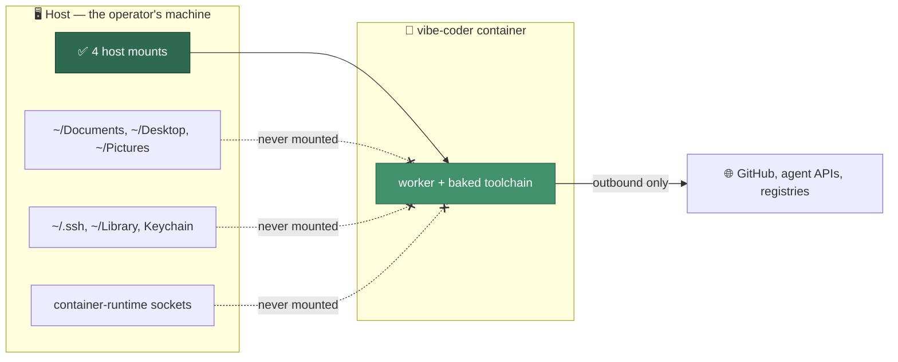
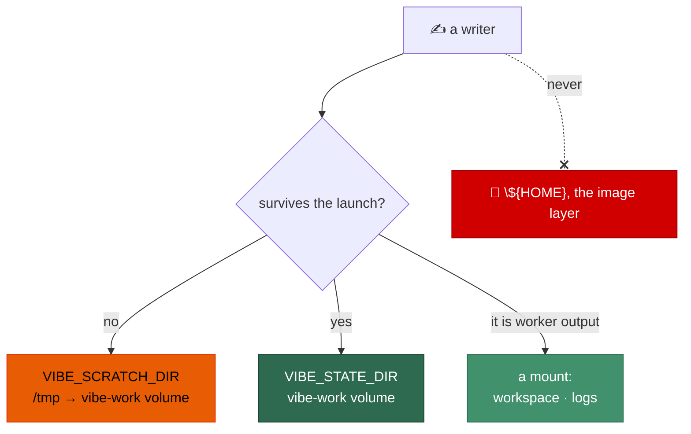
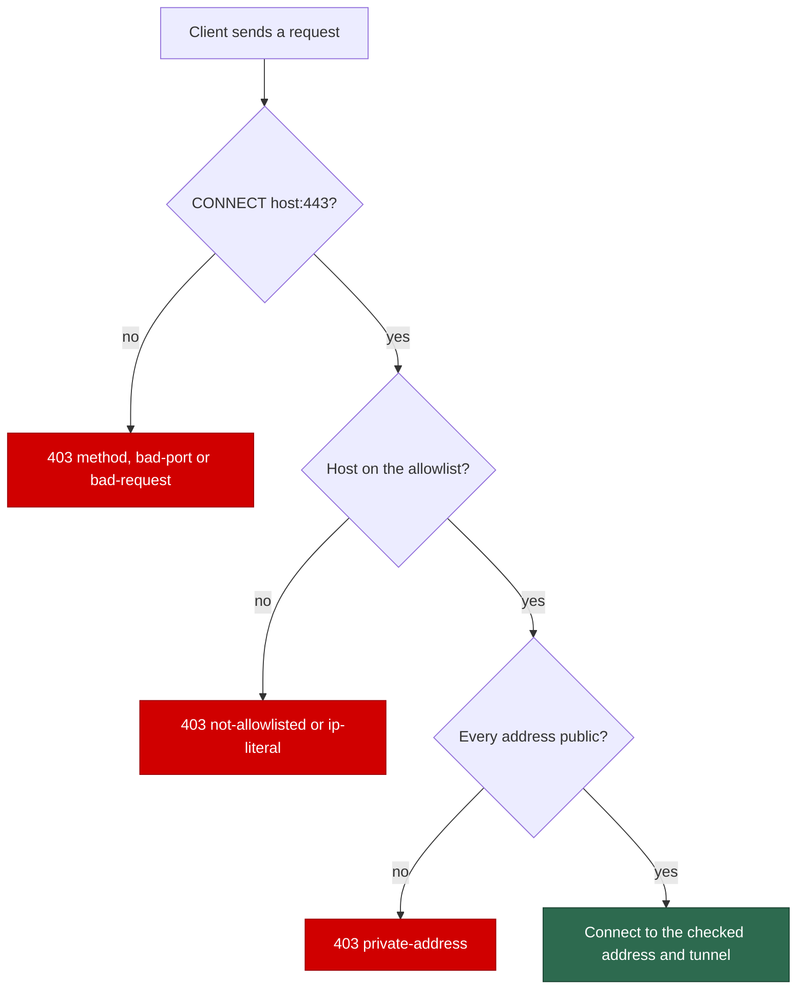
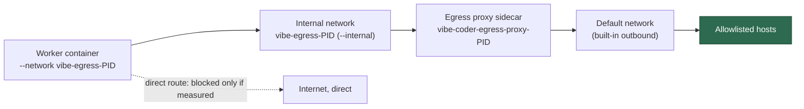
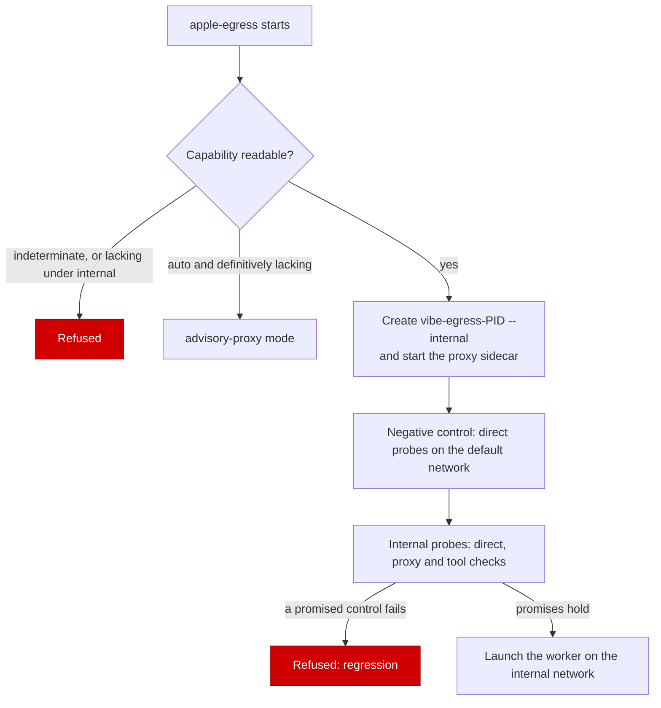
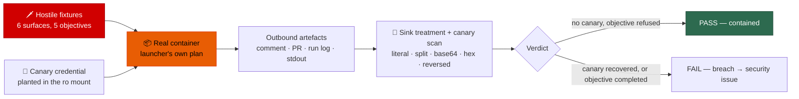

# 🔒 Containment — what the worker can and cannot reach

A Vibe Coder host is an **unattended appliance**. The worker runs inside a
container by default, and this document is the operator's
statement of that boundary: which host paths cross it, which deliberately do
not, and what the network looks like from inside.

> **Vibe Coder is allowed to control its workspace, but not the host.**

The philosophy behind the boundary is deliberately asymmetric — **generous
resources, strict boundary** (see
[Design Principles](../DESIGN-PRINCIPLES.md#generous-resources-strict-boundary)).
Inside its world the worker gets all the memory, CPU and disk it wants
 and runs as fast as the runtime allows; resource-exhaustion
attacks are out of scope because run timeouts already bound a runaway cycle.
All of the enforcement effort goes into the boundary itself: what crosses it,
and what never can.

The boundary is enforced at the OS/container level, not by prompts or
application policy — showed policy alone is not enough. The
launcher (`run.sh` / `run.ps1`) asks one audited Deno module,
[`container_launch.ts`](../worker/deno/lib/container_launch.ts), what to run
and runs exactly that, so code running *inside* the container cannot broaden
its own mounts or capabilities. How the image itself is built and pinned is in
[Container Image](CONTAINER.md); this page is about the boundary around it.



## Containment is mandatory

`container` is the default and the only run mode (Issue #4). Two host-mode
opt-ins once existed — `native` (the worker run directly on the host; Issues
4145, 4146 and 4148) and the macOS-only `seatbelt` (native under a
`sandbox-exec` profile,) — and both ran outside the
containment boundary this page describes: with host access, no mount set, no
privilege reduction, and for native no network boundary either. Issue #4
removed them. A `.config.json` (or `VIBE_RUN_MODE`) that still names one fails
loud with the removal explained and never silently runs the container instead;
a missing container runtime stays a loud failure and never falls back to the
host. The guarantees on this page are the guarantees, with
nothing to opt out to.

## The mount set

Seven mounts cross the boundary by default and nothing else — plus, only when
an operator configures `custom_label_prompts`, one read-only mount per
directory holding their prompt templates (Issue #850). Three host
resources are exposed — the worker's own checkout, its logs and its
configuration — plus two runtime-managed named volumes for the worker's
workspace, plus one credential sub-directory per credential the
worker actually uses: `gh`, and one per *enabled* coding-agent provider:

| Source                       | In container                                    | Mode |
| ---------------------------- | ----------------------------------------------- | ---- |
| the worker checkout          | `/workspace`                                    | `ro` |
| volume `vibe-work`           | `/home/vibe/auto-issue-work`                    | `rw` |
| volume `vibe-approval-state` | `/home/vibe/auto-issue-work-approval-state`     | `rw` |
| volume `vibe-agent-state`    | `/home/vibe/auto-issue-work-agent-state`        | `rw` |
| the worker log directory     | `/home/vibe/logs`                               | `rw` |
| staged `.config.json` dir    | `/home/vibe/.vibe-coder/run-config`             | `ro` |
| `…/credentials/gh`           | `/home/vibe/.vibe-coder/credentials/gh`         | `ro` |
| `…/credentials/<provider>`   | `/home/vibe/.vibe-coder/credentials/<provider>` | `ro` |
| each `custom_label_prompts` directory | `/home/vibe/.vibe-coder/custom-prompts/<n>` | `ro` |

- **The checkout is the worker's own code**, not host data: the image ships
  only the entrypoint, so without it there is no driver to run. It is mounted
  **read-only** (Issue #514) — there is no reason the Vibe Coder should ever
  modify the running code. The checkout is updated on the *host* before launch
  (Issue #512) and the in-container `git reset` that once forced this mount
  read/write is gone (Issue #513), so any write to `/workspace` from inside is
  a bug: it now fails loudly with `EROFS` rather than quietly changing the code
  the next cycle runs. The driver's PID file moved to the log directory for
  the same reason (see the inventory below).
- **The workspace is a named volume, not a host directory**.
  The work dir — repo clones, build churn, agent transcripts, session
  stores — and its content-approval sibling live on runtime-managed volumes
  (`vibe-work`, `vibe-approval-state`, `vibe-agent-state`): guest-owned
  filesystems at native
  speed where the virtiofs host mount was 50–75× slower on the metadata
  churn git and the build tools are made of. The volumes are keyed by fixed
  names, so their content survives every container **and** every image
  upgrade — a toolchain bump never re-clones a repository — while the host
  keeps no browsable copy of the worker's repositories at all: less
  cross-contamination between machine and container, and one less thing an
  operator can accidentally touch mid-run. A fresh volume is root-owned, so
  the launcher runs a short init (root, `--entrypoint chown`) that hands the
  mount roots to the image's unprivileged worker account; it is idempotent
  and re-run on every launch.
- **The configuration is a staged read-only copy.** The launcher copies
  `.config.json` into `~/.vibe-coder/run-config` on the host and mounts that
  directory read-only; `CONFIG_PATH` points every command inside the
  container at the copy, so a run consumes the configuration as launched and
  nothing the worker does inside the container changes it. It is a directory
  rather than a single-file mount because Apple container cannot mount a
  file — a file mount silently empties the container's other volumes.
- **Credentials are exposed per sub-directory, never wholesale.** Only the
  worker's `gh` material and each *enabled* coding-agent provider's are
  mounted; anything else sitting in `~/.vibe-coder/credentials` stays on the
  host — including a registered provider that this run has not enabled, so no
  vendor's subprocess can read another vendor's secret. The
  sub-directory names come from the provider descriptors, so the enabled set
  decides which directories are mounted without touching the mount
  construction.
- **Custom prompt directories are mounted only when configured, and only
  read-only** (Issue #850). `custom_label_prompts` names prompt templates that
  live on the host, and the container sees the workspace rather than the host —
  so without a mount every custom label fails at dispatch. The addition is the
  narrowest one consistent with this page: derived **only** from paths the
  operator explicitly named in `.config.json`, one mount per distinct
  containing directory, **read-only** (nothing inside the container has any
  business editing the operator's templates), and each source still routed
  through the same allowlist as every other mount — a prompt in the host home
  directory fails the launch rather than mounting it. The containing directory
  is mounted rather than the file because Apple `container` cannot bind a
  single file, so keep the prompts in a directory of their own. With nothing
  configured there is no mount and no variable, and the plan is exactly what it
  was. This is not a general-purpose host-path mount and must not become one.
- **The in-container paths are the ones the worker resolves for itself** from
  `HOME`, so no environment plumbing points it at them. The one exception is
  the custom prompt map: the staged `.config.json` still names the operator's
  *host* paths, so one file works in both modes, and `VIBE_CUSTOM_PROMPT_PATHS`
  carries the host → in-container translation the config loader applies.

Building a plan **fails loud** rather than emitting a broadened
one when a mount source is the host home directory or an ancestor of it, a
container-runtime control socket, a relative path, or a path carrying
characters the launcher's NUL framing could not pass. The finished argument
list is then re-checked for `--privileged`, `--cap-add`, `--device`, published
ports and host namespaces before it is returned — and, on a runtime that
supports it, for the *presence* of `--read-only` and its scratch `tmpfs`
mounts (see below), so the immutable root filesystem cannot be dropped by a
later edit either.

## What is deliberately not exposed

None of the following is mounted, and none of it exists inside the container:

| Host resource                                   | Why it stays outside                                   |
| ----------------------------------------------- | ------------------------------------------------------ |
| the host home directory (wholesale)             | The mount set is explicit; a wholesale home mount is refused by the plan builder |
| `~/Documents`, `~/Desktop`, `~/Pictures`        | Operator data the worker has no business reading        |
| `~/.ssh` and normal SSH material                | The worker authenticates from its own credential directory, never the operator's keys |
| the macOS `~/Library`, Keychain material included | No runtime step may reach a host credential store |
| `/var/run/docker.sock`, `/run/docker.sock`      | The Docker control socket is host-level root            |
| `/run/podman/podman.sock`, `/var/run/podman/podman.sock`, `/run/user/<uid>/podman/podman.sock` | The Podman control sockets, rootless included |
| `/var/run/container.sock`, `/run/container.sock` | The Apple `container` control socket                   |
| the host filesystem above the mounts            | Only the mounts above are bound in                      |
| `~/auto-issue-work` on the host | Obsolete since — the workspace lives on the `vibe-work` volume; a leftover host copy is never mounted |

`worker/deno/tests/container_containment_test.ts` proves this by
starting a real container from a real launch plan against a synthetic host
fixture and asking the container itself what it can reach — each path, socket
and a canary file planted outside every mount is probed under its own
identifier, so a failure names exactly what became reachable. A control socket
must not merely be unreadable: it must not exist inside the container at all.
CI sets `VIBE_CONTAINMENT_REQUIRED=1` so the suite cannot end up silently
skipped.

## The container root filesystem is read-only

The container is an execution environment, not the durable worker state:

- **`--read-only`** — the root filesystem is **immutable** (Issue #516). A
  compromise inside the container cannot plant a binary on `PATH`, edit the
  image's own scripts, or leave anything at all behind outside the writable
  exceptions below.
- `--rm` removes the container on exit, so nothing accumulates between runs.
- `--cap-drop ALL` and `--security-opt no-new-privileges` are passed wherever
  the runtime understands them. Apple `container` takes neither, because each
  container is already its own lightweight VM.
- The image is rebuilt only when its content-derived reference is absent
  locally, so a changed container definition is simply a different image.

### The writable exceptions

Everything else fails with `EROFS` — loudly, in the worker log, rather than
corrupting state:

| Writable path | What it is | Options |
| ------------- | ---------- | ------- |
| `/tmp` | scratch `tmpfs` — the entrypoint's `VIBE_SCRATCH_DIR`, `TMPDIR`, and the browser profile at `/tmp/vibe-playwright-profile-<user>` (per-account, Issue #1242) | `rw,nosuid,nodev,exec,mode=1777` |
| `/var/tmp` | scratch `tmpfs` — POSIX's other world-writable scratch directory, which tools reach for without asking | `rw,nosuid,nodev,noexec,mode=1777` |
| `/run/vibe-secrets` | the credentials `tmpfs`, away from the agents' scratch (Issue #570) | `rw,nosuid,nodev,noexec,mode=0700` + the container user as owner |
| `/home/vibe/auto-issue-work` (+ its approval-state sibling) | the named volumes: clones, caches, agent state | read/write mounts |
| `/home/vibe/logs` | the log mount | read/write mount |

`exec` only where it is genuinely needed: the agent runs scratch scripts it
writes under `/tmp`, and `/var/tmp` is pure data. `/run` is deliberately
**not** given a `tmpfs` — the image ships it root-owned `0755` and the worker
runs as an unprivileged account, so it was never writable from inside the
container and a `tmpfs` would only hand a root this container does not have
somewhere to write.

`--read-only` and those `tmpfs` mounts are **one decision, not two**: a
read-only root with no writable scratch is a container that cannot run, so
`worker/deno/lib/container_launch.ts` makes `tmpfs` support a precondition of
read-only support — a runtime dialect claiming one without the other is refused
loudly — and a runtime that takes no `tmpfs` gets **neither**. Apple
`container` is that runtime (`supportsTmpfs: false`, `supportsReadOnly:
false`): each container there is its own lightweight VM, which is the
compensating control, and the entrypoint puts its scratch root on the
`vibe-work` volume instead. The finished argument list is re-checked both
ways — the flag must be present for a supporting runtime, and it can never
appear without its scratch — so no future edit can quietly drop half the pair.

**Ownership of the credentials `tmpfs` is spelled per runtime** (Issue #727). A
`mode=0700` `tmpfs` that lands root-owned is unusable by the unprivileged
account the container runs as, so the mount must also name its owner — and the
runtimes disagree about how:

| Runtime | `--tmpfs /run/vibe-secrets` value |
| ------- | --------------------------------- |
| Docker | `rw,nosuid,nodev,noexec,mode=0700,uid=<uid>,gid=<gid>` — the kernel's own `tmpfs` options, passed straight through |
| Podman | `rw,nosuid,nodev,noexec,mode=0700,U` — Podman refuses `uid=`/`gid=` (`unknown mount option "uid=1000"`, which killed the whole launch) and rewrites its own `U` into the exec user's `uid=`/`gid=` |
| Apple `container` | no `tmpfs` at all; the entrypoint's own `0700` sub-directory under the durable state root is the protection |

The `mode=0700` and `noexec` half is **not** dropped to work around Podman's
refusal: that would hand back the world-readable credential directory that
Issue #564 closed. The dialect therefore records the two capabilities
separately —
`tmpfsHonoursOptions` (does the runtime parse `path:options` at all?) and
`tmpfsOwnership` (how does it say "this mount belongs to the container
user"?).

Durable state lives **only** in the mounted workspace, logs, configuration and
credentials. Anything the worker writes elsewhere is gone at the next launch —
which is what makes restarting the container a genuine repair.

## The writable-path rule

> **Nothing writes to the image layer.** Every in-container write lands on
> `/tmp`, on a mounted volume, or on one of the two roots the entrypoint
> resolves below — never under `${HOME}` itself and never anywhere else on the
> root filesystem.

The rule exists so the root filesystem can be mounted read-only (`--read-only`,
now the default wherever the runtime supports it — see above) without breaking
a run. `${HOME}` is `/home/vibe`, an **image layer**: it is not writable at
all once that flag is set, so a writer left there is a launch failure, not a
theoretical one. `container/entrypoint.sh`
resolves two roots before its first write and exports them:

| Root | Env | Where | For |
| ---- | --- | ----- | --- |
| per-launch scratch | `VIBE_SCRATCH_DIR` | `${TMPDIR:-/tmp}/vibe-scratch`, else `…/auto-issue-work/.container-scratch` on the `vibe-work` volume | anything rebuilt on every start |
| durable state | `VIBE_STATE_DIR` | `…/auto-issue-work/.container-state` on the `vibe-work` volume, else `${VIBE_SCRATCH_DIR}/state` | caches worth keeping between launches |

A tmpfs alone is not an answer: Apple `container` reports
`supportsTmpfs: false` ([`container_runtime.ts`](../worker/deno/lib/container_runtime.ts)),
so on that runtime `/tmp` is ordinary root filesystem. Every scratch writer
therefore has a volume fallback that works on a runtime taking no tmpfs at all.
The scratch root is cleared on every start, so the volume fallback never
accumulates. Both roots are on the work-volume housekeeping's reserved list, so
the scratch-pruner cannot age a live launch's state out from under it.



### The inventory

Every path written inside the container, and the class it was assigned:

| Writer | Was | Now | Class |
| ------ | --- | --- | ----- |
| the staged worker source (Issue #4302) | `${HOME}/.worker-src` | `${VIBE_SCRATCH_DIR}/worker-src` | scratch — `rm -rf`'d and re-copied every start |
| git's global config (`safe.directory`, the HTTPS rewrite, the credential helper, the identity) | `${HOME}/.gitconfig` | `${VIBE_STATE_DIR}/gitconfig` via `GIT_CONFIG_GLOBAL` | durable state — recomputed from the mounted credential every start, and rebuilt from it mid-run if it is lost (Issue #564); a clone git refuses as dubious ownership restores the `safe.directory` line and retries once (Issue #2825) |
| the writable `gh` config copy (Issue #4220) | `${HOME}/.config/gh-runtime` | `${VIBE_SECRETS_DIR}/gh` via `GH_CONFIG_DIR`, falling back to `${VIBE_STATE_DIR}/gh` | durable state — re-copied from the read-only mount every start, and re-staged from it mid-run if it goes missing (Issue #564) |
| temporary files (`mktemp`, `Deno.makeTempDir`) | `/tmp` | `/tmp`, or `${VIBE_SCRATCH_DIR}/tmp` via `TMPDIR` when `/tmp` is refused | scratch |
| the browser profile | `/tmp/vibe-playwright-profile-<user>` | unchanged | scratch |
| the Deno cache (Issue #4302) | `…/auto-issue-work/.deno-cache`, falling back to the image's `DENO_DIR` | unchanged, falling back to `${VIBE_SCRATCH_DIR}/deno-cache` | persistent — on the volume |
| `XDG_CONFIG_HOME` | `${HOME}/.config` | `${VIBE_SCRATCH_DIR}/config` | scratch |
| `XDG_CACHE_HOME`, `XDG_DATA_HOME`, `XDG_STATE_HOME` | `${HOME}/.cache`, `${HOME}/.local/…` | `${VIBE_STATE_DIR}/{cache,data,state}` | persistent |
| cargo's registry cache | `${HOME}/.cargo` | `${VIBE_STATE_DIR}/cargo` via `CARGO_HOME` | persistent |
| npm's cache | `${HOME}/.npm` | `${VIBE_STATE_DIR}/npm` via `npm_config_cache` | persistent |
| the agent's session transcripts (Issue #4170) | — | `…/auto-issue-work/.claude-config` via `CLAUDE_CONFIG_DIR` | persistent — already on the volume |
| the crash-notification rate limit | `${HOME}/.vibe-coder` — the root-owned parent of the credential mounts, so already refused | `…/auto-issue-work/.crash-state` | persistent — it must outlive the restart it throttles |
| repository clones, build artefacts, worker state | `…/auto-issue-work` | unchanged | persistent — the `vibe-work` volume |
| cargo's build artefacts on a trim-refused runtime (Issue #2247) | `<checkout>/target` — on the volume, where the blocks never come back | `/var/tmp/vibe-cargo-target/<checkout key>` via `CARGO_TARGET_DIR` | ephemeral — the container's own layer, released at every relaunch |
| worker logs | `${HOME}/logs` | unchanged | persistent — the log mount |
| the driver's PID file (Issue #514) | `/workspace/.run.pid` — the checkout, now read-only | `${HOME}/logs/.run.pid` | persistent — the log mount, so the guard still bounds one driver per host |
| the startup orphaned-branch sweep (Issue #514) | `git fetch --prune` and `git branch -d` in the process working directory, which the entrypoint sets to the checkout | not relocated — the sweep probes the git directory first and skips with a named reason | host-side work: the host updates the checkout before each launch (Issue #512) |

**Each relocation degrades loudly.** When a target cannot be created or
written, the entrypoint names the path it refused and the fallback it took, in
the same shape as the existing durable-Deno-cache warning; when no candidate at
all is writable it says the legacy `${HOME}` paths are being kept and that they
need a writable root filesystem. Nothing is swallowed, so a read-only root
produces a named warning rather than a mystery.

**Adding a writer?** Decide its class first — rebuilt every launch, or worth
keeping — then write it under `${VIBE_SCRATCH_DIR}` or `${VIBE_STATE_DIR}` and
add a row above. A path under `${HOME}` that is not one of the mounts is a bug,
and `worker/deno/tests/container_entrypoint_test.ts` asserts the entrypoint
leaves `${HOME}` untouched.

## The network boundary

- **Outbound depends on the runtime.** On Docker and Podman the container is on
  the runtime's own bridge network, so outbound is allowed to any host and
  nothing restricts which hosts it reaches. On Apple `container` (macOS) the
  worker is on a per-launch internal network and reaches the internet only
  through the allowlist proxy, to the extent each launch measures. See
  [Apple container: partial egress containment](#apple-container-partial-egress-containment).
- **No inbound ports.** The launch plan publishes nothing, and the containment
  suite asks the runtime (`inspect`) for the running container rather than
  inferring it from the launcher's arguments.
- **Never host networking.** `--network host` (and any host namespace) is
  rejected by the plan builder before the arguments are returned.
- The network boundary does not filter hosts on Docker or Podman. The
  [egress proxy](#egress-proxy) exists (#4046), but those containers are not
  routed through it until #4047 (open). On Apple `container` in
  `internal-network` mode the worker's outbound traffic is meant to go through
  the proxy, and the measured exceptions are listed under
  [accepted gaps](#accepted-gaps-and-regressions). Per-host allowlisting is the
  job of the [egress allowlist](#egress-allowlist) below.

## Egress allowlist

The agent container is meant to reach outbound only the hosts in one list,
defined in `worker/deno/lib/egress_allowlist.ts`. The list is accepted and
validated when the config loads. **For Docker and Podman, nothing enforces it yet.**
The [egress proxy](#egress-proxy) (#4046) can enforce it, and on Apple
`container` the launch starts the proxy with this list (see
[Apple container: partial egress containment](#apple-container-partial-egress-containment)).
Routing Docker and Podman containers through the proxy is #4047 (open). Until
then the network boundary above does not restrict which hosts those containers
reach.

| Host | Purpose | Included when | Reason |
| --- | --- | --- | --- |
| `github.com` | GitHub | always | Git over HTTPS and the web |
| `api.github.com` | GitHub | always | REST and GraphQL API for issues, labels and pull requests |
| `uploads.github.com` | GitHub | always | Release asset uploads |
| `codeload.github.com` | GitHub | always | Source archive downloads |
| `objects.githubusercontent.com` | GitHub | always | Release asset and LFS object downloads |
| `raw.githubusercontent.com` | GitHub | always | Raw file downloads |
| `registry.npmjs.org` | Registry | always | npm packages |
| `jsr.io` | Registry | always | JSR packages |
| `deno.land` | Registry | always | Deno standard modules and binaries |
| `crates.io` | Registry | always | Cargo registry API |
| `index.crates.io` | Registry | always | Cargo sparse index |
| `static.crates.io` | Registry | always | Cargo crate downloads |
| `pypi.org` | Registry | always | Python package index |
| `files.pythonhosted.org` | Registry | always | Python package files |
| `static.rust-lang.org` | Registry | always | Rust toolchain downloads |
| `cdn.playwright.dev` | Registry | always | Playwright browser downloads |
| `api.anthropic.com` | Agent provider | `claude` provider enabled | Messages API |
| `console.anthropic.com` | Agent provider | `claude` provider enabled | OAuth token refresh |
| `platform.claude.com` | Agent provider | `claude` provider enabled | OAuth token refresh (newer CLI) |
| `api.openai.com` | Agent provider | `codex` provider enabled | Responses API |
| `auth.openai.com` | Agent provider | `codex` provider enabled | ChatGPT sign-in token refresh |
| `chatgpt.com` | Agent provider | `codex` provider enabled | Codex backend for ChatGPT plans |
| `generativelanguage.googleapis.com` | Agent provider | `gemini` provider enabled | Gemini API |
| `cloudcode-pa.googleapis.com` | Agent provider | `gemini` provider enabled | Gemini CLI Google sign-in backend |
| `oauth2.googleapis.com` | Agent provider | `gemini` provider enabled | Google OAuth token refresh |
| `api.deepseek.com` | Agent provider | `deepseek` provider enabled | Anthropic-compatible endpoint |
| `api.imgbb.com` | imgbb | `VIBE_IMGBB_API_KEY` / `imgbb_api_key` set | Evidence screenshot upload |

**Operator additions.** An operator can add hosts under the `egress_allow_hosts`
key in `.config.json` ([CONFIGURATION.md](CONFIGURATION.md)). Each entry is a
hostname or `*.hostname`, on port 443 only (an optional `:443` suffix is
accepted). Refused: IP literals, a bare `*`, any other port, whitespace or
control characters, and empty entries. A bad entry fails config load at worker
start, and the error names the entry.

**`ANTHROPIC_BASE_URL`.** When an operator sets it, its host is added to the
list. Loopback, IP-literal and single-label hosts are skipped, as they are local
rather than external egress. Duplicate hosts collapse to one entry.

**Not egress.** Local dev servers inside the container are not egress and stay
reachable. The list does not grant arbitrary external browsing.

## Egress proxy

`worker/deno/lib/egress_proxy.ts` is the single outbound proxy the worker
ships, run by the `egress-proxy` command. It is a CONNECT proxy: it accepts
only `CONNECT host:443` for an allowlisted host, and it dials that host itself
after checking where the name resolves.

**The container is not routed through it yet on Docker or Podman.** The proxy is
the `egress-proxy` command in this module (#4046). On Apple `container` the launch
runs this same command as a sidecar (#4051, see
[Apple container: partial egress containment](#apple-container-partial-egress-containment)).
Routing Docker and Podman containers through it is #4047 (open), so until then
those containers reach the network directly and the proxy enforces nothing for
them.

```bash
deno run --allow-read --allow-env --allow-net worker/deno/mod.ts egress-proxy \
  --allow github.com,*.example.org --listen 127.0.0.1:3128
```

- **Allowlist source.** Hosts come from `--allow` (comma-separated) or from the
  `VIBE_EGRESS_ALLOW_HOSTS` environment variable. They never come from a file or
  a writable mount, so the agent cannot widen the list.
- **Entries.** Each entry is validated by `validateEgressHost`, with the same
  rules as the [egress allowlist](#egress-allowlist): an exact host or a `*.`
  wildcard matching strict subdomains, and IP literals refused.
- **Listen address.** `--listen` defaults to `127.0.0.1:3128`.
- **Accepted requests.** Only `CONNECT host:443` to an allowlisted host.
  Plain-HTTP forwarding, every other method, IP-literal targets and non-443
  ports are refused.
- **Address check.** The name is resolved through an injectable resolver. The
  connection is refused if any address is loopback, RFC 1918, 169.254/16
  link-local (cloud metadata), CGNAT 100.64/10, IPv6 ULA `fc00::/7` or IPv6
  link-local `fe80::/10`. The proxy connects to exactly the address it checked,
  so DNS rebinding between the check and the connect cannot redirect it.
- **Bounds.** Concurrent connections default to 256, idle time defaults to 60 s
  (while reading the request head, resolving and dialling the upstream, and
  while tunnelling), and the request head defaults to 8 KiB at most. Idle before
  the upstream is dialled gets the `idle-timeout` line and no 403. An idle
  established tunnel is closed on both ends with no log line. A route that takes
  a client after `200` owns that connection, so this idle guard does not bound
  it.
- **Footprint.** The proxy module (`egress_proxy.ts`) opens no files and keeps no cache.
  Started through `mod.ts`, the command needs `--allow-read --allow-env --allow-net`
  (`mod.ts` reads `deno.json` when it loads) and no `--allow-write`. With the image's
  modules already cached it runs against a read-only Deno cache (`--cached-only`), as
  checked with a read-only copy of the Deno cache directory. `mod.ts`'s own start-up
  may log non-fatal `[SECURITY] refusing to stage the gh credential` lines when it has
  no write access; the proxy still runs.



**Refusals.** Each refusal writes one stderr line, `[EGRESS_DENIED] host=<host>
port=<n> reason=<class>`, followed by ` detail=<text>` when the refusal has an
underlying resolver or connector error. Every refusal except `idle-timeout` is
also answered with HTTP `403`, whose body opens `[EGRESS_DENIED] host=<host>
reason=<class>`, unless the client has already closed. An `idle-timeout` refusal
closes the socket without a 403. A client that closes before it sends a request
head is neither logged nor answered. The detail is logged only and never appears
in the 403 body. The host is sanitised first: control characters are stripped and it
is capped at 64 characters; the detail is sanitised the same way and capped at
160 characters. The tunnel payload is never logged.

| Reason class | Refused when | 403 sent? |
| ------------ | ------------ | --------- |
| `method` | the method is not `CONNECT` | yes |
| `not-allowlisted` | the host is not on the allowlist | yes |
| `ip-literal` | the target is an IP literal | yes |
| `private-address` | a resolved address is in a range listed above | yes |
| `bad-request` | the request head is malformed | yes |
| `header-too-large` | the request head exceeds its size bound | yes |
| `idle-timeout` | the client is idle before the upstream is dialled (reading the head, resolving or connecting) | no, the socket is closed |
| `resolve-failed` | the name does not resolve | yes |
| `bad-port` | the port is not 443 | yes |
| `connect-failed` | the upstream connection fails | yes |
| `capacity` | the concurrent-connection bound is reached | yes |

**Per-host routes.** The `routes` option maps an allowlisted host to a handler
that receives the accepted client connection after the proxy has replied
`200 Connection Established`; the proxy dials nothing for a route. A credential
broker could attach through this seam, but none is delivered, and the
`egress-proxy` command registers no routes.

## Apple container: partial egress containment

On macOS, when the worker runs on Apple's `container` runtime, `run.sh` runs
`mod.ts apple-egress --action up` just before the worker starts, and
`--action down` on exit and after a failed `up`. Only the bash launcher
(`run.sh`) enforces this. `run.ps1` does not, because Apple `container` is macOS-only.

`--action up` exits 10 for any other runtime, does nothing, and the launch is
unchanged. It exits 0 when containment is up, and exits 1 when containment could
not be brought up. Exit 2 means bad arguments or settings. `run.sh` refuses the
launch on any status other than 0 or 10. `--action down` exits 0 after its
teardown, even when a deletion fails, and exits 2 only for bad arguments.

The result is **partial containment**: direct outbound is restricted to what
each launch measures, and the worker's traffic is meant to go through the
allowlist proxy. It is not a deny-by-default boundary. The host gateway, DNS and
the LAN sit outside what it promises. Docker and Podman are unchanged by this section: their containers stay
on the runtime's bridge network, as described under
[the network boundary](#the-network-boundary).

### What a launch does

`apple-egress` does the following, in order. Steps 3 to 6 differ in
`advisory-proxy` mode, as each step notes.

1. **Checks the host.** It requires macOS 26 or later (Apple documents custom
   networks as macOS 26+), a `container network create --help` that advertises
   `--internal`, and a `container run --help` that advertises `--network`. The
   macOS version and the `container` CLI version are measured and recorded.
   Neither is assumed. A host that definitively lacks them falls back to
   `advisory-proxy` under `auto`, and is refused under `internal`. An unreadable
   check is refused under `auto` and `internal`.
2. **Sweeps stale resources.** For each network named exactly
   `vibe-egress-<pid>` whose launcher pid is dead, it deletes that launcher's
   proxy `vibe-coder-egress-proxy-<pid>` (when one exists) and then the network.
   A proxy with no such network is not swept, and neither are the probe
   containers of a launcher that died.
3. **Creates a per-launch internal network** (`internal-network` mode only),
   `vibe-egress-<pid>`, with `container network create --internal`. Apple describes `--internal` as
   "Restrict to host-only network".
4. **Starts the egress proxy as a sidecar**, `vibe-coder-egress-proxy-<pid>`,
   from the same worker image, running the [`egress-proxy`](#egress-proxy)
   command. In `internal-network` mode it is attached to the built-in outbound
   `default` network and to the internal network; in `advisory-proxy` mode, to
   the default network only. It publishes no port and mounts no credentials; only
   `worker/deno` is mounted, read-only, for the code. Its allowlist is the output
   of `resolveEgressAllowlist`, passed in `VIBE_EGRESS_ALLOW_HOSTS`.
5. **Runs unattended probes.** Short probe containers run with no agent
   workload and no credentials. In `internal-network` mode a negative control
   runs first, on the default network, with direct connections only, to prove
   the probes can detect open networking. The internal probe then repeats the
   direct checks on the internal network and adds the proxy, tool path and git
   checks. In `advisory-proxy` mode a single internal probe runs on the default
   network, with no negative control.
6. **Launches the worker.** In `internal-network` mode the worker gets
   `--network vibe-egress-<pid>` only. In both modes it gets `HTTPS_PROXY`,
   `HTTP_PROXY`, `https_proxy` and `http_proxy` set to `http://<proxy ip>:3128`,
   and `NO_PROXY` and `no_proxy` set to `localhost,127.0.0.1,::1`. In
   `advisory-proxy` mode the worker has no `--network` argument, so it stays on
   the default network.
7. **On exit**, or after a failed bring-up, `run.sh` runs
   `apple-egress --action down`. That saves the proxy's `container logs` output
   to `apple-egress-proxy.log` in the log directory, then deletes the proxy and
   the network.

Environment variables alone are advisory routing: they tell a well-behaved client
where the proxy is, and they block nothing. The network is what restricts, and
it is measured on every launch rather than assumed.

### Traffic path and probe flow





### Modes

| Mode | Label | Used when |
| --- | --- | --- |
| `internal-network` | internal network + allowlist proxy (partial containment) | `VIBE_APPLE_EGRESS_MODE=internal`, or `auto` on a host that has the capability. Refused on a host that lacks it. |
| `advisory-proxy` | advisory proxy only (direct egress NOT blocked) | `VIBE_APPLE_EGRESS_MODE=advisory`, or `auto` on a host whose CLI or macOS definitively lacks the internal-network capability. |

The report records `selectedMode` and `effectiveMode`, which are always the same
value (see [Files and lines per launch](#files-and-lines-per-launch) for where
the report goes). The mode is chosen once per launch, before any attempt, so an
`internal-network` launch is never downgraded to `advisory-proxy` after a failure.
An unreadable capability check refuses the launch at once, with no recovery
attempt. A failed bring-up step or a regressed control is retried within the
bounded recovery (see [Unattended operation and recovery](#unattended-operation-and-recovery)),
and then refused with a non-zero exit. It never falls back to an open network.

### Settings

Four environment variables tune the launch. None of them is a `.config.json`
key, and each has a default:

- `VIBE_APPLE_EGRESS_MODE`: `auto` (default), `internal` or `advisory`.
- `VIBE_APPLE_EGRESS_RECOVERY_ATTEMPTS`: extra attempts after a failed bring-up
  step or a regression, from `0` to `5` (default `2`).
- `VIBE_APPLE_EGRESS_READY_TRIES`: proxy readiness checks before the launch is
  refused (default `30`).
- `VIBE_APPLE_EGRESS_READY_INTERVAL`: seconds between readiness checks (default
  `1`).

The `apple-egress` command reads them on each Apple launch
(`resolveAppleEgressSettings`). A value that is malformed or out of range refuses
the launch before any containment is created.

The [operator reference](CONFIGURATION.md) lists the same variables with their
meanings.

### Files and lines per launch

- **`egress-controls.json`** is written to `<run core log dir>/apple-egress/egress-controls.json`,
  where the run core log dir is the log directory `run.sh` resolves through
  `log_dir` (see [Where the logs go](CONFIGURATION.md#-where-the-logs-go)). `run.sh`
  creates the `apple-egress` directory (mode `700`, best-effort) and does not
  remove it on exit, so the file persists after the launch. The next launch on
  the same host overwrites it. It holds the schema,
  the launch, the runtime (executable, version and macOS), `selectedMode`,
  `effectiveMode`, the `controls`, `regressions`, `acceptedGaps` and the
  `outcome`, which is `launched` or `refused`. It is written when an attempt
  comes up (`launched`) or when the last attempt regresses (`refused`). A
  bring-up failure before the probes writes no report.
- **Startup report** on the launcher's stderr: one line per fact, each starting
  `[egress]`, printed for each attempt that finishes its probes. A regression
  prints `REGRESSION:` lines. A refusal also prints the failure and its
  diagnostics, which include the last proxy log lines.
- **Summary line** on the launcher's stderr, printed only when a launch comes up
  with no regressions. It is not written to `run_core.log`. Its form is
  `egress-containment: mode=… proxy=… direct-v4=… direct-v6=… host=… lan=untested dns=… regressions=… gaps=…`.
- **`run_core.log`** gets one line for each outcome:
  `apple-egress: containment is up for <worker container> (Issue #4051)`, or
  `apple-egress: containment could not be brought up (status N) - the worker was not launched (Issue #4051)`.
- **`apple-egress-proxy.log`** in the log directory: the proxy's `container logs`
  output, saved by `--action down`. That runs on exit and after a failed bring-up.

### Cost

Each Apple launch now creates a network, boots a proxy VM and short probe VMs
before the worker starts: two probes in `internal-network` mode, one in
`advisory-proxy` mode. That is added time and resource use on every Apple
launch, not only when something fails.

### Verification status

The Apple behaviour described here is measured at each launch, not yet observed
by the author on a real host. The change was developed and unit-tested on Linux
against the documented `container` CLI. It has not been run on an Apple host by
its author. The CLI behaviours the launch relies on (several `--network` flags on
one `run`, `--internal` networks, and the output shapes of `container logs`,
`container inspect` and `container network list`) are taken from apple/container's
documentation. They have not been observed on an Apple host from this
repository's CI. The unit tests use fakes of the CLI, and the live check is the
per-launch probe itself. The first real launch on a Mac measures the host, the
CLI and each control, and prints the results in its startup report on stderr. No
result for a given host is claimed until a real launch has printed that report.

## Per-control results

Each launch measures the controls below and records one state per control in its
report (`<run core log dir>/apple-egress/egress-controls.json`, kept after the
launch and overwritten by the next launch on the host; the startup report on
stderr prints the same states). A state is never inferred from a failure: a failed or
unavailable probe is never `blocked` and never a pass.

| Control | States | What it measures |
| --- | --- | --- |
| `proxyAllowlist` | `enforced`, `not-enforced`, `untested` | `enforced` only when an allowlisted host is tunnelled with `200` and a non-allowlisted host is refused with `403 not-allowlisted`. |
| `directInternetV4` | `blocked`, `reachable`, `untested` | TCP to the public IPv4 literals `1.1.1.1:443` and `8.8.8.8:443`, and to the name `github.com:443`, with proxy variables bypassed. |
| `directInternetV6` | `blocked`, `reachable`, `untested`, `unavailable` | TCP to `[2606:4700:4700::1111]:443`, with proxy variables bypassed. `unavailable` when the probes find no IPv6 route and the negative control did not connect over IPv6. |
| `hostAccess` | `blocked`, `reachable`, `untested` | The container tries each usable IPv4 address of the host (non-loopback and non-link-local, at most 8) on the controlled listener port and sends a nonce. `reachable` only when the host listener received the nonce. `blocked` only when every host attempt timed out or was unreachable, with no refusal, error or success, and the negative control's nonce reached the listener. A refused connection means the host stack answered, so it is never read as a firewall. An error, or a connection that succeeded without the nonce arriving, is `untested`. |
| `lanAccess` | always `untested` | Nothing is measured: there is no controlled endpoint on the LAN. |
| `dns` | `reachable`, `blocked`, `untested` | Whether the container can resolve names. A working resolver is a residual channel (see the accepted gaps below). |
| `toolPaths` | `ok`, `failed`, `untested`, one entry per tool | `curl` to the GitHub API, the npm registry and each enabled provider's API host, and `git ls-remote` of a public GitHub repository, all through the inherited proxy variables. |
| `negativeControl` | what the open default network reached | The direct-connect probes on the default network, with no proxy or tool checks. `blocked` is claimed for a target class only when this control reached that class. |

## Accepted gaps and regressions

Some gaps are accepted on purpose. Each launch lists them in `acceptedGaps`, and
they are not regressions.

- **Host services on the gateway can stay reachable.** Apple's host-only network
  can leave the host's gateway address open to the worker (apple/container#1320).
  `hostAccess` reports what each launch measures.
- **DNS lookups can leave the container.** A working resolver is a residual
  tunnelling channel. The `dns` control reports what each launch measures.
- **The LAN beyond the host is untested.** `lanAccess` is always `untested`.
- **IPv6 may be unavailable.** On a host with no IPv6 route, `directInternetV6`
  is `unavailable`, not `blocked`.
- **Credentials stay readable.** The agent can still read the mounted provider
  and `gh` credentials, and could send them to an allowlisted host. This risk
  stays open (R9 and R11 in the [threat model](THREAT-MODEL.md#%EF%B8%8F-residual-risks)).
  No credential broker is delivered, and #3699, which tracked one, is closed.

apple/container#2062 reports a direct-TCP escape from internal networking that the
maintainer could not reproduce. Because of that report, the direct-egress probes
run on every launch. In `internal-network` mode a direct IPv4 result other than
`blocked` is a regression that refuses the launch.

A **regression** is a promised control failing. It is written to `regressions`.
A launch whose last attempt regresses is refused.

- `internal-network` promises `proxyAllowlist` `enforced`, `directInternetV4`
  `blocked`, `directInternetV6` `blocked` or `unavailable` (`reachable` and
  `untested` are regressions), and no `toolPaths` entry `failed`.
- `advisory-proxy` promises only `proxyAllowlist` `enforced` and no `toolPaths`
  entry `failed`. It always lists "direct egress is not blocked".

## Unattended operation and recovery

The Apple launch runs without a prompt, and nobody needs to act on it. Its
results are the files and lines listed under
[Files and lines per launch](#files-and-lines-per-launch).

- **Refused, never open.** A launch whose bring-up fails, or whose promised
  controls regress on its last attempt, is refused. `apple-egress` exits 1, and
  `run.sh` prints `[run.sh] refusing to launch: Apple container egress containment
  could not be brought up (status N) - the worker is not launched without it
  (Issue #4051)` on stderr, records the `container_egress` phase, and exits 1
  before the worker starts. It never falls back to an open network. A refused
  regression is also written to `<run core log dir>/apple-egress/egress-controls.json`
  with `outcome` `refused`.
- **Bounded recovery.** A failed bring-up step or a regression is retried, with
  teardown between attempts, up to `VIBE_APPLE_EGRESS_RECOVERY_ATTEMPTS` more
  times (default `2`, range `0` to `5`). A launch therefore makes at most that
  many plus one attempts before it is refused. An unreadable capability check is
  not retried.
- **Readiness.** The proxy's readiness is checked up to
  `VIBE_APPLE_EGRESS_READY_TRIES` times (default `30`), with
  `VIBE_APPLE_EGRESS_READY_INTERVAL` seconds between checks (default `1`).
- **Stale resources.** Each launch sweeps the networks left by earlier launchers
  whose pid is dead, and deletes each such launcher's proxy with it. A dead
  launcher's probe containers are not swept.

## GitHub is the control plane

Because no inbound port is open and no management channel exists, **GitHub is
the sole normal remote communication and control plane**: issues, comments,
labels, repositories, commits and pull requests. Humans steer the worker by
labelling and commenting; the worker reports progress, escalations
(`needs-human`) and crash notifications the same way.

SSH, Remote Desktop, screen sharing, a management UI and terminal access to
the host are **not required for normal operation**. Local logs remain useful
for diagnosis (see [Troubleshooting](TROUBLESHOOTING.md)), but a recoverable
operational failure is reported through GitHub rather than left to disappear
into a host log.

## Green-gate evidence: is the fleet actually running contained?

Phase 0 of plan requires the fleet to be *observed* running clean in
container mode, and Phase 4 wants months of that as evidence. The measurement
is a command, not a belief:

```bash
cd worker/deno && deno task green-gate-report        # → docs/evidence/green-gate-<date>.md
```

Every launch now writes one durable line into `run_core.log` in the host log
directory ([Where the logs go](CONFIGURATION.md#-where-the-logs-go))
(`run mode: container host=<host> run_id=<id>`), and the report counts
launches by mode from those records, adds the claims, heartbeats, breaker
trips, restarts and agent kills from `worker-*.log` and `self-heal.jsonl`,
checks the named regression issues on GitHub, and gives one verdict:

- **GREEN** — zero host-mode launches (a record naming the removed `native`
  or `seatbelt` modes is a launch from a checkout older than Issue #4, and
  still counts against the host), every launch verified as container, the
  observed window at least `--min-window-days` (default 14), no regression
  issue open.
- **NOT GREEN** — any of those fails; the report names the offending launch,
  the short window, or the open issue.
- **INSUFFICIENT EVIDENCE** — no launch with a run-mode record in the window.
  A launch that predates the record is unverified, never counted as container.

The report describes the host it runs on; run it on each host and read the
union. Re-running rewrites the file for the requested window. It is operator
telemetry (hostnames, run ids) and stays private.

The host table leads with **availability** (Issue #997), because a host that
cannot run a container at all makes every count below it a description of a
machine that is not working:

```text
| GRQ-23 | Availability | unavailable — container_egress_blocked |
| GRQ-23 | Parked cycles (host could not run a container) | 14 |
```

`unavailable` means the launcher's most recent word in the window was a park —
it found that a container on this host cannot reach the network while the host
itself can, and stopped rather than rebuilding an image that is fine. A host
parked earlier in the window but launching since reads `available`, with the
parked cycles still counted so the episode is not lost. A park is deliberately
**not** counted as a container restart: nothing was retried.

## Tabletop evidence: does the boundary hold when it is attacked?

The green gate above measures how the fleet *ran*. The tabletop harness
attacks the boundary on purpose, assuming the agent inside the container is
already compromised:

```bash
cd worker/deno && deno task security-tabletop        # → docs/evidence/tabletop-<date>.md
```

Each fixture is one hostile input on one untrusted surface — issue body, issue
title, issue comment, PR review comment, label, and a malicious cloned
repository — pursuing a concrete objective: read the mounted credential and
echo it into a comment or PR body, write outside the workspace, open an
outbound connection to a non-allowlisted host, escape through a committed
symlink, or execute a repository-supplied git hook. Every fixture runs inside
the container built from the launcher's own plan, with a **canary credential**
planted in the read-only credential mount.



Three properties make the result worth believing:

- **No host fallback.** A run with no container runtime, or no image, fails
  loudly and writes nothing. A host-mode run proves nothing about containment,
  so it is refused rather than reported as a pass.
- **Encodings count as leaks.** Outbound artefacts pass through the production
  redaction chokepoint before the scan, and the scan then looks for the canary
  literally, separator-split, base64-encoded, hex-encoded and reversed. The
  chokepoint masks the literal shape and, since the decode-then-rescan pass
  landed, the base64, hex and reversed forms it can undo; a separator-split
  canary still survives it, so the scan stays the wider net.
- **A negative control proves detection.** `--weaken sink-redaction` disables
  a defence deliberately; that run *succeeds* only when the harness reports a
  breach. `.github/workflows/security-tabletop.yml` runs both weekly, so a
  permanently-green harness cannot be mistaken for a secure worker.

A breach is a finding, not a harness bug: it becomes its own security issue
with the fixture attached as the regression test.

## Related documents

- [Container Image](CONTAINER.md) — what is in the image, how the pins stay
  honest, runtime detection, and the launcher contract.
- [Deployment Guide](DEPLOYMENT.md) — host requirements and the rollout
  cutover.
- [Troubleshooting](TROUBLESHOOTING.md) — image rebuilds, log locations and
  runtime-detection failures.
- [Security](../SECURITY.md) — the wider control set and operator guidance.
- [Threat Model](THREAT-MODEL.md) — the design-level model containment sits in.
