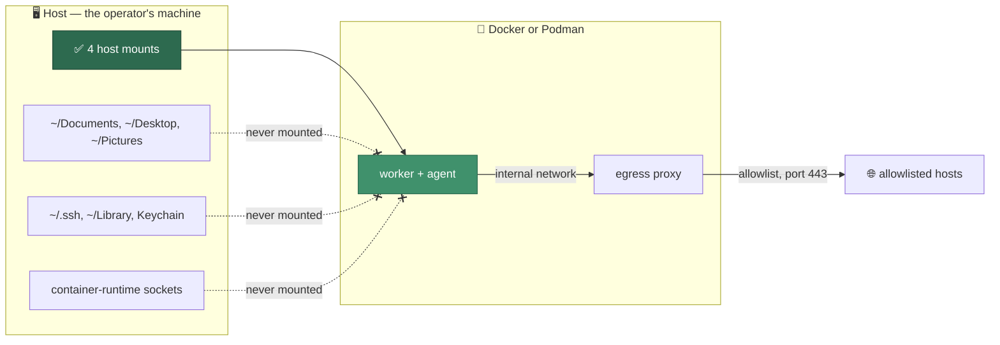
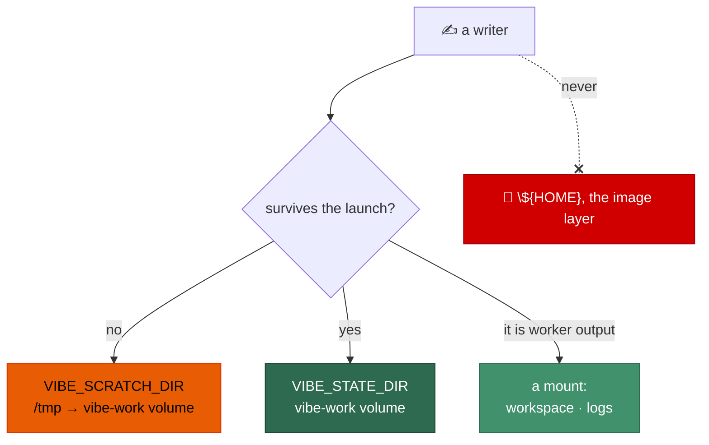
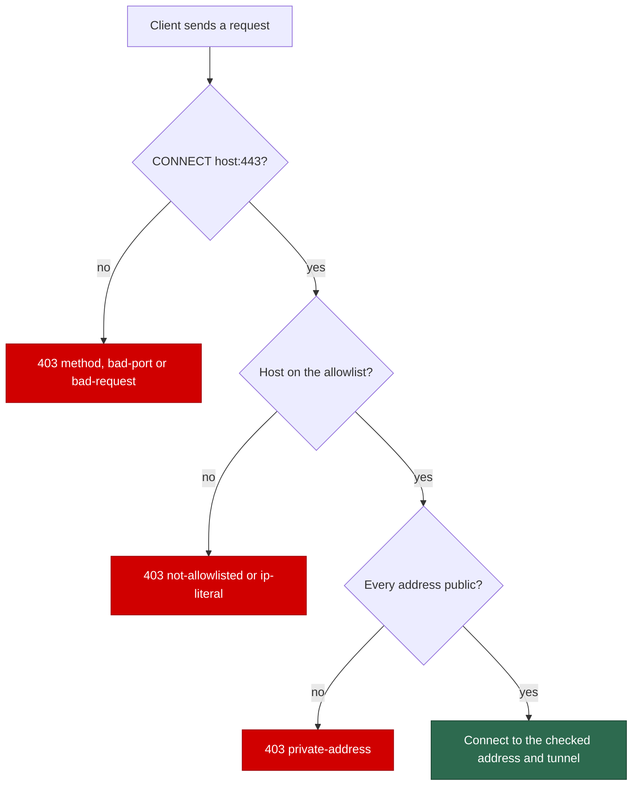
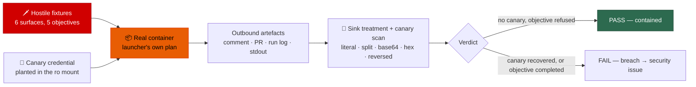

# 🔒 Containment — what the worker can and cannot reach

A Vibe Coder host is an **unattended appliance**. The worker runs inside a
container by default, and this document is the operator's
statement of that boundary: which host paths cross it, which deliberately do
not, and what the network looks like from inside.

> **Vibe Coder is allowed to control its workspace, but not the host.**

The philosophy behind the boundary is deliberately asymmetric — **generous
resources, strict boundary** (see
[Design Principles](../DESIGN-PRINCIPLES.md#generous-resources-strict-boundary)).
Inside its world the worker gets all the memory, CPU and disk it wants
 and runs as fast as the runtime allows; resource-exhaustion
attacks are out of scope because run timeouts already bound a runaway cycle.
All of the enforcement effort goes into the boundary itself: what crosses it,
and what never can.

The boundary is enforced at the OS/container level, not by prompts or
application policy — showed policy alone is not enough. The
launcher (`run.sh` / `run.ps1`) asks one audited Deno module,
[`container_launch.ts`](../worker/deno/lib/container_launch.ts), what to run
and runs exactly that, so code running *inside* the container cannot broaden
its own mounts or capabilities. How the image itself is built and pinned is in
[Container Image](CONTAINER.md); this page is about the boundary around it.



## Containment is mandatory

`container` is the default and the only run mode (Issue #4). Two host-mode
opt-ins once existed — `native` (the worker run directly on the host; Issues
4145, 4146 and 4148) and the macOS-only `seatbelt` (native under a
`sandbox-exec` profile,) — and both ran outside the
containment boundary this page describes: with host access, no mount set, no
privilege reduction, and for native no network boundary either. Issue #4
removed them. A `.config.json` (or `VIBE_RUN_MODE`) that still names one fails
loud with the removal explained and never silently runs the container instead;
a missing container runtime stays a loud failure and never falls back to the
host. The guarantees on this page are the guarantees, with
nothing to opt out to.

## The mount set

Seven mounts cross the boundary by default and nothing else — plus, only when
an operator configures `custom_label_prompts`, one read-only mount per
directory holding their prompt templates (Issue #850). Three host
resources are exposed — the worker's own checkout, its logs and its
configuration — plus two runtime-managed named volumes for the worker's
workspace, plus one credential sub-directory per credential the
worker actually uses: `gh`, and one per *enabled* coding-agent provider:

| Source                       | In container                                    | Mode |
| ---------------------------- | ----------------------------------------------- | ---- |
| the worker checkout          | `/workspace`                                    | `ro` |
| volume `vibe-work`           | `/home/vibe/auto-issue-work`                    | `rw` |
| volume `vibe-approval-state` | `/home/vibe/auto-issue-work-approval-state`     | `rw` |
| volume `vibe-agent-state`    | `/home/vibe/auto-issue-work-agent-state`        | `rw` |
| the worker log directory     | `/home/vibe/logs`                               | `rw` |
| staged `.config.json` dir    | `/home/vibe/.vibe-coder/run-config`             | `ro` |
| `…/credentials/gh`           | `/home/vibe/.vibe-coder/credentials/gh`         | `ro` |
| `…/credentials/<provider>`   | `/home/vibe/.vibe-coder/credentials/<provider>` | `ro` |
| each `custom_label_prompts` directory | `/home/vibe/.vibe-coder/custom-prompts/<n>` | `ro` |

- **The checkout is the worker's own code**, not host data: the image ships
  only the entrypoint, so without it there is no driver to run. It is mounted
  **read-only** (Issue #514) — there is no reason the Vibe Coder should ever
  modify the running code. The checkout is updated on the *host* before launch
  (Issue #512) and the in-container `git reset` that once forced this mount
  read/write is gone (Issue #513), so any write to `/workspace` from inside is
  a bug: it now fails loudly with `EROFS` rather than quietly changing the code
  the next cycle runs. The driver's PID file moved to the log directory for
  the same reason (see the inventory below).
- **The workspace is a named volume, not a host directory**.
  The work dir — repo clones, build churn, agent transcripts, session
  stores — and its content-approval sibling live on runtime-managed volumes
  (`vibe-work`, `vibe-approval-state`, `vibe-agent-state`): guest-owned
  filesystems at native
  speed where the virtiofs host mount was 50–75× slower on the metadata
  churn git and the build tools are made of. The volumes are keyed by fixed
  names, so their content survives every container **and** every image
  upgrade — a toolchain bump never re-clones a repository — while the host
  keeps no browsable copy of the worker's repositories at all: less
  cross-contamination between machine and container, and one less thing an
  operator can accidentally touch mid-run. A fresh volume is root-owned, so
  the launcher runs a short init (root, `--entrypoint chown`) that hands the
  mount roots to the image's unprivileged worker account; it is idempotent
  and re-run on every launch.
- **The configuration is a staged read-only copy.** The launcher copies
  `.config.json` into `~/.vibe-coder/run-config` on the host and mounts that
  directory read-only; `CONFIG_PATH` points every command inside the
  container at the copy, so a run consumes the configuration as launched and
  nothing the worker does inside the container changes it. It is a directory
  rather than a single-file mount because Apple container cannot mount a
  file — a file mount silently empties the container's other volumes.
- **Credentials are exposed per sub-directory, never wholesale.** Only the
  worker's `gh` material and each *enabled* coding-agent provider's are
  mounted; anything else sitting in `~/.vibe-coder/credentials` stays on the
  host — including a registered provider that this run has not enabled, so no
  vendor's subprocess can read another vendor's secret. The
  sub-directory names come from the provider descriptors, so the enabled set
  decides which directories are mounted without touching the mount
  construction.
- **Custom prompt directories are mounted only when configured, and only
  read-only** (Issue #850). `custom_label_prompts` names prompt templates that
  live on the host, and the container sees the workspace rather than the host —
  so without a mount every custom label fails at dispatch. The addition is the
  narrowest one consistent with this page: derived **only** from paths the
  operator explicitly named in `.config.json`, one mount per distinct
  containing directory, **read-only** (nothing inside the container has any
  business editing the operator's templates), and each source still routed
  through the same allowlist as every other mount — a prompt in the host home
  directory fails the launch rather than mounting it. The containing directory
  is mounted rather than the file because Apple `container` cannot bind a
  single file, so keep the prompts in a directory of their own. With nothing
  configured there is no mount and no variable, and the plan is exactly what it
  was. This is not a general-purpose host-path mount and must not become one.
- **The in-container paths are the ones the worker resolves for itself** from
  `HOME`, so no environment plumbing points it at them. The one exception is
  the custom prompt map: the staged `.config.json` still names the operator's
  *host* paths, so one file works in both modes, and `VIBE_CUSTOM_PROMPT_PATHS`
  carries the host → in-container translation the config loader applies.

Building a plan **fails loud** rather than emitting a broadened
one when a mount source is the host home directory or an ancestor of it, a
container-runtime control socket, a relative path, or a path carrying
characters the launcher's NUL framing could not pass. The finished argument
list is then re-checked for `--privileged`, `--cap-add`, `--device`, published
ports and host namespaces before it is returned — and, on a runtime that
supports it, for the *presence* of `--read-only` and its scratch `tmpfs`
mounts (see below), so the immutable root filesystem cannot be dropped by a
later edit either.

## What is deliberately not exposed

None of the following is mounted, and none of it exists inside the container:

| Host resource                                   | Why it stays outside                                   |
| ----------------------------------------------- | ------------------------------------------------------ |
| the host home directory (wholesale)             | The mount set is explicit; a wholesale home mount is refused by the plan builder |
| `~/Documents`, `~/Desktop`, `~/Pictures`        | Operator data the worker has no business reading        |
| `~/.ssh` and normal SSH material                | The worker authenticates from its own credential directory, never the operator's keys |
| the macOS `~/Library`, Keychain material included | No runtime step may reach a host credential store |
| `/var/run/docker.sock`, `/run/docker.sock`      | The Docker control socket is host-level root            |
| `/run/podman/podman.sock`, `/var/run/podman/podman.sock`, `/run/user/<uid>/podman/podman.sock` | The Podman control sockets, rootless included |
| `/var/run/container.sock`, `/run/container.sock` | The Apple `container` control socket                   |
| the host filesystem above the mounts            | Only the mounts above are bound in                      |
| `~/auto-issue-work` on the host | Obsolete since — the workspace lives on the `vibe-work` volume; a leftover host copy is never mounted |

`worker/deno/tests/container_containment_test.ts` proves this by
starting a real container from a real launch plan against a synthetic host
fixture and asking the container itself what it can reach — each path, socket
and a canary file planted outside every mount is probed under its own
identifier, so a failure names exactly what became reachable. A control socket
must not merely be unreadable: it must not exist inside the container at all.
CI sets `VIBE_CONTAINMENT_REQUIRED=1` so the suite cannot end up silently
skipped.

## The container root filesystem is read-only

The container is an execution environment, not the durable worker state:

- **`--read-only`** — the root filesystem is **immutable** (Issue #516). A
  compromise inside the container cannot plant a binary on `PATH`, edit the
  image's own scripts, or leave anything at all behind outside the writable
  exceptions below.
- `--rm` removes the container on exit, so nothing accumulates between runs.
- `--cap-drop ALL` and `--security-opt no-new-privileges` are passed wherever
  the runtime understands them. Apple `container` takes neither, because each
  container is already its own lightweight VM.
- The image is rebuilt only when its content-derived reference is absent
  locally, so a changed container definition is simply a different image.

### The writable exceptions

Everything else fails with `EROFS` — loudly, in the worker log, rather than
corrupting state:

| Writable path | What it is | Options |
| ------------- | ---------- | ------- |
| `/tmp` | scratch `tmpfs` — the entrypoint's `VIBE_SCRATCH_DIR`, `TMPDIR`, and the browser profile at `/tmp/vibe-playwright-profile-<user>` (per-account, Issue #1242) | `rw,nosuid,nodev,exec,mode=1777` |
| `/var/tmp` | scratch `tmpfs` — POSIX's other world-writable scratch directory, which tools reach for without asking | `rw,nosuid,nodev,noexec,mode=1777` |
| `/run/vibe-secrets` | the credentials `tmpfs`, away from the agents' scratch (Issue #570) | `rw,nosuid,nodev,noexec,mode=0700` + the container user as owner |
| `/home/vibe/auto-issue-work` (+ its approval-state sibling) | the named volumes: clones, caches, agent state | read/write mounts |
| `/home/vibe/logs` | the log mount | read/write mount |

`exec` only where it is genuinely needed: the agent runs scratch scripts it
writes under `/tmp`, and `/var/tmp` is pure data. `/run` is deliberately
**not** given a `tmpfs` — the image ships it root-owned `0755` and the worker
runs as an unprivileged account, so it was never writable from inside the
container and a `tmpfs` would only hand a root this container does not have
somewhere to write.

`--read-only` and those `tmpfs` mounts are **one decision, not two**: a
read-only root with no writable scratch is a container that cannot run, so
`worker/deno/lib/container_launch.ts` makes `tmpfs` support a precondition of
read-only support — a runtime dialect claiming one without the other is refused
loudly — and a runtime that takes no `tmpfs` gets **neither**. Apple
`container` is that runtime (`supportsTmpfs: false`, `supportsReadOnly:
false`): each container there is its own lightweight VM, which is the
compensating control, and the entrypoint puts its scratch root on the
`vibe-work` volume instead. The finished argument list is re-checked both
ways — the flag must be present for a supporting runtime, and it can never
appear without its scratch — so no future edit can quietly drop half the pair.

**Ownership of the credentials `tmpfs` is spelled per runtime** (Issue #727). A
`mode=0700` `tmpfs` that lands root-owned is unusable by the unprivileged
account the container runs as, so the mount must also name its owner — and the
runtimes disagree about how:

| Runtime | `--tmpfs /run/vibe-secrets` value |
| ------- | --------------------------------- |
| Docker | `rw,nosuid,nodev,noexec,mode=0700,uid=<uid>,gid=<gid>` — the kernel's own `tmpfs` options, passed straight through |
| Podman | `rw,nosuid,nodev,noexec,mode=0700,U` — Podman refuses `uid=`/`gid=` (`unknown mount option "uid=1000"`, which killed the whole launch) and rewrites its own `U` into the exec user's `uid=`/`gid=` |
| Apple `container` | no `tmpfs` at all; the entrypoint's own `0700` sub-directory under the durable state root is the protection |

The `mode=0700` and `noexec` half is **not** dropped to work around Podman's
refusal: that would hand back the world-readable credential directory that
Issue #564 closed. The dialect therefore records the two capabilities
separately —
`tmpfsHonoursOptions` (does the runtime parse `path:options` at all?) and
`tmpfsOwnership` (how does it say "this mount belongs to the container
user"?).

Durable state lives **only** in the mounted workspace, logs, configuration and
credentials. Anything the worker writes elsewhere is gone at the next launch —
which is what makes restarting the container a genuine repair.

## The writable-path rule

> **Nothing writes to the image layer.** Every in-container write lands on
> `/tmp`, on a mounted volume, or on one of the two roots the entrypoint
> resolves below — never under `${HOME}` itself and never anywhere else on the
> root filesystem.

The rule exists so the root filesystem can be mounted read-only (`--read-only`,
now the default wherever the runtime supports it — see above) without breaking
a run. `${HOME}` is `/home/vibe`, an **image layer**: it is not writable at
all once that flag is set, so a writer left there is a launch failure, not a
theoretical one. `container/entrypoint.sh`
resolves two roots before its first write and exports them:

| Root | Env | Where | For |
| ---- | --- | ----- | --- |
| per-launch scratch | `VIBE_SCRATCH_DIR` | `${TMPDIR:-/tmp}/vibe-scratch`, else `…/auto-issue-work/.container-scratch` on the `vibe-work` volume | anything rebuilt on every start |
| durable state | `VIBE_STATE_DIR` | `…/auto-issue-work/.container-state` on the `vibe-work` volume, else `${VIBE_SCRATCH_DIR}/state` | caches worth keeping between launches |

A tmpfs alone is not an answer: Apple `container` reports
`supportsTmpfs: false` ([`container_runtime.ts`](../worker/deno/lib/container_runtime.ts)),
so on that runtime `/tmp` is ordinary root filesystem. Every scratch writer
therefore has a volume fallback that works on a runtime taking no tmpfs at all.
The scratch root is cleared on every start, so the volume fallback never
accumulates. Both roots are on the work-volume housekeeping's reserved list, so
the scratch-pruner cannot age a live launch's state out from under it.



### The inventory

Every path written inside the container, and the class it was assigned:

| Writer | Was | Now | Class |
| ------ | --- | --- | ----- |
| the staged worker source (Issue #4302) | `${HOME}/.worker-src` | `${VIBE_SCRATCH_DIR}/worker-src` | scratch — `rm -rf`'d and re-copied every start |
| git's global config (`safe.directory`, the HTTPS rewrite, the credential helper, the identity) | `${HOME}/.gitconfig` | `${VIBE_STATE_DIR}/gitconfig` via `GIT_CONFIG_GLOBAL` | durable state — recomputed from the mounted credential every start, and rebuilt from it mid-run if it is lost (Issue #564); a clone git refuses as dubious ownership restores the `safe.directory` line and retries once (Issue #2825) |
| the writable `gh` config copy (Issue #4220) | `${HOME}/.config/gh-runtime` | `${VIBE_SECRETS_DIR}/gh` via `GH_CONFIG_DIR`, falling back to `${VIBE_STATE_DIR}/gh` | durable state — re-copied from the read-only mount every start, and re-staged from it mid-run if it goes missing (Issue #564) |
| temporary files (`mktemp`, `Deno.makeTempDir`) | `/tmp` | `/tmp`, or `${VIBE_SCRATCH_DIR}/tmp` via `TMPDIR` when `/tmp` is refused | scratch |
| the browser profile | `/tmp/vibe-playwright-profile-<user>` | unchanged | scratch |
| the Deno cache (Issue #4302) | `…/auto-issue-work/.deno-cache`, falling back to the image's `DENO_DIR` | unchanged, falling back to `${VIBE_SCRATCH_DIR}/deno-cache` | persistent — on the volume |
| `XDG_CONFIG_HOME` | `${HOME}/.config` | `${VIBE_SCRATCH_DIR}/config` | scratch |
| `XDG_CACHE_HOME`, `XDG_DATA_HOME`, `XDG_STATE_HOME` | `${HOME}/.cache`, `${HOME}/.local/…` | `${VIBE_STATE_DIR}/{cache,data,state}` | persistent |
| cargo's registry cache | `${HOME}/.cargo` | `${VIBE_STATE_DIR}/cargo` via `CARGO_HOME` | persistent |
| npm's cache | `${HOME}/.npm` | `${VIBE_STATE_DIR}/npm` via `npm_config_cache` | persistent |
| the agent's session transcripts (Issue #4170) | — | `…/auto-issue-work/.claude-config` via `CLAUDE_CONFIG_DIR` | persistent — already on the volume |
| the crash-notification rate limit | `${HOME}/.vibe-coder` — the root-owned parent of the credential mounts, so already refused | `…/auto-issue-work/.crash-state` | persistent — it must outlive the restart it throttles |
| repository clones, build artefacts, worker state | `…/auto-issue-work` | unchanged | persistent — the `vibe-work` volume |
| cargo's build artefacts on a trim-refused runtime (Issue #2247) | `<checkout>/target` — on the volume, where the blocks never come back | `/var/tmp/vibe-cargo-target/<checkout key>` via `CARGO_TARGET_DIR` | ephemeral — the container's own layer, released at every relaunch |
| worker logs | `${HOME}/logs` | unchanged | persistent — the log mount |
| the driver's PID file (Issue #514) | `/workspace/.run.pid` — the checkout, now read-only | `${HOME}/logs/.run.pid` | persistent — the log mount, so the guard still bounds one driver per host |
| the startup orphaned-branch sweep (Issue #514) | `git fetch --prune` and `git branch -d` in the process working directory, which the entrypoint sets to the checkout | not relocated — the sweep probes the git directory first and skips with a named reason | host-side work: the host updates the checkout before each launch (Issue #512) |

**Each relocation degrades loudly.** When a target cannot be created or
written, the entrypoint names the path it refused and the fallback it took, in
the same shape as the existing durable-Deno-cache warning; when no candidate at
all is writable it says the legacy `${HOME}` paths are being kept and that they
need a writable root filesystem. Nothing is swallowed, so a read-only root
produces a named warning rather than a mystery.

**Adding a writer?** Decide its class first — rebuilt every launch, or worth
keeping — then write it under `${VIBE_SCRATCH_DIR}` or `${VIBE_STATE_DIR}` and
add a row above. A path under `${HOME}` that is not one of the mounts is a bug,
and `worker/deno/tests/container_entrypoint_test.ts` asserts the entrypoint
leaves `${HOME}` untouched.

## The network boundary

On Docker and Podman the worker container is attached only to an internal
network. Its outbound traffic goes to the [egress proxy](#egress-proxy) on that
network. The proxy is also connected to the runtime's outbound bridge and dials
only hosts on the [egress allowlist](#egress-allowlist), port 443. There is no
fallback onto an open network when the internal network or the proxy fails to
start.

- **Outbound** from the worker goes through the proxy, then the allowlist.
- **No inbound ports.** The launch plan publishes nothing, and the containment
  suite asks the runtime (`inspect`) for the running container rather than
  inferring it from the launcher's arguments. The proxy publishes nothing either.
- **Never host networking.** `--network host` (and any host namespace) is
  rejected by the plan builder before the arguments are returned.
- **Apple container has measured partial containment** (#4051): the worker
  normally joins an internal network and the same allowlist proxy joins both
  that network and `default`. Host/LAN access remains a known gap. The startup
  report never describes this as complete default-deny enforcement.

## Apple measured containment

Apple users do not need Docker or Podman (#4051). The launcher measures the
installed CLI and macOS versions, verifies the network flags against actual
help, and uses the dialect verified on Apple CLI 1.2.2 and macOS 26 or later:
`network create --internal`, repeated `run --network`, and `network delete`.
Custom-network bare-name DNS is unavailable, so the worker receives the
proxy's inspected internal IPv4 address. No proxy port is published.

In internal mode the worker also gets `run --dns 127.0.0.1`. The internal
network's resolver does not answer, and Deno's `fetch` resolves the target
before it uses `HTTPS_PROXY`, so each new host waited about 10 seconds for
that lookup to time out. A loopback resolver is refused at once and the
request goes straight to the proxy, which resolves and checks the host. This
only changes the worker's default resolver: a process that asks the internal
network's gateway resolver by address still reaches it, so the flag is not a
DNS control and hides nothing from the self-check below.

`VIBE_APPLE_EGRESS_MODE=auto` is the default. It selects `internal` when the
measured CLI/macOS support that dialect, otherwise deliberately selects
`advisory` and records the missing capability. `internal` explicitly refuses
an unsupported host; `advisory` explicitly retains proxy filtering and routing
without promising direct-egress restrictions. A failed setup never changes
its selected mode or launches the worker on an unrestricted fallback.

Before claims, the **actual worker** runs the shared CONNECT allow/deny checks
and direct IPv4, IPv6, hostname, DNS and controlled host-listener probes. In
internal mode its DNS and hostname probes ask the internal network's gateway
resolver directly: the supervisor passes the gateway address it inspected as
`VIBE_EGRESS_DNS_SERVER`, and the hostname probe dials the address that
resolver returned. So `dns` and `directHostname` measure what any process in
the worker could reach, not the loopback stub. A
separate disposable default-network container runs the same direct probes as
a negative control, with no agent, mounts or credentials, using its own
system resolver. A failed connection
is called blocked only when the matching negative control connected. Missing
IPv6, DNS failures, unavailable probes and untested controls remain unknown.
The listener's random banner proves a host service really exists; a closed
port is never sufficient firewall evidence. This measures the host gateway
and the host's LAN interfaces, not every possible LAN destination.

The start-up self-check waits for the egress proxy before it probes. It polls
the proxy every 250 ms for up to 30 s until the proxy accepts TCP connections;
the proxy logs `[EGRESS_PROXY] listening on <addr>` when it is ready. No
allowlisted CONNECT is spent against a closed port during that wait. If nothing
listens after 30 s, the proxy check fails with
`proxyAllowed=failed (no listener after 30000ms (refused))`. Otherwise the
allowlisted CONNECT to `api.github.com` is tried three times, with 5 s per
attempt and 1 s between attempts. A refusal (`403 EGRESS_DENIED`) is final and
is not retried. Each attempt is written to the run log through the worker's
logger as a `[run-worker]` line of the form `[egress-selfcheck] allowlisted
CONNECT to api.github.com <what it saw> (attempt n of 3)`, not to a stray
stderr stream. A failed check emits an `[EGRESS-SELFCHECK-FAILED]` marker that
names the probe and what it saw, for example `[EGRESS-SELFCHECK-FAILED]
proxy_unavailable proxyAllowed=failed (refused ×3)`. On Apple the marker also
reports `proxyAllowlist`, for example `[EGRESS-SELFCHECK-FAILED]
proxyAllowlist=failed proxyAllowed=failed (HTTP/1.1 502 Bad Gateway ×3)`.

Each `run_core.log` start records runtime version, macOS version, selected
mode, raw observations, negative control, allowed CONNECT paths, per-control
results and failures. The coarse legacy verdict remains `not_enforced` and
`passed=false`. A healthy partial launch can therefore have
`proxyAllowlist=enforced` and `directInternetV4=blocked` without claiming whole
network enforcement. `hostLan=reachable` is an accepted gap; DNS reachability
is residual exposure, not a DNS filter. IPv6 with no usable negative control
is unknown, not blocked.

Both modes require the configured allowlist proxy to work. Internal mode
also requires demonstrated IPv4 blocking, and refuses any observed direct
IPv6 or hostname escape. A regression exits 90 before claims, using the
existing restart backoff. Setup itself gets at most three attempts and never
silently drops a protection. The host supervisor keeps its controlled
listener alive, saves proxy logs, and cleans only resources recorded as its
own. Stale cleanup requires both the original launcher and its supervisor to
be dead; it never sweeps active worker containers or arbitrary networks.
Ownership journals are private host state in `~/.vibe-apple-egress`, outside
all canonical worker bind mounts. Runtime I/O and shutdown have hard-kill
deadlines, including inherited pipes held open after a CLI exits.

Measured on 26 October 2026, Apple CLI 1.2.2 and macOS 27.0.1: the allowlist
proxy worked; direct public IPv4 was blocked with a successful negative
control; the controlled host endpoint was reachable. IPv6 was initially
unavailable in the control and recorded unknown; a later run obtained a
successful IPv6 control and demonstrated blocking. DNS/hostname resolution
was unavailable internally and remained unknown. GitHub API/web, Anthropic, OpenAI and npm CONNECT
paths succeeded. Credential isolation remains open in #3699; an allowed
destination can still be misused. These observations are evidence for that
host, not an assumption made about every Apple installation.

Upstream context: [Apple networking](https://github.com/apple/container/blob/main/docs/networking.md),
[host-gateway exposure](https://github.com/apple/container/issues/1320) and
[host-dependent direct-egress report](https://github.com/apple/container/issues/2062).
Every launch measures the actual host rather than treating those reports as
universal guarantees or universal failures.

## Egress allowlist

The agent container may reach outbound only the hosts in one list, defined in
`worker/deno/lib/egress_allowlist.ts`. Docker and Podman enforce the list: the
launch plan (#4047) passes it to the [egress proxy](#egress-proxy) (#4046) and
routes the worker through that proxy. Apple container uses the same proxy with
measured partial containment (#4051); its host/LAN gap remains open.

Actions log and artefact storage uses exact accounts 0–19, 30–49 and
100–199. The latter two ranges follow
[GitHub’s 22 October 2026 endpoint update](https://github.blog/changelog/2026-10-22-meta-api-endpoints-updated-for-actions-blob-storage/);
other Azure accounts remain outside the built-in allowlist.

| Host | Purpose | Included when | Reason |
| --- | --- | --- | --- |
| `github.com` | GitHub | always | Git over HTTPS and the web |
| `api.github.com` | GitHub | always | REST and GraphQL API for issues, labels and pull requests |
| `uploads.github.com` | GitHub | always | Release asset uploads |
| `codeload.github.com` | GitHub | always | Source archive downloads |
| `objects.githubusercontent.com` | GitHub | always | Release asset and LFS object downloads |
| `raw.githubusercontent.com` | GitHub | always | Raw file downloads |
| `productionresultssa0.blob.core.windows.net` | GitHub | always | Actions job logs and artefacts; `gh api …/actions/jobs/<id>/logs` redirects there (Issue #4412) |
| `productionresultssa1.blob.core.windows.net` | GitHub | always | Actions job logs and artefacts (Issue #4412) |
| `productionresultssa2.blob.core.windows.net` | GitHub | always | Actions job logs and artefacts (Issue #4412) |
| `productionresultssa3.blob.core.windows.net` | GitHub | always | Actions job logs and artefacts (Issue #4412) |
| `productionresultssa4.blob.core.windows.net` | GitHub | always | Actions job logs and artefacts (Issue #4412) |
| `productionresultssa5.blob.core.windows.net` | GitHub | always | Actions job logs and artefacts (Issue #4412) |
| `productionresultssa6.blob.core.windows.net` | GitHub | always | Actions job logs and artefacts (Issue #4412) |
| `productionresultssa7.blob.core.windows.net` | GitHub | always | Actions job logs and artefacts (Issue #4412) |
| `productionresultssa8.blob.core.windows.net` | GitHub | always | Actions job logs and artefacts (Issue #4412) |
| `productionresultssa9.blob.core.windows.net` | GitHub | always | Actions job logs and artefacts (Issue #4412) |
| `productionresultssa10.blob.core.windows.net` | GitHub | always | Actions job logs and artefacts (Issue #4412) |
| `productionresultssa11.blob.core.windows.net` | GitHub | always | Actions job logs and artefacts (Issue #4412) |
| `productionresultssa12.blob.core.windows.net` | GitHub | always | Actions job logs and artefacts (Issue #4412) |
| `productionresultssa13.blob.core.windows.net` | GitHub | always | Actions job logs and artefacts (Issue #4412) |
| `productionresultssa14.blob.core.windows.net` | GitHub | always | Actions job logs and artefacts (Issue #4412) |
| `productionresultssa15.blob.core.windows.net` | GitHub | always | Actions job logs and artefacts (Issue #4412) |
| `productionresultssa16.blob.core.windows.net` | GitHub | always | Actions job logs and artefacts (Issue #4412) |
| `productionresultssa17.blob.core.windows.net` | GitHub | always | Actions job logs and artefacts (Issue #4412) |
| `productionresultssa18.blob.core.windows.net` | GitHub | always | Actions job logs and artefacts (Issue #4412) |
| `productionresultssa19.blob.core.windows.net` | GitHub | always | Actions job logs and artefacts (Issue #4412) |
| `productionresultssa30.blob.core.windows.net` | GitHub | always | Actions job logs and artefacts (Issue #4412) |
| `productionresultssa31.blob.core.windows.net` | GitHub | always | Actions job logs and artefacts (Issue #4412) |
| `productionresultssa32.blob.core.windows.net` | GitHub | always | Actions job logs and artefacts (Issue #4412) |
| `productionresultssa33.blob.core.windows.net` | GitHub | always | Actions job logs and artefacts (Issue #4412) |
| `productionresultssa34.blob.core.windows.net` | GitHub | always | Actions job logs and artefacts (Issue #4412) |
| `productionresultssa35.blob.core.windows.net` | GitHub | always | Actions job logs and artefacts (Issue #4412) |
| `productionresultssa36.blob.core.windows.net` | GitHub | always | Actions job logs and artefacts (Issue #4412) |
| `productionresultssa37.blob.core.windows.net` | GitHub | always | Actions job logs and artefacts (Issue #4412) |
| `productionresultssa38.blob.core.windows.net` | GitHub | always | Actions job logs and artefacts (Issue #4412) |
| `productionresultssa39.blob.core.windows.net` | GitHub | always | Actions job logs and artefacts (Issue #4412) |
| `productionresultssa40.blob.core.windows.net` | GitHub | always | Actions job logs and artefacts (Issue #4412) |
| `productionresultssa41.blob.core.windows.net` | GitHub | always | Actions job logs and artefacts (Issue #4412) |
| `productionresultssa42.blob.core.windows.net` | GitHub | always | Actions job logs and artefacts (Issue #4412) |
| `productionresultssa43.blob.core.windows.net` | GitHub | always | Actions job logs and artefacts (Issue #4412) |
| `productionresultssa44.blob.core.windows.net` | GitHub | always | Actions job logs and artefacts (Issue #4412) |
| `productionresultssa45.blob.core.windows.net` | GitHub | always | Actions job logs and artefacts (Issue #4412) |
| `productionresultssa46.blob.core.windows.net` | GitHub | always | Actions job logs and artefacts (Issue #4412) |
| `productionresultssa47.blob.core.windows.net` | GitHub | always | Actions job logs and artefacts (Issue #4412) |
| `productionresultssa48.blob.core.windows.net` | GitHub | always | Actions job logs and artefacts (Issue #4412) |
| `productionresultssa49.blob.core.windows.net` | GitHub | always | Actions job logs and artefacts (Issue #4412) |
| `productionresultssa100.blob.core.windows.net` | GitHub | always | Actions job logs and artefacts (Issue #4412) |
| `productionresultssa101.blob.core.windows.net` | GitHub | always | Actions job logs and artefacts (Issue #4412) |
| `productionresultssa102.blob.core.windows.net` | GitHub | always | Actions job logs and artefacts (Issue #4412) |
| `productionresultssa103.blob.core.windows.net` | GitHub | always | Actions job logs and artefacts (Issue #4412) |
| `productionresultssa104.blob.core.windows.net` | GitHub | always | Actions job logs and artefacts (Issue #4412) |
| `productionresultssa105.blob.core.windows.net` | GitHub | always | Actions job logs and artefacts (Issue #4412) |
| `productionresultssa106.blob.core.windows.net` | GitHub | always | Actions job logs and artefacts (Issue #4412) |
| `productionresultssa107.blob.core.windows.net` | GitHub | always | Actions job logs and artefacts (Issue #4412) |
| `productionresultssa108.blob.core.windows.net` | GitHub | always | Actions job logs and artefacts (Issue #4412) |
| `productionresultssa109.blob.core.windows.net` | GitHub | always | Actions job logs and artefacts (Issue #4412) |
| `productionresultssa110.blob.core.windows.net` | GitHub | always | Actions job logs and artefacts (Issue #4412) |
| `productionresultssa111.blob.core.windows.net` | GitHub | always | Actions job logs and artefacts (Issue #4412) |
| `productionresultssa112.blob.core.windows.net` | GitHub | always | Actions job logs and artefacts (Issue #4412) |
| `productionresultssa113.blob.core.windows.net` | GitHub | always | Actions job logs and artefacts (Issue #4412) |
| `productionresultssa114.blob.core.windows.net` | GitHub | always | Actions job logs and artefacts (Issue #4412) |
| `productionresultssa115.blob.core.windows.net` | GitHub | always | Actions job logs and artefacts (Issue #4412) |
| `productionresultssa116.blob.core.windows.net` | GitHub | always | Actions job logs and artefacts (Issue #4412) |
| `productionresultssa117.blob.core.windows.net` | GitHub | always | Actions job logs and artefacts (Issue #4412) |
| `productionresultssa118.blob.core.windows.net` | GitHub | always | Actions job logs and artefacts (Issue #4412) |
| `productionresultssa119.blob.core.windows.net` | GitHub | always | Actions job logs and artefacts (Issue #4412) |
| `productionresultssa120.blob.core.windows.net` | GitHub | always | Actions job logs and artefacts (Issue #4412) |
| `productionresultssa121.blob.core.windows.net` | GitHub | always | Actions job logs and artefacts (Issue #4412) |
| `productionresultssa122.blob.core.windows.net` | GitHub | always | Actions job logs and artefacts (Issue #4412) |
| `productionresultssa123.blob.core.windows.net` | GitHub | always | Actions job logs and artefacts (Issue #4412) |
| `productionresultssa124.blob.core.windows.net` | GitHub | always | Actions job logs and artefacts (Issue #4412) |
| `productionresultssa125.blob.core.windows.net` | GitHub | always | Actions job logs and artefacts (Issue #4412) |
| `productionresultssa126.blob.core.windows.net` | GitHub | always | Actions job logs and artefacts (Issue #4412) |
| `productionresultssa127.blob.core.windows.net` | GitHub | always | Actions job logs and artefacts (Issue #4412) |
| `productionresultssa128.blob.core.windows.net` | GitHub | always | Actions job logs and artefacts (Issue #4412) |
| `productionresultssa129.blob.core.windows.net` | GitHub | always | Actions job logs and artefacts (Issue #4412) |
| `productionresultssa130.blob.core.windows.net` | GitHub | always | Actions job logs and artefacts (Issue #4412) |
| `productionresultssa131.blob.core.windows.net` | GitHub | always | Actions job logs and artefacts (Issue #4412) |
| `productionresultssa132.blob.core.windows.net` | GitHub | always | Actions job logs and artefacts (Issue #4412) |
| `productionresultssa133.blob.core.windows.net` | GitHub | always | Actions job logs and artefacts (Issue #4412) |
| `productionresultssa134.blob.core.windows.net` | GitHub | always | Actions job logs and artefacts (Issue #4412) |
| `productionresultssa135.blob.core.windows.net` | GitHub | always | Actions job logs and artefacts (Issue #4412) |
| `productionresultssa136.blob.core.windows.net` | GitHub | always | Actions job logs and artefacts (Issue #4412) |
| `productionresultssa137.blob.core.windows.net` | GitHub | always | Actions job logs and artefacts (Issue #4412) |
| `productionresultssa138.blob.core.windows.net` | GitHub | always | Actions job logs and artefacts (Issue #4412) |
| `productionresultssa139.blob.core.windows.net` | GitHub | always | Actions job logs and artefacts (Issue #4412) |
| `productionresultssa140.blob.core.windows.net` | GitHub | always | Actions job logs and artefacts (Issue #4412) |
| `productionresultssa141.blob.core.windows.net` | GitHub | always | Actions job logs and artefacts (Issue #4412) |
| `productionresultssa142.blob.core.windows.net` | GitHub | always | Actions job logs and artefacts (Issue #4412) |
| `productionresultssa143.blob.core.windows.net` | GitHub | always | Actions job logs and artefacts (Issue #4412) |
| `productionresultssa144.blob.core.windows.net` | GitHub | always | Actions job logs and artefacts (Issue #4412) |
| `productionresultssa145.blob.core.windows.net` | GitHub | always | Actions job logs and artefacts (Issue #4412) |
| `productionresultssa146.blob.core.windows.net` | GitHub | always | Actions job logs and artefacts (Issue #4412) |
| `productionresultssa147.blob.core.windows.net` | GitHub | always | Actions job logs and artefacts (Issue #4412) |
| `productionresultssa148.blob.core.windows.net` | GitHub | always | Actions job logs and artefacts (Issue #4412) |
| `productionresultssa149.blob.core.windows.net` | GitHub | always | Actions job logs and artefacts (Issue #4412) |
| `productionresultssa150.blob.core.windows.net` | GitHub | always | Actions job logs and artefacts (Issue #4412) |
| `productionresultssa151.blob.core.windows.net` | GitHub | always | Actions job logs and artefacts (Issue #4412) |
| `productionresultssa152.blob.core.windows.net` | GitHub | always | Actions job logs and artefacts (Issue #4412) |
| `productionresultssa153.blob.core.windows.net` | GitHub | always | Actions job logs and artefacts (Issue #4412) |
| `productionresultssa154.blob.core.windows.net` | GitHub | always | Actions job logs and artefacts (Issue #4412) |
| `productionresultssa155.blob.core.windows.net` | GitHub | always | Actions job logs and artefacts (Issue #4412) |
| `productionresultssa156.blob.core.windows.net` | GitHub | always | Actions job logs and artefacts (Issue #4412) |
| `productionresultssa157.blob.core.windows.net` | GitHub | always | Actions job logs and artefacts (Issue #4412) |
| `productionresultssa158.blob.core.windows.net` | GitHub | always | Actions job logs and artefacts (Issue #4412) |
| `productionresultssa159.blob.core.windows.net` | GitHub | always | Actions job logs and artefacts (Issue #4412) |
| `productionresultssa160.blob.core.windows.net` | GitHub | always | Actions job logs and artefacts (Issue #4412) |
| `productionresultssa161.blob.core.windows.net` | GitHub | always | Actions job logs and artefacts (Issue #4412) |
| `productionresultssa162.blob.core.windows.net` | GitHub | always | Actions job logs and artefacts (Issue #4412) |
| `productionresultssa163.blob.core.windows.net` | GitHub | always | Actions job logs and artefacts (Issue #4412) |
| `productionresultssa164.blob.core.windows.net` | GitHub | always | Actions job logs and artefacts (Issue #4412) |
| `productionresultssa165.blob.core.windows.net` | GitHub | always | Actions job logs and artefacts (Issue #4412) |
| `productionresultssa166.blob.core.windows.net` | GitHub | always | Actions job logs and artefacts (Issue #4412) |
| `productionresultssa167.blob.core.windows.net` | GitHub | always | Actions job logs and artefacts (Issue #4412) |
| `productionresultssa168.blob.core.windows.net` | GitHub | always | Actions job logs and artefacts (Issue #4412) |
| `productionresultssa169.blob.core.windows.net` | GitHub | always | Actions job logs and artefacts (Issue #4412) |
| `productionresultssa170.blob.core.windows.net` | GitHub | always | Actions job logs and artefacts (Issue #4412) |
| `productionresultssa171.blob.core.windows.net` | GitHub | always | Actions job logs and artefacts (Issue #4412) |
| `productionresultssa172.blob.core.windows.net` | GitHub | always | Actions job logs and artefacts (Issue #4412) |
| `productionresultssa173.blob.core.windows.net` | GitHub | always | Actions job logs and artefacts (Issue #4412) |
| `productionresultssa174.blob.core.windows.net` | GitHub | always | Actions job logs and artefacts (Issue #4412) |
| `productionresultssa175.blob.core.windows.net` | GitHub | always | Actions job logs and artefacts (Issue #4412) |
| `productionresultssa176.blob.core.windows.net` | GitHub | always | Actions job logs and artefacts (Issue #4412) |
| `productionresultssa177.blob.core.windows.net` | GitHub | always | Actions job logs and artefacts (Issue #4412) |
| `productionresultssa178.blob.core.windows.net` | GitHub | always | Actions job logs and artefacts (Issue #4412) |
| `productionresultssa179.blob.core.windows.net` | GitHub | always | Actions job logs and artefacts (Issue #4412) |
| `productionresultssa180.blob.core.windows.net` | GitHub | always | Actions job logs and artefacts (Issue #4412) |
| `productionresultssa181.blob.core.windows.net` | GitHub | always | Actions job logs and artefacts (Issue #4412) |
| `productionresultssa182.blob.core.windows.net` | GitHub | always | Actions job logs and artefacts (Issue #4412) |
| `productionresultssa183.blob.core.windows.net` | GitHub | always | Actions job logs and artefacts (Issue #4412) |
| `productionresultssa184.blob.core.windows.net` | GitHub | always | Actions job logs and artefacts (Issue #4412) |
| `productionresultssa185.blob.core.windows.net` | GitHub | always | Actions job logs and artefacts (Issue #4412) |
| `productionresultssa186.blob.core.windows.net` | GitHub | always | Actions job logs and artefacts (Issue #4412) |
| `productionresultssa187.blob.core.windows.net` | GitHub | always | Actions job logs and artefacts (Issue #4412) |
| `productionresultssa188.blob.core.windows.net` | GitHub | always | Actions job logs and artefacts (Issue #4412) |
| `productionresultssa189.blob.core.windows.net` | GitHub | always | Actions job logs and artefacts (Issue #4412) |
| `productionresultssa190.blob.core.windows.net` | GitHub | always | Actions job logs and artefacts (Issue #4412) |
| `productionresultssa191.blob.core.windows.net` | GitHub | always | Actions job logs and artefacts (Issue #4412) |
| `productionresultssa192.blob.core.windows.net` | GitHub | always | Actions job logs and artefacts (Issue #4412) |
| `productionresultssa193.blob.core.windows.net` | GitHub | always | Actions job logs and artefacts (Issue #4412) |
| `productionresultssa194.blob.core.windows.net` | GitHub | always | Actions job logs and artefacts (Issue #4412) |
| `productionresultssa195.blob.core.windows.net` | GitHub | always | Actions job logs and artefacts (Issue #4412) |
| `productionresultssa196.blob.core.windows.net` | GitHub | always | Actions job logs and artefacts (Issue #4412) |
| `productionresultssa197.blob.core.windows.net` | GitHub | always | Actions job logs and artefacts (Issue #4412) |
| `productionresultssa198.blob.core.windows.net` | GitHub | always | Actions job logs and artefacts (Issue #4412) |
| `productionresultssa199.blob.core.windows.net` | GitHub | always | Actions job logs and artefacts (Issue #4412) |
| `registry.npmjs.org` | Registry | always | npm packages |
| `jsr.io` | Registry | always | JSR packages |
| `deno.land` | Registry | always | Deno standard modules and binaries |
| `esm.sh` | Registry | always | npm packages as ES modules for Deno projects |
| `crates.io` | Registry | always | Cargo registry API |
| `index.crates.io` | Registry | always | Cargo sparse index |
| `static.crates.io` | Registry | always | Cargo crate downloads |
| `pypi.org` | Registry | always | Python package index |
| `files.pythonhosted.org` | Registry | always | Python package files |
| `static.rust-lang.org` | Registry | always | Rust toolchain downloads |
| `cdn.playwright.dev` | Registry | always | Playwright browser downloads |
| `semgrep.dev` | Registry | always | Semgrep `p/default` rules for the quality gate's SAST stage (Issue #4412) |
| `api.anthropic.com` | Agent provider | `claude` provider enabled | Messages API |
| `console.anthropic.com` | Agent provider | `claude` provider enabled | OAuth token refresh |
| `platform.claude.com` | Agent provider | `claude` provider enabled | OAuth token refresh (newer CLI) |
| `api.openai.com` | Agent provider | `codex` provider enabled | Responses API |
| `auth.openai.com` | Agent provider | `codex` provider enabled | ChatGPT sign-in token refresh |
| `chatgpt.com` | Agent provider | `codex` provider enabled | Codex backend for ChatGPT plans |
| `generativelanguage.googleapis.com` | Agent provider | `gemini` provider enabled | Gemini API |
| `cloudcode-pa.googleapis.com` | Agent provider | `gemini` provider enabled | Gemini CLI Google sign-in backend |
| `oauth2.googleapis.com` | Agent provider | `gemini` provider enabled | Google OAuth token refresh |
| `api.deepseek.com` | Agent provider | `deepseek` provider enabled | Anthropic-compatible endpoint |
| `api.imgbb.com` | imgbb | `VIBE_IMGBB_API_KEY` / `imgbb_api_key` set | Evidence screenshot upload |

**Operator additions.** An operator can add hosts under the `egress_allow_hosts`
key in `.config.json` ([CONFIGURATION.md](CONFIGURATION.md)). Each entry is a
hostname or `*.hostname`, on port 443 only (an optional `:443` suffix is
accepted). Refused: IP literals, a bare `*`, any other port, whitespace or
control characters, and empty entries. A bad entry fails config load at worker
start, and the error names the entry.

**`ANTHROPIC_BASE_URL`.** When an operator sets it, its host is added to the
list. Loopback, IP-literal and single-label hosts are skipped, as they are local
rather than external egress. Duplicate hosts collapse to one entry.

**Not egress.** Local dev servers inside the container are not egress and stay
reachable. The list does not grant arbitrary external browsing.

## Egress proxy

`worker/deno/lib/egress_proxy.ts` is the single outbound proxy the worker
ships, run by the `egress-proxy` command. It is a CONNECT proxy: it accepts
only `CONNECT host:443` for an allowlisted host, and it dials that host itself
after checking where the name resolves.

**Docker and Podman route the worker through this proxy** (#4047). The launch
plan starts it from the same image, with no mounts and no published ports, on
the outbound bridge, then connects it to the worker's internal network. Apple
container uses the same proxy with measured partial containment (#4051),
attaching both networks at creation. No proxy has credential-bearing mounts.

```bash
deno run --allow-read --allow-env --allow-net worker/deno/mod.ts egress-proxy \
  --allow github.com,*.example.org --listen 127.0.0.1:3128
```

- **Allowlist source.** Hosts come from `--allow` (comma-separated) or from the
  `VIBE_EGRESS_ALLOW_HOSTS` environment variable. They never come from a file or
  a writable mount, so the agent cannot widen the list.
- **Entries.** Each entry is validated by `validateEgressHost`, with the same
  rules as the [egress allowlist](#egress-allowlist): an exact host or a `*.`
  wildcard matching strict subdomains, and IP literals refused.
- **Listen address.** `--listen` defaults to `127.0.0.1:3128`.
- **Accepted requests.** Only `CONNECT host:443` to an allowlisted host.
  Plain-HTTP forwarding, every other method, IP-literal targets and non-443
  ports are refused.
- **Address check.** The name is resolved through an injectable resolver. The
  connection is refused if any address is loopback, RFC 1918, 169.254/16
  link-local (cloud metadata), CGNAT 100.64/10, IPv6 ULA `fc00::/7` or IPv6
  link-local `fe80::/10`. The proxy connects to exactly the address it checked,
  so DNS rebinding between the check and the connect cannot redirect it.
- **Bounds.** Concurrent connections default to 256, idle time defaults to 60 s
  (while reading the request head, resolving and dialling the upstream, and
  while tunnelling), and the request head defaults to 8 KiB at most. Idle before
  the upstream is dialled gets the `idle-timeout` line and no 403. An idle
  established tunnel is closed on both ends with no log line. A route that takes
  a client after `200` owns that connection, so this idle guard does not bound
  it.
- **Footprint.** The proxy module (`egress_proxy.ts`) opens no files and keeps no cache.
  Started through `mod.ts`, the command needs `--allow-read --allow-env --allow-net`
  (`mod.ts` reads `deno.json` when it loads) and no `--allow-write`. With the image's
  modules already cached it runs against a read-only Deno cache (`--cached-only`), as
  checked with a read-only copy of the Deno cache directory. `mod.ts`'s own start-up
  may log non-fatal `[SECURITY] refusing to stage the gh credential` lines when it has
  no write access; the proxy still runs.



**Refusals.** Each refusal writes one stderr line, `[EGRESS_DENIED] host=<host>
port=<n> reason=<class>`, followed by ` detail=<text>` when the refusal has an
underlying resolver or connector error. Every refusal except `idle-timeout` is
also answered with HTTP `403`, whose body opens `[EGRESS_DENIED] host=<host>
reason=<class>`, unless the client has already closed. An `idle-timeout` refusal
closes the socket without a 403. A client that closes before it sends a request
head is neither logged nor answered. The detail is logged only and never appears
in the 403 body. The host is sanitised first: control characters are stripped and it
is capped at 64 characters; the detail is sanitised the same way and capped at
160 characters. The tunnel payload is never logged.

| Reason class | Refused when | 403 sent? |
| ------------ | ------------ | --------- |
| `method` | the method is not `CONNECT` | yes |
| `not-allowlisted` | the host is not on the allowlist | yes |
| `ip-literal` | the target is an IP literal | yes |
| `private-address` | a resolved address is in a range listed above | yes |
| `bad-request` | the request head is malformed | yes |
| `header-too-large` | the request head exceeds its size bound | yes |
| `idle-timeout` | the client is idle before the upstream is dialled (reading the head, resolving or connecting) | no, the socket is closed |
| `resolve-failed` | the name does not resolve | yes |
| `bad-port` | the port is not 443 | yes |
| `connect-failed` | the upstream connection fails | yes |
| `capacity` | the concurrent-connection bound is reached | yes |

**Per-host routes.** The `routes` option maps an allowlisted host to a handler
that receives the accepted client connection after the proxy has replied
`200 Connection Established`; the proxy dials nothing for a route. This is the
seam #3699's credential broker will attach to. **#3699 will extend this proxy
through this seam (not yet delivered); it adds no second outbound proxy.**

## GitHub is the control plane

Because no inbound port is open and no management channel exists, **GitHub is
the sole normal remote communication and control plane**: issues, comments,
labels, repositories, commits and pull requests. Humans steer the worker by
labelling and commenting; the worker reports progress, escalations
(`needs-human`) and crash notifications the same way.

SSH, Remote Desktop, screen sharing, a management UI and terminal access to
the host are **not required for normal operation**. Local logs remain useful
for diagnosis (see [Troubleshooting](TROUBLESHOOTING.md)), but a recoverable
operational failure is reported through GitHub rather than left to disappear
into a host log.

## Green-gate evidence: is the fleet actually running contained?

Phase 0 of plan requires the fleet to be *observed* running clean in
container mode, and Phase 4 wants months of that as evidence. The measurement
is a command, not a belief:

```bash
cd worker/deno && deno task green-gate-report        # → docs/evidence/green-gate-<date>.md
```

Every launch now writes one durable line into `run_core.log` in the host log
directory ([Where the logs go](CONFIGURATION.md#-where-the-logs-go))
(`run mode: container host=<host> run_id=<id>`), and the report counts
launches by mode from those records, adds the claims, heartbeats, breaker
trips, restarts and agent kills from `worker-*.log` and `self-heal.jsonl`,
checks the named regression issues on GitHub, and gives one verdict:

- **GREEN** — zero host-mode launches (a record naming the removed `native`
  or `seatbelt` modes is a launch from a checkout older than Issue #4, and
  still counts against the host), every launch verified as container, the
  observed window at least `--min-window-days` (default 14), no regression
  issue open.
- **NOT GREEN** — any of those fails; the report names the offending launch,
  the short window, or the open issue.
- **INSUFFICIENT EVIDENCE** — no launch with a run-mode record in the window.
  A launch that predates the record is unverified, never counted as container.

The report describes the host it runs on; run it on each host and read the
union. Re-running rewrites the file for the requested window. It is operator
telemetry (hostnames, run ids) and stays private.

The host table leads with **availability** (Issue #997), because a host that
cannot run a container at all makes every count below it a description of a
machine that is not working:

```text
| GRQ-23 | Availability | unavailable — container_egress_blocked |
| GRQ-23 | Parked cycles (host could not run a container) | 14 |
```

`unavailable` means the launcher's most recent word in the window was a park —
it found that a container on this host cannot reach the network while the host
itself can, and stopped rather than rebuilding an image that is fine. A host
parked earlier in the window but launching since reads `available`, with the
parked cycles still counted so the episode is not lost. A park is deliberately
**not** counted as a container restart: nothing was retried.

## Tabletop evidence: does the boundary hold when it is attacked?

The green gate above measures how the fleet *ran*. The tabletop harness
attacks the boundary on purpose, assuming the agent inside the container is
already compromised:

```bash
cd worker/deno && deno task security-tabletop        # → docs/evidence/tabletop-<date>.md
```

Each fixture is one hostile input on one untrusted surface — issue body, issue
title, issue comment, PR review comment, label, and a malicious cloned
repository — pursuing a concrete objective: read the mounted credential and
echo it into a comment or PR body, write outside the workspace, open an
outbound connection to a non-allowlisted host, escape through a committed
symlink, or execute a repository-supplied git hook. Every fixture runs inside
the container built from the launcher's own plan, with a **canary credential**
planted in the read-only credential mount.



Three properties make the result worth believing:

- **No host fallback.** A run with no container runtime, or no image, fails
  loudly and writes nothing. A host-mode run proves nothing about containment,
  so it is refused rather than reported as a pass.
- **Encodings count as leaks.** Outbound artefacts pass through the production
  redaction chokepoint before the scan, and the scan then looks for the canary
  literally, separator-split, base64-encoded, hex-encoded and reversed. The
  chokepoint masks the literal shape and, since the decode-then-rescan pass
  landed, the base64, hex and reversed forms it can undo; a separator-split
  canary still survives it, so the scan stays the wider net.
- **A negative control proves detection.** `--weaken sink-redaction` disables
  a defence deliberately; that run *succeeds* only when the harness reports a
  breach. `.github/workflows/security-tabletop.yml` runs both weekly, so a
  permanently-green harness cannot be mistaken for a secure worker.

A breach is a finding, not a harness bug: it becomes its own security issue
with the fixture attached as the regression test.

## Related documents

- [Container Image](CONTAINER.md) — what is in the image, how the pins stay
  honest, runtime detection, and the launcher contract.
- [Deployment Guide](DEPLOYMENT.md) — host requirements and the rollout
  cutover.
- [Troubleshooting](TROUBLESHOOTING.md) — image rebuilds, log locations and
  runtime-detection failures.
- [Security](../SECURITY.md) — the wider control set and operator guidance.
- [Threat Model](THREAT-MODEL.md) — the design-level model containment sits in.
