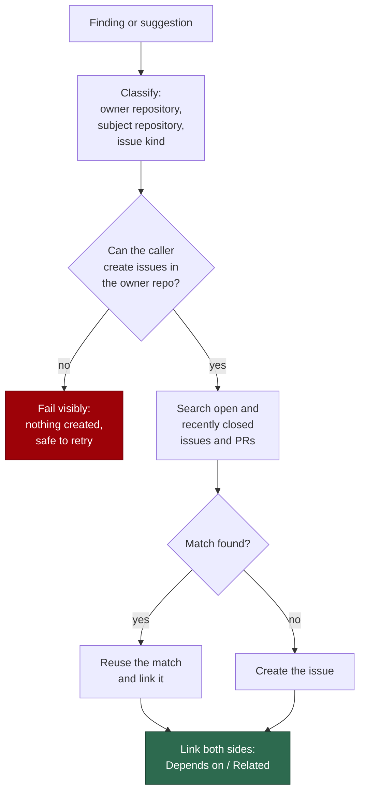

# Issue Routing — Operator Manual

A follow-up issue belongs **where the code lives**. Issue routing is the
deterministic rule, and the `route-issue` command, that decide which repository
a follow-up is filed in, search for an existing issue first, and link the
result — instead of leaving the choice to the agent's judgement each run. The
classifier and `routeIssueCreation` live in
[`issue_routing.ts`](../worker/deno/lib/issue_routing.ts).

Acceptance examples: a worker defect filed against a product repo
(GRQ-AutoTrader#3242 and GRQ-AutoTrader#3184, whose root causes were
VibeCoder#3607 and VibeCoder#3630), and the reverse.

## 1. Flow



## 2. Policy

| What the follow-up changes | Owner repository |
| --- | --- |
| Product code, CI, config | The repo that versions it |
| Worker, fleet, container, prompt, provider or orchestration | `stSoftwareAU/VibeCoder` |
| A repo-scoped diagnostic (see section 4) | The monitored repo |
| A change across several repos | One issue per independently deployable codebase, linked with `Depends on` / `Related`; no duplicated scope |

## 3. Audit fields

Every routed filing records, in the issue body and the command output:

| Field | Meaning |
| --- | --- |
| `owner_repository` | Where the issue was filed (or reused) |
| `subject_repository` | The repo the finding was observed in |
| `issue_kind` | `implementation`, `diagnostic` or `cross-repo` |
| routing reason | The rule that chose the owner, in one sentence |

## 4. The diagnostic exception

A repo-scoped diagnostic — a setup fast-failure (#2592), a lock or lease, a
back-off, an escalation anchor — **stays in the monitored repo**, because it is
the live signal for that repo. Never close a live diagnostic as "wrong repo". If
the cause is in the worker, file a separate VibeCoder root-cause issue and link
the two.

## 5. Running it

```bash
route-issue --repo owner/repo --title "..." --body-file body.md [--label bug,enhancement] [--dry-run]
```

`--label` takes a comma-separated list (or a JSON array); it is not repeatable.
Labels are applied only when the issue stays in the same repo, never migrated
across repos. The audit is printed to stdout as JSON (`classification`,
`owner_repository`, `subject_repository`, `issue_kind`, `reason`, `action`,
`issues`, `labels_not_migrated`). The command exits non-zero on a permission
refusal, an unreadable body file, an unknown option or any other error.

Prefer it to a bare `gh issue create` whenever the target repo may not be the
owner. `--dry-run` prints the classification, the audit fields and any
duplicate it would reuse, and creates nothing; use it first when unsure.

To close a wrong-repo duplicate in favour of the correct issue, run:

```bash
route-issue --resolve-duplicate owner/repo#N --correct owner/repo#M [--dry-run]
```

`owner/repo#N` is the wrong issue and `owner/repo#M` the correct one; each is
`owner/repo#number`. The command verifies that the correct issue exists, checks
write permission on both repos, comments on both issues, and closes the wrong
issue last, as not planned. The titles need not match: this is the case of
`stSoftwareAU/VibeCoder#3607` and `stSoftwareAU/GRQ-AutoTrader#3242`, which
describe the same problem under different titles. `--dry-run` calls nothing at
all; it prints what would be linked and closed. A repo-scoped diagnostic is
never closed (section 4), and the command refuses and says why. `--repo`,
`--title`, `--body-file` and `--label` cannot be combined with
`--resolve-duplicate`, and `--correct` requires it.

## 6. Failure and ambiguity

- **Permission failure.** If the caller cannot create issues in the owner repo,
  the command fails visibly with the reason. Nothing is created, so a retry is
  safe.
- **Ambiguity.** When the owner is not clear, state the basis for the choice
  in the issue and close nothing.

## 7. Duplicates

Search open **and** recently closed issues and PRs in the owner repo before
filing, and reuse or link what you find. For a duplicate that was filed in the
wrong repo, in this order:

1. Create, or verify, the correct issue.
2. Link both sides.
3. Close the duplicate with an explanation.

Never delete history, and never migrate labels or assignees. If two filers
race and both create an issue, the **lowest-numbered issue wins**: the later
one is linked to it and closed as not planned.

## Related

Related work: #3689, #3690, #3594 and #3674. For the prompt-side rule see
`prompts/coding_guidelines/` ("Issue routing") and
[Design Principles](../DESIGN-PRINCIPLES.md).
