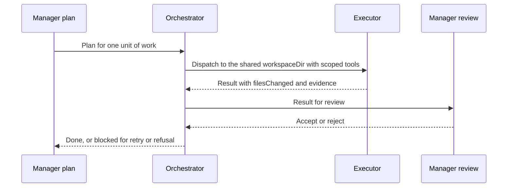
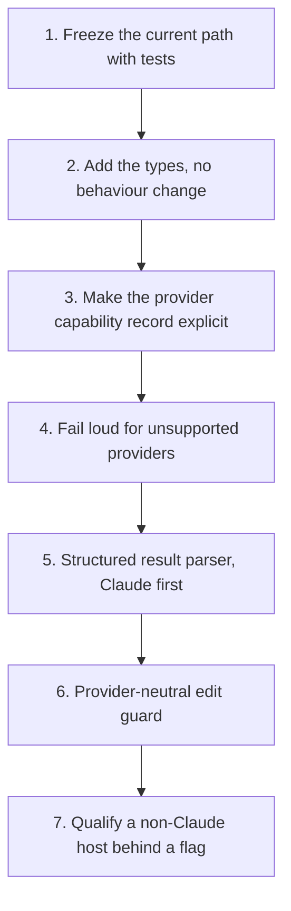

# Manager-worker contract (provider-neutral)

**Issue:** [#3641](https://github.com/stSoftwareAU/VibeCoder/issues/3641)

This page is the design contract for how a manager (the advisor that plans an
`issue`-phase run) hands work to executor and reviewer sub-agents, and how that
hand-off must stay the same whichever provider CLI runs the phase. It records
what the worker does today, with citations, and what the external orchestrator
built by Issue #3642 does. That orchestrator sits behind the opt-in
`external_orchestration` key, which defaults to `false`. The default path is
unchanged, and no other default changes.

## 1. Purpose and scope

In scope: the `issue` phase's advisor/executor split, the reviewer sub-agents,
and the read-only explorer sub-agent, as they reach the four provider CLIs
(`claude`, `codex`, `gemini`, `deepseek`).

Out of scope: the planning, question, PR-feedback, CI-fix and quality-fix
phases, except where they share the provider seam; the billing policy itself
(see [Provider parity](PROVIDER-PARITY.md)); and the per-model cost tables (see
[Model, Caching & Batching](MODEL-AND-CACHING.md)).

## 2. Terminology

- **Vendor:** the company whose model is run (Anthropic, OpenAI, Google,
  DeepSeek).
- **Provider CLI:** the program the worker spawns for one invocation. The four
  are registered in `AGENT_PROVIDERS` (`worker/deno/lib/agent_provider.ts:1154`).
  A provider CLI is not a vendor. The `deepseek` child environment points
  `ANTHROPIC_BASE_URL` at DeepSeek's endpoint (`worker/deno/lib/deepseek_env.ts:166-167`),
  so the vendor and the CLI are different axes.
- **Model:** the identifier passed to a provider CLI for one phase, such as
  `sonnet`, `haiku` or `opus` for Claude. The `issue` default is
  `DEFAULT_CLAUDE_MODEL_ISSUE` (`worker/deno/lib/config_defaults.ts:1114`).
- **Subscription entitlement:** the right to run a model under a flat-rate
  subscription login rather than a metered API key. The worker withholds
  non-subscription credentials from subscription runs
  (`worker/deno/lib/claude_env.ts:177`).
- **Host-validated prerequisite:** a model that a provider has not shipped in
  the host's supported set. It must be validated on the host before any
  configuration names it. It is never a default. Astra and Sol availability is
  a prerequisite to validate per host, by checking that the CLI is installed
  and the account is entitled. It is never assumed. Until a host is validated,
  no routing changes for it.

## 3. Existing behaviour audit

Each row cites the file and line that was opened to verify it. Paths are
relative to the repository root.

| Area | Where | What it does today |
| --- | --- | --- |
| Split switch | `worker/deno/lib/issue_executor_split.ts:42-59` | `isIssueExecutorSplitEnabled` returns false unless the phase is `issue`. A repo boolean overrides the host value. |
| Host defaults | `worker/deno/lib/config_defaults.ts:506`, `:516`, `:522` | `issueExecutorSplit: true`, `issueSubAgentTier: "haiku"`, `issueReviewerAgents: true`. |
| Config load | `worker/deno/lib/config.ts:982-1006` | Loads the three keys (`:982-983`, `:987-989`, `:992-993`); the tier goes through `resolveHostIssueSubAgentTier`. `external_orchestration` and its settings load at `:997-1006`, and the settings are validated at `:1347`. |
| Production wiring | `worker/deno/commands/execute_claude_phase.ts:173-179` | Threads the host values into the phase options. |
| Tier resolution | `worker/deno/lib/issue_sub_agent_tier.ts:43`, `:72` | Host value first, then the `repo_config` override. |
| Executor definitions | `worker/deno/lib/issue_executor_agents.ts:37`, `:54`, `:114`, `:146` | Sonnet model constant, Haiku model constant, `["Agent"]` disallowed, `buildIssueExecutorAgents`. |
| Reviewer definitions | `worker/deno/lib/issue_executor_agents.ts:208`, `:296` | Read-only tools `Read`, `Grep`, `Glob`; `buildIssueReviewerAgents`. |
| Explorer definition | `worker/deno/lib/issue_executor_agents.ts:337`, `:340`, `:374` | Haiku, read-only. Built only on the haiku tier (see assembly below). |
| Assembly | `worker/deno/lib/issue_executor_agents.ts:420-436` | `buildIssueRunAgents` returns `undefined` when the split is off, reviewers are off and the tier is not haiku (`:424-426`). The explorer is added only on the haiku tier (`:434`). |
| Phase wiring | `worker/deno/lib/execute_claude_phase.ts:1326-1348` | Resolves the split (`:1326-1331`), which is forced off when `externalOrchestration` is on (`:1326`). Then resolves the tier (the `"sonnet"` fallback applies only when no option is passed), then calls `buildIssueRunAgents` at `:1348`. The external path builds no `--agents` (`:1346-1348`). |
| Edit guard | `worker/deno/lib/issue_executor_enforcement.ts:47`, `:58`, `:124`, `:138` | Guarded tools are `Edit` and `Write`. A call with `agent_id` present (an executor) is allowed. A call without it (the advisor) is denied, unless its `file_path` is one of the advisor's own run-record files (`isAdvisorRunRecordPath`, `:98`, `:142-145`): the PR summary `docs/archive/pr-summaries/pr-summary-<issue>.md` or the PR-feedback reply file `.pr_response_message`. |
| Hook settings | `worker/deno/lib/issue_executor_enforcement.ts:205`, `:240` | `buildIssueExecutorHookSettings` and `resolveIssueExecutorHookSettings` build the `--settings` payload. |
| Guard CLI | `worker/deno/lib/issue_edit_guard_cli.ts:46` | `runIssueEditGuard` is the hook entry point. |
| Flag delivery | `worker/deno/lib/agent_provider.ts:595` (`buildClaudeCliArgs`), `:618`, `:623`, `:639` | `buildClaudeCliArgs` emits `--agents` JSON (`:618`), and `--settings` at two places (`:623`, `:639`). The `--settings` argument is emitted twice when `settingsJson` is set. This is recorded here and not fixed by this change. |
| Descriptor | `worker/deno/lib/agent_provider.ts:373` (`agents`), `:412` (`settingsJson`), `:446` (`promptTransport`), `:508` (`buildInvocation`), `:517` (`buildChildEnv`) | The `AgentProviderDescriptor` fields. |

Per-provider behaviour, from the same file:

- **Claude:** `promptTransport` is `"stdin"` (`agent_provider.ts:720`). Its
  `buildInvocation` is at `:748` and `buildChildEnv` at `:761-762`, which calls
  `buildClaudeChildEnv` (`worker/deno/lib/claude_env.ts:228`).
- **Codex:** `promptTransport` is `"stdin"` (`:853`). `buildInvocation` (`:870`)
  calls `buildCodexArgs` (`:893`, defined at `worker/deno/lib/codex_executor.ts:343`)
  and carries no `agents` or `settingsJson`. `buildChildEnv` (`:916`) calls
  `buildIsolatedCodexChildEnv` (`worker/deno/lib/codex_env.ts:116`), which calls
  `buildCodexChildEnv` (`worker/deno/lib/codex_env.ts:90`).
- **Gemini:** `promptTransport` is `"argv"` (`:973`). `buildInvocation` (`:988`)
  calls `buildGeminiArgs` (`:990`, defined at `worker/deno/lib/gemini_executor.ts:251`)
  and carries no `agents` or `settingsJson`. `buildChildEnv` (`:1006`) uses
  `buildGeminiChildEnv` (`worker/deno/lib/gemini_env.ts:91`).
- **DeepSeek:** `promptTransport` is `"stdin"` (`:1067`). `buildInvocation`
  (`:1103`) destructures out `agents` and `settingsJson` (`:1120`). `agents`
  triggers `warnDeepSeekAgentsUnsupported` (`:1121`,
  `worker/deno/lib/deepseek_executor.ts:253`). `settingsJson` is dropped
  silently, with `settingsJson: undefined` at `:1132`. `buildChildEnv` (`:1138`)
  uses `buildDeepSeekChildEnv` (`worker/deno/lib/deepseek_env.ts:157`).

Prompt templates. The advisor and executor instructions are built in code, and
the template carries only a placeholder.

- The block is `ISSUE_EXECUTOR_SPLIT_INSTRUCTIONS`
  (`worker/deno/lib/issue_executor_split_prompt.ts:27`).
- `buildPrompt` splices it into `{{EXECUTOR_SPLIT_INSTRUCTIONS}}` when the split
  is on, and renders the empty string otherwise
  (`worker/deno/lib/prompt_builder.ts:718-728`, `:782`, `:832-834`).
- It warns when a split run's template lacks the placeholder (`prompt_builder.ts:845-856`).
- The placeholder is optional for the `issue` template
  (`worker/deno/lib/prompt_manager.ts:259-270`, `:267`).
- The shipped template carries it at `prompts/issue/prompt.md:407`. A
  case-insensitive grep of `prompts/` for `executor` finds no other advisor or
  executor instruction text. `prompts/coding_guidelines/prompt.md:72` names the
  section only.

Lifecycle entry points are covered in section 5.

The issue owner states that the PR reviewer stays on Opus. The code has no
`pr_review` key: `PHASE_MODEL_DEFAULTS` (`worker/deno/lib/config_defaults.ts:1234-1251`)
does not list one (its `issue` key is at `:1240`). PR feedback and review runs
use the host `claude_model` (`worker/deno/lib/pr_feedback_processor.ts:790`,
`processorDeps.claudeModel ?? DEFAULT_CLAUDE_MODEL`), which defaults to
`DEFAULT_CLAUDE_MODEL = "opus"` (`worker/deno/lib/config_defaults.ts:980`, and
`worker/deno/lib/config.ts:602`). The comment above `DEFAULT_CLAUDE_MODEL_ISSUE`
(`worker/deno/lib/config_defaults.ts:1101-1113`) records the intent.

## 4. Target contract

The contract is provider-neutral: the manager and each sub-agent exchange plain
data, and no provider's CLI flags appear in the exchange. Issue #3642 implements
it behind `external_orchestration`, in `worker/deno/lib/orchestration/`
(`types.ts`, `capabilities.ts`, `checkpoint.ts`, `orchestrator.ts` and
`issue_run_gate.ts`). The default path does not use that code.

### Role contracts

| Role | Duty | Tools | Today (Claude) |
| --- | --- | --- | --- |
| Manager | Plans, dispatches, verifies. Read-only for edits. | Full read, dispatch | Advisor. `Edit` and `Write` are denied when `agent_id` is absent (except on the advisor's own run-record files), by the #2344 `PreToolUse` hook delivered via `--settings`. Enforced on Claude only today. |
| Executor | Makes the mechanical edits in one unit of work. | Edit, Write, read tools, scoped to `workspaceDir`. No further delegation. | `buildIssueExecutorAgents`, with `Agent` disallowed. |
| Spec reviewer | Checks the change against the issue. Read-only. | `Read`, `Grep`, `Glob` | `buildIssueReviewerAgents`. |
| Standards reviewer | Checks the change against the standards. Read-only. | `Read`, `Grep`, `Glob` | `buildIssueReviewerAgents`. |
| Explorer | Answers a narrow question about the repository. Read-only. | `Read`, `Grep`, `Glob` | `buildIssueExplorerAgents`, haiku tier only. |

### Task envelope and structured result

The manager sends one `TaskEnvelope` per unit of work. The worker returns one
`StructuredResult`. Both are plain data, so any provider can carry them. The
result must be checked by the host before the manager acts on it.

The types are defined in `worker/deno/lib/orchestration/types.ts`
(`TaskEnvelope` at `:32-52`, `StructuredResult` at `:63-69`,
`ProviderCapabilities` at `:75-84`). The excerpt below is abridged from that
file, which is authoritative.

```ts
// Abridged from worker/deno/lib/orchestration/types.ts.

export type TargetRole =
  | "manager"
  | "executor"
  | "spec_reviewer"
  | "standards_reviewer"
  | "explorer";

export type TargetProvider = "claude" | "codex" | "gemini" | "deepseek";

export interface RoleSelection {
  provider: TargetProvider;
  model?: string;
  effort?: string;
}

export interface TaskEnvelope {
  role: TargetRole;
  provider: TargetProvider;
  model?: string;
  effort?: string;
  allowedTools: string[];
  deniedTools: string[];
  workspaceDir: string;
  brief: string;
  issueId: string;
  branch: string;
  constraints: string[];
  acceptanceCriteria: string[];
  stopConditions: string[];
  maxRetries: number;
  timeoutMs: number;
  leaseId: string;
  leaseExpiresAt: number; // epoch milliseconds
  heartbeatIntervalMs: number;
}

export interface StructuredResult {
  role: TargetRole;
  status: "done" | "blocked" | "failed" | "cancelled" | "timed_out";
  filesChanged: string[];
  summary: string;
  evidence: string[];
}

export interface ProviderCapabilities {
  agents: boolean;
  settingsHook: boolean;
  compaction: boolean;
  promptTransport: "stdin" | "argv";
}
```

## 5. Lifecycle

### Exists today

The diagram below shows the path a Claude `issue` run takes today. It reads
from the claim through the advisor and its sub-agents to the result.


Supporting lifecycle code, each cited from the file it lives in:

- `worker/deno/lib/claude_runner.ts:1134` `runClaudeWithTimeout` runs the CLI
  under a timeout.
- `worker/deno/lib/claim_issue.ts:471` `findLiveHeartbeatMarker` and `:1784`
  `releaseClaimWithCooldown` cover the heartbeat and release.
- `worker/deno/lib/pr_review_claim_lease.ts:70` `isLeaseLive` and `:102`
  `createClaimLeaseRenewer` cover the lease used by PR review.
- `worker/deno/lib/stream_compaction.ts:67-70` lists the compactable
  providers (`claude` and `deepseek` only). `:160` is `supportsCompaction`.
- **Session persistence and resume.** `worker/deno/lib/session_resume.ts:132`
  `recordPhaseCompletion` increments the phase count on a session-state record
  (called from `worker/deno/lib/planning_processor.ts:1872`). `:216`
  `buildSessionResumeArgs` returns the `--resume` or `--session-id` arguments.
  `:233` `sessionResumeForProvider` filters the stored state to the calling
  provider. A state tagged with another `providerId` is dropped (`:238`). An
  untagged legacy state is kept only for `claude` or `deepseek` (`:240-242`).
  DeepSeek calls it at `worker/deno/lib/agent_provider.ts:1125-1128`. Compaction
  is a separate path (`stream_compaction.ts:67-70`, see section 7).

### Target

The orchestrator implements this state machine. Its legal moves are
`ORCHESTRATION_TRANSITIONS` (`worker/deno/lib/orchestration/types.ts:170-207`),
and `assertTransition` (`types.ts:213-220`) runs on every state change, so an
illegal move cannot be recorded. Resumption enters `recovering` from every
unreleased state, and a refusal, cancellation or budget stop may arise in any
active state. The diagram is the transition table, so it does not add or drop
a move. With the flag off, the Claude-native path described above is what runs.

```mermaid
stateDiagram-v2
  [*] --> claimed
  claimed --> planning
  planning --> dispatched
  planning --> refused
  planning --> blocked
  planning --> timed_out
  planning --> cancelled
  planning --> recovering
  dispatched --> executing
  dispatched --> refused
  dispatched --> recovering
  dispatched --> cancelled
  executing --> reviewing
  executing --> dispatched : retry
  executing --> blocked
  executing --> refused
  executing --> timed_out
  executing --> cancelled
  executing --> recovering
  reviewing --> done
  reviewing --> blocked
  reviewing --> refused
  reviewing --> timed_out
  reviewing --> cancelled
  reviewing --> recovering
  recovering --> planning
  recovering --> dispatched
  recovering --> refused
  recovering --> released
  blocked --> released
  blocked --> recovering
  timed_out --> released
  timed_out --> recovering
  cancelled --> released
  cancelled --> recovering
  refused --> released
  refused --> recovering
  done --> released
  done --> recovering
  note right of done
    Outcome reported as done.
    Checkpoint ends released.
  end note
  released --> [*]
```



- **Retry.** `invokeRole` (`worker/deno/lib/orchestration/orchestrator.ts:497-580`)
  retries an `error` or `timeout` call up to `maxRetries` extra times
  (`:549-551`). A retry does not change state, except in the execute phase,
  where the run moves `executing` to `dispatched` before the retry (`:550`).
- **Auth and quota.** An `auth` or `quota` failure is refused at once, with no
  retry (`:529-548`), as `auth_failure` or `quota_exhausted`.
- **Last attempt.** A final `timeout` ends the run as `timed_out` (`:553-561`).
  A final `error` is refused as `retries_exhausted` (`:562-570`).
- **Cancellation and budget.** `isCancelled` is checked before each call
  (`stopBeforeCall`, `:411-443`), and a cancel ends the run as `cancelled`.
  Invocation and cost limits stop the run before the call (`:426-441`).
- **Stale lease.** A lease that has lapsed is refused as `stale_lease`
  (`:398-403` on resume, `:420-425` before a call). That refusal does not overwrite the checkpoint (`:392`).
- **Terminal done.** An accepted review moves the run to `done` (`:668`), saves
  the final checkpoint (`:669-673`), then moves it to `released` (`:675`). The
  outcome the run reports is `done`, while the checkpoint ends `released`. A
  later run on the same lease does not resume that released checkpoint; it
  starts afresh (see Leases below). The gate returns the manager's last result
  only on `done` (`issue_run_gate.ts:247-249`).
- **Recovering.** A resumed run enters `recovering`. The only moves out of it are
  to `planning`, `dispatched`, `refused` or `released` (`types.ts:200`).

### Orchestrated handoff (`external_orchestration`)

The flagged path hands work from the manager's plan to an executor and then to
the manager's review. The orchestrator relays each step (Issue #3642).



- **Bounds.** The defaults are `maxRetries` 1, `maxDelegationDepth` 1,
  `maxConcurrency` 1, `maxInvocations` 6 and no `maxCostUsd`
  (`worker/deno/lib/orchestration/types.ts:119-124`). The per-call timeout is
  `CALL_TIMEOUT_MS`, 10 minutes (`orchestrator.ts:45`). The settings keys
  `max_retries`, `max_concurrency`, `max_invocations` and `max_cost_usd` are
  validated as non-negative or positive whole numbers at load time
  (`worker/deno/lib/config.ts:1347`). `maxDelegationDepth` is not a settings
  key. Below 1 it is refused as `depth_exceeded` (`orchestrator.ts:285-291`).
  The gate uses the default of 1. The gate refuses `maxConcurrency` above 1
  (`issue_run_gate.ts:179-188`), so an operator who sets 2 gets that refusal at
  run time. The orchestrator itself accepts any whole number of one or more
  (`orchestrator.ts:130-131`). `max_cost_usd` is enforced only against
  invocations whose token usage the gate can price (`costOf`,
  `issue_run_gate.ts:131-141`). An unpriced call adds nothing to the spend
  (`orchestrator.ts:523`), so when nothing is priced the cost cap cannot
  trigger and `max_invocations` is the effective hard bound.
- **Capabilities.** A probe builds one invocation through each provider's
  descriptor, carrying one agent, a settings payload and a denied tool, and
  reads back what the argv keeps (`worker/deno/lib/orchestration/capabilities.ts:70-97`).
  A denied tool counts as enforced only when `--disallowed-tools` in the argv
  carries it (`:85-87`). `assertRoleSupported` (`:130-166`) checks, in order:
  the provider is a known orchestration provider with a descriptor (`unsupported_provider`); the
  role's required compaction, which only the manager needs
  (`ROLE_REQUIRED_CAPABILITIES`, `:49-57`; `unsupported_capability`); and that
  every denied tool is enforced (`missing_tool_support`). Compaction is
  available only for `claude` and `deepseek` (`worker/deno/lib/stream_compaction.ts:67-70`).
  Codex and Gemini cannot enforce a denied tool through their argv, so any role
  that denies a tool is refused `missing_tool_support`. Both the manager and the
  executor deny tools (`orchestrator.ts:48`, `:57`). Codex and Gemini are first
  refused `unsupported_capability` for the manager, which needs compaction.
  Whether DeepSeek passes the denied-tool check is decided by its probe at run
  time, and this contract does not pre-judge it.
- **Billing.** A role's provider is refused as `metered_billing` only when its
  billing mode is `metered` (`worker/deno/lib/orchestration/orchestrator.ts:303-312`;
  `worker/deno/lib/provider_billing.ts:115`). The `unknown` and
  `fixed-subscription` modes are not refused (`provider_billing.ts:86`, `:96`,
  `:120`).
- **Checkpoints.** One JSON file per issue, at
  `<checkpointDir>/<encodeURIComponent(issueId)>.json`
  (`worker/deno/lib/orchestration/checkpoint.ts:48-50`). The gate uses
  `<agent state dir>/orchestration` (`issue_run_gate.ts:195`, `:240`). The
  schema key is `orchestration-checkpoint-v1` (`checkpoint.ts:22`). A
  checkpoint holds `schema`, `issueId`, `leaseId`, `leaseHeartbeatMs`, `state`,
  `invocations` and `costUsd` (both counted across resumes of the same unreleased
  lease, see Resume or start afresh below), `steps` (the output
  of each successful call, by idempotency key), `results`, and `final` once
  terminal (`checkpoint.ts:25-46`). A file that is not JSON, is not an object,
  has another schema, is malformed or names another issue is ignored with a
  warning, and the run starts fresh (`checkpoint.ts:105-146`). Writes go to a
  temporary file that is renamed over the checkpoint file, and a failed rename removes
  the temporary file (`checkpoint.ts:155-172`).
- **Idempotency.** The key is `<issueId>:<role>:<attempt>:<sha256 hex of brief>`
  (`checkpoint.ts:62-76`). A call whose key already has a recorded output is not
  sent again on resume (`orchestrator.ts:506-508`). A changed brief gives a new key.
- **Leases.** The gate's lease id is `issue-<issueNumber>`, which is stable per
  issue so a resumed run matches its checkpoint (`issue_run_gate.ts:230-231`).
  Each envelope carries `leaseExpiresAt = now + leaseTtlMs`
  (`orchestrator.ts:493`), with `leaseTtlMs` defaulting to 15 minutes
  (`DEFAULT_LEASE_TTL_MS`, `:42`), and `heartbeatIntervalMs = floor(leaseTtlMs / 3)`
  (`:494`). A stale lease is refused as described under Lifecycle above.
- **Resume or start afresh.** Only a checkpoint that is not `released` and
  carries the same lease id is resumed (`orchestrator.ts:335-340`, `resumed`
  true). A checkpoint already in `released` is a completed run, so a later run
  on the same lease starts afresh (`:341-352`): a fresh checkpoint overwrites the
  released file, with `invocations`, `costUsd`, `steps` and `results` reset to
  zero or empty, so the provider is called again. A checkpoint under another
  lease also starts afresh. Both fresh starts log a warning and report
  `resumed` false. Each retry attempt counts as one invocation
  (`orchestrator.ts:515`); the checkpoint keeps no separate retry count.

## 6. Permissions and credential isolation

- **Advisor cannot edit.** The edit guard denies `Edit` and `Write` when
  `agent_id` is absent (`worker/deno/lib/issue_executor_enforcement.ts:124`,
  `:138`), except on the advisor's own run-record files: the PR summary and
  the PR-feedback reply file are allowed without `agent_id` (`:142-145`). The
  hook is delivered through `--settings`, which only the Claude provider
  carries.
- **Executors cannot dispatch.** `["Agent"]` is disallowed for executors
  (`worker/deno/lib/issue_executor_agents.ts:114`). The reviewers and explorer
  are read-only. Under the gate, each envelope's `deniedTools` are appended to
  `--disallowed-tools` (`worker/deno/lib/orchestration/issue_run_gate.ts:116-119`).
- **No recursive delegation.** Today every sub-agent definition
  disallows `Agent`: the executor
  (`worker/deno/lib/issue_executor_agents.ts:114`), the reviewers (`:214`)
  and the explorer (`:349`). This is enforced only by the Claude `--agents`
  payload. Under `external_orchestration` (Issue #3642), delegation depth is
  configurable on `OrchestrationBounds` (`worker/deno/lib/orchestration/types.ts:108-109`,
  default 1 at `:121`). The gate keeps the default of 1, and a depth below 1
  is refused as `depth_exceeded` (`orchestrator.ts:285-291`). The contract still
  requires every provider adapter that runs a worker to enforce that a worker
  cannot dispatch further workers. An adapter that cannot enforce it is refused
  (section 8), not run with delegation open.
- **Executor workspace is shared under the flag.** Today sub-agents run inside
  the advisor's single CLI process, so they share its working directory. The CLI
  is spawned with one `cwd` (`worker/deno/lib/claude_runner.ts:1386`), and
  there is no per-executor workspace. Under `external_orchestration` (Issue
  #3642), the task envelope carries `workspaceDir` (`types.ts:39`), which the
  gate sets to the repository directory (`issue_run_gate.ts:234`). The gate
  creates no per-executor workspace, and the manager stays read-only. The
  orchestrator runs executors at concurrency 1, one at a time, in that shared
  checkout. Branch ownership is recorded on the task envelope (`types.ts:42`),
  but no per-executor git worktree enforces it. Per-executor worktrees are
  future work.
- **Credentials are scrubbed per provider.** Each provider builds its own child
  environment.
  - Claude: `withholdNonSubscriptionCredentials` (`worker/deno/lib/claude_env.ts:177`)
    keeps non-subscription credentials out of subscription runs.
  - Codex: `buildIsolatedCodexChildEnv` (`worker/deno/lib/codex_env.ts:116`)
    deletes `OPENAI_API_KEY`, `CODEX_API_KEY` and `CODEX_HOME`. When a Codex home is
    selected it passes only that home, so a revoked subscription fails
    authentication rather than falling back to an API key (`:105-111`).
  - DeepSeek: `ANTHROPIC_AUTH_TOKEN` is set only from `DEEPSEEK_API_KEY`
    (`worker/deno/lib/deepseek_env.ts:172-173`).
  - Gemini: `buildGeminiChildEnv` (`worker/deno/lib/gemini_env.ts:91`) delegates to
    `buildAgentChildEnv` with a Gemini denylist and secret allowlist.
- **The gap today.** The edit guard exists only for Claude. Codex and Gemini
  drop `agents` and `settingsJson` silently, and DeepSeek drops `settingsJson`
  silently. An executor split on those providers therefore has no edit guard
  and no executor definitions, with no error raised. Under
  `external_orchestration` (Issue #3642), the orchestrator refuses a provider
  that cannot carry the contract (section 8). With the flag off, the gap stands.

## 7. Compatibility matrix

Compatibility with the split switched on. "Silent" means no warning is logged.

| Provider | Prompt transport | `--agents` | `--settings` (edit guard) | `supportsCompaction` | Behaviour with split on |
| --- | --- | --- | --- | --- | --- |
| `claude` | stdin (`agent_provider.ts:720`) | Emitted (`:618`) | Emitted (`:623`, `:639`) | Yes (`stream_compaction.ts:67-70`) | Prompt block renders; executors defined; edit guard active. |
| `codex` | stdin (`:853`) | Not carried, silent | Not carried, silent | No | Prompt block renders; no executor definitions; no edit guard. |
| `gemini` | argv (`:973`) | Not carried, silent | Not carried, silent | No | Prompt block renders; no executor definitions; no edit guard. |
| `deepseek` | stdin (`:1067`) | Stripped, warned (`:1120-1121`) | Stripped, silent (`:1120`, `:1132`) | Yes | Prompt block renders; no executor definitions; warning for `agents` only. No edit guard. |

**The prompt block renders on every provider on the Claude-native path (confirmed).** The advisor/executor
block is not gated on the provider. `isIssueExecutorSplitEnabled` takes the
phase, repo and host config only (`worker/deno/lib/issue_executor_split.ts:42-59`).
Both phase paths call it with no provider argument
(`worker/deno/lib/execute_claude_phase.ts:1326-1331`,
`worker/deno/lib/phases/execute_phase.ts:730`). The resolved flag then reaches
the prompt builder through the phase options (`execute_claude_phase.ts:1390`,
`:1626`) and `buildPrompt` (`phases/execute_phase.ts:760`).
`prompt_builder.ts:832-834` splices the block whenever it is true. The only
provider check is `worker/deno/lib/claude_runner.ts:1228`, which gates the
`--settings` hook and nothing else. The `agents` request is added at
`claude_runner.ts:1213` and still reaches every provider's `buildInvocation`,
where the Codex, Gemini and DeepSeek rows above drop it. On those three
providers the advisor is therefore told to dispatch `executor` sub-agents that
the CLI never defines. This is a known gap, recorded beside the silent-drop gap
in section 6. This section records the gap and does not change code. Under
`external_orchestration` (Issue #3642), a provider that cannot carry the contract
is refused (section 8).

## 8. Rollout and safeguards

- **Flags.** Each key is read host-wide, and a repository can override some of
  them.
  - `issue_executor_split`: host value `worker/deno/lib/config.ts:982-983`; a
    `repo_config` boolean overrides it (`worker/deno/lib/issue_executor_split.ts:49-51`).
    Under `external_orchestration` it is never resolved on
    (`worker/deno/lib/execute_claude_phase.ts:1326`).
  - `issue_sub_agent_tier` (`haiku` or `sonnet`): host value read through
    `resolveHostIssueSubAgentTier` (`worker/deno/lib/config.ts:987-989`,
    `worker/deno/lib/issue_sub_agent_tier.ts:43`); the repo override is applied
    by `resolveIssueSubAgentTier` (`worker/deno/lib/issue_sub_agent_tier.ts:72`).
  - `issue_reviewer_agents`: host only (`worker/deno/lib/config.ts:992-993`).
  - `external_orchestration` (`true` or `false`, default `false`): host only
    (`worker/deno/lib/config_defaults.ts:528`; validated at
    `worker/deno/lib/config.ts:997-1003`). Issue #3642 implements the
    orchestrator behind it. `external_orchestration_settings` sets the provider,
    model, effort and bounds for that path. It is resolved at
    `worker/deno/lib/config.ts:1005-1006` and validated at `:1347`.

  See [Configuration Reference](CONFIGURATION.md), rows for these keys.
- **Invariant.** A provider that cannot carry the contract fails loud when the
  split is on. It is refused before any sub-agent starts, and the run reports
  why. Under `external_orchestration` (Issue #3642) the orchestrator enforces
  this refusal. The default path does not change.
- **Current state.** Codex and Gemini drop agents silently, and DeepSeek drops
  `settingsJson` silently (section 3). On the default Claude-native path the
  invariant is not yet true. Under `external_orchestration` (Issue #3642), a
  provider that cannot carry the contract is refused.
- **No default change.** `issue_executor_split` stays `true`,
  `issue_sub_agent_tier` stays `"haiku"` and `issue_reviewer_agents` stays
  `true`. `external_orchestration` defaults to `false`, and
  `external_orchestration_settings` defaults to `{}`, so the orchestrator is
  opt-in (Issue #3642). Nothing in the rollout changes these defaults.
- **Rollback of the orchestrated path.** Configuration-only: set
  `external_orchestration: false`, or remove the key (Issue #3642). The run then
  returns to the Claude-native `--agents` path. No code revert is needed.
- **Rollback of the Claude-native split.** Setting `issue_executor_split: false` and
  `issue_reviewer_agents: false` alone does not remove `--agents` on the default
  `haiku` tier. `buildIssueRunAgents` (`worker/deno/lib/issue_executor_agents.ts:420-436`)
  still adds the explorer definition from `buildIssueExplorerAgents()`
  (`worker/deno/lib/issue_executor_agents.ts:374`) when `issue_sub_agent_tier`
  is `"haiku"`. A full rollback to no `--agents` argument also sets
  `issue_sub_agent_tier: "sonnet"`. The run is then a single session, as it was
  before the split.

## 9. Incremental implementation order

Each step lands on its own and is verified before the next starts.



1. Freeze the current path with the tests in section 10.
2. Add the `TaskEnvelope` and `StructuredResult` types. No behaviour changes.
   Done under Issue #3642: `worker/deno/lib/orchestration/types.ts`.
3. Make the `ProviderCapabilities` record explicit by wrapping the
   `AgentProviderDescriptor` fields. Done under Issue #3642:
   `worker/deno/lib/orchestration/capabilities.ts`.
4. Refuse unsupported providers loudly when the split is on. This is the first
   behaviour change, and it sits behind the existing flags. Done for the
   orchestrated path only (`assertRoleSupported`, `capabilities.ts:130-166`).
   The native split path does not yet refuse.
5. Add a parser for the structured result, Claude first.
6. Port the edit-guard decision to a provider-neutral check. Keep the Claude
   hook as the enforcement mechanism for that provider.
7. Qualify a non-Claude host behind a flag. Defaults stay unchanged until the
   host passes qualification.

## 10. Tests protecting the current path

These tests cover the behaviour this document describes. Each named file was
confirmed to exist under `worker/deno/tests/`.

- `worker/deno/tests/manager_worker_contract_3641_test.ts` (added for #3641)
- `worker/deno/tests/external_orchestration_3642_config_test.ts` and
  `worker/deno/tests/external_orchestration_3642_phase_test.ts`: the tests for
  the orchestrated path behind `external_orchestration` (Issue #3642).
- `worker/deno/tests/orchestration_3642_contracts_test.ts`,
  `worker/deno/tests/orchestration_3642_gate_test.ts` and
  `worker/deno/tests/orchestration_3642_orchestrator_test.ts`: the
  orchestrator-side tests added by Issue #3642.
- `worker/deno/tests/issue_executor_split_test.ts`
- `worker/deno/tests/readme_docs_reachability_test.ts`
- `worker/deno/tests/agent_provider_readme_docs_test.ts`
- `worker/deno/tests/config_docs_consistency_test.ts`

## 11. Related issues

- [#2320](https://github.com/stSoftwareAU/VibeCoder/issues/2320): the parent
  advisor/executor pilot.
- [#2341](https://github.com/stSoftwareAU/VibeCoder/issues/2341): the split
  executor switch.
- [#2342](https://github.com/stSoftwareAU/VibeCoder/issues/2342): the
  `--agents` definitions for the split.
- [#2343](https://github.com/stSoftwareAU/VibeCoder/issues/2343): the
  advisor/executor prompt block.
- [#2344](https://github.com/stSoftwareAU/VibeCoder/issues/2344): the edit
  guard hook delivered through `--settings`.
- [#2575](https://github.com/stSoftwareAU/VibeCoder/issues/2575): the reviewer
  sub-agents.
- [#2812](https://github.com/stSoftwareAU/VibeCoder/issues/2812): the split and
  reviewers turned on by default.
- [#3402](https://github.com/stSoftwareAU/VibeCoder/issues/3402): the
  `issue_sub_agent_tier` key.
- [#3473](https://github.com/stSoftwareAU/VibeCoder/issues/3473): the Sonnet
  manager over Haiku executors.
- [#3801](https://github.com/stSoftwareAU/VibeCoder/issues/3801): defaults the
  `issue` phase to a Sonnet manager (high effort) over Haiku executors (merged;
  decision recorded under #3473).
- [#3642](https://github.com/stSoftwareAU/VibeCoder/issues/3642): the external
  provider-neutral orchestrator behind `external_orchestration`.
