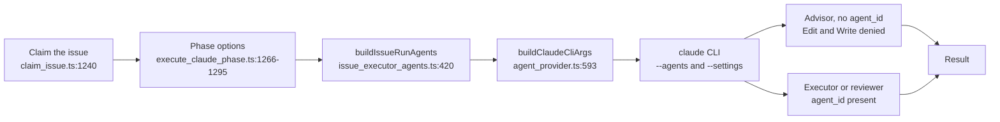
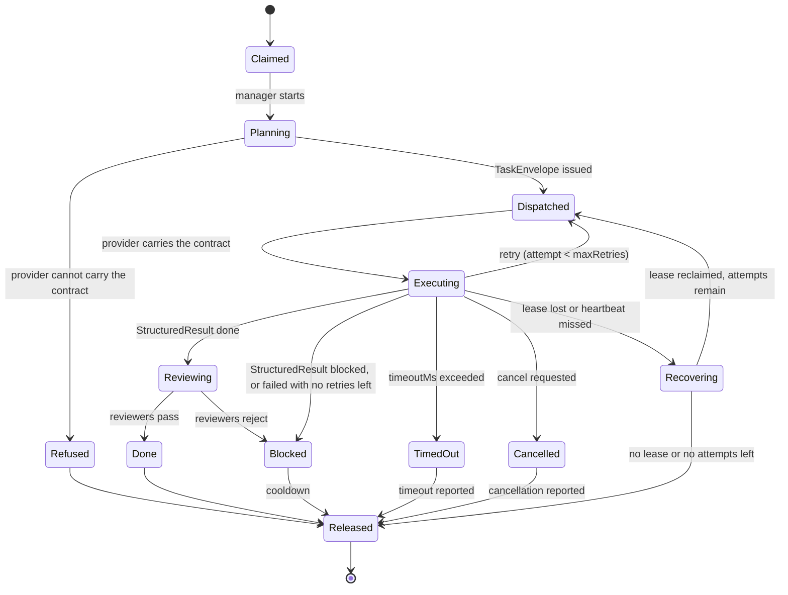
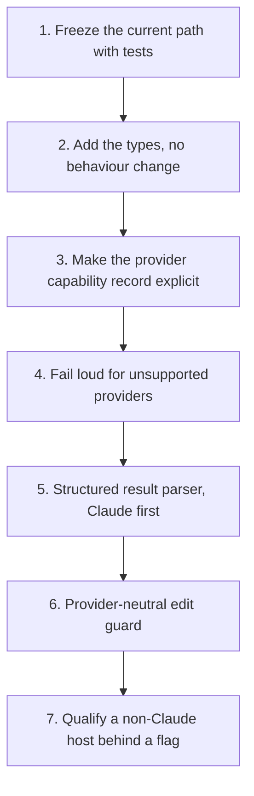

# Manager-worker contract (provider-neutral)

**Issue:** [#3641](https://github.com/stSoftwareAU/VibeCoder/issues/3641)

This page is the design contract for how a manager (the advisor that plans an
`issue`-phase run) hands work to executor and reviewer sub-agents, and how that
hand-off must stay the same whichever provider CLI runs the phase. It records
what the worker does today with citations, names the target contract, and sets
the order in which the pieces should land. It changes no runtime behaviour and
no default.

## 1. Purpose and scope

In scope: the `issue` phase's advisor/executor split, the reviewer sub-agents,
and the read-only explorer sub-agent, as they reach the four provider CLIs
(`claude`, `codex`, `gemini`, `deepseek`).

Out of scope: the planning, question, PR-feedback, CI-fix and quality-fix
phases, except where they share the provider seam; the billing policy itself
(see [Provider parity](PROVIDER-PARITY.md)); and the per-model cost tables (see
[Model, Caching & Batching](MODEL-AND-CACHING.md)).

## 2. Terminology

- **Vendor:** the company whose model is run (Anthropic, OpenAI, Google,
  DeepSeek).
- **Provider CLI:** the program the worker spawns for one invocation. The four
  are registered in `AGENT_PROVIDERS` (`worker/deno/lib/agent_provider.ts:1151`).
  A provider CLI is not a vendor. The `deepseek` child environment points
  `ANTHROPIC_BASE_URL` at DeepSeek's endpoint (`worker/deno/lib/deepseek_env.ts:157`),
  so the vendor and the CLI are different axes.
- **Model:** the identifier passed to a provider CLI for one phase, such as
  `sonnet`, `haiku` or `opus` for Claude. The `issue` default is
  `DEFAULT_CLAUDE_MODEL_ISSUE` (`worker/deno/lib/config_defaults.ts:1102`).
- **Subscription entitlement:** the right to run a model under a flat-rate
  subscription login rather than a metered API key. The worker withholds
  non-subscription credentials from subscription runs
  (`worker/deno/lib/claude_env.ts:177`).
- **Host-validated prerequisite:** a model that a provider has not shipped in
  the host's supported set. It must be validated on the host before any
  configuration names it. It is never a default. Astra and Sol availability is
  a prerequisite to validate per host, by checking that the CLI is installed
  and the account is entitled. It is never assumed. Until a host is validated,
  no routing changes for it.

## 3. Existing behaviour audit

Each row cites the file and line that was opened to verify it. Paths are
relative to the repository root.

| Area | Where | What it does today |
| --- | --- | --- |
| Split switch | `worker/deno/lib/issue_executor_split.ts:42-51` | `isIssueExecutorSplitEnabled` returns false unless the phase is `issue`. A repo boolean overrides the host value. |
| Host defaults | `worker/deno/lib/config_defaults.ts:505`, `:515`, `:521` | `issueExecutorSplit: true`, `issueSubAgentTier: "haiku"`, `issueReviewerAgents: true`. |
| Config load | `worker/deno/lib/config.ts:976-987` | Loads the three keys; the tier goes through `resolveHostIssueSubAgentTier`. |
| Production wiring | `worker/deno/commands/execute_claude_phase.ts:173-178` | Threads the host values into the phase options. |
| Tier resolution | `worker/deno/lib/issue_sub_agent_tier.ts:43`, `:72` | Host value first, then the `repo_config` override. |
| Executor definitions | `worker/deno/lib/issue_executor_agents.ts:37`, `:54`, `:114`, `:146` | Sonnet model constant, Haiku model constant, `["Agent"]` disallowed, `buildIssueExecutorAgents`. |
| Reviewer definitions | `worker/deno/lib/issue_executor_agents.ts:208`, `:296` | Read-only tools `Read`, `Grep`, `Glob`; `buildIssueReviewerAgents`. |
| Explorer definition | `worker/deno/lib/issue_executor_agents.ts:337`, `:374` | Haiku, read-only. Built only on the haiku tier (see assembly below). |
| Assembly | `worker/deno/lib/issue_executor_agents.ts:420-434` | `buildIssueRunAgents` returns `undefined` when the split is off, reviewers are off and the tier is not haiku (`:424-426`). The explorer is added only on the haiku tier (`:434`). |
| Phase wiring | `worker/deno/lib/execute_claude_phase.ts:1266-1295` | Resolves the split, then the tier (the `"sonnet"` fallback at `:1286` applies only when no option is passed), then calls `buildIssueRunAgents` at `:1295`. |
| Edit guard | `worker/deno/lib/issue_executor_enforcement.ts:47`, `:58`, `:124`, `:138` | Guarded tools are `Edit` and `Write`. A call with `agent_id` present (an executor) is allowed; a call without it (the advisor) is denied. |
| Hook settings | `worker/deno/lib/issue_executor_enforcement.ts:205`, `:240` | `buildIssueExecutorHookSettings` and `resolveIssueExecutorHookSettings` build the `--settings` payload. |
| Guard CLI | `worker/deno/lib/issue_edit_guard_cli.ts:46` | `runIssueEditGuard` is the hook entry point. |
| Flag delivery | `worker/deno/lib/agent_provider.ts:593`, `:614-615`, `:619-620`, `:635-636` | `buildClaudeCliArgs` emits `--agents` JSON, and `--settings` at two places. The `--settings` argument is emitted twice when `settingsJson` is set. This is recorded here and not fixed by this change. |
| Descriptor | `worker/deno/lib/agent_provider.ts:365`, `:373`, `:395`, `:410`, `:431`, `:444`, `:506`, `:515` | The `AgentProviderDescriptor` fields: `agents`, `settingsJson`, `promptTransport`, `buildInvocation`, `buildChildEnv`. |

Per-provider behaviour, from the same file:

- **Claude:** `promptTransport` is `"stdin"` (`agent_provider.ts:717`). Its
  `buildInvocation` is at `:745` and `buildChildEnv` at `:758`, which calls
  `buildClaudeChildEnv` (`worker/deno/lib/claude_env.ts:228`).
- **Codex:** `promptTransport` is `"stdin"` (`:850`). `buildInvocation` (`:867`)
  calls `buildCodexArgs` (`:890`) and carries no `agents` or `settingsJson`.
  `buildChildEnv` (`:913`) uses `buildCodexChildEnv` (`worker/deno/lib/codex_env.ts:90`).
- **Gemini:** `promptTransport` is `"argv"` (`:970`). `buildInvocation` (`:985`)
  calls `buildGeminiArgs` (`:987`) and carries no `agents` or `settingsJson`.
  `buildChildEnv` (`:1003`) uses `buildGeminiChildEnv` (`worker/deno/lib/gemini_env.ts:91`).
- **DeepSeek:** `promptTransport` is `"stdin"` (`:1064`). `buildInvocation`
  (`:1100`) removes `agents` and `settingsJson` (`:1117`). It warns only for
  `agents`, through `warnDeepSeekAgentsUnsupported` (`:1118`,
  `worker/deno/lib/deepseek_executor.ts:253`). `settingsJson` is dropped
  silently (`:1129`). `buildChildEnv` (`:1135`) uses `buildDeepSeekChildEnv`
  (`worker/deno/lib/deepseek_env.ts:157`).

DeepSeek strips both `agents` and `settingsJson`
(`worker/deno/lib/agent_provider.ts:1117-1118`). It warns only for `agents`,
through `warnDeepSeekAgentsUnsupported`, and drops `settingsJson` silently
(`worker/deno/lib/agent_provider.ts:1129`).

Lifecycle entry points are covered in section 5.

The issue owner states that the PR reviewer stays on Opus. The code has no
`pr_review` key: `PHASE_MODEL_DEFAULTS` (`worker/deno/lib/config_defaults.ts:1222-1239`)
does not list one. PR feedback and review runs use the host `claude_model`
(`worker/deno/lib/pr_feedback_processor.ts:764`, `processorDeps.claudeModel ??
DEFAULT_CLAUDE_MODEL`), which defaults to `DEFAULT_CLAUDE_MODEL = "opus"`
(`worker/deno/lib/config_defaults.ts:968`, and `worker/deno/lib/config.ts:596`).
The comment above `DEFAULT_CLAUDE_MODEL_ISSUE` (`worker/deno/lib/config_defaults.ts:1094-1096`)
records the intent.

## 4. Target contract

The target is a provider-neutral contract between the manager and each
sub-agent. It is described below and sketched in TypeScript. Nothing in this
section exists in the worker yet.

### Role contracts

| Role | Duty | Tools | Today (Claude) |
| --- | --- | --- | --- |
| Manager | Plans, dispatches, verifies. Read-only for edits. | Full read, dispatch | Advisor. `Edit` and `Write` are denied when `agent_id` is absent, by the #2344 `PreToolUse` hook delivered via `--settings`. Enforced on Claude only today. |
| Executor | Makes the mechanical edits in one unit of work. | Edit, Write, read tools. No dispatch. | `buildIssueExecutorAgents`, with `Agent` disallowed. |
| Spec reviewer | Checks the change against the issue. Read-only. | `Read`, `Grep`, `Glob` | `buildIssueReviewerAgents`. |
| Standards reviewer | Checks the change against the standards. Read-only. | `Read`, `Grep`, `Glob` | `buildIssueReviewerAgents`. |
| Explorer | Answers a narrow question about the repository. Read-only. | `Read`, `Grep`, `Glob` | `buildIssueExplorerAgents`, haiku tier only. |

### Task envelope and structured result

The manager sends one `TaskEnvelope` per unit of work. The worker returns one
`StructuredResult`. Both are plain data, so any provider can carry them. The
result must be checked by the host before the manager acts on it.

The shapes below are the *target* shape. They are not code that exists today.

```ts
// Target, not implemented. Sketch only (Issue #3641).
// No file under worker/deno/lib defines these names yet.

export type TargetRole =
  | "manager"
  | "executor"
  | "spec_reviewer"
  | "standards_reviewer"
  | "explorer";

export type TargetProvider = "claude" | "codex" | "gemini" | "deepseek";

export interface TaskEnvelope {
  readonly role: TargetRole;
  readonly provider: TargetProvider;
  // Host-validated before it is named here. Never a default.
  readonly model: string;
  readonly effort: "low" | "medium" | "high";
  readonly allowedTools: readonly string[];
  readonly deniedTools: readonly string[];
  readonly workspaceDir: string;
  // The manager's instruction for this one unit of work.
  readonly brief: string;
  // The issue this unit of work belongs to.
  readonly issueId: string;
  // The branch the executor works on.
  readonly branch: string;
  // Rules the executor must not break.
  readonly constraints: readonly string[];
  // Checks the result must meet before the manager accepts it.
  readonly acceptanceCriteria: readonly string[];
  // Conditions that end the attempt early, for example budget exhausted, refusal, or blocked on dependency.
  readonly stopConditions: readonly string[];
  // Retries allowed after the first attempt.
  readonly maxRetries: number;
  // Wall-clock limit for one attempt, in milliseconds.
  readonly timeoutMs: number;
  // Identifier of the lease that grants this dispatch.
  readonly leaseId: string;
  // ISO 8601 time after which the lease is lost unless renewed.
  readonly leaseExpiresAt: string;
  // Interval between executor heartbeats, in milliseconds.
  readonly heartbeatIntervalMs: number;
}

export interface StructuredResult {
  readonly role: TargetRole;
  readonly status: "done" | "blocked" | "failed" | "cancelled" | "timed_out";
  readonly filesChanged: readonly string[];
  readonly summary: string;
  // Command output or test names that back the summary.
  readonly evidence: readonly string[];
}

export interface ProviderCapabilities {
  readonly agents: boolean;
  readonly settingsHook: boolean;
  readonly compaction: boolean;
  readonly promptTransport: "stdin" | "argv";
}
```

## 5. Lifecycle

### Exists today

The diagram below shows the path a Claude `issue` run takes today. It reads
from the claim through the advisor and its sub-agents to the result.



Supporting lifecycle code, each cited from the file it lives in:

- `worker/deno/lib/claude_runner.ts:1126` `runClaudeWithTimeout` runs the CLI
  under a timeout.
- `worker/deno/lib/claim_issue.ts:471` `findLiveHeartbeatMarker` and `:1784`
  `releaseClaimWithCooldown` cover the heartbeat and release.
- `worker/deno/lib/pr_review_claim_lease.ts:70` `isLeaseLive` and `:102`
  `createClaimLeaseRenewer` cover the lease used by PR review.
- `worker/deno/lib/stream_compaction.ts:67-70` lists the compactable
  providers (`claude` and `deepseek` only). `:160` is `supportsCompaction`.
- `worker/deno/lib/session_resume.ts:132` `recordPhaseCompletion`, `:216`
  `buildSessionResumeArgs` and `:233` `sessionResumeForProvider` cover resume.

### Target

The target adds an explicit state for the provider check, so an unsupported
provider is refused before any sub-agent starts. It also adds retries,
cancellation, timeouts, leases with heartbeats, and recovery. These are target
behaviour, not code that exists today.



- **Executing to Dispatched (retry).** A failed attempt is dispatched again
  while the attempt count is below `maxRetries`.
- **Executing to TimedOut.** The attempt ran past `timeoutMs`. It is stopped
  and released with the timeout reported. This diagram does not retry it.
- **Executing to Cancelled.** A cancel request stops the attempt. It is
  released with the cancellation reported and is not reviewed.
- **Executing to Recovering.** The lease lapsed or no heartbeat arrived within
  `heartbeatIntervalMs`. The host treats the executor as gone and starts
  recovery.
- **Recovering to Dispatched.** The host takes a fresh lease and dispatches
  again, while attempts remain.
- **Recovering to Released.** No lease can be reclaimed, or no attempts remain.
  The claim is released.
- **TimedOut or Cancelled to Released.** Terminal paths. The reason is recorded
  on release.

## 6. Permissions and credential isolation

- **Advisor cannot edit.** The edit guard denies `Edit` and `Write` when
  `agent_id` is absent (`worker/deno/lib/issue_executor_enforcement.ts:124`,
  `:138`). The hook is delivered through `--settings`, which only the Claude
  provider carries.
- **Executors cannot dispatch.** `["Agent"]` is disallowed for executors
  (`worker/deno/lib/issue_executor_agents.ts:114`). The reviewers and explorer
  are read-only.
- **Credentials are scrubbed per provider.** Each provider builds its own child
  environment.
  - Claude: `withholdNonSubscriptionCredentials` (`worker/deno/lib/claude_env.ts:177`)
    keeps non-subscription credentials out of subscription runs.
  - Codex: `buildIsolatedCodexChildEnv` (`worker/deno/lib/codex_env.ts:116`)
    deletes `OPENAI_API_KEY`, `CODEX_API_KEY` and `CODEX_HOME`, and fails closed
    when a Codex home is selected.
  - DeepSeek: `ANTHROPIC_AUTH_TOKEN` is set only from `DEEPSEEK_API_KEY`
    (`worker/deno/lib/deepseek_env.ts:157`).
  - Gemini: `buildGeminiChildEnv` (`worker/deno/lib/gemini_env.ts:91`) delegates to
    `buildAgentChildEnv` with a Gemini denylist and secret allowlist.
- **The gap today.** The edit guard exists only for Claude. Codex and Gemini
  drop `agents` and `settingsJson` silently, and DeepSeek drops `settingsJson`
  silently. An executor split on those providers therefore has no edit guard
  and no executor definitions, with no error raised. The target closes this
  with a refusal (section 8).

## 7. Compatibility matrix

Compatibility with the split switched on. "Silent" means no warning is logged.

| Provider | Prompt transport | `--agents` | `--settings` (edit guard) | `supportsCompaction` | Behaviour with split on |
| --- | --- | --- | --- | --- | --- |
| `claude` | stdin (`agent_provider.ts:717`) | Emitted (`:614-615`) | Emitted (`:619-620`) | Yes (`stream_compaction.ts:67-70`) | Executors defined; edit guard active. |
| `codex` | stdin (`:850`) | Not carried, silent | Not carried, silent | No | No executor definitions; no edit guard. |
| `gemini` | argv (`:970`) | Not carried, silent | Not carried, silent | No | No executor definitions; no edit guard. |
| `deepseek` | stdin (`:1064`) | Stripped, warned (`:1117-1118`) | Stripped, silent (`:1117`, `:1129`) | Yes | No executor definitions; warning for `agents` only. No edit guard. |

Unconfirmed for every non-Claude row: whether the advisor/executor prompt block
renders on that provider. The block renders from the split switch and is not
checked against the provider here.

## 8. Rollout and safeguards

- **Flags.** `issue_executor_split` (repo and host), `issue_sub_agent_tier`
  (`haiku` or `sonnet`, with a repo override) and `issue_reviewer_agents` (host
  only). See [Configuration Reference](CONFIGURATION.md), rows for these keys.
- **Invariant (target).** A provider that cannot carry the contract fails loud
  when the split is on. It is refused before any sub-agent starts, and the run
  reports why. This is a behaviour change and is not part of this document's
  implementation.
- **Current state.** Codex and Gemini drop agents silently, and DeepSeek drops
  `settingsJson` silently (section 3). The invariant is not yet true.
- **No default change.** `issue_executor_split` stays `true`,
  `issue_sub_agent_tier` stays `"haiku"` and `issue_reviewer_agents` stays
  `true`. Nothing in the rollout changes them.
- **Rollback.** Setting `issue_executor_split: false` and
  `issue_reviewer_agents: false` alone does not remove `--agents` on the default
  `haiku` tier. `buildIssueRunAgents` (`worker/deno/lib/issue_executor_agents.ts:420-434`)
  still adds the explorer definition from `buildIssueExplorerAgents()`
  (`worker/deno/lib/issue_executor_agents.ts:374`) when `issue_sub_agent_tier`
  is `"haiku"`. A full rollback to no `--agents` argument also sets
  `issue_sub_agent_tier: "sonnet"`. The run is then a single session, as it was
  before the split.

## 9. Incremental implementation order

Each step lands on its own and is verified before the next starts.



1. Freeze the current path with the tests in section 10.
2. Add the `TaskEnvelope` and `StructuredResult` types. No behaviour changes.
3. Make the `ProviderCapabilities` record explicit by wrapping the
   `AgentProviderDescriptor` fields.
4. Refuse unsupported providers loudly when the split is on. This is the first
   behaviour change, and it sits behind the existing flags.
5. Add a parser for the structured result, Claude first.
6. Port the edit-guard decision to a provider-neutral check. Keep the Claude
   hook as the enforcement mechanism for that provider.
7. Qualify a non-Claude host behind a flag. Defaults stay unchanged until the
   host passes qualification.

## 10. Tests protecting the current path

These tests cover the behaviour this document describes. Each file was
confirmed to exist under `worker/deno/tests/`.

- `worker/deno/tests/manager_worker_contract_3641_test.ts` (added for this issue)
- `worker/deno/tests/issue_executor_split_test.ts`
- `worker/deno/tests/readme_docs_reachability_test.ts`
- `worker/deno/tests/agent_provider_readme_docs_test.ts`
- `worker/deno/tests/config_docs_consistency_test.ts`

## 11. Related issues

- [#2320](https://github.com/stSoftwareAU/VibeCoder/issues/2320): the parent
  advisor/executor pilot.
- [#2341](https://github.com/stSoftwareAU/VibeCoder/issues/2341): the split
  executor switch.
- [#2342](https://github.com/stSoftwareAU/VibeCoder/issues/2342): the
  `--agents` definitions for the split.
- [#2343](https://github.com/stSoftwareAU/VibeCoder/issues/2343): the
  advisor/executor prompt block.
- [#2344](https://github.com/stSoftwareAU/VibeCoder/issues/2344): the edit
  guard hook delivered through `--settings`.
- [#2575](https://github.com/stSoftwareAU/VibeCoder/issues/2575): the reviewer
  sub-agents.
- [#2812](https://github.com/stSoftwareAU/VibeCoder/issues/2812): the split and
  reviewers turned on by default.
- [#3402](https://github.com/stSoftwareAU/VibeCoder/issues/3402): the
  `issue_sub_agent_tier` key.
- [#3473](https://github.com/stSoftwareAU/VibeCoder/issues/3473): the Sonnet
  manager over Haiku executors.
- [#3801](https://github.com/stSoftwareAU/VibeCoder/issues/3801): defaults the
  `issue` phase to a Sonnet manager (high effort) over Haiku executors (merged;
  decision recorded under #3473).
