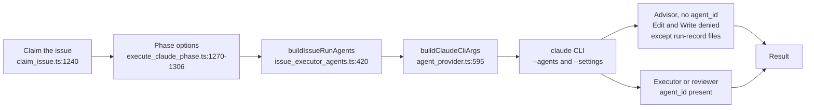
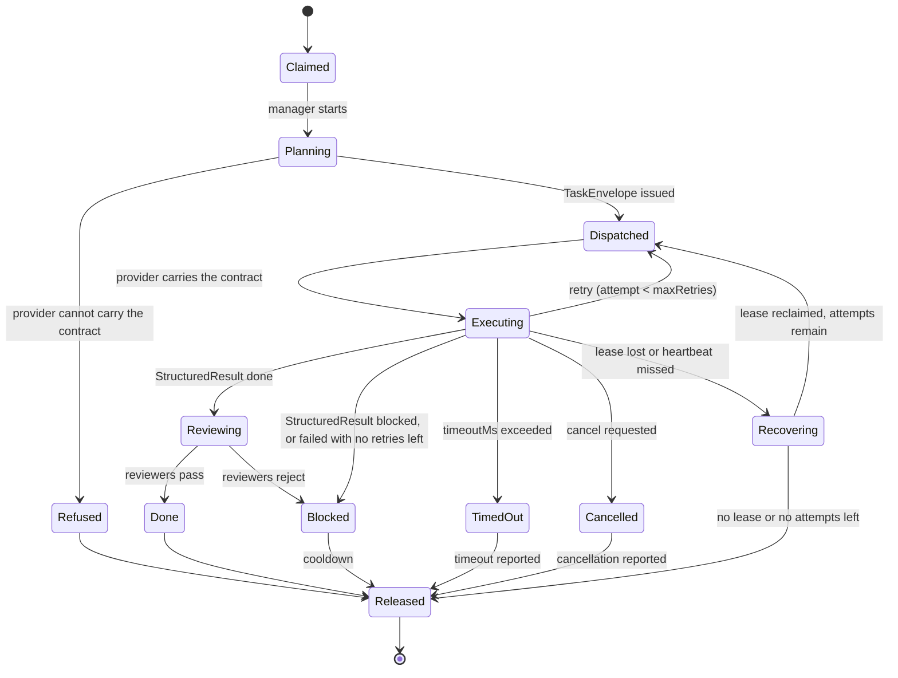
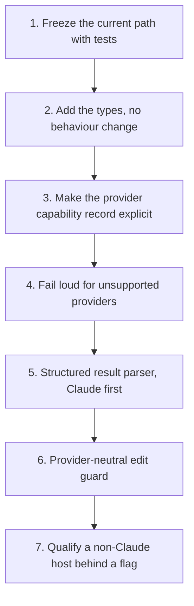

# Manager-worker contract (provider-neutral)

**Issue:** [#3641](https://github.com/stSoftwareAU/VibeCoder/issues/3641);
the review-gate audit and the fail-loud rollout below were completed by
[#3933](https://github.com/stSoftwareAU/VibeCoder/issues/3933).

The original audit below predates the opt-in implementation.
[Role configuration](ROLE-CONFIGURATION.md) documents the runtime delivered
for independent role selection, its supported adapters and rollback.

This page is the design contract for how a manager (the advisor that plans an
`issue`-phase run) hands work to executor and reviewer sub-agents, and how that
hand-off must stay the same whichever provider CLI runs the phase. It records
what the worker does today with citations, names the target contract, and sets
the order in which the pieces should land. The original contract changed no runtime behaviour or default.

## 1. Purpose and scope

In scope: the `issue` phase's advisor/executor split, the reviewer sub-agents,
and the read-only explorer sub-agent, as they reach the four provider CLIs
(`claude`, `codex`, `gemini`, `deepseek`).

Out of scope: the planning, question, PR-feedback, CI-fix and quality-fix
phases, except where they share the provider seam; the billing policy itself
(see [Provider parity](PROVIDER-PARITY.md)); and the per-model cost tables (see
[Model, Caching & Batching](MODEL-AND-CACHING.md)).

## 2. Terminology

- **Vendor:** the company whose model is run (Anthropic, OpenAI, Google,
  DeepSeek).
- **Provider CLI:** the program the worker spawns for one invocation. The four
  are registered in `AGENT_PROVIDERS` (`worker/deno/lib/agent_provider.ts:1154`).
  A provider CLI is not a vendor. The `deepseek` child environment points
  `ANTHROPIC_BASE_URL` at DeepSeek's endpoint (`worker/deno/lib/deepseek_env.ts:166-167`),
  so the vendor and the CLI are different axes.
- **Model:** the identifier passed to a provider CLI for one phase, such as
  `sonnet`, `haiku` or `opus` for Claude. The `issue` default is
  `DEFAULT_CLAUDE_MODEL_ISSUE` (`worker/deno/lib/config_defaults.ts:1102`).
- **Subscription entitlement:** the right to run a model under a flat-rate
  subscription login rather than a metered API key. The worker withholds
  non-subscription credentials from subscription runs
  (`worker/deno/lib/claude_env.ts:177`).
- **Host-validated prerequisite:** a model that a provider has not shipped in
  the host's supported set. It must be validated on the host before any
  configuration names it. It is never a default. Astra and Sol availability is
  a prerequisite to validate per host, by checking that the CLI is installed
  and the account is entitled. It is never assumed. Until a host is validated,
  no routing changes for it.

## 3. Original behaviour audit (before independent role dispatch)

Each row cites the file and line that was opened to verify it. Paths are
relative to the repository root.

| Area | Where | What it does today |
| --- | --- | --- |
| Split switch | `worker/deno/lib/issue_executor_split.ts:42-51` | `isIssueExecutorSplitEnabled` returns false unless the phase is `issue`. A repo boolean overrides the host value. |
| Host defaults | `worker/deno/lib/config_defaults.ts:505`, `:515`, `:521` | `issueExecutorSplit: true`, `issueSubAgentTier: "haiku"`, `issueReviewerAgents: true`. |
| Config load | `worker/deno/lib/config.ts:976-987` | Loads the three keys; the tier goes through `resolveHostIssueSubAgentTier`. |
| Production wiring | `worker/deno/commands/execute_claude_phase.ts:173-178` | Threads the host values into the phase options. |
| Tier resolution | `worker/deno/lib/issue_sub_agent_tier.ts:43`, `:72` | Host value first, then the `repo_config` override. |
| Executor definitions | `worker/deno/lib/issue_executor_agents.ts:37`, `:54`, `:114`, `:146` | Sonnet model constant, Haiku model constant, `["Agent"]` disallowed, `buildIssueExecutorAgents`. |
| Reviewer definitions | `worker/deno/lib/issue_executor_agents.ts:208`, `:296` | Read-only tools `Read`, `Grep`, `Glob`; `buildIssueReviewerAgents`. |
| Explorer definition | `worker/deno/lib/issue_executor_agents.ts:337`, `:374` | Haiku, read-only. Built only on the haiku tier (see assembly below). |
| Assembly | `worker/deno/lib/issue_executor_agents.ts:420-434` | `buildIssueRunAgents` returns `undefined` when the split is off, reviewers are off and the tier is not haiku (`:424-426`). The explorer is added only on the haiku tier (`:434`). |
| Phase wiring | `worker/deno/lib/execute_claude_phase.ts:1270-1306` | Resolves the split (`:1282-1286`), then the tier (the `"sonnet"` fallback at `:1291` applies only when no option is passed), then calls `buildIssueRunAgents` at `:1300`. |
| Edit guard | `worker/deno/lib/issue_executor_enforcement.ts:47`, `:58`, `:124`, `:138` | Guarded tools are `Edit` and `Write`. A call with `agent_id` present (an executor) is allowed. A call without it (the advisor) is denied, unless its `file_path` is one of the advisor's own run-record files (`isAdvisorRunRecordPath`, `:98`, `:142-145`): the PR summary `docs/archive/pr-summaries/pr-summary-<issue>.md` or the PR-feedback reply file `.pr_response_message`. |
| Hook settings | `worker/deno/lib/issue_executor_enforcement.ts:205`, `:240` | `buildIssueExecutorHookSettings` and `resolveIssueExecutorHookSettings` build the `--settings` payload. |
| Guard CLI | `worker/deno/lib/issue_edit_guard_cli.ts:46` | `runIssueEditGuard` is the hook entry point. |
| Flag delivery | `worker/deno/lib/agent_provider.ts:595` (`buildClaudeCliArgs`), `:617-618`, `:622-623`, `:638-639` | `buildClaudeCliArgs` emits `--agents` JSON (`:617-618`), and `--settings` at two places (`:622-623`, `:638-639`). The `--settings` argument is emitted twice when `settingsJson` is set. This is recorded here and not fixed by this change. |
| Descriptor | `worker/deno/lib/agent_provider.ts:373` (`agents`), `:412` (`settingsJson`), `:446` (`promptTransport`), `:508` (`buildInvocation`), `:517` (`buildChildEnv`) | The `AgentProviderDescriptor` fields. |

Per-provider behaviour, from the same file:

- **Claude:** `promptTransport` is `"stdin"` (`agent_provider.ts:720`). Its
  `buildInvocation` is at `:748` and `buildChildEnv` at `:761-762`, which calls
  `buildClaudeChildEnv` (`worker/deno/lib/claude_env.ts:228`).
- **Codex:** `promptTransport` is `"stdin"` (`:853`). `buildInvocation` (`:870`)
  calls `buildCodexArgs` (`:893`, defined at `worker/deno/lib/codex_executor.ts:343`)
  and carries no `agents` or `settingsJson`. `buildChildEnv` (`:916`) calls
  `buildIsolatedCodexChildEnv` (`worker/deno/lib/codex_env.ts:116`), which calls
  `buildCodexChildEnv` (`worker/deno/lib/codex_env.ts:90`).
- **Gemini:** `promptTransport` is `"argv"` (`:973`). `buildInvocation` (`:988`)
  calls `buildGeminiArgs` (`:990`, defined at `worker/deno/lib/gemini_executor.ts:251`)
  and carries no `agents` or `settingsJson`. `buildChildEnv` (`:1006`) uses
  `buildGeminiChildEnv` (`worker/deno/lib/gemini_env.ts:91`).
- **DeepSeek:** `promptTransport` is `"stdin"` (`:1067`). `buildInvocation`
  (`:1103`) destructures out `agents` and `settingsJson` (`:1120`). `agents`
  triggers `warnDeepSeekAgentsUnsupported` (`:1121`,
  `worker/deno/lib/deepseek_executor.ts:253`). `settingsJson` is dropped
  silently, with `settingsJson: undefined` at `:1132`. `buildChildEnv` (`:1138`)
  uses `buildDeepSeekChildEnv` (`worker/deno/lib/deepseek_env.ts:157`).

Prompt templates. The advisor and executor instructions are built in code, and
the template carries only a placeholder.

- The block is `ISSUE_EXECUTOR_SPLIT_INSTRUCTIONS`
  (`worker/deno/lib/issue_executor_split_prompt.ts:27`).
- `buildPrompt` splices it into `{{EXECUTOR_SPLIT_INSTRUCTIONS}}` when the split
  is on, and renders the empty string otherwise
  (`worker/deno/lib/prompt_builder.ts:718-728`, `:782`, `:832-834`).
- It warns when a split run's template lacks the placeholder (`prompt_builder.ts:845-856`).
- The placeholder is optional for the `issue` template
  (`worker/deno/lib/prompt_manager.ts:259-270`, `:267`).
- The shipped template carries it at `prompts/issue/prompt.md:405`. A
  case-insensitive grep of `prompts/` for `executor` finds no other advisor or
  executor instruction text. `prompts/coding_guidelines/prompt.md:72` names the
  section only.

Lifecycle entry points are covered in section 5.

### Review gates

The audit list's "review gates" area covers more than the two reviewer
sub-agents. Each row below was opened to verify it, and the citations are
current.

| Gate | Where | What it does today |
| --- | --- | --- |
| Reviewer sub-agents | `worker/deno/lib/issue_executor_agents.ts:296` | `buildIssueReviewerAgents` builds the spec and standards reviewers as read-only — `ISSUE_REVIEWER_TOOLS` is `Read`, `Grep`, `Glob` (`:208`) and `ISSUE_REVIEWER_DISALLOWED_TOOLS` is `Agent` (`:214`) — delivered through `--agents` on Claude only. |
| Issue-reviewer switch | `worker/deno/lib/config.ts:1013-1014` | `issue_reviewer_agents` (host only, default `true`) toggles the two reviewer definitions. |
| PR review claim lease | `worker/deno/lib/pr_review_claim_lease.ts:29`, `:33`, `:70`, `:102` | A `pr_review` claim comment is a lease, not a dismissal. `createClaimLeaseRenewer` (`:102`) renews it every `PR_REVIEW_CLAIM_RENEW_MS` (five minutes, `:33`) by editing the comment body, and `isLeaseLive` (`:70`) deems it live while its last beat is inside `PR_REVIEW_CLAIM_LEASE_MS` (`:29`, the fleet heartbeat live window). A host that stops renewing lets the lease lapse, and the review becomes reclaimable by another host. |
| Post-PR reviewer model | `worker/deno/lib/pr_feedback_processor.ts:803`, `worker/deno/lib/config_defaults.ts:982` | PR feedback and review runs use the host `claude_model`, defaulting to `DEFAULT_CLAUDE_MODEL = "opus"`. |
| External review gate | `worker/deno/lib/orchestration/issue_run_gate.ts:178`, `worker/deno/lib/orchestration/capabilities.ts:130` | With external orchestration on, the reviewer is a separate read-only call that fails closed before any paid work: `assertRoleSupported` (`:130`) refuses an unsupported provider or a tool denial it cannot enforce, and the subscription/CLI preflight (`worker/deno/lib/orchestration/preflight.ts:11`) refuses a missing CLI, unproved entitlement or exhausted quota. An unsupported reviewer provider is refused, not run. |

The owner stated that the PR reviewer stays on Opus. The code has no `pr_review`
key: `PHASE_MODEL_DEFAULTS` (`worker/deno/lib/config_defaults.ts:1236`) does not
list one, so PR feedback and review runs fall back to the host `claude_model`,
which defaults to `DEFAULT_CLAUDE_MODEL = "opus"`
(`worker/deno/lib/config_defaults.ts:982`). The comment above
`DEFAULT_CLAUDE_MODEL_ISSUE` (`worker/deno/lib/config_defaults.ts:1110-1113`)
records the intent — Opus review is what keeps merged quality high while the
run itself is a Sonnet manager over Haiku executors.

## 4. Target contract

The target is a provider-neutral contract between the manager and each
sub-agent. It is described below and sketched in TypeScript. This section records the original target rather than the current runtime API;
see [Role configuration](ROLE-CONFIGURATION.md) for the implementation.

### Role contracts

| Role | Duty | Tools | Today (Claude) |
| --- | --- | --- | --- |
| Manager | Plans, dispatches, verifies. Read-only for edits. | Full read, dispatch | Advisor. `Edit` and `Write` are denied when `agent_id` is absent (except on the advisor's own run-record files), by the #2344 `PreToolUse` hook delivered via `--settings`. Enforced on Claude only today. |
| Executor | Makes the mechanical edits in one unit of work. | Edit, Write, read tools, scoped to `workspaceDir`. No further delegation. | `buildIssueExecutorAgents`, with `Agent` disallowed. |
| Spec reviewer | Checks the change against the issue. Read-only. | `Read`, `Grep`, `Glob` | `buildIssueReviewerAgents`. |
| Standards reviewer | Checks the change against the standards. Read-only. | `Read`, `Grep`, `Glob` | `buildIssueReviewerAgents`. |
| Explorer | Answers a narrow question about the repository. Read-only. | `Read`, `Grep`, `Glob` | `buildIssueExplorerAgents`, haiku tier only. |

### Task envelope and structured result

The manager sends one `TaskEnvelope` per unit of work. The worker returns one
`StructuredResult`. Both are plain data, so any provider can carry them. The
result must be checked by the host before the manager acts on it.

The shapes below are the original target sketch, not the runtime API.

```ts
// Original contract sketch (Issue #3641); runtime types live under lib/orchestration/.

export type TargetRole =
  | "manager"
  | "executor"
  | "spec_reviewer"
  | "standards_reviewer"
  | "explorer";

export type TargetProvider = "claude" | "codex" | "gemini" | "deepseek";

export interface TaskEnvelope {
  readonly role: TargetRole;
  readonly provider: TargetProvider;
  // Host-validated before it is named here. Never a default.
  readonly model: string;
  readonly effort: "low" | "medium" | "high";
  readonly allowedTools: readonly string[];
  readonly deniedTools: readonly string[];
  readonly workspaceDir: string;
  // The manager's instruction for this one unit of work.
  readonly brief: string;
  // The issue this unit of work belongs to.
  readonly issueId: string;
  // The branch the executor works on.
  readonly branch: string;
  // Rules the executor must not break.
  readonly constraints: readonly string[];
  // Checks the result must meet before the manager accepts it.
  readonly acceptanceCriteria: readonly string[];
  // Conditions that end the attempt early, for example budget exhausted, refusal, or blocked on dependency.
  readonly stopConditions: readonly string[];
  // Retries allowed after the first attempt.
  readonly maxRetries: number;
  // Wall-clock limit for one attempt, in milliseconds.
  readonly timeoutMs: number;
  // Identifier of the lease that grants this dispatch.
  readonly leaseId: string;
  // ISO 8601 time after which the lease is lost unless renewed.
  readonly leaseExpiresAt: string;
  // Interval between executor heartbeats, in milliseconds.
  readonly heartbeatIntervalMs: number;
}

export interface StructuredResult {
  readonly role: TargetRole;
  readonly status: "done" | "blocked" | "failed" | "cancelled" | "timed_out";
  readonly filesChanged: readonly string[];
  readonly summary: string;
  // Command output or test names that back the summary.
  readonly evidence: readonly string[];
}

export interface ProviderCapabilities {
  readonly agents: boolean;
  readonly settingsHook: boolean;
  readonly compaction: boolean;
  readonly promptTransport: "stdin" | "argv";
}
```

## 5. Lifecycle

### Original native path

The diagram below shows the path a Claude `issue` run takes today. It reads
from the claim through the advisor and its sub-agents to the result.



Supporting lifecycle code, each cited from the file it lives in:

- `worker/deno/lib/claude_runner.ts:1126` `runClaudeWithTimeout` runs the CLI
  under a timeout.
- `worker/deno/lib/claim_issue.ts:471` `findLiveHeartbeatMarker` and `:1784`
  `releaseClaimWithCooldown` cover the heartbeat and release.
- `worker/deno/lib/pr_review_claim_lease.ts:70` `isLeaseLive` and `:102`
  `createClaimLeaseRenewer` cover the lease used by PR review.
- `worker/deno/lib/stream_compaction.ts:67-70` lists the compactable
  providers (`claude` and `deepseek` only). `:160` is `supportsCompaction`.
- **Session persistence and resume.** `worker/deno/lib/session_resume.ts:132`
  `recordPhaseCompletion` increments the phase count on a session-state record
  (called from `worker/deno/lib/planning_processor.ts:1872`). `:216`
  `buildSessionResumeArgs` returns the `--resume` or `--session-id` arguments.
  `:233-247` `sessionResumeForProvider` filters the stored state to the calling
  provider. A state tagged with another `providerId` is dropped (`:238`). An
  untagged legacy state is kept only for `claude` or `deepseek` (`:239-245`).
  DeepSeek calls it at `worker/deno/lib/agent_provider.ts:1125-1128`. Compaction
  is a separate path (`stream_compaction.ts:67-70`, see section 7).

### Target

The target adds an explicit state for the provider check, so an unsupported
provider is refused before any sub-agent starts. It also adds retries,
cancellation, timeouts, leases with heartbeats, and recovery. These are target
behaviour, not code that exists today.



- **Executing to Dispatched (retry).** A failed attempt is dispatched again
  while the attempt count is below `maxRetries`.
- **Executing to TimedOut.** The attempt ran past `timeoutMs`. It is stopped
  and released with the timeout reported. This diagram does not retry it.
- **Executing to Cancelled.** A cancel request stops the attempt. It is
  released with the cancellation reported and is not reviewed.
- **Executing to Recovering.** The lease lapsed or no heartbeat arrived within
  `heartbeatIntervalMs`. The host treats the executor as gone and starts
  recovery.
- **Recovering to Dispatched.** The host takes a fresh lease and dispatches
  again, while attempts remain.
- **Recovering to Released.** No lease can be reclaimed, or no attempts remain.
  The claim is released.
- **TimedOut or Cancelled to Released.** Terminal paths. The reason is recorded
  on release.

## 6. Permissions and credential isolation

- **Advisor cannot edit.** The edit guard denies `Edit` and `Write` when
  `agent_id` is absent (`worker/deno/lib/issue_executor_enforcement.ts:124`,
  `:138`), except on the advisor's own run-record files: the PR summary and
  the PR-feedback reply file are allowed without `agent_id` (`:142-145`). The
  hook is delivered through `--settings`, which only the Claude provider
  carries.
- **Executors cannot dispatch.** `["Agent"]` is disallowed for executors
  (`worker/deno/lib/issue_executor_agents.ts:114`). The reviewers and explorer
  are read-only.
- **Target: no recursive delegation.** Today every sub-agent definition
  disallows `Agent`: the executor
  (`worker/deno/lib/issue_executor_agents.ts:114`), the reviewers (`:214`)
  and the explorer (`:349`). This is enforced only by the Claude `--agents`
  payload. In the target, every provider adapter that runs a worker must
  enforce that a worker cannot dispatch further workers. An adapter that
  cannot enforce it is refused (section 8), not run with delegation open.
- **Target: executor workspace is scoped.** Today sub-agents run inside the
  advisor's single CLI process, so they share its working directory. The CLI
  is spawned with one `cwd` (`worker/deno/lib/claude_runner.ts:1369`), and
  there is no per-executor workspace. In the target, the manager hands each
  executor a `workspaceDir` in the task envelope (section 4). The executor's
  edits and commands are confined to it, and the manager stays read-only.
- **Credentials are scrubbed per provider.** Each provider builds its own child
  environment.
  - Claude: `withholdNonSubscriptionCredentials` (`worker/deno/lib/claude_env.ts:177`)
    keeps non-subscription credentials out of subscription runs.
  - Codex: `buildIsolatedCodexChildEnv` (`worker/deno/lib/codex_env.ts:116`)
    deletes `OPENAI_API_KEY`, `CODEX_API_KEY` and `CODEX_HOME`, and fails closed
    when a Codex home is selected.
  - DeepSeek: `ANTHROPIC_AUTH_TOKEN` is set only from `DEEPSEEK_API_KEY`
    (`worker/deno/lib/deepseek_env.ts:172-173`).
  - Gemini: `buildGeminiChildEnv` (`worker/deno/lib/gemini_env.ts:91`) delegates to
    `buildAgentChildEnv` with a Gemini denylist and secret allowlist.
- **The gap today.** The edit guard exists only for Claude. Codex and Gemini
  drop `agents` and `settingsJson` silently, and DeepSeek drops `settingsJson`
  silently. An executor split on those providers therefore has no edit guard
  and no executor definitions, with no error raised. The target closes this
  with a refusal (section 8).

## 7. Compatibility matrix

Compatibility with the split switched on. "Silent" means no warning is logged.

| Provider | Prompt transport | `--agents` | `--settings` (edit guard) | `supportsCompaction` | Behaviour with split on |
| --- | --- | --- | --- | --- | --- |
| `claude` | stdin (`agent_provider.ts:720`) | Emitted (`:617-618`) | Emitted (`:622-623`) | Yes (`stream_compaction.ts:67-70`) | Prompt block renders; executors defined; edit guard active. |
| `codex` | stdin (`:853`) | Not carried, silent | Not carried, silent | No | Prompt block renders; no executor definitions; no edit guard. |
| `gemini` | argv (`:973`) | Not carried, silent | Not carried, silent | No | Prompt block renders; no executor definitions; no edit guard. |
| `deepseek` | stdin (`:1067`) | Stripped, warned (`:1120-1121`) | Stripped, silent (`:1120`, `:1132`) | Yes | Prompt block renders; no executor definitions; warning for `agents` only. No edit guard. |

**The prompt block renders on every provider (confirmed).** The advisor/executor
block is not gated on the provider. `isIssueExecutorSplitEnabled` takes the
phase, repo and host config only (`worker/deno/lib/issue_executor_split.ts:42-59`).
Both phase paths call it with no provider argument
(`worker/deno/lib/execute_claude_phase.ts:1282-1286`,
`worker/deno/lib/phases/execute_phase.ts:665-669`) and pass the result to
`buildPrompt` (`execute_claude_phase.ts:1342`, `phases/execute_phase.ts:729-730`).
`prompt_builder.ts:832-834` splices the block whenever it is true. The only
provider check is `worker/deno/lib/claude_runner.ts:1211`, which gates the
`--settings` hook and nothing else. The `agents` request still reaches every
provider's `buildInvocation` (`worker/deno/lib/claude_runner.ts:1217`), where the
Codex, Gemini and DeepSeek rows above drop it. On those three providers the
advisor is therefore told to dispatch `executor` sub-agents that the CLI never
defines. This is a known gap, recorded beside the silent-drop gap in section 6.

**Two paths now.** The table above is the native split path, which runs only
when external orchestration is off
(`worker/deno/lib/execute_claude_phase.ts:1338`,
`worker/deno/lib/phases/execute_phase.ts:796`). The opt-in external
orchestration path never sets `--agents`
(`worker/deno/lib/orchestration/issue_run_gate.ts:112`) and refuses a provider
that cannot carry a role before any paid work: `assertRoleSupported`
(`worker/deno/lib/orchestration/capabilities.ts:130`) refuses an unsupported
provider, capability or tool-denial gap, and the subscription/CLI preflight
(`worker/deno/lib/orchestration/preflight.ts:11`) refuses a missing CLI,
unproved entitlement or exhausted quota. On that path nothing is dropped
silently: Claude roles use CLI tool denials, Codex roles use read-only or
workspace-write sandboxes, and Gemini and DeepSeek fail closed. See
[Role configuration](ROLE-CONFIGURATION.md).

## 8. Rollout and safeguards

- **Flags.** Each key is read host-wide, and a repository can override some of
  them.
  - `issue_executor_split`: host value `worker/deno/lib/config.ts:1003-1004`; a
    `repo_config` boolean overrides it (`worker/deno/lib/issue_executor_split.ts:49-51`).
  - `issue_sub_agent_tier` (`haiku` or `sonnet`): host value read through
    `resolveHostIssueSubAgentTier` (`worker/deno/lib/config.ts:1008-1009`,
    `worker/deno/lib/issue_sub_agent_tier.ts:43`); the repo override is applied
    by `resolveIssueSubAgentTier` (`worker/deno/lib/issue_sub_agent_tier.ts:72`).
  - `issue_reviewer_agents`: host only (`worker/deno/lib/config.ts:1013-1014`).
  - `external_orchestration` (default `false`): opts a host or repository into
    the independent provider-neutral path. When it is on, the native split and
    `--agents` are not resolved
    (`worker/deno/lib/execute_claude_phase.ts:1338`,
    `worker/deno/lib/phases/execute_phase.ts:796`). See
    [Role configuration](ROLE-CONFIGURATION.md).

  See [Configuration Reference](CONFIGURATION.md), rows for these keys.
- **Invariant (delivered).** On the external orchestration path, a provider that
  cannot carry a role fails loud before any paid work: `assertRoleSupported`
  (`worker/deno/lib/orchestration/capabilities.ts:130`) refuses an unsupported
  provider, capability or tool-denial gap, and the subscription/CLI preflight
  (`worker/deno/lib/orchestration/preflight.ts:11`) refuses a missing CLI,
  unproved entitlement or exhausted quota. The gate never falls back to
  `--agents` or a metered API
  (`worker/deno/lib/orchestration/issue_run_gate.ts:112`).
- **Native split, current state.** The native `issue_executor_split` path runs
  only when external orchestration is off
  (`worker/deno/lib/execute_claude_phase.ts:1338`,
  `worker/deno/lib/phases/execute_phase.ts:796`). On that path Codex and Gemini
  still drop `agents` silently and DeepSeek drops `settingsJson` silently
  (section 3). The fail-loud invariant is therefore delivered for the
  provider-neutral path, not the native split; closing the native path's silent
  drop is a separate behaviour change.
- **No default change.** `issue_executor_split` stays `true`,
  `issue_sub_agent_tier` stays `"haiku"` and `issue_reviewer_agents` stays
  `true`. `external_orchestration` stays `false` until a host opts in. Nothing
  in the rollout changes them.
- **Rollback.** Native: setting `issue_executor_split: false` and
  `issue_reviewer_agents: false` alone does not remove `--agents` on the default
  `haiku` tier. `buildIssueRunAgents` (`worker/deno/lib/issue_executor_agents.ts:420-434`)
  still adds the explorer definition from `buildIssueExplorerAgents()`
  (`worker/deno/lib/issue_executor_agents.ts:374`) when `issue_sub_agent_tier`
  is `"haiku"`. A full rollback to no `--agents` argument also sets
  `issue_sub_agent_tier: "sonnet"`. The run is then a single session, as it was
  before the split. External orchestration: set `external_orchestration` to
  `false` on the host or repository and restart the worker; the native path
  resumes with the existing configuration keys.

## 9. Incremental implementation order

Each step lands on its own and is verified before the next starts.



1. Freeze the current path with the tests in section 10.
2. Add the `TaskEnvelope` and `StructuredResult` types. No behaviour changes.
3. Make the `ProviderCapabilities` record explicit by wrapping the
   `AgentProviderDescriptor` fields.
4. Refuse unsupported providers loudly when the split is on. This is the first
   behaviour change, and it sits behind the existing flags.
5. Add a parser for the structured result, Claude first.
6. Port the edit-guard decision to a provider-neutral check. Keep the Claude
   hook as the enforcement mechanism for that provider.
7. Qualify a non-Claude host behind a flag. Defaults stay unchanged until the
   host passes qualification.

## 10. Tests protecting the current path

These tests cover the behaviour this document describes. Each file was
confirmed to exist under `worker/deno/tests/`.

- `worker/deno/tests/manager_worker_contract_3641_test.ts` (added for this issue)
- `worker/deno/tests/issue_executor_split_test.ts`
- `worker/deno/tests/readme_docs_reachability_test.ts`
- `worker/deno/tests/agent_provider_readme_docs_test.ts`
- `worker/deno/tests/config_docs_consistency_test.ts`

## 11. Related issues

- [#2320](https://github.com/stSoftwareAU/VibeCoder/issues/2320): the parent
  advisor/executor pilot.
- [#2341](https://github.com/stSoftwareAU/VibeCoder/issues/2341): the split
  executor switch.
- [#2342](https://github.com/stSoftwareAU/VibeCoder/issues/2342): the
  `--agents` definitions for the split.
- [#2343](https://github.com/stSoftwareAU/VibeCoder/issues/2343): the
  advisor/executor prompt block.
- [#2344](https://github.com/stSoftwareAU/VibeCoder/issues/2344): the edit
  guard hook delivered through `--settings`.
- [#2575](https://github.com/stSoftwareAU/VibeCoder/issues/2575): the reviewer
  sub-agents.
- [#2812](https://github.com/stSoftwareAU/VibeCoder/issues/2812): the split and
  reviewers turned on by default.
- [#3402](https://github.com/stSoftwareAU/VibeCoder/issues/3402): the
  `issue_sub_agent_tier` key.
- [#3473](https://github.com/stSoftwareAU/VibeCoder/issues/3473): the Sonnet
  manager over Haiku executors.
- [#3801](https://github.com/stSoftwareAU/VibeCoder/issues/3801): defaults the
  `issue` phase to a Sonnet manager (high effort) over Haiku executors (merged;
  decision recorded under #3473).
