# 🔀 Merge Enforcement — Operator Manual

This document is the operator-facing reference for how the Vibe Coder guarantees
that **every required CI status check passes _before_ a feature branch is merged
into a repository's default branch — never after**. The intent is documented in
the parent issue and the sub-issues that built it.

A post-merge check failure is too late: by the time the default branch has
moved, the deploy/publish workflows have already fired and the bad change is
live. The worker therefore enforces correctness ahead of the merge with a
**dual-layer** model and keeps the default branch **read-only** so it can only
ever change through a verified merge.

For the **agent-facing** summary see
[DESIGN-PRINCIPLES.md → Dual-layer pre-merge enforcement](../DESIGN-PRINCIPLES.md#dual-layer-pre-merge-enforcement).
For the ruleset **setup note** see
[Layer 1 — the GitHub ruleset "wall"](#layer-1--the-github-ruleset-wall) below.

## The dual-layer model

Enforcement lives in **two independent places**, so a gap in either one is
caught by the other:

| Layer        | Where                      | Mechanism                                                        | Covers                                                                            |
| ------------ | -------------------------- | ---------------------------------------------------------------- | --------------------------------------------------------------------------------- |
| **Wall**     | GitHub repository rulesets | Required status checks + strict "branch up to date" (strict is off when a merge queue is enabled) | The native auto-merge path (`gh pr merge --auto`) and any human/third-party merge |
| **Backstop** | Worker pre-merge gate      | Re-fetch CI status + branch freshness immediately before merging | The worker's direct-merge fallback used on unprotected branches; never lands a PR on a merge-queued default branch (`blocked: merge_queue`) |

The two layers are deliberately redundant. The ruleset is the primary defence;
the worker backstop closes the gap on repositories where no ruleset covers the
default branch or one cannot be configured (for example, when the worker lacks
admin rights on the repo).

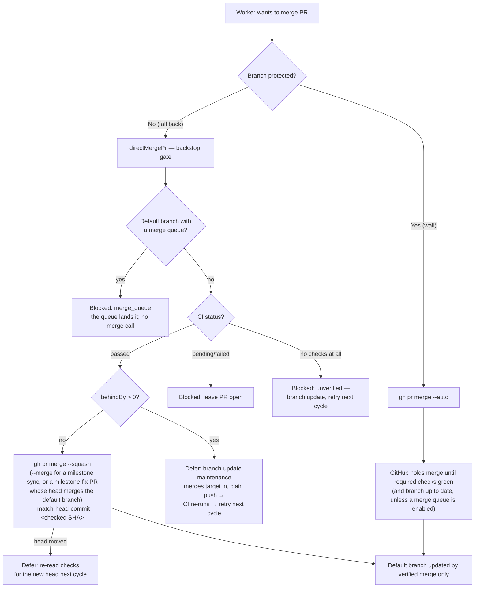

## Layer 1 — the GitHub ruleset "wall"

The default branch's ruleset is configured **at setup time**, once per monitored
repo, idempotently. It sets these things:

- **One required check: `gate`.** The `Quality` workflow
  (`.github/workflows/quality.yml`) calls each gated workflow as a reusable
  workflow and ends with a `gate` job that `needs` all of them and fails
  unless every one reported exactly `success` (`.github/scripts/gate.sh` —
  a skipped or cancelled job closes the gate). The ruleset requires `gate`
  alone, so adding a shard or renaming a job never means editing the
  ruleset. `pr_check_contexts.ts` derives the called workflows' contexts as
  *covered by* the gate, and the offline test still refuses a check nothing
  requires. The pattern is GRQ-AutoTrader's.
- **Require status checks to pass** — the merge is blocked until every required
  check is green.
- **Require the branch to be up to date**
  (`strict_required_status_checks_policy: true`) — a stale feature branch must
  be brought current with its target before the merge is allowed, so green CI
  results are never trusted against an out-of-date head. **Unless the merge
  queue is enabled** on the default branch: then the policy is `false`, and the
  queue tests each PR against its future head instead
  ([Merge queue](#merge-queue)).
- **A merge queue, where GitHub allows one** — a `merge_queue` rule on the same
  ruleset, decided at each setup run ([Merge queue](#merge-queue)).

### Rulesets only — classic branch protection is never written

GitHub has moved enforcement to **repository rulesets**; classic branch
protection (`PUT /repos/<repo>/branches/<branch>/protection`) is the legacy
surface, and the worker **never writes it**. It used to: every setup run
recreated a classic rule that humans then deleted, and that rule demanded status
contexts (`gitleaks`, `semgrep`) many repos no longer report — so the merge box
sat on _"Expected — Waiting for status to be reported"_ forever while the repo's
real ruleset checks were green.

Two boundaries follow:

- **Defer to an existing ruleset.** When the default branch is already covered
  by a ruleset the worker does not own — a human-managed one, or an organisation
  ruleset — the sync is a genuine no-op (`skipped:
  "existing-ruleset"`). The
  worker never competes with an existing enforcement policy.
- **Report, never delete, a legacy rule.** Leftover classic protection is read
  and reported (`legacyClassicProtection: true`), and setup prints the exact
  `gh api -X DELETE …` command to clear it. Deleting it stays a deliberate human
  action.

### Never lock a direct-push branch

A required-status-checks ruleset assumes every change arrives through a pull
request. On a **data repo whose default branch the fleet pushes to directly**
(FLEET workers checking results straight in to `Develop`) there is never a PR,
so no check can ever be reported, and every push is refused:

```text
remote: error: GH013: Repository rule violations found for refs/heads/Develop.
remote: - 2 of 2 required status checks are expected.
```

Six data repos stalled that way for days after the ruleset configurator locked
them. So, before creating **or** updating its ruleset, the configurator asks
`assessBranchPushPolicy()` in
[`worker/deno/lib/branch_push_policy.ts`](../worker/deno/lib/branch_push_policy.ts)
how the branch is fed:

- **Explicit opt-out** — the repo topic `direct-push`, or the marker file
  `.vibe/no-default-branch-ruleset` at the default branch head, skips with
  `skipped: "opted-out"`.
- **Observed direct pushes** — the last 20 commits on the branch are sampled; a
  commit counts as direct when its subject carries no `(#N)` squash marker, is
  not a `Merge pull request #N` commit, and
  `GET /repos/{repo}/commits/{sha}/pulls` names no **merged** PR. Any direct
  commit skips with `skipped: "direct-push-branch"`, logging the offending sha
  and subject.
- **Uncertainty** — if the topics, marker, or commit history cannot be read, the
  branch is treated as direct-push (`skipped: "direct-push-branch"`, with the
  read failure in `detail`). The worker never locks on uncertainty, the same
  stance as the check-name discovery below.

**Removing protection needs stronger evidence than suppressing it**
(Issue #1289). A stale ruleset the worker created earlier is **deleted** only
on evidence the worker trusts: demonstrable direct pushes (commit history it
read itself) or the `direct-push` topic, which is repository *settings* and
takes admin permission to write. The marker file is repository *content* —
anybody with write access, or a merged PR, can land it — so it suppresses
creating a ruleset but never removes one that already exists. Only the ruleset
named exactly `Vibe Coder default branch` and owned by the repository is ever
deleted; a human-managed or organisation ruleset is never touched, and a
human-managed ruleset covering the branch still wins (`existing-ruleset`)
before any of this runs. On an unreadable history nothing is written _and_
nothing is deleted.

The read-only sweep `audit-default-branch-rulesets` (see
[Extending → Maintenance Commands](EXTENDING.md#-maintenance-commands)) lists,
per repo, what the sync would now do without writing anything.

### Never require an unsatisfiable check

The guiding invariant is **never require an unsatisfiable check**. A check that
can never pass on a repo must never be marked required there — otherwise it
blocks **every** merge. Three filters enforce it:

- `requiresPublic` checks are dropped on non-public repos (e.g.
  `dependency-review`, which needs GitHub Advanced Security).
- Language-gated checks are dropped when the language is absent (or when the
  detected-language set is unknown).
- Any visibility other than the literal `"public"` (including `"private"`,
  `"unknown"`, or `undefined`) is treated as private — fail-safe, so a
  public-only check is never required when the answer is uncertain.

That satisfiable subset is computed by `getRequiredChecksForRepo()` in
[`worker/deno/lib/branch_protection_definitions.ts`](../worker/deno/lib/branch_protection_definitions.ts),
which reuses the `visibilityScope: "public-only"` signal from
`workflow_definitions.ts` so the two stay in lock-step.

The catalogue names **candidate** contexts only. Since a bespoke repo may name
the same capability differently (`quality` for a job that runs gitleaks as a
step, `Semgrep SAST scan` for semgrep), the candidates are intersected with the
names the repo has **genuinely reported** — `getReportedCheckNames()` in
[`worker/deno/lib/reported_check_names.ts`](../worker/deno/lib/reported_check_names.ts)
reads the check runs and commit statuses on the default branch head _and_ on the
head of the most recently closed PR (the canonical workflows trigger on
`pull_request`, so a squash-merged default branch carries none). Only the
alternative that actually reported is required. When nothing matches, or the
discovery cannot be read at all, **no ruleset is created** — a ghost context is
never written.

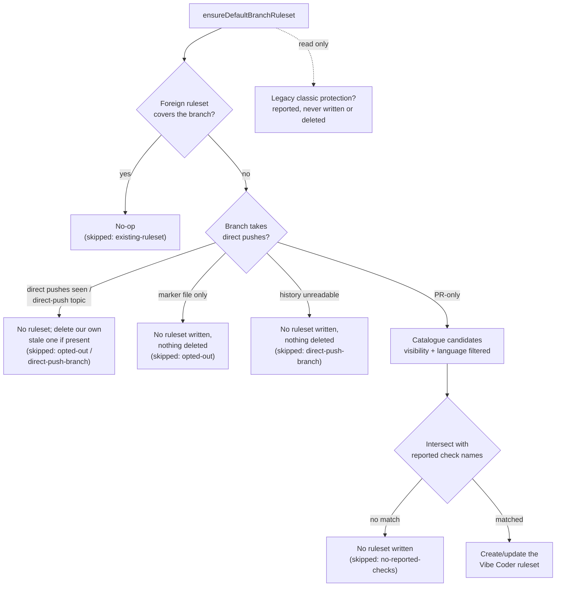

### Additive convergence — foreign checks are never deleted

Convergence **only ever adds**. An update to the worker's own ruleset sends the
**union** of its current required contexts and the worker's desired set, so a
required check the worker did not create — an org security scan, a compliance
gate, another team's workflow — survives the sync instead of being silently
stripped. Those contexts are reported back as `preserved`, and their presence
alone is **not** drift: a repo whose only difference is an extra gate stays a
genuine no-op.

Pruning a stale required check is therefore a deliberate human action, not a
side effect of onboarding or a setup run.

### The update never weakens the rules it rewrites

The ruleset update is a **full-document PUT**, so the same additive stance has
to cover the rules the worker does not model, not just the contexts it does
(Issue #1290). An admin who hardens `Vibe Coder default branch` with
`pull_request` (required approvals), `non_fast_forward`, `deletion`,
`required_signatures`, or bypass actors would otherwise lose all of it the next
time a new check appeared and the sync rebuilt the body from status checks
alone — reported as a success, because the count of preserved *contexts* says
nothing about the rules that went.

So before it rewrites the document the configurator **reads the live ruleset**
(`GET /repos/{repo}/rulesets/{id}`), rewrites only the `required_status_checks`
rule, and carries every other rule and the `bypass_actors` list through
unchanged. That rule is the **union** of the worker's contexts and the contexts
already live in the ruleset, each live check keeping its `integration_id`
(Issue #4487), so an owner-added check such as a secret scan or static-analysis
gate survives a reconcile. The update never removes a check; pruning one is a
deliberate human action (above). The types it kept are reported as
`preservedRules` and named in the setup output, so a run over a hardened
ruleset shows what survived.

A ruleset whose current rules **cannot be read** — a 403, a 404, an unparseable
body — fails the sync loudly and writes nothing. "Could not see it" is never
read as "there was nothing there". A missing live `rules` array, or a
malformed `required_status_checks` rule (missing `parameters` or its checks
array, non-array checks, non-object entry, non-string or empty `context`, or a
present, non-null non-integer `integration_id`) refuses the update loudly too,
rather than being silently dropped. Checks with one context but different
`integration_id`s remain separate because each pins the check to a different
source app.

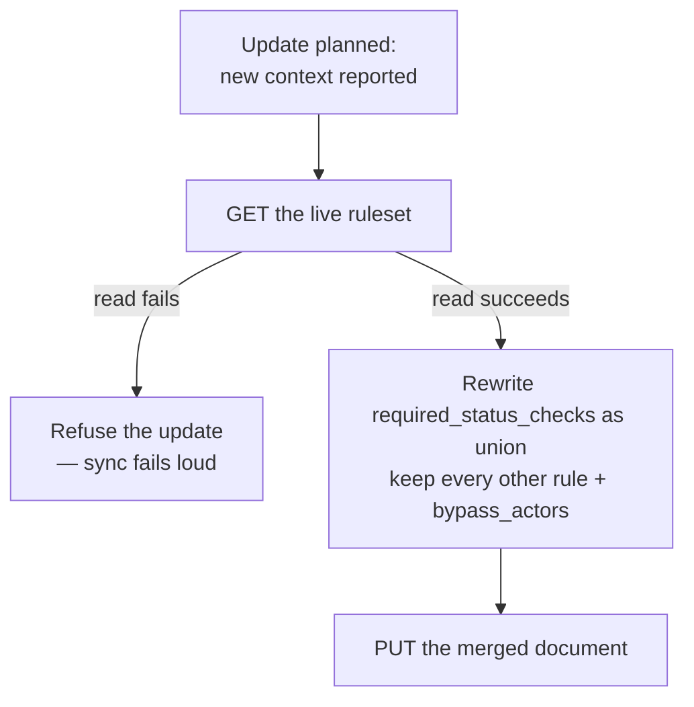

### Setup-time sync across all monitored repos

The walk over every monitored repo is performed by
[`syncBranchProtectionForAllRepos()`](../worker/deno/setup/branch_protection_sync.ts)
. For each repo it resolves visibility via `getRepoVisibility` and the default
branch via `gh api repos/<repo> --jq .default_branch`, then calls
`ensureDefaultBranchRuleset()`. It is wired into `setup.sh` as the
`branch-protection-sync` subcommand of `setup_cli.ts`, run **after** the
collaborator precheck (which validates access). The sync collects a per-repo
`SyncResult[]`, prints a summary, and treats every single-repo failure as a
non-fatal warning.

Setup respects a setup-time-only rate-limit budget — the metadata reads, a small
number of ruleset/check-name reads, the direct-push detection reads (three, plus
one per sampled commit lacking a PR marker;), and at most **one** ruleset write
or delete per repo, plus the merge-queue probe's create and delete where repository
metadata cannot settle availability — and never runs in the per-tick main loop. A repo already
covered by someone else's ruleset short-circuits before the direct-push
detection and the check-name discovery.

### Merge queue

Where GitHub allows one, the default-branch ruleset can also carry a **merge
queue** (Issue #4424). A queue lands approved PRs in batches and tests each one
against the real future head of the branch, so the worker stops asking a PR to
be current with its base before it merges. The queue is **default-branch only**.
A `milestone/**` branch keeps its own rules, and the direct-merge fallback never
lands a PR on a queued base.

**Availability** is decided from repository and organisation metadata where that
is conclusive, and by a probe where it is not
([`merge_queue.ts`](../worker/deno/lib/merge_queue.ts)):

| Repository                                              | Result        | Decided by |
| ------------------------------------------------------- | ------------- | ---------- |
| Owned by a user account                                 | unavailable   | metadata   |
| Organisation, public                                    | available     | metadata   |
| Organisation, private, plan `enterprise`                | available     | metadata   |
| Organisation, private, any other named plan (e.g. Team) | unavailable   | metadata   |
| Organisation, private, plan unreadable                  | probe decides | probe      |
| Repository metadata unreadable                          | probe decides | probe      |

The probe creates a **disabled** ruleset named `Vibe Coder merge queue probe`
carrying a `merge_queue` rule, then deletes it straight away. Only a setup run
creates it. The read-only `audit-default-branch-rulesets` sweep never does: it
plans with `readOnly` set (`branch_protection_sync.ts`, `planBranchProtectionForRepo`),
so an inconclusive answer is reported as `unverified`. A setup run always
attempts the delete straight after a successful create. GitHub's
`422 Invalid rule 'merge_queue'` means unavailable. Any other create failure, or
a probe that cannot be deleted, is `unknown`; a leftover probe is named in the
output for deletion by hand. `unknown` is never treated as available.

**Opt-out.** The repository topic `no-merge-queue` opts the repository out. A
topic list that cannot be read is an error, never read as "not opted out"
([`readMergeQueueOptOut`](../worker/deno/lib/merge_queue.ts)).

**Enablement.** The queue is added only when availability is established, the
repository is not opted out, and every required check's workflow runs on the
`merge_group` event. Each required check is judged by
[`merge_queue_workflows.ts`](../worker/deno/lib/merge_queue_workflows.ts), which
refuses to enable the queue while a workflow lacks the `merge_group` trigger.
The decision is shown below.

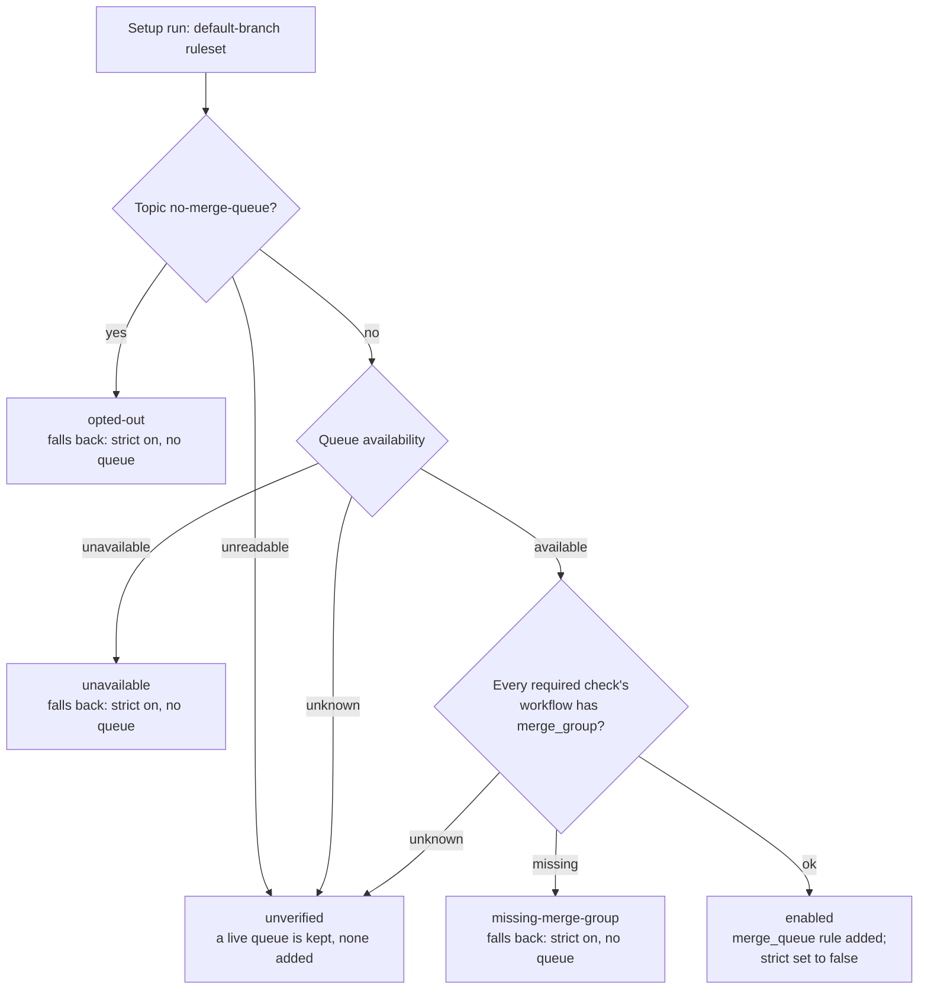

The verdicts are:

| Verdict              | Effect on the default-branch ruleset                                                 |
| -------------------- | ------------------------------------------------------------------------------------ |
| `enabled`            | `merge_queue` rule added; required checks kept with `strict_required_status_checks_policy: false` |
| `opted-out`          | Falls back: no queue, strict up-to-date kept                                         |
| `unavailable`        | Falls back: no queue, strict up-to-date kept                                         |
| `missing-merge-group` | Falls back: no queue, strict up-to-date kept                                         |
| `unverified`         | Nothing changes: an existing queue is never removed on an unverified read            |

A definitive refusal writes no queue, so it removes a live queue from the
worker's ruleset, including one a human tuned there, and strict goes back to
`true`. An unverified read keeps a live queue and adds none. Only an `enabled`
decision keeps a human-tuned queue, and then only its parameters are kept
(`effectiveMergeQueue` and `repo_rulesets.ts`, where
`strict_required_status_checks_policy` is `mergeQueue === undefined`).

**Falling back** leaves the worker on the behaviour it has without a queue: a
behind PR is updated, and the direct-merge gate refuses while it is behind. The
setup run prints one line per repository with the reason for the fallback. The
detection result is not written to `.config.json`: it is recomputed at each setup
run, and the live ruleset is the record. (No write to `.config.json` in
[`merge_queue.ts`](../worker/deno/lib/merge_queue.ts),
[`merge_queue_workflows.ts`](../worker/deno/lib/merge_queue_workflows.ts) or
[`default_branch_ruleset.ts`](../worker/deno/lib/default_branch_ruleset.ts).)

**Queue parameters** come from `buildMergeQueueParameters()`
([`merge_queue.ts`](../worker/deno/lib/merge_queue.ts)): grouping `ALLGREEN`; up
to five entries built and five merged per batch; a minimum of one entry; a
one-minute wait; a sixty-minute check response timeout. The merge method is
`SQUASH` when the repository allows squash, otherwise `MERGE` when it allows
merge commits, otherwise `REBASE` (`pickMergeMethod()`).

**What a queued base changes.** On a merge-queued default branch, a PR that is
only behind is not updated by the branch-update loop, nor by the armed-PR step of
the auto-merge sweep; a conflicting PR still is
([`pr_branch_update.ts`](../worker/deno/lib/pr_branch_update.ts),
[`auto_merge_sweep.ts`](../worker/deno/lib/auto_merge_sweep.ts)). The queue tests
the PR against its future head, and lands it once the checks pass there.

**A queue removal is a red check, not a re-run.** When the queue removes a PR
at its current head, the CI-fix lane is handed that removal as a failed check
named `merge queue`, with the synthetic id `merge-queue-<first 12 characters of
the head sha>` ([`merge_queue_check_id.ts`](../worker/deno/lib/merge_queue_check_id.ts)).
Nothing is looked up or re-run under that id, and a spent retry budget is not
re-run. The PR is not re-armed (`merge-queue-removed`) until a new head arrives,
and the direct-merge fallback never lands it on a queued base. See
[ci-fix.md](workflows/ci-fix.md) and [pr-feedback.md](workflows/pr-feedback.md).

**Non-default branches are unchanged.** The direct-merge queue check runs only
for a default-branch target
([`direct_merge.ts`](../worker/deno/lib/direct_merge.ts), the `prTargetsDefaultBranch`
guard), and a `milestone/**` branch whose rules carry no `merge_queue` rule is
not treated as queued ([`merge_queue_runtime.ts`](../worker/deno/lib/merge_queue_runtime.ts)).

## Layer 2 — the worker pre-merge "backstop"

The native auto-merge path is covered by the ruleset. The **direct-merge
fallback** (used on unprotected branches) is covered by the worker's own gate,
`enforcePreMergeRequirements()` in
[`worker/deno/lib/direct_merge.ts`](../worker/deno/lib/direct_merge.ts), called
from inside `directMergePr()` so **every** direct-merge call site is protected
by construction.

Immediately before merging, the gate:

1. **Re-fetches CI status** via `checkCiStatus()` and refuses (a typed "blocked"
   result, never a throw) unless the status is `passed`.
2. **Re-fetches fresh branch state** (`behindBy` from `pr_branch_state.ts`) and
   refuses when `behindBy > 0`, so stale CI results are never trusted.

Both signals are re-fetched **at merge time**, not reused from PR-creation time.

On a default branch with a merge queue, the gate is never reached.
`directMergePr()` returns a typed deferral, `blocked: "merge_queue"`, with no
gate and no merge call ([`direct_merge.ts`](../worker/deno/lib/direct_merge.ts),
the return at line 1182, ahead of the gate call at line 1187). If the base cannot
be read to decide, the merge fails closed with an error and is retried on the
next scan. The escalation layer treats `merge_queue` as "await checks", since the
queue lands the PR
([`merge_block_escalation.ts`](../worker/deno/lib/merge_block_escalation.ts)).

### The merge is pinned to the SHA its checks were read for

Re-fetching at merge time still leaves a window: the gate reads the checks for
one specific head commit, and two-to-three `gh` round trips later the merge
runs. A push landing in between would be squash-merged on checks that never
evaluated it.

The gate therefore reports the head SHA it read (`headSha` on both
`CiStatusResult` and `PreMergeGateOutcome`), and `directMergePr()` merges with
`gh pr merge --squash --match-head-commit <sha>` — or `--merge` when the head
is a `sync/milestone-*` branch, which must land as a merge commit
(Issue #1048), or a same-repository `milestone-fix/**` head that merges the
default branch (Issue #3596). GitHub refuses the merge if
the head has moved, so the merge is only ever performed on the exact commit the
verdict was formed against.

- **Head moved** — a deferral (`blocked: "head_moved"`), not a fault. The PR is
  left open, the new head's checks run, and the next maintenance cycle
  re-evaluates the gate.
- **No head SHA reported** — refused outright. An unpinnable merge cannot be
  tied to the verdict that allowed it, so the worker fails closed and retries on
  the next scan rather than merging whatever the head happens to be now.

### The CI verdict is an allowlist

`determineCiStatus()` decides "green" from an **allowlist**, never a denylist. A
check run passes only when its conclusion is `success`, `skipped` or `neutral`;
every other completed conclusion — `failure`, `cancelled`, `timed_out`,
`action_required`, `startup_failure`, `stale`, or any value GitHub adds in
future — is `failed`. The same rule applies to the combined commit status:
anything that is neither `success` nor pending is `failed`.

GitHub's own aggregate verdict, `statusCheckRollup.state` (fetched by
`check_runs_batch.ts`), is folded into the decision and the **worse** of the two
verdicts wins, so a red rollup can never be masked by check runs that
individually look green.

When that rollup cannot be read, `checkCiStatus()` falls back to
`repos/{repo}/commits/{sha}/check-runs` with `per_page=100` and `--paginate`.
`gh` applies `--jq` per page and prints one object per line; those pages are
merged before `determineCiStatus()` runs. A page that cannot be parsed, pages
that disagree on `total_count`, or a merged run count that does not equal
`total_count` is a lookup failure, and the gate retries. A short page is not
the full set, so a failed or still-running check past the first page cannot
read as `passed`.

This matters because a PR waiting on a manual approval (`action_required`)
reports a completed check run. Under the old denylist that conclusion hit
neither the failure branch nor the pending branch, so it fell through to
`passed` and was direct-merged past branch protection.

A workflow that fails at startup is different. When the repository's Actions
policy rejects a `uses:` action, GitHub records a check **suite** with conclusion
`startup_failure` and creates **no check run** at all, so a check-run rollup
never shows it (Issue #4347). `determineCiStatus()` therefore also reads the
head commit's check suites: a completed suite from the `github-actions` app
whose conclusion is not on the passing allowlist makes the verdict `failed`
only when that suite created no check run of its own. A suite that has runs is
already judged through the latest check run, so an earlier failed or cancelled
run of the same workflow does not fail the commit again. The suites come from
GraphQL `checkSuites` (including `checkRuns.totalCount`) on the batched read,
and from `repos/{repo}/commits/{sha}/check-suites`
(`latest_check_runs_count`) on the REST fallback. Suites from other apps, and
suites that have not finished, change nothing. The CI-fix scan reads the same
zero-run suites: a completed `github-actions` suite with conclusion
`startup_failure` becomes a CI-fix candidate keyed by the suite id and named
after the workflow and file path. The run URL is carried in its annotations,
so the agent can locate the startup refusal while the check name and failure
signature stay stable across pushes. Without workflow metadata the name is
`GitHub Actions workflow startup failure`. GraphQL reads the path from
`workflowRun.file.path`; the REST fallback reads the workflow run by suite id.
The CI-fix handoff distinguishes suite ids from job ids. A no-change repair
re-runs the entire workflow because a startup failure has no failed job to
re-run. Startup suites stay eligible for repair even after the local job retry
budget is spent; the fleet-wide attempt cap still bounds them and invokes the
existing abandon-and-restart path, including when GitHub refuses a rerun.


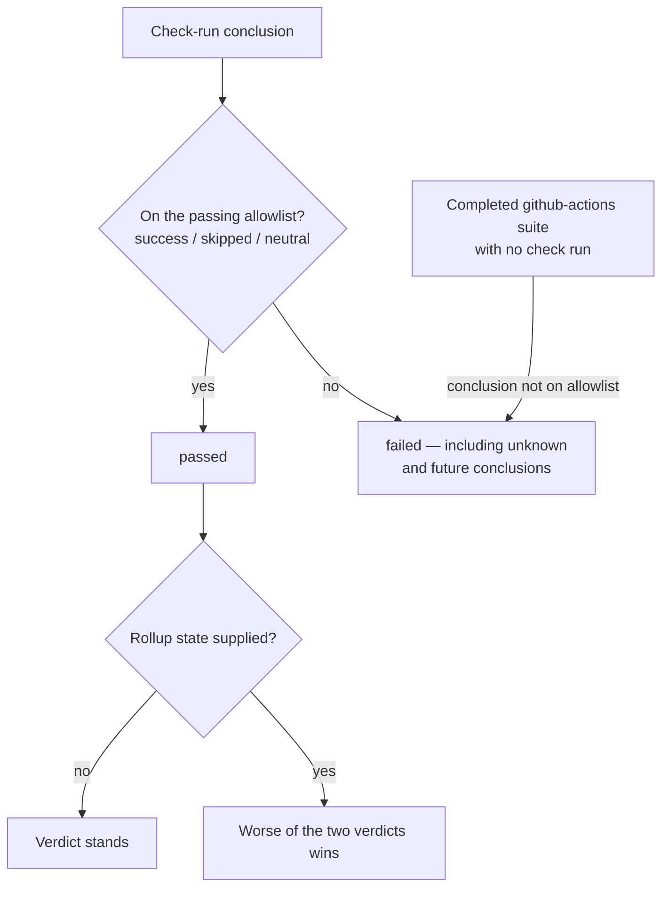

### An unprotected default branch needs an approval, not a refusal

Two guards used to intersect at nothing. On a base with **no required checks**
the worker refuses GitHub's `--auto` (it would merge immediately whatever CI
said) and routes the PR through the gated direct merge instead — which then
refuses **every** default-branch target as a blast-radius guard. A repo whose
default branch carries no ruleset therefore had no path at all:
`NEAT-AI-Ockham#116` was green, approved and mergeable, and the worker logged
the same refusal roughly forty times over four hours while all six `work-on`
issues behind it stayed blocked.

The blast-radius guard asks for "branch protection or a human review". On an
unprotected default branch there is no protection to bypass, so the worker now
asks for the review explicitly:

- **An approving review from a login outside the fleet** — the PR proceeds to
  the same pre-merge gate as any other: green CI, current branch, settled head,
  SHA-pinned merge. Nothing is relaxed except the target-branch refusal.
- **No such approval** — a typed deferral (`default_branch_unapproved`), so the
  PR is *held* and the hold is logged. It is not retried as a failure and it is
  not escalated to a human.
- **A sibling fleet account's approval does not count.** The fleet cannot
  review itself into a merge; only a login outside `service_accounts` /
  `fleet_pr_authors` / the host login satisfies the guard.
- **An unreadable review list fails closed** — refused and retried next scan,
  never treated as an implied approval.

A **protected** base is untouched: it still goes through native auto-merge,
which GitHub holds until the required checks are green.

**GitHub's own refusal outranks the rules endpoint** (Issue #1763). "Required
checks on the base?" is answered by `repos/{repo}/rules/branches/{base}`, which
lists only the rules the fleet token can see — an organisation-level ruleset
needs `admin:org` to list. `stSoftwareAU/GRQ-FX` `Develop` answered `[]`, the
base was judged unprotected, and the gated direct merge was refused with "the
base branch policy prohibits the merge" on every cycle the PR stayed open. So
a direct merge refused with that wording (or a `GH013` rule violation) now
marks the base **protected** for the rest of the cycle, logs one line naming
the repo and branch as policy-protected with no visible rule, and arms native
auto-merge — which honours whatever rule exists — instead of retrying. Any
other direct-merge failure is still reported as the failure it is.

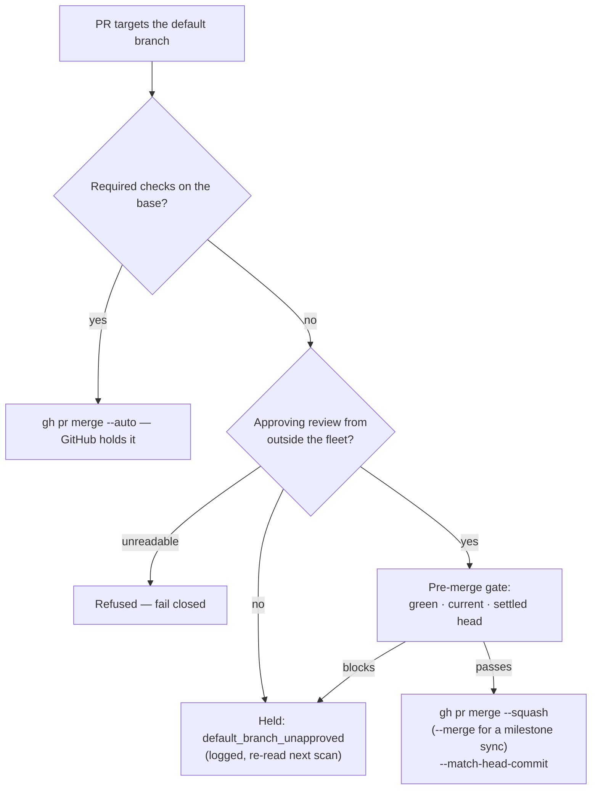

### Zero checks is not "passed"

A head commit with **no check runs and no commit statuses** has been verified by
nothing. `checkCiStatus()` reports it as `no_checks` — a status distinct from
`passed` — and the gate blocks the merge with the `no_checks` reason. A failed
`github-actions` check suite with no check run of its own on such a head makes
it `failed` instead, because a suite can exist with no check run
([the allowlist](#the-ci-verdict-is-an-allowlist)). The
direct-merge path is the one that bypasses branch protection, so it must fail
closed here exactly as its neighbouring guards do.

The automated path never merges such a PR and never hands it to a human
(Issue #4304): `classifyMergeAttempt({ kind: "no_checks" })` returns `retry`,
which requests a branch update — a fresh head the repository's checks can run
on — logs a warning, and tries again next cycle.

The only way to land such a PR through the worker is the **explicit operator
override** on the CLI:

```bash
deno run ... merge-if-checks-passed --repo owner/repo --pr 42 --allow-no-checks
```

The override relaxes the "no checks" refusal only. Every other requirement —
non-default target branch, branch freshness, repo allowlist, PR authorship —
still applies.

### Who may call `merge-if-checks-passed`

The command applies the same two gates the maintenance scan applies before it
touches GitHub:

- **Monitored-repo allowlist** — `--repo` must be listed in `.config.json`
  `repos`; anything else is refused before any API call is made.
- **PR authorship** — the PR must be authored by this worker's own `gh` login or
  by a configured sibling fleet host (`fleet_pr_authors`).

Both fail closed: an unresolvable worker login or an unreadable PR author is a
refusal, never an implied pass.

### Defer-and-retry when behind

On a merge-queued default branch this section does not apply: the gate is not
reached, and a PR that is only behind is not updated (see
[Merge queue](#merge-queue)).

When the gate blocks because the branch is behind its target, the PR is **left
open** and a deferral is logged. The existing branch-update maintenance
(Priority 1.27, `pr_branch_update.ts`) merges the target into the branch and
pushes normally — never a rebase, never a force-push, so a PR under review
keeps its commits and review comments (#2807) — CI re-runs on the new head,
and the next cycle re-evaluates the gate — an automatic **auto-update →
re-check → merge-if-green** loop with no bespoke retry machinery.

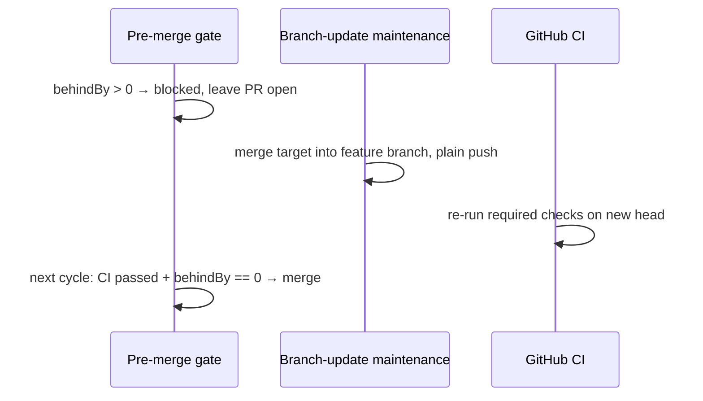

#### The pre-merge sync point

Pre-merge is the last of the three branch sync points (the others are work
start and PR raise — see
[milestones.md](workflows/milestones.md#-the-three-branch-sync-points)).
`ensurePrMergeable` (`git_pull.ts`) merges the target into a branch that is
behind and pushes plainly. `enforcePreMergeRequirements` (`direct_merge.ts`)
then refuses the merge while CI is pending or failing, while the branch is
still behind (`behind_target`), or while the head moved since the CI read
(`head_moved`) — so it merges only once the required checks are green on that
synced head — and `directMergePr` passes `--match-head-commit` so GitHub
rejects the merge if the head moved after the gate read it (Issue #2809).

#### The milestone base is behind the default branch

The same defer-and-retry shape covers the *base* as well as the head
(Issue #1779). A child PR whose base is a `milestone/*` branch that is behind
the default branch is **armed anyway** (Issue #2460): the milestone ruleset's
strict up-to-date policy holds the *merge* until the branch is level, so arming
early is safe and the child lands the moment the sync catches up. That safety
comes entirely from the ruleset, so it is conditional on the base **having** one
— see "A behind base with no required checks" below.
`decideMilestoneBaseMerge` in
[`worker/deno/lib/milestone_children_gate.ts`](../worker/deno/lib/milestone_children_gate.ts)
still returns `defer` / `milestone-behind` — that decision is what triggers the
inline sync and the reason comment, and it rides along on the armed outcome as a
log marker rather than withholding the arming.

- **What is compared.** `repos/{repo}/compare/{default}...{milestone}`, whose
  `behind_by` is the milestone branch measured against the default branch. The
  orientation is the Issue #470 one: in `compare/{base}...{head}` the numbers
  describe the **head**, so the milestone branch must be the head.
- **What it costs.** The comparison is memoised per (repo, milestone branch)
  for 60 seconds, so the N children of one milestone in a single Priority 1.65
  sweep cost **one** API call, and a PR based on the default branch costs none.
  The memo expires well inside a cycle, so the next sync is seen rather than a
  stale reading held for the life of the process.
- **What the worker does.** It first tries the same inline milestone sync
  the child run uses before cutting a branch (Issue #2005 / #1780), once
  per milestone per cycle. A clean landing (or a sync PR that merges in
  the remaining budget) invalidates the compare memo and arms the PR in
  the same cycle — at creation, on the post-scan sweep, and on priority
  1.65. A conflicting sync is never side-picked, but it no longer holds
  the child back either: the reason is posted on the PR and `--auto` is
  issued regardless (Issue #2460), leaving GitHub to release the merge
  once the periodic 1.72 sweep levels the branch. The armed outcome still
  names the behind base (`deferral: "milestone-behind"`) for logging, so
  the PR-maintenance scan treats a healthy child as landed rather than
  escalating it to `needs-human`.
- **A behind base with no required checks is still held.** Arming is only safe
  while something holds the merge, and on an unprotected base nothing does:
  `--auto` there merges immediately whatever CI says (Issue #4375), and the
  gated direct merge only measures the head against its own base, not the base
  against the default branch. Either route would land the child on a stale tip
  — the side-pick this section exists to prevent — so a behind base that does
  not enforce required checks defers to the next scan instead, until the
  periodic 1.72 sweep has levelled the branch (Issue #2460). A protection
  lookup that *fails* reads as unprotected here, as it does everywhere else in
  the arming path. The protection is settled **before** the sync reason is
  written, so that one comment says which of the two happened — a held PR is
  never told it was armed.
- **The milestone sync PR is exempt.** Its base *is* the milestone branch and
  its head is `sync/milestone-*` — it is the PR that clears "behind". Deferring
  it for the state it exists to fix would deadlock the milestone: the sync
  could never land, the branch could never catch up, and no child could ever
  merge. `isMilestoneSyncBranch(headRefName)` skips the check, and the exempt
  PR costs no comparison at all. A head that cannot be read defers as
  `lookup-failed` rather than guessing which PR this is.
- **…but a sync PR whose base is the *default* branch is closed, never
  merged** (Issue #1967). A sync PR merges the default branch into a milestone
  branch, so one targeting the default branch has had its base deleted and been
  retargeted there by GitHub — approval and auto-merge carried over, and a diff
  that reverts the milestone's own work. `enableAutoMerge` — the door every
  arming path goes through — closes a same-repository `sync/milestone-*` head
  on the default branch before either GitHub's `--auto` or the gated direct
  merge is reached, posting the reason on the PR. A default branch it cannot
  read, or a sync PR whose own base cannot be read (Issue #3614), defers as
  `sync-base-unreadable` rather than arming. See
  [INTERNALS](INTERNALS.md#-a-sync-pr-never-outlives-the-branch-it-targets).
- **An unreadable comparison defers as `lookup-failed`**, exactly as an
  unreadable route does (Issue #477). "I could not read it" is never actioned.
- **Who holds the merge.** GitHub does, not the worker. Once `--auto` is
  issued the merge is GitHub's to release, and nothing the worker decides
  afterwards is consulted. The `milestone/**` ruleset holds the merge until
  the child's required checks pass; it does **not** require the branch to be
  up to date. Setup writes every `milestone/**` ruleset to the GRQ-AutoTrader
  template, whose `strict_required_status_checks_policy` is `false` (Issue
  #2623), so an armed child whose base is still behind lands on green checks
  and the 1.72 sweep levels the milestone branch afterwards.
- **The strict policy is no longer a finding.** Issue #2461 made
  `assessMilestoneRuleset` in
  [`worker/deno/lib/milestone_ruleset_check.ts`](../worker/deno/lib/milestone_ruleset_check.ts)
  raise a `non-strict-checks` error on a ruleset without the strict policy.
  Issue #2623 removed it: setup writes that policy as `false` itself, and must
  not report the ruleset it just wrote as broken. The findings that remain for
  a `milestone/**` ruleset the fleet cannot rely on — `no-required-checks`,
  `create-blocked` and `unreportable-checks` — are printed per repository by
  `setup`'s ruleset pass (`reportMilestoneRuleset`).

Two callers deliberately do **not** require a synced base. The post-merge
landing check (`merge_landing.ts`) asks a different question — that PR has
already merged, and how far the branch has drifted since says nothing about
whether its work landed. `directMergePr()` is not opted in either: on the
automated routes it is reached only *after* `enableAutoMerge` has run this gate
(the fallback fires on `not_allowed`, never on a deferral), and the one route
that reaches it directly is the explicit operator command
`merge-if-checks-passed`, which is a human asking for that merge by name.

## Hands-off landing — precedence and loud failure

The auto-fix loop (fetch → diagnose → fix → merge) is only hands-off if a green
fix PR actually lands. Two things make that true.

**Every repo and every fleet author is swept.** The main loop's priority 1.65
sweep (`sweepAutoMerge` in
[`worker/deno/lib/auto_merge_sweep.ts`](../worker/deno/lib/auto_merge_sweep.ts))
lists PRs for **every push-capable fleet author**, the same set
`getBlockingPRForIssue()` defers `work-on` issues to. A single-login sweep left
`GRQ-GTC#305` — authored by a sibling fleet account — with no merge attempt
logged against it for five days while its repository stayed frozen.

It also walks the **monitored repo list**, not the repos with claimable work: a
repo whose only PR blocks all of its own issues has no claimable work by
construction, so a work-driven sweep would never revisit it. That was already
true before the sweep was extracted; it is now asserted by a test rather than
left to be re-broken.

**A PR is armed when it is created, not next cycle.** The sweep is a
**backstop**, never the primary mechanism. Priority 1.65 runs near the top of a
cycle and the Priority 2 issue scan — the pass that raises PRs — runs after it,
so a PR raised by cycle N is structurally invisible to cycle N's sweep.
PR #1133 was created 51 minutes after that cycle's sweep and sat green,
unblocked and unarmed until a human merged it, freezing every sibling issue the
blocking guard defers to it (Issue #1136).

Two changes close that window:

- **Arm at creation.** The completion phase calls `finalisePr` immediately
  after `gh pr create` for **every** PR it raises, milestone children
  included. GitHub then lands the PR the moment its checks pass, with no cycle
  boundary involved. The milestone *summary* PR is raised by
  `milestone_completion.ts`, not here, and arms itself there through the same
  `finalisePr` chokepoint (Issue #2458) — head the milestone branch, base the
  default branch — so it too is armed before the function returns rather than
  waiting for the next sweep. Every arming is re-gated on open children at
  merge time by `decideSummaryPrMerge` (Issue #3909), so neither a child PR nor
  the summary PR merges a milestone early: an open child withholds the arming
  and the gate's own comment is the only one posted, while a refusal nothing
  else explained gets exactly one reason comment naming the sweep retry
  (Issue #2457). The same gate is also re-gated on each sub-issue's declared
  dependencies (Issue #3014): a dependency still open, or closed into a
  different still-open milestone, withholds the summary PR's merge the same
  way an open child does, until it lands. A repository with `skip_auto_merge`
  set has its summary PR raised and left unarmed, exactly as the sweep already
  treats it.
- **Sweep again once the slots drain.** `runPostScanAutoMerge` in
  [`worker/deno/lib/run_core.ts`](../worker/deno/lib/run_core.ts) repeats the
  sweep at the end of a cycle that did work, catching the paths arming cannot:
  an arming call that failed, a host that died mid-run, and an unprotected base
  whose gated direct merge deferred because CI was still running when the PR
  was raised. It lists **live**, not from the iteration-scoped `prs_${author}`
  cache the 1.65 sweep filled before those PRs existed. An idle cycle skips it
  and says so — it raised nothing to sweep.
- **Drafts are skipped, not failed** (Issue #1800). GitHub refuses to arm
  auto-merge on a draft ("Pull Request is still a draft"), and the sweep used
  to log that refusal as a failure every cycle for as long as the draft stayed
  open. The fleet listing now carries `isDraft`; the sweep skips a draft with
  one line the first time this process sees it, and an arming call that still
  meets a draft (at creation, or from a listing written before the field
  existed) returns the typed `draft` outcome, logged at info. A draft is the
  author asking for eyes — marking it ready is what puts it back in the sweep.

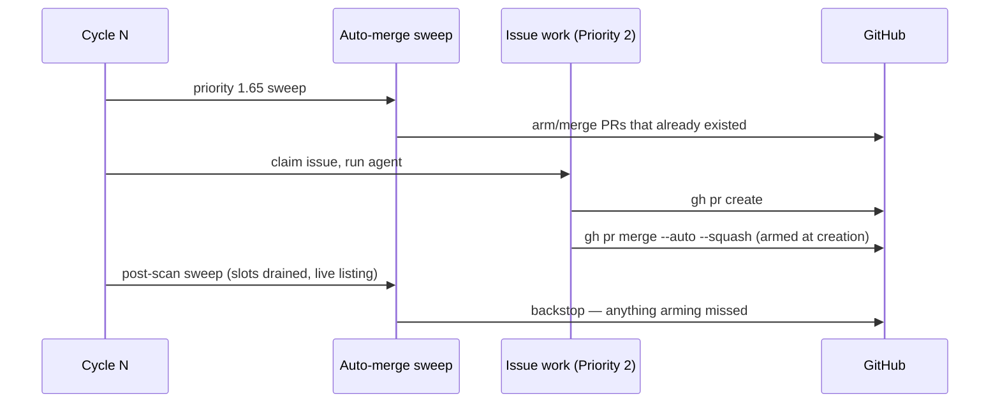

**Precedence is fixed, not a race.** The auto-merge scan
(`ensureAutoMergeOnOpenPrs` in
[`worker/deno/lib/pr_maintenance.ts`](../worker/deno/lib/pr_maintenance.ts))
always tries GitHub's **native auto-merge first**, and only falls back to direct
merge when native auto-merge is refused because the target branch is
unprotected. Native auto-merge is idempotent, so a consuming repo's own
`auto-merge.yml` arming the same PR converges on the identical state rather than
competing with the worker — there is no winner to determine.

**A sweep that does nothing says so.** Every repository the sweep visits
produces a line: the candidate PR numbers it found, or `no candidates` when the
fleet had no open PR there. Every attempt's outcome is logged by
`logAutoMergeOutcome` with the repo, PR number and result. Without those lines
"the sweep found nothing" and "the sweep refused everything" read identically,
which is why five unarmed PRs in one day were each treated as an isolated
omission rather than one defect (Issues #470, #1136).

**A blocked merge is never silent.** Every outcome runs through
`handleMergeAttempt()` in
[`worker/deno/lib/merge_block_escalation.ts`](../worker/deno/lib/merge_block_escalation.ts),
which maps it to exactly one of four dispositions. None of them hands the PR to
a human (Issue #4304): every PR merges once it is approved and green, and the
worker keeps working it until it does.

| Outcome                                                | Disposition     | Worker behaviour                                                                                 |
| ------------------------------------------------------ | --------------- | ------------------------------------------------------------------------------------------------ |
| Merged, or native auto-merge armed                     | `landed`        | Nothing — the PR will land unattended                                                            |
| Checks pending or failed                               | `await_checks`  | Log and wait; the CI-fix loop owns a red check; its 3-attempt cap closes the PR and redoes its issue (Issue #4304)           |
| Branch behind its base                                 | `update_branch` | `PUT .../update-branch` so the checks re-run against the merged state                            |
| No checks at all on the head commit                    | `retry`         | Branch update requested so checks run on a fresh head; logged as a warning, retried next cycle   |
| Head moved after its checks were read                  | `await_checks`  | Log and wait; the new head's checks are on their way and the next cycle re-evaluates             |
| Merge refused (protection rule, conflict, unmergeable) | `retry`         | Branch update requested; logged as a warning, retried next cycle                                 |

A failed branch update is retried the same way. A PR that conflicts with its
base is the merge-conflict ladder's, which finds it by its mergeable state; no
comment and no `needs-human` label is ever posted by this path.

Review requests are **informational**: a requested reviewer never blocks a fix
PR. Only branch protection can require an approval, and that is a per-repo
setting. The one place `reviewDecision` is consulted is branch upkeep
(Issue #2702): a PR at `CHANGES_REQUESTED` is **never branch-updated** — not by
the auto-merge sweep's armed-and-behind rule (Issue #2462), nor by the
Priority 1.6 branch-update pass. It cannot merge until the review is answered,
so the update unblocks nothing, and on GRQ#5032 it moved the head underneath
the owner's review. Both read the decision from a call they already make — the
sweep's live `gh pr view`, the branch-update pass's batched GraphQL state — and
log the skip at info.

Every fleet PR is armed for auto-merge and stays armed (Issue #4291). PRs do
not merge until they have a review approval and CI is green, and GitHub
enforces both. No review, finding or label withholds arming or disarms a PR;
only the routing holds above (a closed milestone route, a retargeted base, a
retargeted sync PR, an open-children summary PR) and a draft do.
When a pre-PR verifier finding or a Standards violation survives its recovery
turn on an existing PR (Issues #3382, #3796), the completion phase posts the
findings on that PR and still arms it. A top-level findings comment whose
first line is `<!-- vibe-pre-pr-verifier-hold -->` and whose author is a fleet
login is actionable feedback, including when this host wrote it; a fleet
eyes reaction prevents repeat processing (Issue #3798).

A repository with auto-merge switched off is no exception (Issue #4304):
`enableAutoMerge()` falls back to the same gated, SHA-pinned direct merge an
unprotected base takes, so the PR lands once it is approved and green instead
of carrying a "merge it manually" note.

The scan lists PRs authored by the worker only, so **human-authored PRs are
never commented on or merged** by this path.

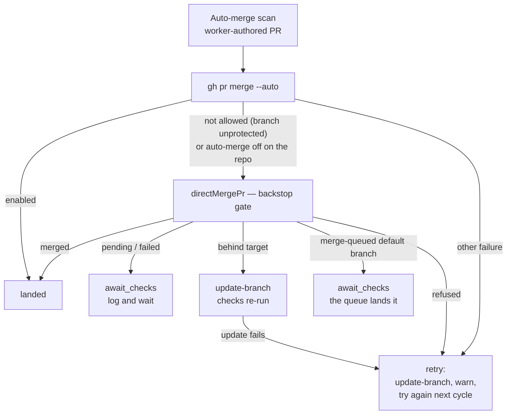

## Read-only default branch

The default branch must only ever change via a **verified merge**. The worker
never pushes commits directly to it — no formatting changes, no version bumps,
no dependency bumps, no lint/scan fix-ups. Every such change rides a normal
feature-branch PR and passes through the pre-merge enforcement like any other
change.

This is enforced at the single git-push choke-point by
`assertPushTargetAllowed()` in
[`worker/deno/lib/git_push.ts`](../worker/deno/lib/git_push.ts), through which
`commitAndPushPending()` and `pushUnpushedCommits()` flow:

- **Fails closed on the default branch.** When the resolved default branch
  equals the target branch, the push is rejected with an explicit error.
- **Fails open when the default cannot be resolved.** If `origin/HEAD` is unset
  the default branch is unknown, so a legitimate feature-branch push is never
  blocked by a transient lookup failure — direct-to-default is only possible
  when the target literally equals the resolved default.
- **Opt-out reserved for merge machinery.** An `allowDefaultBranch` parameter
  (default `false` = forbid) exists only for the legitimate merge path that must
  update the default-branch ref.
- **Worker-owned state files are unstaged, not allowed through** (Issue #1661).
  Between `git add -A` and the pre-commit safety gate, `commitAndPushPending()`
  drops the worker's own state files (`.heartbeat_<owner>_<repo>_<n>`,
  `.heartbeat-marker_<owner>_<repo>_<n>`, `.vibe_default_branch` — the shapes
  `worker/deno/lib/worker_state_paths.ts` defines) from the index and warns,
  naming each path. The gate never sees them, so a stray worker file no longer
  costs the whole commit; the gate itself is unchanged and still refuses every
  genuinely hidden or secret-bearing path.
- **A merge's already-tracked hidden files are not the agent's** (Issue #2737).
  Merging the base branch in stages every path the base changed, including
  hidden files it already tracks (`.claude/…`). The gate exempts a staged path
  only when its blob and mode are identical to that path on `MERGE_HEAD`, and
  logs each exemption at INFO. A hidden or secret file the agent adds or edits
  during the merge is still refused; with no readable `MERGE_HEAD` nothing is
  exempt. See [SECURITY.md](../SECURITY.md) for the full rule.
- **The same holds for a merge commit a rung wrote itself** (Issue #2739).
  When the sync adopts a milestone merge commit it did not write, a flagged
  path is exempt only when its blob and mode are identical on the default
  branch's tip, and only when that tip and the pre-merge commit are the
  commit's two parents. Each exemption is logged at INFO. Agent-added or
  agent-edited hidden or secret files are still refused, and an unreadable
  parent exempts nothing.
- **Nor is a hidden file the default branch already publishes** (Issue #2774).
  Outside a merge too, a staged path is exempt when its blob and mode are
  identical to that path on the default branch's tip, read from the local
  `origin/<default>` ref that `origin/HEAD` names, never fetched. Each
  exemption is logged at INFO naming the ref. An added, edited or deleted
  hidden or secret file is still refused, and an unresolvable `origin/HEAD`
  exempts nothing.
- **Nor is a hidden path the repository's own `.gitignore` re-allows**
  (Issue #3296). A staged hidden path outside the fleet-wide allowlist is
  exempt when `git check-ignore` finds an explicit `!`-negation rule, decided
  by that repository's own tracked, unmodified root `.gitignore` itself, for
  the path or an ancestor directory — for example this repository's
  `.gitignore` re-allows `.claude/skills/` and `.claude/agents/` (Issues
  #2675, #2976). `HEAD:.gitignore` must also match `.gitignore` on the local
  `origin/<default>` ref, so a re-allow committed only on the branch under
  review cannot exempt a later commit on that branch (PR #3308
  review). Every forbidden secret pattern stays refused regardless, and
  if `.gitignore` cannot be read, has been modified, differs from
  `origin/<default>`'s copy, or no rule decides the path at all, nothing is
  exempt. See [SECURITY.md](../SECURITY.md) for the full rule.

Existing maintenance that touches files (bump-deps, gitignore/gitattributes
sync) **stages locally and rides the next feature-branch PR** — it never pushes
to default. `directMergePr()` additionally applies `prTargetsDefaultBranch()` as
a blast-radius guard at every call site.

## Workflow-trigger normalisation

To honour **"don't re-run required status checks on the default branch"**,
test/lint/scan workflows are made **PR-only** while publishers keep firing on
push. Classification drives the decision:

| Category                       | Examples                                                                                                                        | Trigger policy                                                                                |
| ------------------------------ | ------------------------------------------------------------------------------------------------------------------------------- | --------------------------------------------------------------------------------------------- |
| **test / lint / scan**         | `deno test`/`lint`/`check`, `cargo fmt`/`clippy`, `eslint`, `pytest`, `actionlint`, `semgrep`, `gitleaks`, audits               | **PR-only** — drop `push:` to default; keep `pull_request` / `schedule` / `workflow_dispatch` |
| **deploy / publish / release** | `gh release`, `npm`/`cargo`/`deno publish`, `softprops/action-gh-release`, `actions/deploy-pages`, `aws-actions/*`, docker push | **Keep `push:`** — reporting a publish failure at PR stage is too late                        |
| **ambiguous**                  | mixed or unknown signatures                                                                                                     | **Left as-is** — never risk breaking a publisher                                              |

The classifier (`classifyWorkflow()` in `workflow_classifier.ts`) is a pure
function returning a category, a confidence level, and the evidence (matched
signatures) used. A workflow is classified `deploy` when any step matches a
publisher signature; otherwise `test` when steps match test/lint/scan
signatures; mixed or unknown signatures resolve to `ambiguous`.

### Detect and file, never bulk-rewrite

The worker does **not** bulk-rewrite workflow YAML — a blind rewriter risks
losing comments and breaking publishers. Instead the `github-actions-audit`
idle-task template **detects and files**: for each high-confidence
test/lint/scan workflow whose `on:` block still includes `push:` to the default
branch, it files a `BP-TRIGGER-<workflow>` finding describing the change. Deploy
and ambiguous workflows produce no finding. The actual YAML fix then lands as a
normal worker PR, which itself passes through the pre-merge gate — keeping the
default branch read-only. The scan itself raises no PR (see
[`docs/GITHUB-ACTIONS-AUDIT-SCAN.md`](GITHUB-ACTIONS-AUDIT-SCAN.md)).

## No post-merge re-run of required checks

Required status checks run on the **feature branch / PR before merge**. They are
**not** re-run on the default branch after merge — that would be a duplicate run
with no enforcement value (the merge has already happened) and it would burn CI
minutes on every push to default. Making test/lint/scan workflows PR-only is
precisely what removes that duplicate post-merge run, while
deploy/publish/release workflows remain on push so publishing problems surface
at the only point where they are actionable.

## This repository's own `main` ruleset

The sections above describe the ruleset the worker configures on a **monitored**
repo. This repository's `main` is different: its ruleset is human-managed, so
the worker never writes it — and it drifted. `validate` was not a required
status check, so auto-merge fired on a PR whose `deno lint` was red and put
`main` red twice (PRs #825 and #832, recovered by #827 and #833). Nothing
reported the gap; the only evidence was `main` going red and a human noticing.

The fix is a committed payload plus a check that compares it against reality,
mirroring
[`infra/rulesets/release-tags.json`](../infra/rulesets/release-tags.json) for
tags:

- **[`infra/rulesets/main.json`](../infra/rulesets/main.json)** is the source of
  truth for the ruleset applied to `main`, including every required context.
- **The required set is derived, not remembered.** `pr_check_contexts.ts` reads
  the workflows and expands each job — matrix included — into the check contexts
  a PR into `main` always reports. Every one of them is either required by the
  payload or carries a recorded reason in `EXEMPT_CONTEXTS`. A new CI job that
  nobody adds to the ruleset fails the test suite, which is what closes the
  class rather than the two names that were missing.
- **A path-filtered workflow never contributes.** `dependency-audit` runs only
  when a lockfile changes, so requiring one of its contexts would leave the
  merge box waiting for a check that never arrives — the same trap the
  reported-check-name intersection avoids above.

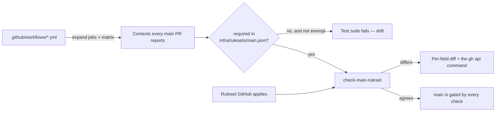

Reconcile the applied ruleset against the file at any time — read-only, and it
skips loudly rather than passing when there is no credential:

```bash
deno run --allow-all worker/deno/mod.ts check-main-ruleset
```

Applying the payload needs **admin** on the repository, which the fleet's
service account does not hold; branch protection stays a deliberate human
action. The command prints the exact call:

```bash
gh api --method PUT repos/stSoftwareAU/VibeCoder/rulesets/21019403 \
  --input infra/rulesets/main.json
```

## Never push to a ruleset-gated PR head

The rule above protects a *branch* from being locked. This one protects the
*agent passes* from a branch that is already locked (Issue #1679).

`stSoftwareAU/GRQ#4702` is the case. Its head is the milestone branch
`milestone/4690-…`, and GRQ's ruleset applies `required_status_checks` to
`milestone/**`, so a commit can only reach that branch through a pull request.
The spelling, CI-fix and merge-conflict passes did not know that: each checked
the head out, let the agent commit on it, and pushed —

```text
remote: error: GH013: Repository rule violations found for
  refs/heads/milestone/4690-….
remote: - 2 of 2 required status checks are expected.
```

— once per worker run, for as long as the PR stayed open. Each refusal spent a
merge-conflict attempt or a CI-fix retry on a push that could never land, and
the spelling pass then claimed the refused push had landed.

So every pass asks
[`worker/deno/lib/gated_head_guard.ts`](../worker/deno/lib/gated_head_guard.ts)
**before** the branch is checked out:

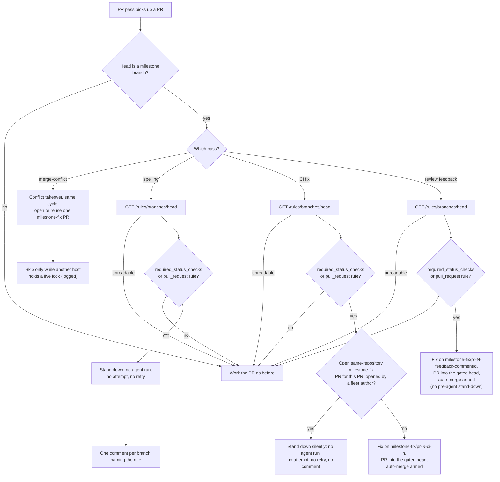

What each pass does with a `milestone/**` head:

| Pass | On a `milestone/**` head | Marker on the comment |
| --- | --- | --- |
| Spelling fix | `guardGatedHead` — stands down when a rule gates it | `vibe-gated-head`, owner `conflict takeover` |
| CI fix | Fixes on `milestone-fix/<leaf>/pr-<N>-ci-<n>`, raises an auto-merge-armed PR into the gated head; stands down before the agent runs (no retry spent) while an open fix PR for this head exists that the fleet opened from this repository (a same-repository head), or when the check for one fails, for example on bad JSON or a full results page (Issues #2907 and #3854) | None — the stand-down is silent; the open fix PR itself carries the explanation |
| Review feedback | Fixes on its own `milestone-fix/<leaf>/pr-<N>-feedback-<commentId>` branch and raises an auto-merge-armed PR the same way; no pre-agent stand-down — a different comment's fix in flight does not stop this one (Issue #2907). The delivery decision is made against origin: commits on the fix branch on origin that the PR head lacks are raised as a fix PR even when the run's local change/push view reads "nothing pushed" (for example the agent pushed the branch itself), so a pushed fix is never stranded behind a no-change reply (Issue #4466). | None |
| Merge conflict | **Conflict takeover in the same cycle**, gated or not: opens one `milestone-fix/<leaf>/pr-<N>-takeover-<sha12>` PR into the head, or reuses the open one (Issue #3031) | None — no stand-down; the takeover's attempt and conclusion markers |

- **The merge-conflict pass takes a milestone head over in the same cycle**
  (Issue #3031). It used to stand down and leave the head to the milestone
  sync (Issue #1772), and GRQ-AutoTrader#2028 and #1957 both stalled there
  until a human merged the base by hand. Now `processMergeConflict` calls
  `runConflictTakeover` for any `milestone/**` head, decided on the branch name
  alone: the takeover resolves on a `milestone-fix/**` side branch and opens
  one PR into the milestone branch, or reuses the open one, so a milestone PR
  never gets a second fix PR. It never pushes the head, so it cannot race the
  sync's push. It skips only while another host holds a live PR lock, and the
  log line names that host and the lock's age. A failed takeover posts a
  `failed` marker that counts against the shared `CONFLICT_RESOLUTION_BUDGET`,
  the same as the ordinary route. No stand-down comment is posted. The
  CI-nudge behaviour (Issue #1762) is unchanged by this.
- **The spelling pass's agent never runs on a gated head**, so nothing is
  committed that cannot be pushed, and no attempt or retry is spent —
  `guardGatedHead` runs before the checkout.
- **CI fix and review feedback fix instead of standing down** (Issue #2907).
  Each checks the gated head's rules the same way, but instead of refusing
  outright it works on a `milestone-fix/<leaf>/pr-<N>-ci-<n>` (CI fix) or
  `milestone-fix/<leaf>/pr-<N>-feedback-<commentId>` (review feedback) side
  branch, runs the agent there, and — once the fix pushes — opens (or reuses)
  an auto-merge-armed pull request into the gated head via
  `raiseMilestoneFixPr()` (`milestone_fix_pr.ts`). A retry is spent on that
  attempt exactly as an ungated head would.
  - **CI fix stands down before the agent runs** when `findOpenMilestoneFixPr()`
    finds an open `milestone-fix/pr-<N>-*` PR for that head that the fleet
    opened in this repository, so a repeat CI
    failure on the same PR does not spend a retry racing a fix already in
    flight.
  - **Review feedback has no such pre-check** — each comment gets its own
    `feedback-<commentId>` branch, so a different comment's fix in flight does
    not stand this one down. `raiseMilestoneFixPr()`'s own reuse only matches
    that exact branch name, which recurs solely on a retried attempt at the
    same comment.
- **The fix PR's merge method follows its head** (Issue #3596). A
  `milestone-fix/**` PR into a `milestone/**` base merges as a merge commit when
  its head merges the default branch, and as a squash otherwise
  (`milestoneFixMergeMethod` in `milestone_fix_pr.ts`). A squash of a head that
  carries a merge of the default branch drops that ancestry, so the final PR
  stays CONFLICTING. Creation arming has no same-repository check, because the
  worker pushed the branch itself. The Auto-Merge sweep and the direct merge
  apply the rule only to same-repository heads, so a fork's fix-shaped head
  still squashes as before. Where the repository forbids merge commits, a fix
  PR that needs one is refused and never squashed: at creation with a warning
  and a PR comment; on the sweep with a logged warning and a failed result; in
  the direct merge with an error. Each names Settings → Pull Requests → Allow
  merge commits. If the method cannot be read, the PR is not armed or merged:
  at creation with a warning and a PR comment; on the sweep as a failed result,
  re-read next scan; in the direct merge refused with an error, retried on the
  next maintenance scan.
- **The CI-nudge pass asks too** (Issue #1762). Its `none` path adds an empty
  commit and pushes it to the head, so on VibeCoder#1741's own milestone head
  it was refused with GH013 every cycle the PR stayed a nudge candidate. The
  guard now runs before that checkout; a gated head is recorded as a `noop`
  nudge and left for the milestone completion path. The `queued` path only
  re-runs a workflow and pushes nothing, so it is not gated.
- **One comment per branch, not one per run.** The comment carries a hidden
  marker — `<!-- vibe-gated-head branch="…" at="…" -->`; a later run that
  finds the marker stays silent. (The retired merge-conflict stand-down's
  `<!-- vibe-milestone-head … -->` marker is no longer posted, Issue #3031.)
  Dedup matches on the `branch="…"` prefix, so a legacy marker without `at=`
  still suppresses a repeat comment. A comment thread that cannot be read posts nothing and
  says so in the log — a duplicate every run is the noise this removes.
- **Each stand-down names its owner and a takeover time** (Issue #2997).
  `buildGatedHeadComment` (owner `conflict takeover`) adds a
  `**Owner:** \`<owner>\`` line and a `**Takeover at <ISO-8601 UTC>**` line —
  the stand-down time plus `CONFLICT_OWNER_CHECK_HOURS` (2 hours): if the PR
  head has not moved by then, the merge-conflict pass takes the conflict back
  and fixes it forward. A builder given a non-finite time throws, so a
  comment with no takeover time is never posted. The merge-conflict pass's own
  park comment (`buildParkedPrComment`, owner `conflict takeover`) carries the
  same two lines — see
  [`docs/workflows/merge-conflicts.md`](workflows/merge-conflicts.md) for the
  park comment.
  `readLatestStandDownAtMs(comments, isTrustedAuthor)` in
  `gated_head_guard.ts` is the pure reader for all three stand-down markers —
  `vibe-gated-head`, the legacy `vibe-milestone-head` (still read on PRs
  that carry one) and the park marker `vibe-merge-conflict-parked`: it returns the newest trusted marker's `at=`
  time (epoch ms), falling back to the comment's `created_at` for a legacy
  marker and ignoring untrusted authors. It is not yet wired to the stall
  watchdog — that is a later sub-issue of #2965.
- **Only `milestone/**` heads are assessed.** `GET /rules/branches/{branch}`
  does not account for the caller's bypass permission, so assessing every head
  would stand the passes down on repos where the fleet account can push
  perfectly well. A milestone head is the case #589 already settled: changes
  land there through a PR into the milestone branch.
- **Unreadable rules fail open.** The push is attempted exactly as before, and
  a genuine refusal is still loud on stderr. Failing closed would stop every
  milestone PR being worked on a transient API blip.
- **A push a ruleset refuses anyway spends no merge-conflict attempt**
  (Issue #1772). Rules only gate `milestone/**` heads here, so an ordinary head
  under a repo-wide ruleset still reaches the push and is still refused with
  GH013. That refusal recurs identically every run, so the pass posts no
  `vibe-coder:merge-conflict-failed` conclusion: it withdraws the attempt
  marker, logs `not charged: push rejected by ruleset`, and the next scan
  counts zero attempts. The drain carries on to the next conflicting PR — only
  a withdrawal made because the **run** was ending (`runEnded`) stops the pass,
  so one gated PR cannot starve the cycle. Every other push failure — a race, a
  network fault — is charged exactly as before.

A claim that the fix was pushed is now made against the remote in all three
passes: the spelling pass adopted `verifyPushLanded()`
([`push_claim_verification.ts`](../worker/deno/lib/push_claim_verification.ts),
Issue #579) and treats a failed commit-and-push as "not pushed" whatever the
local HEAD did.

## The merge-conflict attempt budget

A PR that conflicts with its base cannot run CI, so the merge-conflict pass
merges the base branch in for real rather than side-picking. That pass is
bounded by **two concluded attempts, with no wait between them** —
`DEFAULT_MAX_CONFLICT_ATTEMPTS`
([`pr_merge_conflict_scan.ts`](../worker/deno/lib/pr_merge_conflict_scan.ts)) —
the first attempt and one retry against whatever the base has become since
(Issue #2305). The second judged failure runs the abandon-and-restart rung, and
no outcome of the *scan's* spent-budget route asks a person at all (Issue #2310);
the resolution processor's own spent budget asks no person either — it goes to
abandon-and-redo in its turn (Issue #3032). A PR one concluded failure in is due
again on the very next pass: the four-hour cooldown that used to sit between
the attempts bought nothing a moved base does not, and two hosts are kept off
one PR by the cross-host lock rather than by a wait.

That rung closes the PR — never force-pushes it — and re-queues its originating
issue. A pickup label the issue already carries is kept as it is, so a restart
never demotes a `top-priority` issue; an issue carrying none gains `idle-task`,
the one pickup label the worker may apply, and no route through the rung parks
the issue at `needs-human` (Issue #2277). Every fallback files one
`merge-fallback` issue recording what happened, linked from the closed PR; a PR
whose originating issue cannot be found is closed too, and its flag carries
`idle-task` and the PR's diff summary so the flag *is* the re-do item
(Issue #2310). There is no cap on restarts per issue (Issue #3033): every
redo starts on a fresh branch cut from the base branch's current tip, never
the abandoned one. Its preconditions and its exits are in
[the merge-conflict workflow](workflows/merge-conflicts.md#%EF%B8%8F-abandon-and-restart-before-a-human-is-asked).

**Milestone branches spend the same budget.** `milestone_sync_streak.ts`
exports `MILESTONE_CONFLICT_ATTEMPT_BUDGET` as that same constant — one
constant, two consumers — so the PR ladder and the milestone ladder cannot
drift apart. The sync pass opens and concludes an attempt around every
conflicting merge and hands an exhausted budget on: to a rebuild first when a
roll-back was already spent on the branch, otherwise to the roll-back
(Issues #1778, #4328); nothing is posted to a comment, a label or an issue while an
automatic attempt remains.

What does and does not spend an attempt:

| Attempt outcome                              | Charged? | Why                                                                                       |
| -------------------------------------------- | -------- | ----------------------------------------------------------------------------------------- |
| **Failed** — the merge was judged unmergeable | Yes      | The conflict itself was looked at and beat the worker — or a clean merge produced a tree the repository's own check refuses, a conflict git could not see (Issue #4304) |
| **Disrupted** — opened, never concluded       | No       | A restart, a swept heartbeat, or the worker killing the agent at the cycle deadline; the conflict was never judged (Issues #395, #1693). An agent that runs out **its own** timeout is judged and charged (Issue #2305) |
| **Not-charged** — a conclusion the branch is not answerable for | No | The resolution gate refused an agent's resolution, a ruleset refused the push, or the pass stood down before touching the branch. Not charged is not *no consequence*: a resolution-gate refusal that repeats unchanged is counted separately as a wedge, which holds the milestone's issues back and files one worker diagnostic in VibeCoder (Issue #2388). A refusal of the kind above (the rung was not offered, or the gate refused the resolution) is also counted in `refusedCycles`, and the fourth consecutive one is charged as a failure so the branch climbs to the hand-off (Issue #4328) |

**A provider outage is not a conflict** (Issue #2613). When the agent's provider
refuses the request — a spent balance (HTTP 402), a refused credential
(401/403), a usage limit, or a 429/5xx that outlasted its retries — the conflict was never judged, so the attempt is
concluded as disrupted and charged nothing. The milestone sync reports the
branch `disrupted`: no `merge-fallback` issue is filed, no roll-back is
attempted, gate repair stops, and the branch is left exactly as it was for a
later cycle. A PR conflict run cut short the same way is not charged either. A
spent balance is parked like a usage limit rather than walking the model ladder,
so it adds nothing to a failure streak or a repo back-off. The worker keeps one
self-closing alert issue per provider in VibeCoder — see
[INTERNALS.md → the provider-outage alert](INTERNALS.md#-the-provider-outage-alert).

A disrupted attempt is re-attempted rather than charged, and is bounded
separately: `DEFAULT_MAX_DISRUPTED_ATTEMPTS` disruptions on one PR means the
disruption — not the conflict — is the problem, and it is logged loudly rather
than asking a person: no label is applied and the PR is left queued.

For a **PR**, the ledger is the attempt/conclusion marker comments on the PR
itself, so the bound holds across hosts and worker restarts. For a **milestone
branch that heads an open PR** (the milestone → default-branch PR), the sync
reads and writes the same shared marker comments, so a milestone branch and
its rollup PR cannot each believe they hold separate budgets (Issue #2998).
Only a **milestone branch with no open PR** falls back to the persisted
per-branch ledger in `milestone_sync_failures.json`, described in
[INTERNALS.md → the milestone conflict ledger](INTERNALS.md#%EF%B8%8F-the-conflict-attempt-ledger-a-milestone-branch-spends).
Either way a **success** is the only thing that refills the budget: a moved
default tip never refills the attempt count.

## Failure and recovery modes

| Situation                                           | Worker behaviour                                           | Recovery                                                                       |
| --------------------------------------------------- | ---------------------------------------------------------- | ------------------------------------------------------------------------------ |
| Required CI check **pending**                       | Backstop returns blocked; PR left open                     | Next cycle re-checks once CI completes                                         |
| Required CI check **failed**                        | Backstop returns blocked; PR left open                     | Fix lands on the feature branch; CI re-runs; re-evaluated next cycle           |
| Feature branch **behind target** (no merge queue)   | Backstop defers; PR left open                              | Branch-update maintenance merges the target in → CI re-runs → merge-if-green   |
| Default branch has a **merge queue**                | Direct-merge fallback returns `blocked: merge_queue`; a PR that is only behind is not updated | The queue tests the PR against its future head and lands it once green |
| Head **moves** between the check read and the merge | SHA-pinned merge refused by GitHub; deferred, PR left open | The new head's checks run; next cycle re-evaluates the gate                    |
| Green PR **refused by the merge**                   | Branch update requested; warning logged                    | Retried every cycle (Issue #4304) — never handed to a human                    |
| **Branch update fails** on a behind PR              | Warning logged — never left silently open                  | Retried next cycle; a conflict is resolved by the merge-conflict ladder        |
| Push **targets default branch**                     | Push rejected with explicit error                          | Change is redirected through a feature-branch PR                               |
| Default branch **cannot be resolved**               | Push allowed (fail-open)                                   | Feature-branch pushes are never blocked by a transient lookup failure          |
| Ruleset write **fails for one repo**                | Logged as a non-fatal warning                              | Setup continues; the next setup run retries idempotently                       |
| Required check is **unsatisfiable** on the repo     | Check is dropped from the required set                     | The merge is never blocked by a check that can never pass                      |
| PR head is a **ruleset-gated** `milestone/**` branch (spelling pass) | Pass stands down before the agent runs; one comment names the rule | Changes land through a PR into the milestone branch, or an operator adds a bypass actor |
| PR head is a **ruleset-gated** `milestone/**` branch (CI fix / review feedback) | Fix runs on a `milestone-fix/**` branch and is raised as an auto-merge-armed PR into the gated head (Issue #2907); the CI-fix pass alone stands down without spending a retry while an open fix PR for the head exists that the fleet opened from this repository (a same-repository head), or when the check for one fails | The fix PR's own CI runs and it auto-merges into the gated head once green |

## Related implementation

- [`worker/deno/lib/branch_protection_definitions.ts`](../worker/deno/lib/branch_protection_definitions.ts)
  — visibility/language-aware satisfiable required-check candidates
  (`getRequiredChecksForRepo()`).
- [`worker/deno/lib/repo_rulesets.ts`](../worker/deno/lib/repo_rulesets.ts) —
  ruleset read/write primitives; the only classic-protection endpoint touched
  anywhere is its read.
- [`worker/deno/lib/reported_check_names.ts`](../worker/deno/lib/reported_check_names.ts)
  — `getReportedCheckNames()`, the genuinely-reported check names the candidates
  are intersected with.
- [`worker/deno/lib/gated_head_guard.ts`](../worker/deno/lib/gated_head_guard.ts)
  — `assessGatedHead()`, the read the CI-fix and review-feedback passes use to
  detect a gated head before working on a `milestone-fix/**` branch instead
  (Issue #2907), `guardGatedHead()`, the stand-down the spelling pass still
  makes on a head no direct push can reach. The merge-conflict pass no longer
  stands down on a `milestone/**` head: it calls `runConflictTakeover()`
  (`conflict_takeover.ts`) in the same cycle (Issue #3031).
- [`worker/deno/lib/milestone_fix_pr.ts`](../worker/deno/lib/milestone_fix_pr.ts)
  — `milestoneFixBranchFor()`, `findOpenMilestoneFixPr()` and
  `raiseMilestoneFixPr()`, the CI-fix and review-feedback passes' delivery of a
  gated-head fix through an auto-merge-armed pull request (Issue #2907).
- [`worker/deno/lib/branch_push_policy.ts`](../worker/deno/lib/branch_push_policy.ts)
  — `assessBranchPushPolicy()`, the direct-push / opt-out detection that keeps a
  data repo's branch unlocked.
- [`worker/deno/lib/default_branch_ruleset.ts`](../worker/deno/lib/default_branch_ruleset.ts)
  — `planDefaultBranchRuleset()` (read-only decision) and
  `ensureDefaultBranchRuleset()`, the idempotent ruleset configurator.
- [`worker/deno/lib/default_branch_ruleset_audit.ts`](../worker/deno/lib/default_branch_ruleset_audit.ts)
  — the read-only `audit-default-branch-rulesets` sweep.
- [`worker/deno/lib/pr_check_contexts.ts`](../worker/deno/lib/pr_check_contexts.ts)
  — `pullRequestCheckContexts()` / `reconcileRequiredContexts()`, the contexts a
  PR into `main` always reports and the drift against the committed ruleset.
- [`worker/deno/lib/main_branch_ruleset_check.ts`](../worker/deno/lib/main_branch_ruleset_check.ts)
  — `checkMainBranchRuleset()`, the read-only live-versus-committed
  reconciliation behind `check-main-ruleset`.
- [`worker/deno/lib/ruleset_reconcile.ts`](../worker/deno/lib/ruleset_reconcile.ts)
  — `reconcileRuleset()` / `diffRulesetPayloads()`, the fetch and the
  drift/absent/skipped semantics that check shares with the release-tag one
  ([`check-release-tag-ruleset`](RELEASE-TAGGING.md#reconciling-it),
  Issue #1049).
- [`worker/deno/lib/direct_merge.ts`](../worker/deno/lib/direct_merge.ts) —
  `enforcePreMergeRequirements()` (backstop gate), `directMergePr()`,
  `checkCiStatus()`, `prTargetsDefaultBranch()`.
- [`worker/deno/lib/merge_block_escalation.ts`](../worker/deno/lib/merge_block_escalation.ts)
  — `classifyMergeAttempt()` / `handleMergeAttempt()` / `requestBranchUpdate()`
  (hands-off landing and loud merge failure).
- [`worker/deno/lib/git_push.ts`](../worker/deno/lib/git_push.ts) —
  `assertPushTargetAllowed()` / `resolveLocalDefaultBranch()` (read-only
  default-branch guard).
- [`docs/GITHUB-ACTIONS-AUDIT-SCAN.md`](GITHUB-ACTIONS-AUDIT-SCAN.md) — the
  idle-task template that files the workflow-trigger findings.
