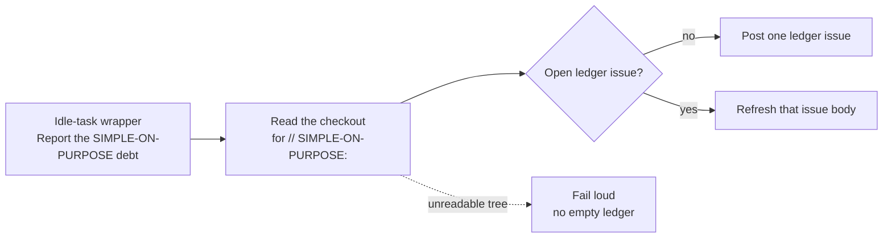

# SIMPLE-ON-PURPOSE debt ledger

The ponytail-debt scan is the twentieth registered
[idle-task](IDLE-TASK-FRAMEWORK.md) template (template #20). When the worker
has no claimable work it may pick this template, clone one monitored
repository, and list every `// SIMPLE-ON-PURPOSE:` marker in that repository.

Each marker is reported with its `path:line`, the ceiling named before
`upgrade when`, and the upgrade condition that follows. A marker with no
`upgrade when` clause is flagged. A marker that names neither a ceiling nor
a condition is flagged as malformed.

The scan posts one ledger issue, or refreshes that issue's body when it is
already open. It makes no commit and opens no pull request. Nothing is
installed and nothing is fetched at run time.

A directory that cannot be listed, or a file that cannot be read, fails the
run. An unreadable tree is never published as an empty ledger.

