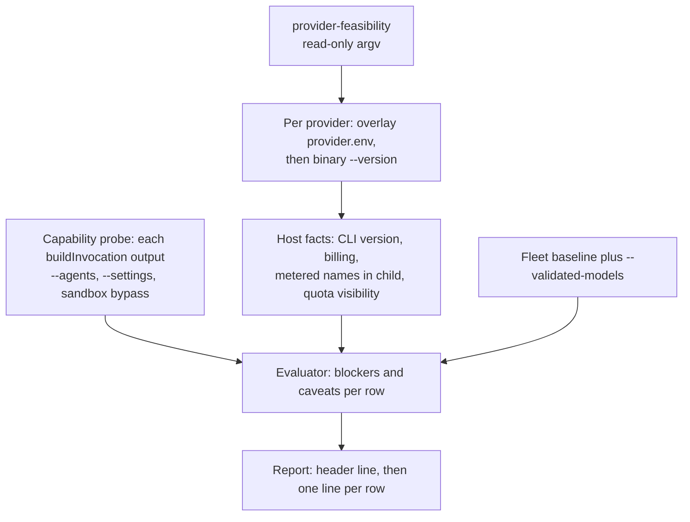

# Provider feasibility — subscription-only Codex and mixed manager–worker

**Issue:** #3647

This is the prerequisite to any cross-provider rollout of the manager–worker split. It changes no default, no routing and no billing path, and the Claude fleet is untouched. Codex is not installed on this worker host. The one live step run here was the read-only `provider-feasibility` command (section 6), and the Codex-dependent items are tracked in the live validation record in section 6. The Codex login, quota read, refresh, resume and model turn are operator procedure (section 5). Related: [Provider parity](PROVIDER-PARITY.md), [Manager-worker contract](MANAGER-WORKER-CONTRACT.md), [Subscription soak](SUBSCRIPTION-SOAK.md).

## 1. Verdict

The verdicts are what `provider-feasibility` prints for these rows at this change. The table is read from the evaluator (`worker/deno/lib/provider_feasibility.ts`) and matches the host run quoted in section 6 (2026-10-25). It shows the default candidate set: claude `opus`, `sonnet`, `haiku`; codex `gpt-6-astra`, `gpt-6.1-sol`, `gpt-6-luna` (`provider_feasibility.ts:93-110`). Three evaluator rules shape it. First, registration comes first: a provider, or an executor or reviewer row's manager provider, that is not registered prints `no-go` with `provider-not-registered` or `manager-provider-not-registered`, and returns before any other check, so the model-validation rule below never applies to it (`provider_feasibility.ts:287-299`). Second, for a registered provider, a model not validated on the host prints `unavailable` whatever its other blockers (`provider_feasibility.ts:350-355`). Its structural blockers still appear in `blockers=`, so the row prints `no-go` once validated. Third, only the Claude fleet's models count as validated without an operator record: `DEFAULT_CLAUDE_MODEL`, the `PHASE_MODEL_DEFAULTS` values and the issue sub-agent constants (`provider_feasibility.ts:133-146`). No Codex model does.

| Provider and model | Role (manager provider) | Printed verdict | Basis |
| --- | --- | --- | --- |
| claude `opus`, `sonnet`, `haiku` | manager (claude) | **go** | Carries `--agents` and `--settings` (`agent_provider.ts:617-618`, `:622-623`). Billing is proved by `CLAUDE_CODE_OAUTH_TOKEN` (`agent_provider.ts:706`). Go only where the host facts pass: CLI installed, fixed-subscription credential, no metered variable in the child. |
| claude `opus`, `sonnet`, `haiku` | executor, reviewer (claude) | **go** | Same-provider sub-agents, so no cross-provider blocker. Same host conditions. |
| codex `gpt-6-astra`, `gpt-6.1-sol`, `gpt-6-luna` | manager (codex) | **unavailable**; no-go once validated | `buildInvocation` emits neither `--agents` nor `--settings` (`agent_provider.ts:895-933`), so `no-sub-agent-definitions` and `no-advisor-edit-guard` apply (`provider_feasibility.ts:336-337`). Not validated on any host by default. All three carry `api-equivalent-price-missing` (no price row; `lookupModelPricing`, `token_usage.ts:642`). Astra: the vendor does not state which plans or sign-in methods get it (section 6). |
| codex `gpt-6-astra`, `gpt-6.1-sol`, `gpt-6-luna` | executor, reviewer (codex) | **unavailable**; no-go once validated | Same-provider, so the same two blockers (`provider_feasibility.ts:336-337`). |
| codex `gpt-6-astra`, `gpt-6.1-sol`, `gpt-6-luna` | executor, reviewer (claude manager) | **unavailable**; no-go once validated | `cross-provider-dispatch-not-implemented` (`provider_feasibility.ts:328-334`). |
| claude `opus`, `sonnet`, `haiku` | executor, reviewer (codex manager) | **no-go** | `cross-provider-dispatch-not-implemented (sub-agents run inside the codex manager's CLI process)`. Claude models are validated, so these print `no-go`, not `unavailable`. This is the six no-go rows in section 6. |
| codex `gpt-5-codex`, `gpt-5`, `gpt-5-mini` (no longer defaults; only via `--models`, e.g. `--models codex:gpt-5-codex`) | any | **unavailable**; no-go once validated | Same blockers as the gpt-6 rows. They have price rows (`token_usage.ts`), so no `api-equivalent-price-missing` caveat. |
| `gemini`, `deepseek` (need `--providers` naming the provider, because the default is `claude,codex`, and `--models` naming the model, because no gemini or deepseek candidate is a default) | any | **unavailable**; no-go once validated | No fixed-price subscription is declared (`agent_provider.ts:965`, `:1057`), so the billing blocker applies. Out of the subscription-only scope. |

This change offers no API-key workaround. A subscription run withholds `OPENAI_API_KEY` and `CODEX_API_KEY` when a Codex home is selected (`codex_env.ts:124-136`). Missing or unreadable billing classifies as `unknown`, and `unknown` is a blocker, never a fallback (`provider_billing.ts:74`, `:138`). The opt-in `agent_provider_fallback` can name a metered provider ([Provider parity](PROVIDER-PARITY.md#subscription-only-billing-policy), rule 3). This change neither adds nor uses it, and no verdict above depends on it.

## 2. Findings per work item

| Item | Finding | Evidence | Live-verified on a host? |
| --- | --- | --- | --- |
| Unattended Codex under a ChatGPT subscription; zero intervention after setup | Designed path: one `codex login --device-auth` at setup, persisted under `CODEX_HOME` in agent state. No restart path runs `codex login`, and a revoked login should classify as unavailable rather than prompt. | `CODEX-SUBSCRIPTION-AUTH.md` (One-time login; Restart behaviour); `SUBSCRIPTION-SOAK.md` section 3 | no — operator procedure |
| Noninteractive renewal | Refresh is the CLI's own, per the OpenAI behaviour cited in `CODEX-SUBSCRIPTION-AUTH.md`. Whether it succeeds unattended is the soak's test. | `CODEX-SUBSCRIPTION-AUTH.md` (Why `CODEX_HOME` is persistent); `SUBSCRIPTION-SOAK.md` section 4 | no — operator procedure |
| Quota and remaining-usage visibility | No free Codex quota probe. The budget is the newest rollout `token_count` snapshot (remaining is `100 - used_percent`), and a fresh `CODEX_HOME` is `unknown` (`no-rate-limit-event`) until a paid turn. Unknown is never zero; the row shows `quota-unknown`. `codex exec --json` carries no `rate_limits`, so the rollout file is the only source (source-level claim in `CODEX-BUDGET-SOURCES.md`, not re-verified here). | `codex_budget.ts:1-32`, `:548`; `provider_quota.ts:9-10`; `PROVIDER-PARITY.md:192-196`; `CODEX-BUDGET-SOURCES.md` (five facts; What was rejected) | no — operator procedure |
| Limits and failure behaviour | Codex failures classify as authentication (`codex_output_adapter.ts:387-406`), quota-exhausted (`:410-422`), invalid-session (`:426-434`), model-unavailable (`:436-445`), network (`:447-458`), rate-limit with retry-after (`:460-473`) or task-failure (`:475-480`), using the categories in `agent_output.ts:77-88`. A bare HTTP 429 is recorded as a throttle, not an exhausted window (`CODEX-BUDGET-SOURCES.md`, Two honest limitations). The CLI does not expose retry-after to the adapter (`CODEX-BUDGET-SOURCES.md`, five facts). In auto mode only two categories are recorded as a process-local outage (`provider_auto_state.ts:15-17`; recorded at `claude_runner.ts:2579-2588`): `quota-exhausted` gets a `retryAt` (the reset the response reported, otherwise five minutes, `provider_auto_state.ts:28`, `:59-60`), and `authentication` gets none, so it holds until the next fresh worker process (`provider_auto_state.ts:9-11`). Other failure categories are not recorded there (`PROVIDER-PARITY.md:137-140`). The vendor page gives no per-model rate limit. | as cited | no — operator procedure |
| Credential isolation | `buildIsolatedCodexChildEnv` deletes `OPENAI_API_KEY`, `CODEX_API_KEY` and `CODEX_HOME` from its copy, then sets only the selected account's values (`codex_env.ts:116-145`). The container mounts only enabled providers' credential directories, read-only (`CONTAINMENT.md:80`, `:115-119`). | as cited | no — operator procedure |
| Per-host container CLI install | Codex is pinned at 0.163.0 (raised from 0.147.0 on 2026-10-22) with per-architecture SHA-256 (`container/tools.json:62-71`). `codex.sh` checks the archive digest (`container/providers/codex.sh:58-59`, `:72`) and the installed `--version` (`:83-90`). It is not in the default image (`container/tools.json:97`, `installedProviders: ["claude"]`); a host adds it through `AGENT_PROVIDERS` (`container/Containerfile:135`). | as cited | no — image not built here |
| Session resume | `codex exec resume <id>` (`codex_executor.ts:542-543`), using the `thread_id` read from the CLI output (`codex_output_adapter.ts:200`). Used only for a stored Codex session with a prior phase (`session_resume.ts:179-186`). | as cited | no — operator procedure |
| Sandboxed tools | Codex runs with `--dangerously-bypass-approvals-and-sandbox` (`codex_executor.ts:58`), so its own sandbox and approvals are off. The container is the boundary: read-only root (`CONTAINMENT.md:177`), outbound-only network (`:325-330`). Claude runs with `--dangerously-skip-permissions` (`agent_provider.ts:606`). | as cited | no — operator procedure |
| Repeatable smoke test, no production side effects | `provider-feasibility` is read-only by code: one `--version` per provider, no model turn, no GitHub call, no file written (`worker/deno/commands/provider_feasibility.ts:1-12`, `:117-131`). The same command was run on this host (section 6). | as cited; section 6 | yes — run on this worker host, 2026-10-25; see section 6 |
| Astra-as-manager; Sol-as-executor | Both `unavailable` on this host (section 1). No API-key or metered route was tested or offered. | section 1 | no — operator procedure (section 5) |
| `CODEX_HOME` default (follow-up #3955) | With `CODEX_HOME` unset, the billing probe resolves the home to `<agent-state>/codex` (`agent_provider.ts:802-803`; `agent_state_dir.ts:54-58`; `codex_auth_mode.ts:171-180`). The child gets `CODEX_HOME` only from the parent environment or the credential overlay (`agent_provider.ts:923`; `codex_env.ts:130-136`). No code under `lib/`, `commands/` or `container/` exports the default to the child. The CLI default is `$HOME/.codex` (`commands/codex_budget.ts:36-44`). Filed as stSoftwareAU/VibeCoder#3955, "Codex billing probe and child disagree on CODEX_HOME when it is not set explicitly". | code read; #3955 | no — operator procedure |

## 3. Provider capability matrix

| Capability | claude | codex | gemini | deepseek |
| --- | --- | --- | --- | --- |
| Fixed-price subscription billing | Yes: `CLAUDE_CODE_OAUTH_TOKEN` (`agent_provider.ts:706`) | Yes, when a ChatGPT login is stored under `CODEX_HOME`; a probe, not a variable (`agent_provider.ts:798-818`) | None declared (`agent_provider.ts:965`) | None declared (`agent_provider.ts:1057`) |
| `--agents` carried | Yes (`agent_provider.ts:617-618`) | No, dropped silently (`agent_provider.ts:870-906`); a native `issue` run carrying them is refused before spawn (`claude_runner.ts`, Issue #4010) | No, dropped silently (contract section 7); a native `issue` run carrying them is refused before spawn (`claude_runner.ts`, Issue #4010) | Stripped with a warning (`agent_provider.ts:1120-1121`); a native `issue` run carrying them is refused before spawn (`claude_runner.ts`, Issue #4010) |
| Advisor edit guard (`--settings`) | Yes, gated to Claude (`claude_runner.ts:1228`; `agent_provider.ts:622-623`, `:638-639`) | No | No | Dropped silently (`agent_provider.ts:1132`; contract section 7) |
| Compaction lever | Yes (`stream_compaction.ts:67-70`) | No (`stream_compaction.ts:160-162`; `compaction unavailable` at `:297`) | No | Yes (`stream_compaction.ts:67-70`) |
| Session resume | Session flags from stored state (`agent_provider.ts:656-659`) | `exec resume <thread id>` (`codex_executor.ts:542-543`) | `--resume latest`, not by id (`gemini_executor.ts:66-67`, `:239-241`) | Claude-shaped flags (`agent_provider.ts:1125-1129`) |
| CLI sandbox | `--dangerously-skip-permissions` (`agent_provider.ts:606`) | `--dangerously-bypass-approvals-and-sandbox` (`codex_executor.ts:58`) | unverified | unverified |
| Quota probe | Status adapter, five-hour and seven-day windows (`provider_auto_runtime.ts:348-350`; `PROVIDER-PARITY.md:37-38`) | Rollout snapshot, unknown until a paid turn (`codex_budget.ts`; `PROVIDER-PARITY.md:194-196`) | None (`provider_auto_runtime.ts:353-360`) | None (`provider_auto_runtime.ts:353-360`) |
| Container install | In the default image (`container/tools.json:97`) | Pinned; opt-in via `AGENT_PROVIDERS` | Pinned; not default | Pinned; not default |

- Sub-agents run inside the advisor's single CLI process (contract section 6). Claude is the only provider with a sub-agent and guard path today.
- The evaluator's `cli-sandbox-bypassed` caveat is keyed to Codex's flag only (`provider_feasibility.ts:182`, `:212`, `:344`), so Claude's `--dangerously-skip-permissions` is not reported.
- The evaluator's own quota reading is Codex-only (`commands/provider_feasibility.ts:252-254`). Every Claude row therefore prints `quota-unknown (no free quota probe for this provider)`, even though the status adapter above exists.

## 4. API-equivalent cost attribution caveats

Decision (2026-10-13): report estimated API-equivalent USD only. No subscription fee is allocated and no seat is amortised. Manager, executor, reviewer, retries and failed attempts are attributed at published pricing, and missing data is flagged.

1. **An estimate, not a bill.** Non-Claude rows are priced at the API-equivalent list price and labelled `(API-equivalent)` (`token_usage.ts:437-445`; `cost_estimate.ts:362`). No subscription quota is converted to USD.
2. **Priced Codex rows.** `gpt-5-codex`, `gpt-5-mini` and `gpt-5` carry rows marked `apiEquivalent: true` (`token_usage.ts:236-270`, `:458-460`).
3. **Dotted ids are understated.** The `gpt-5` prefix also matches `gpt-5.2` and `gpt-5.3-codex`, which the table's comment says OpenAI prices dearer. They cost at the `gpt-5` rate (`token_usage.ts:452-459`). The comment says the worker routes only the three priced ids, and the Codex phase table agrees (`config_defaults.ts:1267-1280`, `:1305-1320`).
4. **No row for `gpt-6-astra`, `gpt-6.1-sol` or `gpt-6-luna`.** `lookupModelPricing` returns `null` (`token_usage.ts:638`, `:691`). The two surfaces then disagree. Run statistics leave the model out of the total, show `pricing unknown` and mark the heading `(partial — see below)` (`cost_estimate.ts:267-285`, `:347-359`). The credit log and daily summary charge it at `UNPRICED_UPPER_BOUND_PRICING` and list it in `unpricedModels` (`token_usage.ts:477-485`, `:744-752`; `credit_tracker.ts:514`, `:543`, `:547`). That upper bound is deliberate (Issue #3870). A run's run-statistics figure can therefore be lower than what the spend ceiling counts.
5. **Missing usage is unknown, never zero.** A Codex run with no usable usage is `usageUnknown` and carries a warning (`provider_token_usage.ts:108-135`). The credit entry records the flag (`claude_runner.ts:2495-2524`), and the daily summary counts it separately (`credit_tracker.ts:479`).
6. **Sub-agents.** Claude's `--agents` sub-agents run inside the advisor's CLI process (contract section 6), so their tokens sit in the advisor's invocation. A per-model split needs Claude's per-model breakdown. Without one, a multi-model run is marked `sub-agents: not costed` (`planning_run_stats.ts:599-637`; `cost_estimate.ts:374`). The Codex adapter reads no per-model breakdown or served-model list, so a Codex run cannot be split by role.
7. **Retries and failed attempts.** Recorded only when credit logging is configured: an invocation that settles writes one credit entry only `if (creditLogDir && workerName)` (`claude_runner.ts:2511`), so a call carrying neither option writes none. The write precedes failure classification (`:2562`). `runClaudeWithTimeout` (`:1151`) wraps `runClaudeWithTimeoutBody` (`:1160`), which holds the write. The retry loop calls `runClaudeWithTimeout` once per attempt and counts `totalInvocations` (`claude_runner.ts:3039`, `:3143-3144`), so each attempt with logging configured is its own entry. A failed attempt is costed at whatever usage it reported, and otherwise recorded as `usageUnknown` (`:2503-2505`, `:2523`). Not confirmed, so treated as missing data: whether every production caller sets both options (not traced); attempts that fail before the child settles; retries made by other modules (whether `infra_retry.ts`, `haiku_refusal_retry.ts` and others re-enter the same call is not traced); and a lost credit write, which is fire-and-forget and only logs a warning (`claude_runner.ts:2528-2536`).
8. **Model attribution.** The credit model is the requested id, or, when none was resolved, the first served model, and only then the sentinel `default` (`claude_runner.ts:2486-2488`; sentinel at `:784`), which has no price row and is charged at the upper bound.

**Missing data, explicitly:** Codex subscription consumption in tokens or windows (never converted, so every Codex figure is API-equivalent only); the Codex served model (not recorded); prices for `gpt-6-astra`, `gpt-6.1-sol` and `gpt-6-luna` (none); attempts that fail before the child settles and retries outside the runner wrapper (not traced); failed credit appends (warning only); and a per-role split for any Codex run.

## 5. Smoke test

### Command contract

From `worker/deno`:

```bash
deno run --allow-read --allow-env --allow-run mod.ts provider-feasibility \
  [--providers claude,codex] [--models codex:gpt-6-astra,...] \
  [--validated-models codex:gpt-6.1-sol,...] [--codex-home DIR] [--credential-dir DIR]
```

- Runs only `<binary> --version` per provider, under a scrubbed environment (`commands/provider_feasibility.ts:117-131`). No model turn, no GitHub API call, no file written (`:1-12`).
- Reads the provider's `provider.env` under the credential directory as the worker provisions it. The file values overlay the parent environment (`commands/provider_feasibility.ts:226-238`). Output carries variable names and state labels only, passed through `redactSecrets` (`:138`, `:143`, `:382-390`).
- Default candidates: claude `opus`, `sonnet`, `haiku`; codex `gpt-6-astra`, `gpt-6.1-sol`, `gpt-6-luna` — the Codex tiers mapped to Claude's on 2026-10-22 (`provider_feasibility.ts`, `DEFAULT_CANDIDATES`). The `gpt-5` ids are evaluated only when named in `--models`.
- `--providers` defaults to `claude,codex` (`commands/provider_feasibility.ts:58`, `:302`), so `--models` alone is enough to add a model of either. A model of any other provider (gemini, deepseek) also needs `--providers` naming it, and `--models` rejects a model whose provider is not selected (`:317-325`).
- Rows: one manager row per model, then for each manager provider one executor and one reviewer row per model. That is 30 rows by default: six manager rows, then two manager providers × six models × two roles = 24 (`provider_feasibility.ts:240-263`).
- Capabilities come from each provider's own `buildInvocation` output (`--agents`, `--settings`, `--dangerously-bypass-approvals-and-sandbox`), not a hard-coded list (`provider_feasibility.ts:193-214`).
- `--validated-models` adds to the fleet baseline (`commands/provider_feasibility.ts:343-355`). `--codex-home` sets `CODEX_HOME` for the probe (`:357-359`).

Output format (`provider_feasibility.ts:372-380`):

```text
[feasibility] rows=<n> go=<n> no-go=<n> unavailable=<n>
[feasibility] <verdict> role=<role> manager=<p> provider=<p> model=<m> blockers=<...|none> caveats=<...|none>
```

Blockers make a row `no-go`: `provider-not-registered`, `manager-provider-not-registered`, `host-not-probed`, `cli-not-runnable (<detail>)`, `billing-<mode> (<reason>)`, `metered-credential-reaches-child (<names>)`, `cross-provider-dispatch-not-implemented (...)`, `no-sub-agent-definitions`, `no-advisor-edit-guard` (`provider_feasibility.ts:292-340`). `cli-not-runnable` covers a missing binary (detail `not on PATH`) and a CLI whose `--version` exits non-zero (detail `exit <code>: <first stderr line>`, redacted and capped at 200 characters, or `exit <code>` when stderr is empty). It was named `cli-not-installed` until the rename noted in section 6. `model-not-validated-on-host` makes it `unavailable`. Caveats never block: `quota-unknown (<detail>)`, `cli-sandbox-bypassed (...)`, `api-equivalent-price-missing`.



### Reading the verdicts

- `go`: no blocker. Caveats may still apply.
- `no-go`: at least one blocker. The `blockers=` list says which.
- `unavailable`: not validated on this host. Its structural blockers are still listed, so validation alone does not turn a Codex row into `go`.

### Live entitlement check (opt-in, manual)

This consumes fixed-price subscription quota. It must never use an API key.

1. Use a fresh directory: `cd "$(mktemp -d)"`.
2. Run with `CODEX_HOME` set to the persistent subscription home and both API-key variables unset (layout per `CODEX-SUBSCRIPTION-AUTH.md`):

   ```bash
   cd "$(mktemp -d)" && env -u OPENAI_API_KEY -u CODEX_API_KEY \
     CODEX_HOME=/home/vibe/auto-issue-work-agent-state/codex \
     codex exec --model gpt-6.1-sol --sandbox read-only --skip-git-repo-check \
     "Reply with the single word OK"
   ```

   The `codex exec --model gpt-6.1-sol` form matches the vendor page's CLI example `codex exec -m gpt-6.1-sol` (fetched 2026-10-17). Only `--sandbox read-only` is unverified against an installed CLI.

3. If it fails as model-unavailable, authentication or quota-exhausted (`codex_output_adapter.ts:387-445`), record nothing.
4. On success, re-run the smoke test with `--validated-models codex:gpt-6.1-sol`. The command writes no file, so the operator keeps the record.
5. To read the quota snapshot without a turn, run `deno run --allow-read --allow-env mod.ts codex-budget --codex-home <dir>` from `worker/deno` (`CODEX-BUDGET-SOURCES.md`, The live diagnostic).
6. The restart and token-refresh steps are in [Subscription soak](SUBSCRIPTION-SOAK.md) sections 3 and 4, not restated here.

## 6. What was and was not verified on this host

**Observed run, this worker host, 2026-10-25.** From `worker/deno`:

```bash
deno run --frozen --lock=deno.lock --allow-read --allow-env --allow-run --allow-sys=hostname mod.ts provider-feasibility
```

Observed header: `[feasibility] rows=30 go=9 no-go=6 unavailable=15`. The rows match the table in section 1:

- Claude: the nine rows for `opus`, `sonnet` and `haiku` as manager, and as executor and reviewer under a Claude manager, printed `go`. Each carries the caveat `quota-unknown (no free quota probe for this provider)`. The `claude` binary is at `/usr/local/bin/claude` on this host.
- Codex: all 15 Codex rows printed `unavailable`. Each carried `cli-not-runnable (not on PATH)`, `billing-unknown (subscription-credential-missing)` and `model-not-validated-on-host`, with the caveats `quota-unknown (no-session-file)`, `cli-sandbox-bypassed (...)` and `api-equivalent-price-missing`. Codex manager rows, and Codex executor and reviewer rows under a Codex manager, also add `no-sub-agent-definitions` and `no-advisor-edit-guard`; Codex rows under a Claude manager carry `cross-provider-dispatch-not-implemented` instead.
- No-go: the six Claude executor and reviewer rows under a Codex manager, each blocked only by `cross-provider-dispatch-not-implemented`.
- Stderr: the same three `[SECURITY] refusing to stage the gh credential` lines (`lib/gh_credential_stage.ts:420`) and a final `[SECURITY] cannot re-stage the gh credential` line (`:435`). The run has no `--allow-write`, so staging was refused and nothing was written. The code path that reaches staging was not traced, so "no file written" holds under this permission set.

History: the 2026-10-17 run, made before the Codex tiers were mapped on 2026-10-22, printed `rows=40 go=9 no-go=6 unavailable=25` against the older candidate list. It is superseded by the run above.

Host probe, 2026-10-25: `codex` is not on PATH, `~/.codex` does not exist, `docker` and `podman` are not on PATH, and `/home/vibe/auto-issue-work-agent-state/` holds only `claude-config/`, `lost+found/` and `.claude-sessions/`.

**Not verified:**

- Codex is not installed on this host (the evaluator reports `cli-not-runnable (not on PATH)`). No login, quota read, refresh, resume or model turn was run.
- Vendor statements were fetched on 2026-10-17 from https://developers.openai.com/codex/models, which redirected to https://learn.chatgpt.com/docs/models. They are dated to that fetch. The page says the GPT-6.1 Sol launch rollout includes Plus, Pro, Business, Enterprise and Edu in Codex, that Enterprise and Edu keep it off until an administrator enables it, and that "Free and Go are not included at launch". It says Astra availability "depends on the rollout, your sign-in method, and your client" and that "Some paid plans omit Astra Extra High", without stating which plans or sign-in methods get Astra. It gives no per-model rate limit. It states that `gpt-5.4` and `gpt-5.4-mini` retired from Codex with ChatGPT sign-in on August 31, 2026, that `gpt-5.5` retires on October 14, 2026 at 19:00 UTC, and that `gpt-5.2` and `gpt-5.3-codex` are deprecated. It does not mention `gpt-5`, `gpt-5-codex` or `gpt-5-mini`. Their entitlement under ChatGPT sign-in is therefore unverified, and they are not claimed to be retired.
- Whether the pinned CLI 0.163.0 (`container/tools.json:65`; raised from 0.147.0 on 2026-10-22) accepts `gpt-6-astra` or `gpt-6.1-sol` is unverified. A model-unavailable result may come from the pin rather than the entitlement.
- No container image was built. `codex.sh` was read, not run.
- Gemini and DeepSeek sandbox facts are unverified. The evaluator's quota reading covers Codex only (section 3).
- The `CODEX_HOME` default divergence (section 2, #3955) is code-read only. Whether the child's default home persists inside the container is unverified.
- Evaluator gap: `cli-sandbox-bypassed` covers only Codex's flag, so Claude's bypass is not reported (section 3).
- Nothing in the "Live validation record" below has been run.

### Live validation record (pending — needs a Codex-capable host)

These items need a host with the Codex CLI and a one-off ChatGPT subscription login. No worker host has either. Until an operator fills in the evidence column, an item stays unverified and must not be read as met.

| Item | How to exercise it | Evidence to record | Status |
| --- | --- | --- | --- |
| 1. One-off login and smoke test | `codex login --device-auth`, then `provider-feasibility` with `--codex-home` per `CODEX-SUBSCRIPTION-AUTH.md` | The header line and the Codex rows | not run — no Codex-capable host |
| 2. Unattended renewal | Per `SUBSCRIPTION-SOAK.md` section 4 | The section 4 record | not run — no Codex-capable host |
| 3. Quota and remaining-usage visibility | `codex-budget --codex-home <dir>` after one paid turn (`CODEX-BUDGET-SOURCES.md`, The live diagnostic) | The `codex-budget` output after that turn | not run — no Codex-capable host |
| 4. Credential isolation | Confirm `OPENAI_API_KEY` and `CODEX_API_KEY` are absent from the child (`codex_env.ts:116-145`) | The child's environment check, by variable name | not run — no Codex-capable host |
| 5. Per-host container CLI install | Build with `AGENT_PROVIDERS="claude,codex"` (`container/Containerfile:135`) | The `codex --version` output, which must equal 0.163.0 | not run — no Codex-capable host |
| 6. Session resume | `codex exec resume <id>` (`codex_executor.ts:542-543`) | The resumed session's output | not run — no Codex-capable host |
| 7. Sandboxed tools | Confirm the container boundary with `--dangerously-bypass-approvals-and-sandbox` (`codex_executor.ts:58`) | The container-boundary check result | not run — no Codex-capable host |
| 8. Zero manual intervention after setup | Restart per `SUBSCRIPTION-SOAK.md` section 3 | Whether the restart completed with no prompt | not run — no Codex-capable host |
| 9. Rate-limit behaviour | Record the classified category on a limit hit (`codex_output_adapter.ts:387-480`) | The category recorded | not run — no Codex-capable host |
| 10. Astra and Sol availability | Read the host's actual `codex` model list; no API-key route | Each model recorded as available or unavailable | not run — no Codex-capable host |

## 7. What would change the verdicts

In the order [Manager-worker contract](MANAGER-WORKER-CONTRACT.md) section 9 sets (steps 3 to 7):

1. An explicit provider capability record (step 3). Today the evaluator reads `buildInvocation` output instead.
2. A fail-loud refusal when the split is on and a provider cannot carry the contract (section 8 invariant; step 4). For `--agents` on the native split path this is now delivered (`runClaudeWithTimeoutBody` in `claude_runner.ts`, Issue #4010): a run carrying `--agents` is refused before spawn under Codex, Gemini and DeepSeek. DeepSeek still drops `settings` silently at the descriptor layer, but the edit-guard hook is only requested for Claude.
3. A provider-neutral edit guard (step 6). Today the guard exists only for Claude (contract section 6).
4. Cross-provider dispatch. Only this lifts `cross-provider-dispatch-not-implemented` for Sol, or any Codex executor, under a Claude manager. It is not implemented.
5. A pricing row for any newly routed model. The comment at `token_usage.ts:452-459` says to add the row with the routing change, including a row for any `gpt-5.x` id before it is routed.
6. A passing live entitlement check on the host (section 5) and a completed soak ([Subscription soak](SUBSCRIPTION-SOAK.md)). Validation alone does not make a Codex row `go`.
7. A vendor statement that Astra is exposed to the coding agent under fixed-price terms. Without one, Astra stays `unavailable`, and the manager contract still blocks it.
8. Any CLI pin change in `container/tools.json`, since it changes the capability and entitlement facts.
