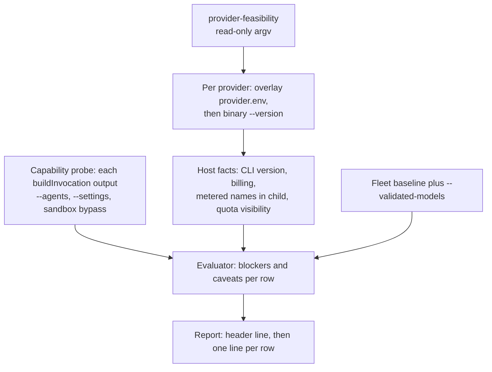

# Provider feasibility — subscription-only Codex and mixed manager–worker

**Issue:** #3647

This is the prerequisite to any cross-provider rollout of the manager–worker split. It changes no default, no routing and no billing path, and the Claude fleet is untouched. Codex is not installed on the host where this was written, so nothing here was verified live. The live steps are an operator procedure (section 5). Related: [Provider parity](PROVIDER-PARITY.md), [Manager-worker contract](MANAGER-WORKER-CONTRACT.md), [Subscription soak](SUBSCRIPTION-SOAK.md).

## 1. Verdict

The verdicts are what `provider-feasibility` prints for these rows at this change. They are read from the evaluator (`worker/deno/lib/provider_feasibility.ts`), not from a host run. Two evaluator rules shape the table. First, a model not validated on the host prints `unavailable` whatever else is true (`provider_feasibility.ts:352-355`); its structural blockers still appear in `blockers=`, so the row prints `no-go` once validated. Second, only the Claude fleet's models count as validated without an operator record: `DEFAULT_CLAUDE_MODEL`, the `PHASE_MODEL_DEFAULTS` values and the issue sub-agent constants (`provider_feasibility.ts:135-149`). No Codex model does.

| Provider and model | Role (manager provider) | Printed verdict | Basis |
| --- | --- | --- | --- |
| claude `opus`, `sonnet`, `haiku` | manager (claude) | **go** | Carries `--agents` and `--settings` (`agent_provider.ts:617-618`, `:622-623`). Billing is proved by `CLAUDE_CODE_OAUTH_TOKEN` (`agent_provider.ts:706`). Go only where the host facts pass: CLI installed, fixed-subscription credential, no metered variable in the child. |
| claude `opus`, `sonnet`, `haiku` | executor, reviewer (claude) | **go** | Same-provider sub-agents, so no cross-provider blocker. Same host conditions. |
| codex `gpt-5-codex`, `gpt-5`, `gpt-5-mini` | manager (codex) | **unavailable**; no-go once validated | `buildInvocation` emits neither `--agents` nor `--settings` (`agent_provider.ts:870-906`), so `no-sub-agent-definitions` and `no-advisor-edit-guard` apply. Not validated on any host by default. |
| codex `gpt-5-codex`, `gpt-5`, `gpt-5-mini` | executor, reviewer (codex) | **unavailable**; no-go once validated | Same-provider, so the same two blockers. |
| codex `gpt-5-codex`, `gpt-5`, `gpt-5-mini` | executor, reviewer (claude) | **unavailable**; no-go once validated | `cross-provider-dispatch-not-implemented` (`provider_feasibility.ts:331-336`). |
| codex `gpt-6-astra` | manager (codex) | **unavailable**; no-go regardless | Codex cannot carry the manager contract (row above). The vendor does not state availability (section 5), and there is no price row (`api-equivalent-price-missing`). |
| codex `gpt-6.1-sol` | executor, reviewer (claude) | **unavailable**; no-go once validated | Vendor-exposed in the CLI on paid plans (dated quote, section 5), but cross-provider dispatch is not implemented. No price row. |
| codex `gpt-6.1-sol` | manager, executor, reviewer (codex) | **unavailable**; no-go once validated | Same-provider blockers as above. |
| gemini, deepseek (only if named with `--providers` and `--models`) | any | **unavailable**; no-go once validated | No fixed-price subscription is declared (`agent_provider.ts:965`, `:1057`), so the billing blocker applies. Out of the subscription-only scope. |

This change offers no API-key workaround. A subscription run withholds `OPENAI_API_KEY` and `CODEX_API_KEY` when a Codex home is selected (`codex_env.ts:124-136`). Missing or unreadable billing classifies as `unknown`, and `unknown` is a blocker, never a fallback (`provider_billing.ts:74`, `:138`). The opt-in `agent_provider_fallback` can name a metered provider ([Provider parity](PROVIDER-PARITY.md#subscription-only-billing-policy), rule 3). This change neither adds nor uses it, and no verdict above depends on it.

## 2. Findings per work item

| Item | Finding | Evidence | Live-verified on a host? |
| --- | --- | --- | --- |
| Unattended Codex under a ChatGPT subscription; zero intervention after setup | Designed path: one `codex login --device-auth` at setup, persisted under `CODEX_HOME` in agent state. No restart path runs `codex login`, and a revoked login should classify as unavailable rather than prompt. | `CODEX-SUBSCRIPTION-AUTH.md` (One-time login; Restart behaviour); `SUBSCRIPTION-SOAK.md` section 3 | no — operator procedure |
| Noninteractive renewal | Refresh is the CLI's own, per the OpenAI behaviour cited in `CODEX-SUBSCRIPTION-AUTH.md`. Whether it succeeds unattended is the soak's test. | `CODEX-SUBSCRIPTION-AUTH.md` (Why `CODEX_HOME` is persistent); `SUBSCRIPTION-SOAK.md` section 4 | no — operator procedure |
| Quota and remaining-usage visibility | No free Codex quota probe. The budget is the newest rollout `token_count` snapshot (remaining is `100 - used_percent`), and a fresh `CODEX_HOME` is `unknown` (`no-rate-limit-event`) until a paid turn. Unknown is never zero; the row shows `quota-unknown`. `codex exec --json` carries no `rate_limits`, so the rollout file is the only source (source-level claim in `CODEX-BUDGET-SOURCES.md`, not re-verified here). | `codex_budget.ts:1-32`, `:548`; `provider_quota.ts:9-10`; `PROVIDER-PARITY.md:192-196`; `CODEX-BUDGET-SOURCES.md` (five facts; What was rejected) | no — operator procedure |
| Limits and failure behaviour | Codex failures classify as authentication (`codex_output_adapter.ts:387-406`), quota-exhausted (`:410-422`), invalid-session (`:426-434`), model-unavailable (`:436-445`), network (`:447-458`), rate-limit with retry-after (`:460-473`) or task-failure (`:475-480`), using the categories in `agent_output.ts:77-88`. In auto mode a failing provider is unavailable until its reset, or for five minutes when none was reported (`PROVIDER-PARITY.md:133-136`; `provider_auto_state.ts:27-28`). A bare HTTP 429 is recorded as a throttle, not an exhausted window (`CODEX-BUDGET-SOURCES.md`, Two honest limitations). The CLI does not expose retry-after to the adapter (`CODEX-BUDGET-SOURCES.md`, five facts). The vendor page publishes no per-model rate limit. | as cited | no — operator procedure |
| Credential isolation | `buildIsolatedCodexChildEnv` deletes `OPENAI_API_KEY`, `CODEX_API_KEY` and `CODEX_HOME` from its copy, then sets only the selected account's values (`codex_env.ts:116-145`). The container mounts only enabled providers' credential directories, read-only (`CONTAINMENT.md:80`, `:115-119`). | as cited | no — operator procedure |
| Per-host container CLI install | Codex is pinned at 0.147.0 with per-architecture SHA-256 (`container/tools.json:62-71`). `codex.sh` checks the archive digest (`container/providers/codex.sh:58-59`, `:72`) and the installed `--version` (`:83-90`). It is not in the default image (`container/tools.json:97`, `installedProviders: ["claude"]`); a host adds it through `AGENT_PROVIDERS` (`container/Containerfile:135`). | as cited | no — image not built here |
| Session resume | `codex exec resume <id>` (`codex_executor.ts:345-347`), using the `thread_id` read from the CLI output (`codex_output_adapter.ts:200`). Used only for a stored Codex session with a prior phase (`session_resume.ts:179-186`). | as cited | no — operator procedure |
| Sandboxed tools | Codex runs with `--dangerously-bypass-approvals-and-sandbox` (`codex_executor.ts:56`), so its own sandbox and approvals are off. The container is the boundary: read-only root (`CONTAINMENT.md:177`), outbound-only network (`:325-330`). Claude runs with `--dangerously-skip-permissions` (`agent_provider.ts:606`). | as cited | no — operator procedure |
| Repeatable smoke test, no production side effects | `provider-feasibility` is read-only by code: one `--version` per provider, no model turn, no GitHub call, no file written (`worker/deno/commands/provider_feasibility.ts:1-12`, `:99-107`). | as cited | no — not run for this document |
| Astra-as-manager; Sol-as-executor | Both `unavailable` on this host (section 1). No API-key or metered route was tested or offered. | section 1 | no — operator procedure (section 5) |
| `CODEX_HOME` default (found while reading) | With `CODEX_HOME` unset, the billing probe resolves the home to `<agent-state>/codex` (`agent_provider.ts:802-803`; `agent_state_dir.ts:54-58`; `codex_auth_mode.ts:171-180`). The child gets `CODEX_HOME` only from the parent environment or credential overlay (`agent_provider.ts:923`; `codex_env.ts:130-136`). No code in `lib/`, `commands/` or `container/` that I searched exports the default to the child. The CLI default is `$HOME/.codex` (`commands/codex_budget.ts:36-44`). | code read only | no — operator procedure |

## 3. Provider capability matrix

| Capability | claude | codex | gemini | deepseek |
| --- | --- | --- | --- | --- |
| Fixed-price subscription billing | Yes: `CLAUDE_CODE_OAUTH_TOKEN` (`agent_provider.ts:706`) | Yes, when a ChatGPT login is stored under `CODEX_HOME`; a probe, not a variable (`agent_provider.ts:798-818`) | None declared (`agent_provider.ts:965`) | None declared (`agent_provider.ts:1057`) |
| `--agents` carried | Yes (`agent_provider.ts:617-618`) | No, dropped silently (`agent_provider.ts:870-906`) | No, dropped silently (contract section 7) | Stripped with a warning (`agent_provider.ts:1120-1121`) |
| Advisor edit guard (`--settings`) | Yes, gated to Claude (`claude_runner.ts:1228`; `agent_provider.ts:622-623`, `:638-639`) | No | No | Dropped silently (`agent_provider.ts:1132`; contract section 7) |
| Compaction lever | Yes (`stream_compaction.ts:67-70`) | No (`stream_compaction.ts:160-162`; `compaction unavailable` at `:297`) | No | Yes (`stream_compaction.ts:67-70`) |
| Session resume | Session flags from stored state (`agent_provider.ts:656-659`) | `exec resume <thread id>` (`codex_executor.ts:345-347`) | `--resume latest`, not by id (`gemini_executor.ts:66-67`, `:239-241`) | Claude-shaped flags (`agent_provider.ts:1125-1129`) |
| CLI sandbox | `--dangerously-skip-permissions` (`agent_provider.ts:606`) | `--dangerously-bypass-approvals-and-sandbox` (`codex_executor.ts:56`) | unverified | unverified |
| Quota probe | Status adapter, five-hour and seven-day windows (`provider_auto_runtime.ts:348-350`; `PROVIDER-PARITY.md:37-38`) | Rollout snapshot, unknown until a paid turn (`codex_budget.ts`; `PROVIDER-PARITY.md:194-196`) | None (`provider_auto_runtime.ts:353-360`) | None (`provider_auto_runtime.ts:353-360`) |
| Container install | In the default image (`container/tools.json:97`) | Pinned; opt-in via `AGENT_PROVIDERS` | Pinned; not default | Pinned; not default |

- Sub-agents run inside the advisor's single CLI process (contract section 6). Claude is the only provider with a sub-agent and guard path today.
- The evaluator's `cli-sandbox-bypassed` caveat is keyed to Codex's flag only (`provider_feasibility.ts:182`, `:212`), so Claude's `--dangerously-skip-permissions` is not reported.

## 4. API-equivalent cost attribution caveats

Decision (2026-10-13): report estimated API-equivalent USD only. No subscription fee is allocated and no seat is amortised. Manager, executor, reviewer, retries and failed attempts are attributed at published pricing, and missing data is flagged.

1. **An estimate, not a bill.** Non-Claude rows are priced at the API-equivalent list price and labelled `(API-equivalent)` (`token_usage.ts:437-445`; `cost_estimate.ts:362`). No subscription quota is converted to USD.
2. **Priced Codex rows.** `gpt-5-codex`, `gpt-5-mini` and `gpt-5` carry rows marked `apiEquivalent: true` (`token_usage.ts:236-270`, `:458-460`).
3. **Dotted ids are understated.** The `gpt-5` prefix also matches `gpt-5.2` and `gpt-5.3-codex`, which the table's comment says OpenAI prices dearer. They cost at the `gpt-5` rate (`token_usage.ts:452-459`). The comment says the worker routes only the three priced ids, and the Codex phase table agrees (`config_defaults.ts:1267-1280`, `:1305-1320`).
4. **No row for `gpt-6-astra` or `gpt-6.1-sol`.** `lookupModelPricing` returns `null` (`token_usage.ts:638`, `:691`). The two surfaces then disagree. Run statistics leave the model out of the total, show `pricing unknown` and mark the heading `(partial — see below)` (`cost_estimate.ts:267-285`, `:347-359`). The credit log and daily summary charge it at `UNPRICED_UPPER_BOUND_PRICING` and list it in `unpricedModels` (`token_usage.ts:477-485`, `:744-752`; `credit_tracker.ts:514`, `:543`, `:547`). That upper bound is deliberate (Issue #3870). A run's run-statistics figure can therefore be lower than what the spend ceiling counts.
5. **Missing usage is unknown, never zero.** A Codex run with no usable usage is `usageUnknown` and carries a warning (`provider_token_usage.ts:108-135`). The credit entry records the flag (`claude_runner.ts:2456-2476`), and the daily summary counts it separately (`credit_tracker.ts:479`).
6. **Sub-agents.** Claude's `--agents` sub-agents run inside the advisor's CLI process (contract section 6), so their tokens sit in the advisor's invocation. A per-model split needs Claude's per-model breakdown. Without one, a multi-model run is marked `sub-agents: not costed` (`planning_run_stats.ts:599-637`; `cost_estimate.ts:374`). The Codex adapter reads no per-model breakdown or served-model list, so a Codex run cannot be split by role.
7. **Retries and failed attempts.** Recorded: every `runClaudeWithTimeout` invocation that settles writes one credit entry (`claude_runner.ts:2465`) before failure classification (`:2510`). The retry loop calls it once per attempt and counts `totalInvocations` (`claude_runner.ts:3015-3016`), so each attempt is its own entry. A failed attempt is costed at whatever usage it reported, and otherwise recorded as `usageUnknown`. Not confirmed, so missing data: attempts that fail before the child settles; retries made by other modules (I did not trace whether `infra_retry.ts`, `haiku_refusal_retry.ts` and others re-enter the same call); and a lost credit write, which is fire-and-forget and only logs a warning (`claude_runner.ts:2484`).
8. **Model attribution.** The credit model is the requested id (`claude_runner.ts:2439`). An unresolved model is logged as the sentinel `default` (`claude_runner.ts:769`), which has no price row and is charged at the upper bound.

**Missing data, explicitly:** Codex subscription consumption in tokens or windows (never converted, so every Codex figure is API-equivalent only); the Codex served model (not recorded); prices for `gpt-6-astra` and `gpt-6.1-sol` (none); attempts that fail before the child settles and retries outside the runner wrapper (not traced); failed credit appends (warning only); and a per-role split for any Codex run.

## 5. Smoke test

### Command contract

From `worker/deno`:

```bash
deno run --allow-read --allow-env --allow-run mod.ts provider-feasibility \
  [--providers claude,codex] [--models codex:gpt-6-astra,...] \
  [--validated-models codex:gpt-6.1-sol,...] [--codex-home DIR] [--credential-dir DIR]
```

- Runs only `<binary> --version` per provider, under a scrubbed environment (`commands/provider_feasibility.ts:99-107`). No model turn, no GitHub API call, no file written (`:1-12`).
- Reads the provider's `provider.env` under the credential directory as the worker provisions it (`commands/provider_feasibility.ts:194-210`). Output carries variable names and state labels only, passed through `redactSecrets` (`:368-376`).
- Default candidates: claude `opus`, `sonnet`, `haiku`; codex `gpt-5-codex`, `gpt-5`, `gpt-5-mini`, `gpt-6-astra`, `gpt-6.1-sol` (`provider_feasibility.ts:93-110`).
- Rows: one manager row per model, then for each manager provider one executor and one reviewer row per model. That is 40 rows by default (`provider_feasibility.ts:242-266`).
- Capabilities come from each provider's own `buildInvocation` output (`--agents`, `--settings`, `--dangerously-bypass-approvals-and-sandbox`), not a hard-coded list (`provider_feasibility.ts:193-214`).
- `--validated-models` adds to the fleet baseline (`commands/provider_feasibility.ts:338-341`). `--codex-home` sets `CODEX_HOME` for the probe (`:343-345`).

Output format (`provider_feasibility.ts:372-380`):

```text
[feasibility] rows=<n> go=<n> no-go=<n> unavailable=<n>
[feasibility] <verdict> role=<role> manager=<p> provider=<p> model=<m> blockers=<...|none> caveats=<...|none>
```

Blockers make a row `no-go`: `provider-not-registered`, `manager-provider-not-registered`, `host-not-probed`, `cli-not-installed (<detail>)`, `billing-<mode> (<reason>)`, `metered-credential-reaches-child (<names>)`, `cross-provider-dispatch-not-implemented (...)`, `no-sub-agent-definitions`, `no-advisor-edit-guard` (`provider_feasibility.ts:292-340`). `model-not-validated-on-host` makes it `unavailable`. Caveats never block: `quota-unknown (<detail>)`, `cli-sandbox-bypassed (...)`, `api-equivalent-price-missing`.



### Reading the verdicts

- `go`: no blocker. Caveats may still apply.
- `no-go`: at least one blocker; the `blockers=` list says which.
- `unavailable`: not validated on this host. Its structural blockers are still listed, so validation alone does not turn a Codex row into `go`.

### Live entitlement check (opt-in, manual)

This consumes fixed-price subscription quota. It must never use an API key.

1. Use a fresh directory: `cd "$(mktemp -d)"`.
2. Run with `CODEX_HOME` set to the persistent subscription home and both API-key variables unset (layout per `CODEX-SUBSCRIPTION-AUTH.md`):

   ```bash
   cd "$(mktemp -d)" && env -u OPENAI_API_KEY -u CODEX_API_KEY \
     CODEX_HOME=/home/vibe/auto-issue-work-agent-state/codex \
     codex exec --model gpt-6.1-sol --sandbox read-only --skip-git-repo-check \
     "Reply with the single word OK"
   ```

3. If it fails as model-unavailable, authentication or quota-exhausted (`codex_output_adapter.ts:387-445`), record nothing.
4. On success, re-run the smoke test with `--validated-models codex:gpt-6.1-sol`. The command writes no file, so the operator keeps the record.
5. To read the quota snapshot without a turn, run `deno run --allow-read --allow-env mod.ts codex-budget --codex-home <dir>` from `worker/deno` (`CODEX-BUDGET-SOURCES.md`, The live diagnostic).
6. The restart and token-refresh steps are in [Subscription soak](SUBSCRIPTION-SOAK.md) sections 3 and 4, not restated here.

The `--sandbox read-only` flag and the `codex exec --model` form come from the task brief. They were not checked against the installed CLI, because Codex is not installed here.

## 6. What was not verified on this host

- Codex is not installed (`codex: command not found`) and there is no `CODEX_HOME`. No login, quota read, refresh, resume or model turn was run.
- The `provider-feasibility` command was not run for this document; section 1 is read from code.
- Vendor statements are quoted from the task brief (learn.chatgpt.com/docs/models, retrieved 2026-10-17). They were not re-fetched here, and they are dated.
- Entitlement of `gpt-5`, `gpt-5-codex` and `gpt-5-mini` under ChatGPT sign-in: the vendor page does not mention them. They are not claimed to be retired. Unverified.
- Whether the pinned CLI 0.147.0 (`container/tools.json:65`) accepts `gpt-6-astra` or `gpt-6.1-sol` is unverified. A model-unavailable result may come from the pin rather than the entitlement.
- Astra availability by plan and sign-in method: the vendor text does not state it.
- No container image was built; `codex.sh` was read, not run.
- Gemini and DeepSeek sandbox and quota facts are unverified.
- The `CODEX_HOME` default divergence (section 2) is code-read only. Whether the child's default home persists inside the container is unverified.
- Evaluator gap: `cli-sandbox-bypassed` covers only Codex's flag, so Claude's bypass is not reported (section 3).

## 7. What would change the verdicts

In the order [Manager-worker contract](MANAGER-WORKER-CONTRACT.md) section 9 sets (steps 3 to 7):

1. An explicit provider capability record (step 3). Today the evaluator reads `buildInvocation` output instead.
2. A fail-loud refusal when the split is on and a provider cannot carry the contract (section 8 invariant; step 4). Until then Codex, Gemini and DeepSeek drop agents or settings silently (sections 6 and 7 of the contract).
3. A provider-neutral edit guard (step 6). Today the guard exists only for Claude (contract section 6).
4. Cross-provider dispatch. Only this lifts `cross-provider-dispatch-not-implemented` for Sol, or any Codex executor, under a Claude manager. It is not implemented.
5. A pricing row for any newly routed model. The comment at `token_usage.ts:452-459` says to add the row with the routing change, including a row for any `gpt-5.x` id before it is routed.
6. A passing live entitlement check on the host (section 5) and a completed soak ([Subscription soak](SUBSCRIPTION-SOAK.md)). Validation alone does not make a Codex row `go`.
7. A vendor statement that Astra is exposed to the coding agent under fixed-price terms. Without one, Astra stays `unavailable`, and the manager contract still blocks it.
8. Any CLI pin change in `container/tools.json`, since it changes the capability and entitlement facts.
