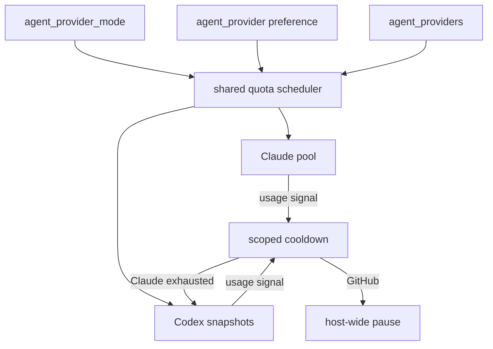
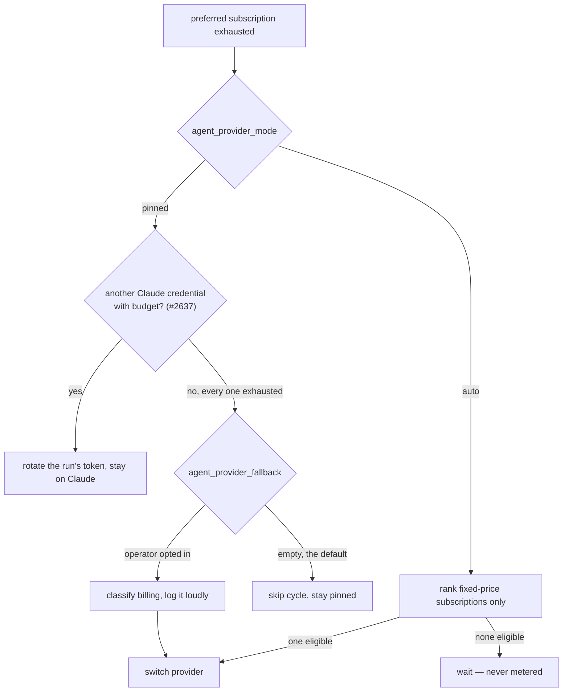

# Provider parity — Codex and mixed fleets

**Issues:** [#1696](https://github.com/stSoftwareAU/VibeCoder/issues/1696),
[#1698](https://github.com/stSoftwareAU/VibeCoder/issues/1698),
[#1700](https://github.com/stSoftwareAU/VibeCoder/issues/1700),
[#1703](https://github.com/stSoftwareAU/VibeCoder/issues/1703),
[#1926](https://github.com/stSoftwareAU/VibeCoder/issues/1926),
[#1923](https://github.com/stSoftwareAU/VibeCoder/issues/1923)
· **Parent:** #1694

Claude remains the default. This page is the operator runbook for a
Codex-only host and for an **opt-in** mixed Claude/Codex host. Nothing
here automatically enables new routing on the production fleet.

See also: [Manager-worker contract](MANAGER-WORKER-CONTRACT.md) for the provider-neutral advisor/executor contract.

See also: [Provider feasibility](PROVIDER-FEASIBILITY.md) for the go/no-go per provider, model and role, and the read-only `provider-feasibility` smoke test.

## Quota policy

A provider adapter supplies real windows, reset timestamps and an
identity label. The shared ranker (`worker/deno/lib/provider_quota.ts`)
uses the ordering each provider policy declares. Unknown budgets stay unknown
— they are never treated as zero.

- **Claude** keeps the five-hour soft gate (#1623 / #1685), prefers weekly
  telemetry to the existing non-weekly fallback (#4503), and ranks weekly
  credentials by largest remaining share. Equal shares use reset then discovery
  order; an elapsed week counts as full. A zero weekly share with a future
  reset is exhausted, separately from the removed 10% band.
- **Codex** uses the rollout `token_count` snapshot from
  [Codex Budget Sources](CODEX-BUDGET-SOURCES.md). An API-key account
  has no subscription window (`api-key-account`). It retains remaining-per-hour
  ordering and its 10% low-remaining floor. Explicit exhaustion excludes that
  credential until reset.

An **account-wide** Claude usage limit writes `provider: "claude"` on the
rate-limit signal. The host loop pauses only when every **enabled**
provider is that blocked vendor, or when GitHub (shared infrastructure) is
the blocker. Codex work continues on a mixed host. A model-scoped limit
that names a tier (for example `You've reached your Fable limit. Switch to
another model to continue.`) writes no rate-limit signal at all; the run
steps down to the next Claude model on the same provider and records a
cooldown in `WORK_DIR/.model_usage_cooldown.json` (Issue #5086, see
[TROUBLESHOOTING](TROUBLESHOOTING.md#-rate-limits-and-subscription-usage-limits)).

## Multiple Codex credentials

`codex/provider.env`, `codex/provider-2.env`, … are ranked by the
shared policy. A single account still works. Only the selected
account's `OPENAI_API_KEY` / `CODEX_API_KEY` / `CODEX_HOME` reach the
child (`buildIsolatedCodexChildEnv`). Other Codex accounts and every
Claude secret stay out. The process-global `HOME` / `CODEX_HOME` are
not rewritten.

## Subscription-only billing policy

VibeCoder is designed to run unattended for months on **fixed-price
subscriptions**, so a subscription that is spent, stale or revoked must fail
authentication rather than quietly become per-token API spend (Issue #1923).

Each provider declares how its credentials are billed, on its own descriptor
(`AgentProviderDescriptor.billing`), and one shared classifier
(`worker/deno/lib/provider_billing.ts`) answers the question for every routing
path. Nothing is inferred from a provider id.

| Provider | Fixed-price subscription | Metered |
| -------- | ------------------------ | ------- |
| Claude | `CLAUDE_CODE_OAUTH_TOKEN` | `ANTHROPIC_API_KEY` |
| Codex | a ChatGPT login persisted under `CODEX_HOME` | `OPENAI_API_KEY`, `CODEX_API_KEY` |
| Gemini | a Google login persisted under `GEMINI_CLI_HOME` | `GEMINI_API_KEY`, `GOOGLE_API_KEY` |
| DeepSeek | none | `DEEPSEEK_API_KEY` |

A Gemini Google-account login proves a fixed-price subscription
(`gemini-google-login`) when an explicit `GEMINI_CLI_HOME` holds
`.gemini/oauth_creds.json` with a `refresh_token` and `.gemini/settings.json`
selects no other auth type; free-tier and paid logins classify the same. A
`settings.json` selecting `gemini-api-key` is `metered`
(`gemini-settings-api-key`), and a corrupt or unreadable login is `unknown`
(`gemini-login-unreadable (<fault>)`) unless a metered key is also present,
when it is `metered`. With no `GEMINI_CLI_HOME`,
`GEMINI_API_KEY` / `GOOGLE_API_KEY` stay `metered`. `GEMINI_CLI_HOME` is a
non-secret state selector in `gemini/provider.env`, so `setup.sh` provisioning
is unchanged. At startup the worker seeds
`<GEMINI_CLI_HOME>/.gemini/oauth_creds.json` once from
`<credential dir>/gemini/oauth_creds.json` (owner-only `0600`, with a
`refresh_token`) and never overwrites an existing, refreshed login; with
neither file present worker startup fails with an error naming both paths. The
Gemini child then gets that home plus `GOOGLE_GENAI_USE_GCA=true` and neither
`GEMINI_API_KEY` nor `GOOGLE_API_KEY`, so an expired login fails
authentication instead of becoming metered spend (mirroring Codex's
`CODEX_HOME` guard); `GEMINI_CLI_HOME` is denied by name to the Claude, Codex
and DeepSeek children. Encrypted credential storage
(`GEMINI_FORCE_ENCRYPTED_FILE_STORAGE=true`) is not supported. The owner's
one-time login and seeding steps are in
[Gemini subscription authentication](GEMINI-SUBSCRIPTION-AUTH.md).

Three rules follow, and they are separate:

1. **Unknown is never fixed-price.** A provider that proves neither is
   `unknown`, and only a positively proved subscription is eligible for
   `agent_provider_mode: "auto"`. A failed probe cannot become API spend.
2. **A subscription run withholds every other Anthropic credential.** When the
   run holds a usable `CLAUDE_CODE_OAUTH_TOKEN`, `buildClaudeChildEnv` removes
   `ANTHROPIC_API_KEY` and `ANTHROPIC_AUTH_TOKEN` from the child, so the CLI
   has nothing to fall back on. This mirrors `buildIsolatedCodexChildEnv`'s
   `CODEX_HOME` guard. `ANTHROPIC_AUTH_TOKEN` is withheld but **not** declared
   metered: it is a bearer for a proxied endpoint, so what it bills cannot be
   proved — it classifies as `unknown`, which rule 1 already makes ineligible.
   A host with **no** subscription token is untouched: an explicit API-key
   deployment keeps working exactly as before.
3. **`agent_provider_fallback` is metered-capable, and says so.** The opt-in
   list is an explicit operator choice and is honoured as written, including a
   metered alternative such as DeepSeek. It is **outside** the subscription-only
   policy, which governs automatic routing. What it may not be is silent: the
   health gate classifies the alternative before switching and logs
   `billing=<mode>` on the switch, plus a `logError` line carrying the
   evidence — the credential variable for a `metered` alternative, or the
   state label (`subscription-credential-missing`,
   `codex-auth-json-unreadable (…)`) for an `unknown` one, which the line
   reports as billing that cannot be established rather than as per-token
   spend. An operator
   who wants the never-metered guarantee end to end leaves
   `agent_provider_fallback` empty (the default) and uses
   `agent_provider_mode: "auto"`, which defers rather than switching to metered.

## Gemini capabilities

The Gemini descriptor (`GEMINI_PROVIDER`, `agent_provider.ts:1079-1209`)
carries the following, read from the code against the pinned Gemini CLI 0.68.0;
every path in the Code column is under `worker/deno/lib/`.

| Capability | Gemini | Code |
| ---------- | ------ | ---- |
| Output adapter | `--output-format stream-json` NDJSON is decoded by `GEMINI_OUTPUT_ADAPTER` into the answer, session, usage and a typed failure: out-of-memory, authentication, quota-exhausted, model-unavailable, turn-limit, network, rate-limit, task-failure (Issue #5340) | `gemini_executor.ts:66-67`; `gemini_output_adapter.ts:414-530`, `:533`; `agent_provider.ts:1133-1135` |
| Session resume | By worker-generated id: `--session-id <id>` on the first phase or after another provider's state; `--resume <id>` once Gemini reported that id; `--resume latest` is refused (Issue #5342) | `session_resume.ts:214-228` (`geminiSessionFlags`); `gemini_executor.ts:269-286` |
| Tool denials | Written to a per-run settings file the CLI reads from `GEMINI_CLI_SYSTEM_SETTINGS_PATH`: mapped tools go to `tools.exclude`, `Task` / `Agent` denials set `experimental.enableAgents: false`, and `NotebookEdit` needs no setting (Gemini has no notebook tool); a `Bash(<prefix>:*)` denial (the `pr_review` feedback run's `git push`, `gh pr merge` and `gh api`, each also denied in its `rtk`-prefixed form (Issue #5571), the best-practices scan's `cargo` family) becomes a deny rule in `policy/deny.toml` beside the settings file, which the settings name under `policyPaths` and the CLI's Policy Engine applies to a shell command, a sub-command of `a && b` and a `bash -c` body alike, but not through a leading `FOO=1` assignment (PR #5524 review); a denied tool with no Gemini mapping (including a `Bash(...)` that is not a plain `:*` prefix), or a file that cannot be written, refuses the spawn (Issue #5341) | `gemini_settings.ts:36`, `:50-57`, `:120` (`buildGeminiToolSettings`), `:286` (`writeGeminiRunSettings`); `agent_provider.ts:1196-1208`; `claude_runner.ts:1665` (`prepareRunSettings` call) |
| MCP servers | The run's MCP config is written under `mcpServers` in the same settings file, and `--allowed-mcp-server-names` always names exactly those servers; its empty form loads none, including servers from the user's own settings or extensions (Issue #5343) | `gemini_settings.ts:294-298`; `gemini_executor.ts:288-300`; `agent_provider.ts:1150-1155` |
| Approvals and sandbox | `--approval-mode yolo` and `--skip-trust`; the CLI's own `--sandbox` is deliberately absent, the container is the boundary | `gemini_executor.ts:65-71` |
| Sub-agents (`--agents`) and advisor edit guard (`--settings`) | Not carried; an issue run that wants sub-agents is rerouted to Claude or stripped before spawn | `agent_provider.ts:1150-1177` (`buildInvocation`); `issue_run_provider_agents.ts` |
| Orchestration roles | The executor, both reviewer and the explorer roles (not the manager, which needs stream compaction Gemini lacks) can run on Gemini, with denials through the settings file (Issue #5341) | `orchestration/capabilities.ts:58-66` (`ROLE_REQUIRED_CAPABILITIES`), `:154-232` (`assertRoleSupported`); `claude_runner.ts:536-540` |

## Routing and fallback

| Key | Default | Meaning |
| --- | ------- | ------- |
| `agent_provider` | `claude` | Preferred provider |
| `repo_config.<repo>.agent_provider` | unset | Per-repo provider pin (Issue #2048); binds when no per-invocation selection names one, and beats both the global `agent_provider` and `auto` ranking for that repo |
| `agent_provider_mode` | `auto` with two or more subscription-capable providers (Claude, Codex, Gemini) enabled, else `pinned`; a provider other than the preferred `agent_provider` proved metered (an API key alone) does not count | `pinned` preserves the existing provider choice; `auto` ranks eligible fixed-price subscriptions (default since #5089) |
| `agent_providers` | preferred alone | Enabled set (credentials mounted) |
| `agent_provider_fallback` | `[]` | Ordered alternatives; empty **pins** the preferred provider |

`agent_provider_mode: "auto"` is the quota-aware path from #1926. Before each
work item it ranks enabled Claude OAuth and Codex ChatGPT subscriptions using
the lowest remaining percentage across each provider's current known windows.
A Gemini Google-account login (under an explicit `GEMINI_CLI_HOME`) is also a
candidate, but its quota is passive: no network probe and no windows, so it
ranks after every provider with fresh known quota. A Gemini API key alone is
metered and never selected.
The provider with more remaining capacity wins in either direction. Status
freshness still controls eligibility; an exact tie is not broken (the input
order stands, and the next work item re-decides — owner decision, #5089). API-key accounts, unknown billing and providers without a
fixed-subscription status adapter are excluded. A real quota or authentication
failure makes that provider unavailable to subsequent work; quota failures are
rechecked at the stated reset, or after a five-minute cooldown when no reset was
reported. If no safe candidate remains, the host waits.

While automatic routing is active, auxiliary configuration reloads preserve
the router's active provider between refreshes. The loaded `agentProvider`
still reports the file's preference to callers; it does not overwrite the
process-wide selection used to invoke work. With automatic routing inactive,
reloads retain the historical pinned-provider behaviour. A per-run health-gate
override continues to take precedence in either mode.

Provision Codex's persistent subscription home using
[Codex subscription authentication](CODEX-SUBSCRIPTION-AUTH.md). The router
reads the same explicit `CODEX_HOME` that the child receives and ignores parent
API keys that the child withholds. It first attempts a bounded, read-only
`codex app-server` `account/rateLimits/read` request, with no thread or model
turn. Successful quota observations are cached for five minutes per subscription
home. If the probe fails, rollout quota retains its original evidence time, so
rereading an old session cannot make its budget fresh.

When automatic routing selects Codex for an issue, both worker entry paths use
the external orchestrator even without a separate `external_orchestration`
opt-in. This preserves the manager/executor/reviewer workflow without passing
Claude's native `--agents` definitions to Codex. Unpinned roles use Codex's
manager (`gpt-6.1-sol`), executor (`gpt-6-luna`) and reviewer (`gpt-6-astra`)
defaults. Explicit role provider/model settings remain pins; existing model-only
settings retain their Claude interpretation. An explicit per-repo provider pin
still determines that repository's provider. Allocation experiment assignments
remain authoritative when configured.

The shared `phase_model_tiers` policy and `provider_model_tiers` catalogue keep
labels independent of model vendors; see
[Model selection](MODEL-AND-CACHING.md#model-selection). To make Quorum follow
the budget-selected provider too, set `quorum_planners: ["auto", "auto"]` and
`quorum_judge: "auto"`. Explicit provider ids remain pins.

An explicit per-invocation provider bypasses the process default and remains
absolute. A per-repo pin (`repo_config.<repo>.agent_provider`, Issue #2048) is
the same class of explicit operator pin, scoped to one repository: it binds
when no per-invocation selection names a provider, beats the global
`agent_provider`, and beats `auto` ranking for that repo. It must name a
registered provider and fails loudly otherwise. In auto mode,
`VIBE_AGENT_PROVIDER` is an emergency per-process pin; it must name an enabled
provider. Outside auto mode the established configuration-file precedence is
unchanged.

The older `agent_provider_fallback` path remains independently opt-in. It fires
only on `subscription-exhausted`, `transient-rate-limit` or
`model-unavailable`, and only when the alternative is already enabled. For a
Claude preferred provider it fires only once **every** Claude credential in
the pool is exhausted on its five-hour window or its weekly limit — one spent
subscription rotates to the next — and the run switches back as soon as one
has budget again (Issue #2637). The weekly pace projection never switches
provider: it drops the backlog tiers only. A `model-unavailable` refusal is
also handled inside the run: when the provider has no cheaper model, the
invocation that was refused is retried on the next alternative, so a phase whose
model the provider will not serve does not give up while the health gate
passes on a different model (Issue #4034). A Codex ChatGPT-login refusal of a
built-in default model is first retried once on Codex with no `--model`
(Issue #4221) before that switch. External orchestration role calls are the
exception: the gate pins the role's provider, so a refusal ends that call on
its own provider (Issue #4986). The fallback is not restricted to fixed-price
subscriptions — see [Subscription-only billing
policy](#subscription-only-billing-policy) for what it logs when the
alternative is metered. Quota-aware auto selection is the default on a host
with two or more subscription-capable providers (Claude, Codex, Gemini)
enabled (#5089); a host with fewer stays pinned. A provider other than the
preferred `agent_provider` whose credentials are proved metered (an API key
alone) does not count; the preferred provider always counts.

## Staged rollout

1. Keep Claude as the default on existing Macs. Do not archive
   repositories or remove Claude support.
2. Test a **Codex-only** host (`agent_provider` / `agent_providers`
   both `codex`) with a dedicated test repository.
3. Opt in **one** non-critical mixed host with
   `agent_provider_mode: "auto"`, `agent_provider: "claude"`, and
   `agent_providers: ["claude", "codex"]` after observed success.
4. Expand only after the mixed host has completed a quota-exhaustion
   and recovery cycle with correct provider attribution.

Rollback: set `agent_provider_mode` to `pinned`, set
`agent_provider` back to `claude`, and relaunch. Existing Claude sessions and
WIP branches are untouched.

## Diagnostics

- Offline: `deno task test tests/provider_parity_conformance_test.ts`
  (fake adapters; no credentials).
- Live Codex smoke (opt-in, never in CI): provision a non-production
  ChatGPT login under a dedicated `CODEX_HOME`, point
  `codex/provider.env` at it, and run one issue on a throwaway
  repository. Do not put real credentials in logs or fixtures.
- Quota source limits and the rejected probe paths are in
  [CODEX-BUDGET-SOURCES.md](CODEX-BUDGET-SOURCES.md).

## Remaining limitations

- Codex has no free quota probe; snapshots come from a prior run's
  rollout file. A brand-new `CODEX_HOME` is unknown until the first
  paid turn.
- Exhaustion prose from the CLI often lacks a parseable reset timezone;
  the reset stays unknown rather than guessed.
- Only Claude and DeepSeek (the same CLI) expose a conversation-compaction
  lever to the worker, so only they get the pre-issue stream compaction
  described in [CONFIGURATION.md](CONFIGURATION.md#-session-resume)
  (Issue #2337). A Codex or Gemini run carries the stream's full transcript and
  logs `compaction unavailable` naming the provider.
- Automatic selection supports Claude OAuth, Codex ChatGPT and Gemini
  Google-account logins. A Gemini login (fixed-price under an explicit
  `GEMINI_CLI_HOME`) has passive quota: `geminiStatus` does no probe and
  reports no windows, so it ranks in the `fresh-unknown-quota` band after every
  provider with fresh known quota. A run-reported quota exhaustion makes it
  `exhausted` until its retry time (the stated reset, or a five-minute
  cooldown), and an authentication failure makes it unavailable. A Gemini API
  key alone is `metered` (`api-key-account`) and never selected; with
  neither credential, billing is `unknown` and Gemini is excluded. DeepSeek and every unknown or metered
  billing mode are ineligible. The default is `auto` when two or more
  subscription-capable providers are enabled (#5089), where a provider other
  than the preferred `agent_provider` proved metered does not count and the
  preferred provider always counts.
- Quota *probing* is still per provider (`provider_auto_runtime.ts`), even
  though billing classification is now descriptor-declared. Adding a
  subscription provider means writing its status adapter as well as its
  `billing` declaration. Two of those adapters (`claudeStatus`, `codexStatus`)
  still test the same credential variables themselves while answering their own
  question — remaining quota — so the same facts are written down twice.
  `geminiStatus` does not: it is built on `classifyProviderBilling` and reads
  the shared classifier rather than re-testing variables.
  Folding them into the shared classifier changes what is eligible for
  `auto`, which this goal deliberately stages behind the soak qualification.
