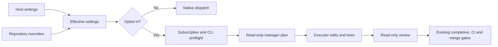

# Independent role configuration

Issue runs keep the native Claude manager and sub-agents by default. Independent
CLI dispatch is opt-in, on both the main worker loop and the standalone
`execute-claude-phase` command. The change implements the orchestration required
by #3643; it does not reopen the cancelled orchestration ticket.

## Configuration and precedence

Each host reads its own operator-owned `.config.json`. Repository settings come
from that file's `repo_config`, never from a checked-out repository. An example:

```json
{
  "agent_providers": ["claude", "codex"],
  "external_orchestration": true,
  "external_orchestration_settings": {
    "manager": {"provider": "claude", "model": "sonnet", "effort": "high"},
    "executor": {"provider": "codex", "model": "gpt-6.1-sol", "cli_adapter": "codex"},
    "reviewer": {"provider": "claude", "model": "opus", "effort": "high"},
    "max_retries": 1,
    "max_concurrency": 1,
    "max_invocations": 6
  },
  "repo_config": {
    "org/legacy": {"external_orchestration": false},
    "org/other": {
      "external_orchestration_settings": {
        "executor": {"provider": "claude", "model": "haiku", "effort": "high"}
      }
    }
  }
}
```

The named Codex model must be available under the host's subscription; this
example does not establish entitlement. A model rejection fails the invocation
rather than selecting another provider or activating API billing.

Repository role fields override host fields. Changing a role's provider clears
inherited model, effort and adapter settings from the previous provider. With no
role selections, external dispatch uses a Sonnet/high manager, a Haiku/high
executor, and manager review. An explicit `reviewer` selection uses a separate
read-only call, defaulting to Claude Opus/high for omitted fields. This reviewer
checks the issue implementation; post-PR review and required CI retain their
existing gates.

Supported effort values are `low`, `medium` and `high`. `cli_adapter`, when
specified, must name the selected provider's registered adapter; arbitrary
executables are not accepted. Unknown keys, malformed settings, mismatched
adapters and providers absent from `agent_providers` fail configuration loading.
Setup preserves these operator overrides. An absent switch preserves native
behaviour, including existing model, phase and sub-agent-tier settings.

## Execution and safeguards



External dispatch is sequential. `max_concurrency` above one is refused. Claude
roles use CLI tool denials; Codex roles use `read-only` or `workspace-write`
sandboxes with approval prompts disabled, network access disabled for workspace
writes, and multi-agent delegation disabled. Gemini cannot enforce the required
tool restrictions; DeepSeek has no proved fixed-price subscription. Those
combinations fail closed. A host without the requested CLI or subscription
fails before paid work. Observed exhausted or unavailable quota also refuses;
unknown quota remains unknown and the runner handles a provider's actual quota
response.

Each role invokes the existing provider adapter and its credential-isolation
path. No session transcript is resumed across roles, model fallback is disabled,
and role invocations are labelled for lifecycle cost attribution. Effective
selections are logged. Checkpoints are stored beside the work volume, scoped by
repository and issue; the lease identity includes branch and role configuration
so changed settings cannot replay another configuration's completed calls.
Retries, call count and optional estimated-cost limits bound orchestration; the
cost limit is checked between calls, not a guarantee of the cost of the next
call. No code purchases subscriptions or changes billing.

## Rollback and verification

Set `external_orchestration` to `false` on the host or repository and restart the
worker. The native path resumes with the existing configuration keys. Different
hosts can choose different providers without changing repository or issue
selection. This configuration does not select or rebalance experiment cohorts.

Behavioural tests cover configuration layering, malformed overrides, adapter
validation, same-provider and cross-provider handoffs, independent review,
context separation, checkpoint recovery and native rollback. Live subscription
entitlements and sandbox support must be verified on each participating host.
