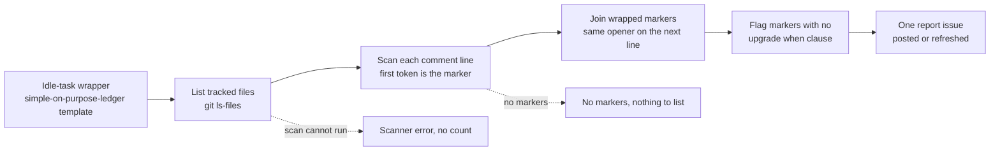

# 📒 SIMPLE-ON-PURPOSE Ledger — Operator Manual

The SIMPLE-ON-PURPOSE ledger is the twentieth registered
[idle-task](IDLE-TASK-FRAMEWORK.md) template (template #20). When the worker
has no claimable work it may pick this template, read one monitored repository's
tracked files, and list every `SIMPLE-ON-PURPOSE` marker it finds. It then posts
or refreshes **one report issue** for that repository. The report answers a
single question: which deliberate corner cuts are in this codebase, what limit
each one accepts, and what should prompt an upgrade.

The ledger is **report-only**. It never edits code, never commits, never opens a
pull request, and never fetches or installs anything at run time.

> **Terminology.** A _SIMPLE-ON-PURPOSE marker_ is a comment that records a
> deliberately simple implementation. It states the ceiling (what the simple
> version does not handle) and the condition that should trigger an upgrade. The
> convention is set out in [Coding standards](../CODING-STANDARDS.md).

## Design intent — the failure this prevents

A corner cut is often the right call on the day it is made. The risk is that it
outlives the reason for it. A `// TODO` with no condition attached never says
when it has become a problem, so the simple version quietly becomes permanent.

The marker format fixes that by making every cut name its own ceiling and its
own upgrade trigger. This template makes the set visible: a reviewer can read
one report and see every known limit in a repository, rather than discovering
them one incident at a time. The idea comes from the ponytail `/ponytail-debt`
ledger, adopted here in our own words — see
[References](REFERENCES.md).



## Marker format

```text
// SIMPLE-ON-PURPOSE: <ceiling> — upgrade when <condition>
```

- **Ceiling** — what the simple version does not handle.
- **`upgrade when`** — the clause the scanner looks for. The text after it is
  the condition that should prompt the upgrade.
- **Dash** — the em dash shown above is the house style between the two parts.

A marker may wrap. When the marker's line is followed by further comment lines
that open the same way (`//` after `//`, `#` after `#`), the scanner joins them
into one marker and reports the first line.

## What the scanner counts

The rules are implemented by
[`simple_on_purpose_scanner.ts`](../worker/deno/lib/simple_on_purpose_scanner.ts).
The scan is deterministic, uses no LLM and no network, and treats every file as
text.

| Input | Rule |
| --- | --- |
| Comment line | The keyword `SIMPLE-ON-PURPOSE:` must be the **first token** of a comment line. The recognised openers are `//`, `#`, `--`, `;`, `/*`, `*` and `<!--`. |
| Mid-line or string text | Not a marker. A string literal, a mention in prose or a keyword after code on the same line does not count. |
| `.md` files | Skipped. Prose documentation may quote the marker without owning it. |
| Binary files | Skipped when the file holds a NUL byte. |
| Oversized files | Skipped when over 1 MiB. |
| Submodule gitlinks and symlinks | Not read at all. |

## What is flagged

Every marker is listed with its path, its line, its ceiling and its upgrade
condition. The report then calls out **markers missing `upgrade when`**. A marker
with a ceiling but no condition is the failure this ledger exists to catch: it
records a limit without saying when the limit stops being acceptable.

A repository with no markers is a valid outcome, and it is distinct from a scan
that could not run.

## Report shape and refresh

The report is a single issue per monitored repository, labelled
`simple-on-purpose-ledger`. It lists:

1. every marker, with its path, line, ceiling and upgrade condition; and
2. the markers that have no `upgrade when` clause, called out separately.

The issue is refreshed on later runs rather than duplicated, so a repository
carries one ledger that reflects the current tree. A scan that fails records the
scanner error **instead of** a count. An unreadable file list or an unreadable
file is never reported as a clean ledger.

## Report-only guarantee

The template has no path that changes the repository it reads:

- it never edits a file or runs a script from the repository;
- it never commits, pushes or opens a pull request;
- it never fetches or installs a tool at run time;
- it never fails a gate, and a marker it lists does not block any work.

The fix for a flagged marker is an ordinary issue for a human to decide on. The
ledger informs that decision and makes no change itself.

## Enable and cadence

The template is part of the standard idle-task draw, so it runs with no extra
switch. Its place in that draw is governed as for every other template:

- **Draw weight.** The default draw is uniform. To bias it, set an entry for
  `simple-on-purpose-ledger` in `idle_task_template_weights`, as described in
  [Configuration](CONFIGURATION.md#%EF%B8%8F-idle-task-template-weights).
  Weights bias a random draw and guarantee nothing.
- **Guaranteed cadence.** The `idle_task_cadence` floor covers three important
  templates only. This template is not in that floor, so it is drawn at random
  like the rest.
- **Repeat scans.** How often one repository is scanned is governed by the
  cooldown gate (`idle_task_cooldown_gate.ts`), as for every template; see
  [Idle-task framework](IDLE-TASK-FRAMEWORK.md#registry) for the registry and
  the cooldown mechanism.

## Related documentation

- [Idle-task framework](IDLE-TASK-FRAMEWORK.md) — lifecycle, registry, cadence.
- [Gate-skip drift scan](GATE-SKIP-DRIFT-SCAN.md) — the nineteenth template, a
  sibling audit that also files one issue per repository.
- [Coding standards](../CODING-STANDARDS.md) — the `SIMPLE-ON-PURPOSE` marker
  convention the ledger reads.
- [References](REFERENCES.md) — where the ponytail debt-ledger idea is credited.
