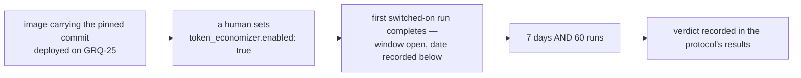

# 🧮 TokenEconomizer trial — learnings that persist across runs

<!-- cspell:ignore microskills loopguard envfacts TOOLPRUNE REPOMAP tokeneconomizer Containerfile noarch pyproject opencode codegraph worktrees untool selfcheck -->

| | |
| - | - |
| **Candidate** | [microsoft/TokenEconomizer](https://github.com/microsoft/TokenEconomizer) at commit `264e7a7f32f0112a06aa83a97b9c2c4681563968` (§1) |
| **Trial host** | **GRQ-25** — one host, Claude Code only (§2) |
| **Switch** | `token_economizer.enabled` in a host's `.config.json`, default `false`: when `true`, the implementation, PR-feedback and CI-fix Claude runs load the plugin ([#4956](https://github.com/stSoftwareAU/VibeCoder/issues/4956), §1) |
| **Bar** | ≥ 10% lower mean cost per completed implementation run, success rate and PR merge rate no worse (§4) |
| **First judged** | after **7 days** or **60** completed switched-on implementation runs, whichever is later (§3) |
| **Status** | ⚪ **not started** — no eligible persisted and accounted trial completion is recorded |

This page is the protocol the TokenEconomizer trial
([#4953](https://github.com/stSoftwareAU/VibeCoder/issues/4953)) is judged by.
It is a sibling of the [RTK output trial](RTK-OUTPUT-TRIAL.md), the
[Repo-context Trial](REPO-CONTEXT-TRIAL.md) and the
[brief trial](BRIEF-TRIAL.md): the same shape of bar, a different candidate and
a different host. Everything a verdict may cite is written here **before** the
window opens, so the verdict is a reading rather than an argument. The owner's
rule for the trial is that the plugin's learnings are recorded to a repository
so that they persist over many cycles, and that a failed experiment is purged
and leaves no code behind (§8).

## 1. 🥊 The candidate and how it is wired

[TokenEconomizer](https://github.com/microsoft/TokenEconomizer) is an
Apache-2.0, standard-library-only Python plugin for Claude Code and other
agents. It cuts the cost of an agent in a repository by learning across that
repository's sessions, without changing the agent. Its paper reports 18–31%
lower mean cost on SWE-Bench. That figure is motivation only — **not
evidence**: it was measured on other people's tasks, and this page's bar is read
from this fleet's own runs (§4).

**Pinned commit.** The trial runs the plugin at commit
`264e7a7f32f0112a06aa83a97b9c2c4681563968`, the tip of upstream `main` when this
page was written (committed 2026-11-08T22:09:30Z, read with
`gh api repos/microsoft/TokenEconomizer/commits/HEAD`). The image vendors that
one commit as a source archive, checked against a recorded sha256 before
anything is installed; it is never cloned at run time. The pin lives in
`container/tools.json`, in the `tokeneconomizer` toolchain entry, as its
`commit` and its `sha256` (under `noarch`), with the version `0.1.0`.
`container/toolchains/tokeneconomizer.sh` reads those pins with jq, refuses an
image `python3` below the package's `requires-python` floor (`>=3.10`, read from
the archive's `pyproject.toml`) at build, and installs only the archive's
`plugin/` and `tokeneconomizer/` trees under `/opt/tokeneconomizer`. The
`tokeneconomizer` wrapper at `/usr/local/bin/tokeneconomizer` answers
`--version` with the pinned version and commit. The image installs the plugin but does not
run it. The worker's own runs load it, through Claude Code's `--plugin-dir`, on a
host that sets `token_economizer.enabled` (see **How the plugin is loaded**,
below). No worker code calls the `tokeneconomizer` wrapper. The commit named
here and the pin in the image are one value, changed in one PR, and the drift
test fails when they differ.

**The block.** The switches are one `token_economizer` block in a host's
`.config.json`, off by default, with four keys: `token_economizer.enabled`,
`token_economizer.learnings_repo` (an `owner/name` private repository, required
when enabled), `token_economizer.microskills` and `token_economizer.loopguard`.
`worker/deno/lib/token_economizer_config.ts` parses and validates the block at
config load, and a malformed block fails the load with an error naming the key.
`microskills` takes `off`, `envfacts`, `distiller` or `envfacts+distiller` (the
default); `loopguard` takes `off` or `nudge` (the default). The error cases and
the defaults are set out in the [Configuration Reference](CONFIGURATION.md).
`enabled` is read by the run launch decision, `loopguard` is passed to the
plugin as `TE_LOOPGUARD`, and `microskills` is clamped to `envfacts` (below).
`learnings_repo` is validated but not read yet: #4957 will persist the learnings
to it, so it changes no run today.

**The mechanisms.** Two are switched on and three are off:

| Mechanism | Setting | State | Why |
| --------- | ------- | ----- | --- |
| Micro-skills | `microskills` clamped to `envfacts`; `off` stays `off` | **on**, `envfacts` only | The distiller's model-written proposals remain disabled because upstream does not independently cap them. The worker sets `TE_MICROSKILLS_MAX_FACTS=4` and `TE_MICROSKILLS_MAX_TOKENS=150`. Its audited adapter also checks cached context at injection: at most four bullet facts and 600 characters, matching upstream's four-characters-per-token estimate. This is a character budget, not an exact tokenizer measurement; fence overhead is additional. Oversized or unsupported output is rejected, never truncated into an apparently valid block. |
| Loop guard | `loopguard` = `nudge` | **on** | A judge model redirects a stuck turn with a short note. The adapter forces synchronous judge/fold execution and bounds their process tree within the hook deadline. Judge text is untrusted and fenced too, with a separate 4,096-character ceiling for non-fact context and notices; the micro-skills fact cap does not apply to nudges. Worker cost aggregation is not yet delivered: #4958 owns it. |
| Tool pruning | `TE_TOOLPRUNE=off` | off | The worker already fixes the tool policy with `--disallowed-tools`, isolated runs ignore project settings, and pruning writes a settings file into the issue checkout, a stray file a commit can pick up. |
| Repository map | `TE_REPOMAP=off` | off | The worker already supplies repository context, the codebase map and, where switched on, Graft and CodeGraph. A third source would confound this trial and the repo-context trial alike. |
| History import | `TE_HISTORY_IMPORT=false` | off | Importing sessions that predate the trial would put learnings from outside the window into the store, so the first runs could not be told from later ones, and it would persist past transcripts into text that is injected into later runs. |

**Claude Code only.** The image installs Claude Code alone (`installedProviders`
in `container/tools.json`), so the trial is run on Claude Code alone. Upstream's
supported-version table is quoted here from its `README.md` at the pinned
commit, under `### Supported versions`. Its "(below)" notes are upstream's, not
this page's.

| Agent | Supported | Older versions |
| --- | --- | --- |
| Claude Code | 2.1.300 to 2.1.310 | not supported |
| Codex | 0.153.1 to 0.164.0 | not supported |
| Copilot CLI | 1.0.83 to 1.0.102 | not supported |
| Pi | 1.2.0 to 1.3.0 | 0.99.x: load the extension by path (below) |
| Cursor Agent (experimental) | 3.24.9 and cursor-agent 2026.11.05, macOS and Linux (below) | not tested |
| Grok Build (experimental) | 1.0.70 | not tested |
| opencode (experimental) | 1.19.5 and 2.2.0 | not tested |
| Hermes Agent (experimental) | 0.22.5 | not tested |
| Antigravity CLI (experimental) | agy 1.5.1, macOS and Linux | not tested |

The commands above were tested on the oldest and newest version in each range; newer versions have not been tested yet.

This image's Claude Code: **2.1.322**, newer than upstream's tested range for Claude Code (2.1.300 to 2.1.310): the bump to the Fable 5.2 CLI (Issue #5082) moved past it, so the trial runs on an untested Claude Code version until upstream extends the range. It is the `claude` provider's `version` in `container/tools.json`, and this line changes in the same PR as any Claude Code bump.

**How the plugin is loaded.** The worker loads the plugin for the Claude
provider only, and only for three run kinds: the implementation run, PR feedback
and CI fix. The decision is `resolveTokenEconomizerLaunch()` in
`worker/deno/lib/token_economizer_plugin.ts`. A run that gets a launch adds
`--plugin-dir /opt/tokeneconomizer/plugin` to its Claude argv (built by
`buildClaudeCliArgs` in `worker/deno/lib/agent_provider.ts`), and its spawn
environment receives these plugin settings: `TOKENECONOMIZER_HOME`, the run's
state directory under `<work>/.token-economizer/runs/<runId>` outside the
checkout; `TE_TOOLPRUNE=off`, `TE_REPOMAP=off`, `TE_HISTORY_IMPORT=false`;
`TE_MICROSKILLS`, clamped as above; `TE_LOOPGUARD`, from config; and the two
fact/token caps. `TE_PYTHON` selects the executable
`worker/deno/lib/token_economizer_hook.ts` from the trusted worker checkout.
The upstream `te-hook` launcher invokes this adapter instead of Python directly;
the adapter invokes the pinned Python dispatcher and reuses
`fenceUntrustedIssueText()` before returning context to Claude. The vendored
archive is unchanged. Stray `TE_` and `TOKENECONOMIZER_` parent variables are
removed before this overlay. The adapter forces `TE_FOLD_SYNC=1` and
`TE_JUDGE_SYNC=1` in Python's child environment, rejects a checkout mismatch,
and tears down unfinished descendants within the event's deadline.

Each spawn gets its own `TOKENECONOMIZER_HOME`, a fresh state directory per
launch, so a fact the plugin learns in one spawn is not in another spawn's home.
The run id that names it is the caller's, or a fresh UUID when none is given; it
is never read from the worker's environment. Carrying learnings across runs is
what the learnings repository (#4957) is for. Until it lands, the cross-run part of the
trial is not exercised, and a verdict on that part would be a verdict on nothing.

Nothing else loads it. Reviewer and verifier calls are not run kinds, and an
external orchestration run gets no launch on any of its role calls. The DeepSeek
descriptor drops the plugin directory from its argv, and `runClaude` passes a
launch only for the Claude provider. An isolated Claude run carries
`--setting-sources ""` (Issue #4657), so a repository's own settings are not
read, and the worker adds the plugin only through `--plugin-dir`.

**Checked on this image.** On 2026-11-12, `claude --version` reported
`2.1.322`. A complete headless call used `--plugin-dir
/opt/tokeneconomizer/plugin --setting-sources "" --tools ""
--strict-mcp-config --mcp-config '{"mcpServers":{}}' --no-session-persistence
--max-turns 1 --output-format stream-json --verbose`, with the plugin settings
above and `loopguard=off`. A local Messages API fixture returned `OK`, ten input
tokens and two output tokens; no production credential or paid endpoint was
used. Observed results:

- `SessionStart:startup` emitted `hook_started`, then `hook_response` with
  `exit_code: 0` and `outcome: success`; `system/init` listed the plugin.
- The CLI returned `result/subtype: success`, `is_error: false`, result `OK`,
  exit 0. The adapter recorded no failure.
- Staged, unstaged and untracked changes in the checkout had identical
  `git status --porcelain` before and after; plugin state stayed outside it.
- A separate call through the real pinned `sidecall.claude_call` used the same
  fixture endpoint and dummy credential and returned `OK`, 20 effective-token
  units. This exercises the real nested CLI adapter, not the judge's trigger
  inside an implementation run.

This verifies hook loading on the installed CLI with isolated settings and a
complete fixture-backed session. It is not trial cost evidence. The two fixture
requests used the same endpoint and credential channel. In production the hook
and Python child inherit the run's sanitised environment and network namespace;
no new egress permission is granted. The adapter keeps judge/fold jobs
synchronous rather than allowing the upstream detached launch. The proposer
remains off. **Not observed:** a paid judge triggered inside an implementation
run, production egress traffic for it, or inclusion in worker cost totals.
Issue #4958 is still open and its accounting integration is absent at this head.

**Failure isolation.** The launch decision never throws, and a launch is never
the cause of a failed run. A disabled block is silent. Any other refusal returns
no plugin, which is the ordinary plugin-off path, and logs a warning naming the
cause: a stop record in force, a run kind outside the three, a missing plugin
manifest, an unusable audited adapter, a run id outside the allow-list, a state directory that cannot be
created, lies outside the work directory or lies inside the checkout, or any
unexpected error.

## 2. 🏠 The trial host

**Trial host: GRQ-25.** One host carries the trial, and no other trial window
may be open on it, or neither result means anything.

- **Why GRQ-25.** Its RTK window never opened: the owner made RTK the fleet
  default first (see §8 of the [RTK output trial](RTK-OUTPUT-TRIAL.md)), so no
  trial window is open on it. GRQ-23 is not used because it is reserved for the
  sequential Graft and CodeGraph windows of the
  [Repo-context Trial](REPO-CONTEXT-TRIAL.md), which would overlap this one.
- **Fleet-wide settings** such as RTK and the advisor/executor split are on by
  default, so unless a host has opted out they affect both sides of the
  comparison equally. A host that has opted out is not a concurrent control: see
  the exclusion in §5.
- **Agent provider: Claude Code.** On GRQ-25, a run that goes through any other
  provider counts as plugin-off: it is recorded as off, it is not in the
  switched-on population, and the cost comparison reads Claude Code
  implementation runs only.
- **Changing the host** after the window opens restarts the window.

## 3. 🪟 The window

The agreed window opens when the **first switched-on run completes** with
persistence and accounting working, not on the day the key is set. An
unpersisted or unaccounted completion does not open it. It is first judged at
whichever comes later: **7 days**, or
**60** completed switched-on implementation runs.

A shorter window measures nothing. Micro-skills needs three sessions to confirm
a fact before it injects it, and the loop guard needs five well-ended turns per
repository before it acts, so the first runs on each repository pay the plugin's
cost and cannot yet have earned any of it back.

**Window opened:** — (not yet opened).

Initial host opt-in remains within the owner's configuration authority. Once
enabled, hook-failure monitoring and the shared stop controller below run
without operator participation. Normal window scheduling and verdict processing
are not present yet: #4959 owns them. A stop report does not wait for either
normal threshold.

## 4. 📏 The bar

The plugin is kept only if **all three** clauses hold over the window, on
completed Claude Code implementation runs:

1. **Cost.** The **mean cost per completed implementation run is at least 10%
   lower** on the switched-on side than on the comparison, with the plugin's own
   model calls included: the micro-skills proposer and the loop-guard judge are
   part of what a switched-on run costs, never free overhead.
2. **Success rate.** The success rate on the switched-on side is **no worse**
   than on the comparison.
3. **PR merge rate.** The PR merge rate on the switched-on side is **no worse**
   than on the comparison.

A miss on any clause is a miss. A saving bought by runs that failed, or by PRs
that were not merged, is not a saving.

## 5. ⚖️ The comparison rule

Two comparisons are taken, and both are written down before the window opens.

- **Before.** The trial host's own runs in the **14 days before the window**,
  with the switch off.
- **Concurrent.** The **other hosts' runs in the same window** and **on the same
  repositories**, with the switch off. A repository with runs on only one side is
  left out of both sides of that comparison.

**If the two comparisons disagree** on any clause of §4, the **concurrent
comparison decides**. It shares the window's dates, so a model change, a prompt
change or a shift in the repository mix lands on both sides, whereas the before
comparison does not. The before comparison is still reported beside it, and the
disagreement is recorded in the verdict.

Exclusions:

- A host with another trial window open on the same dates is not a concurrent
  control.
- A host whose RTK or advisor/executor-split setting differs from the trial
  host's is not a concurrent control, because its runs would differ in more than
  the plugin.
- A run through a provider other than Claude Code is in neither comparison.
- A run from before the run records carry the plugin's on/off flag is excluded
  rather than assumed to be a control run.
- Which side a run belongs to is read from its own recorded flag, never inferred
  from when it ran.

## 6. 🛑 Stop rules

The trial is **switched off at once** and the verdict is recorded as **failed**
if any one of these happens. No margin against the bar is taken, because a stop
rule outranks cost.

| Stop rule | What it protects |
| --------- | ---------------- |
| A learned fact carrying a **secret** is found in the learnings repository, or the gitleaks check before a sync commit catches one | A learned fact is injected into every later run, so a secret in one is retained and repeated |
| A fact injected into a run **comes from another repository** | A fact is derived from one repository's content and must never steer another's |
| The plugin causes a run failure that is **the plugin's fault**, such as a hook error that ends a run | The plugin must never fail a run; it is an accelerator |

The shared controller is `worker/deno/lib/token_economizer_control.ts`.
`stopTokenEconomizerTrial(workDir, finding)` records the first finding at
`<work>/.token-economizer/stop.json` before notifying the outcome issue #4959.
Hook faults are observed while the run is active and scanned again at shutdown;
rejected context returns `{}` and the underlying implementation continues.
The local reason is redacted and bounded; report bodies fence it as untrusted
data. An offline or denied GitHub write leaves a pending report, retried at a
later enabled launch without widening the worker's permissions. Reporting a stop
overrides the 7-day/60-run wait, rather than declaring the normal window complete.

Persistence (#4957, still open) must pass its secret/isolation findings to that
same function and call `tokenEconomizerMaySync(workDir)` before each transfer,
including retries. No persistence implementation is present at this head, so
this is its integration contract, not a claim that sync is already wired.
Unreadable stop records inhibit loading and sync permission. A healthy run does
not clear a failed experiment: the latch remains until authorised recovery or
purge through #4959.

**Remaining boundary gap:** the local stop record is mode 0600 under a mode 0700
directory, but Claude currently runs with the worker's Unix UID. Those modes do
not prevent a deliberately hostile agent from changing the controller's state.
No stronger filesystem boundary is claimed. The available `setpriv` Landlock
probe returned `landlock_create_ruleset failed: Function not implemented` in this
environment. This head does not enable the trial host or widen container
permissions; protection of the durable controller remains unfinished.

## 7. 📥 Where each figure is read from

Cost and success come from the run archive, by the same rules the
[RTK output trial](RTK-OUTPUT-TRIAL.md) uses in its sections 5 and 6: the cost
total in the run-stats comment and the run's own completion outcome, never a
reading of a host log.

| Figure | Read from |
| ------ | --------- |
| Which side a run belongs to | the `TokenEconomizer:` line in the run-stats comment, or the new optional fields on the run callback. Not yet: #4958 adds both |
| Cost per run, plugin's own model calls included | the cost total in the run-stats comment and the run archive record. Not yet: #4958 adds the plugin's cost to the total |
| Success rate | the run's own completion outcome, as the run-stats comment and the run archive record it |
| PR merge rate | the final state of each run's pull request |
| Both comparisons | the weekly report section. Not yet: #4958 adds it |

The run archive is the operator's private repository named by
`fleet_run_archive` in the [Configuration Reference](CONFIGURATION.md). A verdict
taken without it is single-host and says so, naming the host and the window it
covers.

## 8. 🧹 The purge list

This is every file, image layer, config key, doc section, callback field and
learnings directory the trial adds. Not yet:
[#4959](https://github.com/stSoftwareAU/VibeCoder/issues/4959), the verdict
issue, will remove exactly this list when the bar is missed or a stop rule
fired. The drift test fails when a text file tracked by git, other than the
worker state under `graft/` and `.codegraph/` and the historical records under
`docs/archive/` and `docs/audits/`, names the plugin and is missing from the
list. Gitignored local files, such as agent worktrees
and an operator's `.config.json`, are not repository files and are not read.

State is `present` when the path exists and names the plugin today, and
`planned #N` when issue #N is to add it. A row with no path (`—`) is
`planned #N`, because nothing in the repository can show that it exists yet.

| Kind | What | Path | State |
| ---- | ---- | ---- | ----- |
| Drift test | this page's drift test | `worker/deno/tests/token_economizer_trial_docs_test.ts` | present |
| Doc link | the README Documentation-table row | `README.md` | present |
| Doc link | the link in the RTK trial's related documentation | `docs/RTK-OUTPUT-TRIAL.md` | present |
| Doc link | the link in the Repo-context trial's related documentation | `docs/REPO-CONTEXT-TRIAL.md` | present |
| Image layer | the `tokeneconomizer` id in the toolchain install list of the image build | `container/Containerfile` | present |
| Image layer | the `tokeneconomizer` toolchain entry: its version, commit and recorded sha256 | `container/tools.json` | present |
| Image layer | the install fragment: the archive fetch and sha256 check, the `python3` floor check, the `plugin/` and `tokeneconomizer/` install under `/opt/tokeneconomizer`, and the `/usr/local/bin/tokeneconomizer` wrapper | `container/toolchains/tokeneconomizer.sh` | present |
| Image layer | the fragment's entry in the image hash inputs | `worker/deno/lib/container_image_hash.ts` | present |
| Image layer | the fragment's install tests in the toolchain test file | `worker/deno/tests/install_toolchains_test.ts` | present |
| Image layer | the start-up self-check's fixture for the wrapper's `--version` output | `worker/deno/tests/toolchain_selfcheck_test.ts` | present |
| Doc section | the `tokeneconomizer` row of the image's toolchain table | `docs/CONTAINER.md` | present |
| Doc section | the paragraph on `tokeneconomizer` in the image's layer description | `docs/CONTAINER-IMAGE.md` | present |
| Config key | the `token_economizer` block: its parser and its validation | `worker/deno/lib/token_economizer_config.ts` | present |
| Config key | the block's type, its config field and its raw file key | `worker/deno/types.ts` | present |
| Config key | the block's load-time parse and the config error | `worker/deno/lib/config.ts` | present |
| Config key | the block's defaults | `worker/deno/lib/config_defaults.ts` | present |
| Config key | the block's known keys and its nested-key warnings | `worker/deno/lib/config_unknown_keys.ts` | present |
| Config key | the block's parser and loader tests | `worker/deno/tests/token_economizer_config_test.ts` | present |
| Config key | the block's off-by-default spawn tests | `worker/deno/tests/token_economizer_off_spawn_test.ts` | present |
| Doc section | the `token_economizer` row of the configuration reference | `docs/CONFIGURATION.md` | present |
| Source | the `--plugin-dir` argument in the Claude argv, and the drop of the plugin directory in the DeepSeek descriptor | `worker/deno/lib/agent_provider.ts` | present |
| Source | the launch decision: run kinds, environment, stop record and state-directory confinement | `worker/deno/lib/token_economizer_plugin.ts` | present |
| Source | the audited executable hook adapter and context bounds | `worker/deno/lib/token_economizer_hook.ts` | present |
| Source | the shared stop, sync-permission and outcome-reporting controller | `worker/deno/lib/token_economizer_control.ts` | present |
| Source | the plugin option on `runClaude`, and its environment overlay | `worker/deno/lib/claude_runner.ts` | present |
| Source | the implementation spawn's launch, in the phase | `worker/deno/lib/phases/execute_phase.ts` | present |
| Source | the implementation spawn's launch, in the standalone phase | `worker/deno/lib/execute_claude_phase.ts` | present |
| Source | the PR-feedback spawn's launch | `worker/deno/lib/pr_feedback_processor.ts` | present |
| Source | the CI-fix spawns' launch, on both attempts | `worker/deno/lib/pr_ci_processor.ts` | present |
| Source | the production dependencies that pass `config.tokenEconomizer` to the processors | `worker/deno/lib/run_core_production_deps.ts` | present |
| Command | the standalone implementation command that passes `config.tokenEconomizer` | `worker/deno/commands/execute_claude_phase.ts` | present |
| Command | the standalone PR-feedback command that passes `config.tokenEconomizer` | `worker/deno/commands/pr_feedback_processor.ts` | present |
| Command | the standalone CI-fix command that passes `config.tokenEconomizer` | `worker/deno/commands/pr_ci_processor.ts` | present |
| Test | the launch decision's tests | `worker/deno/tests/token_economizer_plugin_test.ts` | present |
| Test | the spawn-wiring tests | `worker/deno/tests/token_economizer_plugin_wiring_test.ts` | present |
| Test | the implementation spawn sites' tests | `worker/deno/tests/token_economizer_impl_callsites_test.ts` | present |
| Test | the PR-feedback and CI-fix spawn sites' tests | `worker/deno/tests/token_economizer_reactive_callsites_test.ts` | present |
| Test | the production dependency pass-through tests | `worker/deno/tests/token_economizer_production_deps_test.ts` | present |
| Doc section | the plugin as a supply-chain component, and learned facts as cross-run context | `docs/THREAT-MODEL.md` | present |
| Runtime directory | `.token-economizer/` under the work directory, holding the stop record, notification receipt and per-spawn state directories; the launch decision creates it at run time | `worker/deno/lib/token_economizer_plugin.ts` | present |
| Source | the learnings pull and push, with the gitleaks check | — | planned #4957 |
| Learnings directory | `token-economizer/` in the repository named by `token_economizer.learnings_repo` | — | planned #4957 |
| Run stats | the `TokenEconomizer:` line | `worker/deno/lib/issue_run_stats_comment.ts` | planned #4958 |
| Callback field | the new optional fields on the run callback | `docs/CALLBACKS.md` | planned #4958 |
| Report section | the weekly report's comparison section | — | planned #4958 |
| Host config | the `token_economizer` block in the trial host's gitignored `.config.json`, with `enabled` set to `false` first; a purge removes the block there | — | planned #4956 |

**What stays.** This page, with its Status changed to *purged* and the measured
figures added, as the record of the negative result. After a purge,
`git grep -i tokeneconomizer` and `git grep token_economizer` find only this
page and the historical records under `docs/archive/` and `docs/audits/`, which a
purge leaves alone.

## 9. 🔗 Related documentation

- **[RTK output trial](RTK-OUTPUT-TRIAL.md)** — the sibling protocol whose cost
  and success rules this page reuses.
- **[Repo-context Trial](REPO-CONTEXT-TRIAL.md)** — the sibling protocol that
  owns GRQ-23.
- **[brief trial](BRIEF-TRIAL.md)** — the sibling protocol for brief, removed on
  analysis before its window opened.
- **[Configuration Reference](CONFIGURATION.md)** — `fleet_run_archive` and every
  other `.config.json` key.
- **[Threat Model](THREAT-MODEL.md)** — where the plugin is recorded as a
  supply-chain component, and its learned facts as cross-run context.
