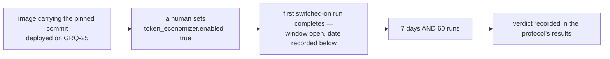

# 🧮 TokenEconomizer trial — learnings that persist across runs

<!-- cspell:ignore microskills loopguard envfacts TOOLPRUNE REPOMAP tokeneconomizer Containerfile -->

| | |
| - | - |
| **Candidate** | [microsoft/TokenEconomizer](https://github.com/microsoft/TokenEconomizer) at commit `264e7a7f32f0112a06aa83a97b9c2c4681563968` (§1) |
| **Trial host** | **GRQ-25** — one host, Claude Code only (§2) |
| **Switch** | `token_economizer.enabled` in a host's `.config.json`, default `false` — not yet: [#4955](https://github.com/stSoftwareAU/VibeCoder/issues/4955) adds it |
| **Bar** | ≥ 10% lower mean cost per completed implementation run, success rate and PR merge rate no worse (§4) |
| **First judged** | after **7 days** or **60** completed switched-on implementation runs, whichever is later (§3) |
| **Status** | ⚪ **not started** — this page is written before the window opens, and no run has used the plugin |

This page is the protocol the TokenEconomizer trial
([#4953](https://github.com/stSoftwareAU/VibeCoder/issues/4953)) is judged by.
It is a sibling of the [RTK output trial](RTK-OUTPUT-TRIAL.md), the
[Repo-context Trial](REPO-CONTEXT-TRIAL.md) and the
[brief trial](BRIEF-TRIAL.md): the same shape of bar, a different candidate and
a different host. Everything a verdict may cite is written here **before** the
window opens, so the verdict is a reading rather than an argument. The owner's
rule for the trial is that the plugin's learnings are recorded to a repository
so that they persist over many cycles, and that a failed experiment is purged
and leaves no code behind (§8).

## 1. 🥊 The candidate and how it is wired

[TokenEconomizer](https://github.com/microsoft/TokenEconomizer) is an
Apache-2.0, standard-library-only Python plugin for Claude Code and other
agents. It cuts the cost of an agent in a repository by learning across that
repository's sessions, without changing the agent. Its paper reports 18–31%
lower mean cost on SWE-Bench. That figure is motivation only — **not
evidence**: it was measured on other people's tasks, and this page's bar is read
from this fleet's own runs (§4).

**Pinned commit.** The trial runs the plugin at commit
`264e7a7f32f0112a06aa83a97b9c2c4681563968`, the tip of upstream `main` when this
page was written (committed 2026-11-08T22:09:30Z, read with
`gh api repos/microsoft/TokenEconomizer/commits/HEAD`). The container
sub-issue vendors that one commit into the image as a source tarball checked
against a recorded sha256; it is never cloned at run time. Not yet: #4955 pins
this commit, so today the image carries nothing of TokenEconomizer. The commit
named here and the pin in the image are one value, changed in one PR, and the
drift test fails when they differ.

**The block.** The switches are one `token_economizer` block in a host's
`.config.json`, off by default, with four keys: `token_economizer.enabled`,
`token_economizer.learnings_repo` (an `owner/name` private repository, required
when enabled), `token_economizer.microskills` and `token_economizer.loopguard`.
Not yet: #4955 adds the block and #4956 wires it into runs; until then no code
reads any of these keys.

**The mechanisms.** Two are switched on and three are off:

| Mechanism | Setting | State | Why |
| --------- | ------- | ----- | --- |
| Micro-skills | `microskills` = `envfacts+distiller` | **on** | Facts about how a repository works (a build step that must run first, a command spelling that works there), learned from repeated failures and from a model that reviews sessions. A fact is injected at session start once three sessions have confirmed it. This is the mechanism the learnings repository exists for. |
| Loop guard | `loopguard` = `nudge` | **on** | A judge model redirects a turn that is stuck in a failure loop with a short note. It never stops a turn itself. |
| Tool pruning | `TE_TOOLPRUNE=off` | off | The worker already fixes the tool policy with `--disallowed-tools`, isolated runs ignore project settings, and pruning writes a settings file into the issue checkout, a stray file a commit can pick up. |
| Repository map | `TE_REPOMAP=off` | off | The worker already supplies repository context, the codebase map and, where switched on, Graft and CodeGraph. A third source would confound this trial and the repo-context trial alike. |
| History import | `TE_HISTORY_IMPORT=false` | off | Importing sessions that predate the trial would put learnings from outside the window into the store, so the first runs could not be told from later ones, and it would persist past transcripts into text that is injected into later runs. |

**Claude Code only.** The fleet's agent CLIs are newer than the plugin's tested
version range, so the trial is run on Claude Code alone. The upstream
supported-version table is to be quoted here with the image's actual Claude Code
version beside it. Not yet: #4955 supplies both.

## 2. 🏠 The trial host

**Trial host: GRQ-25.** One host carries the trial, and no other trial window
may be open on it, or neither result means anything.

- **Why GRQ-25.** Its RTK window never opened: the owner made RTK the fleet
  default first (see §8 of the [RTK output trial](RTK-OUTPUT-TRIAL.md)), so no
  trial window is open on it. GRQ-23 is not used because it is reserved for the
  sequential Graft and CodeGraph windows of the
  [Repo-context Trial](REPO-CONTEXT-TRIAL.md), which would overlap this one.
- **Fleet-wide settings** such as RTK and the advisor/executor split are alike on
  every host, so they affect both sides of the comparison equally and need no
  adjustment.
- **Agent provider: Claude Code.** On GRQ-25, a run that goes through any other
  provider counts as plugin-off: it is recorded as off, it is not in the
  switched-on population, and the cost comparison reads Claude Code
  implementation runs only.
- **Changing the host** after the window opens restarts the window.

## 3. 🪟 The window

The window opens when the **first switched-on run completes**, not on the day
the key is set. It is first judged at whichever comes **later**: **7 days**, or
**60** completed switched-on implementation runs.

A shorter window measures nothing. Micro-skills needs three sessions to confirm
a fact before it injects it, and the loop guard needs five well-ended turns per
repository before it acts, so the first runs on each repository pay the plugin's
cost and cannot yet have earned any of it back.

**Window opened:** — (not yet opened).

Both steps are manual. No code schedules the window, nothing watches the clock,
and no worker flips the switch, to open the window, to close it or to react to a
figure it read halfway through.

## 4. 📏 The bar

The plugin is kept only if **all three** clauses hold over the window, on
completed Claude Code implementation runs:

1. **Cost.** The **mean cost per completed implementation run is at least 10%
   lower** on the switched-on side than on the comparison, with the plugin's own
   model calls included: the micro-skills proposer and the loop-guard judge are
   part of what a switched-on run costs, never free overhead.
2. **Success rate.** The success rate on the switched-on side is **no worse**
   than on the comparison.
3. **PR merge rate.** The PR merge rate on the switched-on side is **no worse**
   than on the comparison.

A miss on any clause is a miss. A saving bought by runs that failed, or by PRs
that were not merged, is not a saving.

## 5. ⚖️ The comparison rule

Two comparisons are taken, and both are written down before the window opens.

- **Before.** The trial host's own runs in the **14 days before the window**,
  with the switch off.
- **Concurrent.** The **other hosts' runs in the same window** and **on the same
  repositories**, with the switch off. A repository with runs on only one side is
  left out of both.

**If the two comparisons disagree** on any clause of §4, the **concurrent
comparison decides**. It shares the window's dates, so a model change, a prompt
change or a shift in the repository mix lands on both sides, whereas the before
comparison does not. The before comparison is still reported beside it, and the
disagreement is recorded in the verdict.

Exclusions:

- A host with another trial window open on the same dates is not a concurrent
  control.
- A run through a provider other than Claude Code is in neither comparison.
- A run from before the run records carry the plugin's on/off flag is excluded
  rather than assumed to be a control run.
- Which side a run belongs to is read from its own recorded flag, never inferred
  from when it ran.

## 6. 🛑 Stop rules

The trial is **switched off at once** and the verdict is recorded as **failed**
if any one of these happens. No margin against the bar is taken, because a stop
rule outranks cost.

| Stop rule | What it protects |
| --------- | ---------------- |
| A learned fact carrying a **secret** is found in the learnings repository, or the gitleaks check before a sync commit catches one | A learned fact is injected into every later run, so a secret in one is retained and repeated |
| A fact injected into a run **comes from another repository** | A fact is derived from one repository's content and must never steer another's |
| The plugin causes a run failure that is **the plugin's fault**, such as a hook error that ends a run | The plugin must never fail a run; it is an accelerator |

A human sets `token_economizer.enabled` to `false` on the trial host the moment
one is found. Not yet: #4957 adds the gitleaks check before each sync commit.

## 7. 📥 Where each figure is read from

Cost and success come from the run archive, by the same rules the
[RTK output trial](RTK-OUTPUT-TRIAL.md) uses in its sections 5 and 6: the cost
total in the run-stats comment and the run's own completion outcome, never a
reading of a host log.

| Figure | Read from |
| ------ | --------- |
| Which side a run belongs to | the `TokenEconomizer:` line in the run-stats comment, or the new optional fields on the run callback. Not yet: #4958 adds both |
| Cost per run, plugin's own model calls included | the cost total in the run-stats comment and the run archive record. Not yet: #4958 adds the plugin's cost to the total |
| Success rate | the run's own completion outcome, as the run-stats comment and the run archive record it |
| PR merge rate | the final state of each run's pull request |
| Both comparisons | the weekly report section. Not yet: #4958 adds it |

The run archive is the operator's private repository named by
`fleet_run_archive` in the [Configuration Reference](CONFIGURATION.md). A verdict
taken without it is single-host and says so, naming the host and the window it
covers.

## 8. 🧹 The purge list

This is every file, image layer, config key, doc section, callback field and
learnings directory the trial adds. The verdict issue
([#4959](https://github.com/stSoftwareAU/VibeCoder/issues/4959)) removes exactly
this list when the bar is missed or a stop rule fired, and the drift test fails
when a file that names the plugin is missing from it.

State is `present` when the path exists and names the plugin today, and
`planned #N` when issue #N is to add it.

| Kind | What | Path | State |
| ---- | ---- | ---- | ----- |
| Drift test | this page's drift test | `worker/deno/tests/token_economizer_trial_docs_test.ts` | present |
| Doc link | the README Documentation-table row | `README.md` | present |
| Doc link | the link in the RTK trial's related documentation | `docs/RTK-OUTPUT-TRIAL.md` | present |
| Doc link | the link in the Repo-context trial's related documentation | `docs/REPO-CONTEXT-TRIAL.md` | present |
| Image layer | the pinned commit, its recorded sha256, the Python 3.10+ check, and the `plugin/` and `tokeneconomizer/` install | `container/Containerfile` | planned #4955 |
| Config key | the `token_economizer` block and its parser | — | planned #4955 |
| Doc section | the config row and the learnings store layout | `docs/CONFIGURATION.md` | planned #4955 |
| Source | the `--plugin-dir` and environment wiring in the Claude spawn | `worker/deno/lib/agent_provider.ts` | planned #4956 |
| Doc section | the plugin as a supply-chain component, and learned facts as cross-run context | `docs/THREAT-MODEL.md` | planned #4956 |
| Source | the learnings pull and push, with the gitleaks check | — | planned #4957 |
| Learnings directory | `token-economizer/` in the repository named by `token_economizer.learnings_repo` | — | planned #4957 |
| Run stats | the `TokenEconomizer:` line | `worker/deno/lib/issue_run_stats_comment.ts` | planned #4958 |
| Callback field | the new optional fields on the run callback | `docs/CALLBACKS.md` | planned #4958 |
| Report section | the weekly report's comparison section | — | planned #4958 |
| Host config | the key in the trial host's `.config.json`, switched off first | — | planned #4955 |

**What stays.** This page, with its Status changed to *purged* and the measured
figures added, as the record of the negative result. After a purge,
`git grep -i tokeneconomizer` and `git grep token_economizer` find only this
page.

## 9. 🔗 Related documentation

- **[RTK output trial](RTK-OUTPUT-TRIAL.md)** — the sibling protocol whose cost
  and success rules this page reuses.
- **[Repo-context Trial](REPO-CONTEXT-TRIAL.md)** — the sibling protocol that
  owns GRQ-23.
- **[brief trial](BRIEF-TRIAL.md)** — the sibling protocol for brief, removed on
  analysis before its window opened.
- **[Configuration Reference](CONFIGURATION.md)** — `fleet_run_archive` and every
  other `.config.json` key.
- **[Threat Model](THREAT-MODEL.md)** — where the plugin is to be recorded as a
  supply-chain component.
