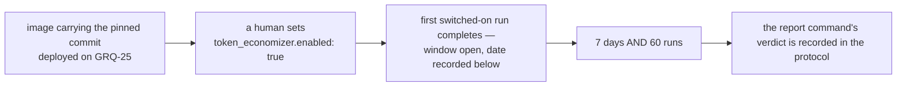

# 🧮 TokenEconomizer trial — learnings that persist across runs

<!-- cspell:ignore microskills loopguard envfacts TOOLPRUNE REPOMAP tokeneconomizer Containerfile noarch pyproject opencode codegraph worktrees untool selfcheck -->

| | |
| - | - |
| **Candidate** | [microsoft/TokenEconomizer](https://github.com/microsoft/TokenEconomizer) at commit `264e7a7f32f0112a06aa83a97b9c2c4681563968` (§1) |
| **Trial host** | **GRQ-25** — one host, Claude Code only (§2) |
| **Switch** | `token_economizer.enabled` in a host's `.config.json`, default `false`: when `true`, the implementation, PR-feedback and CI-fix Claude runs load the plugin ([#4956](https://github.com/stSoftwareAU/VibeCoder/issues/4956), §1) |
| **Bar** | ≥ 10% lower mean cost per completed implementation run, success rate and PR merge rate no worse (§4) |
| **First judged** | after **7 days** or **60** completed switched-on implementation runs, whichever is later (§3) |
| **Status** | ⚪ **not started** — no eligible persisted and accounted trial completion is recorded |

This page is the protocol the TokenEconomizer trial
([#4953](https://github.com/stSoftwareAU/VibeCoder/issues/4953)) is judged by.
It is a sibling of the [RTK output trial](RTK-OUTPUT-TRIAL.md), the
[Repo-context Trial](REPO-CONTEXT-TRIAL.md) and the
[brief trial](BRIEF-TRIAL.md): the same shape of bar, a different candidate and
a different host. Everything a verdict may cite is written here **before** the
window opens, so the verdict is a reading rather than an argument. The owner's
rule for the trial is that the plugin's learnings are recorded to a repository
so that they persist over many cycles, and that a failed experiment is purged
and leaves no code behind (§8).

## 1. 🥊 The candidate and how it is wired

[TokenEconomizer](https://github.com/microsoft/TokenEconomizer) is an
Apache-2.0, standard-library-only Python plugin for Claude Code and other
agents. It cuts the cost of an agent in a repository by learning across that
repository's sessions, without changing the agent. Its paper reports 18–31%
lower mean cost on SWE-Bench. That figure is motivation only — **not
evidence**: it was measured on other people's tasks, and this page's bar is read
from this fleet's own runs (§4).

**Pinned commit.** The trial runs the plugin at commit
`264e7a7f32f0112a06aa83a97b9c2c4681563968`, the tip of upstream `main` when this
page was written (committed 2026-11-08T22:09:30Z, read with
`gh api repos/microsoft/TokenEconomizer/commits/HEAD`). The image vendors that
one commit as a source archive, checked against a recorded sha256 before
anything is installed; it is never cloned at run time. The pin lives in
`container/tools.json`, in the `tokeneconomizer` toolchain entry, as its
`commit` and its `sha256` (under `noarch`), with the version `0.1.0`.
`container/toolchains/tokeneconomizer.sh` reads those pins with jq, refuses an
image `python3` below the package's `requires-python` floor (`>=3.10`, read from
the archive's `pyproject.toml`) at build, and installs only the archive's
`plugin/` and `tokeneconomizer/` trees under `/opt/tokeneconomizer`. The
`tokeneconomizer` wrapper at `/usr/local/bin/tokeneconomizer` answers
`--version` with the pinned version and commit. The image installs the plugin but does not
run it. The worker's own runs load it, through Claude Code's `--plugin-dir`, on a
host that sets `token_economizer.enabled` (see **How the plugin is loaded**,
below). No worker code calls the `tokeneconomizer` wrapper. The commit named
here and the pin in the image are one value, changed in one PR, and the drift
test fails when they differ.

**The block.** The switches are one `token_economizer` block in a host's
`.config.json`, off by default, with four keys: `token_economizer.enabled`,
`token_economizer.learnings_repo` (an `owner/name` private repository, required
when enabled), `token_economizer.microskills` and `token_economizer.loopguard`.
`worker/deno/lib/token_economizer_config.ts` parses and validates the block at
config load, and a malformed block fails the load with an error naming the key.
`microskills` takes `off`, `envfacts`, `distiller` or `envfacts+distiller` (the
default); `loopguard` takes `off` or `nudge` (the default). The error cases and
the defaults are set out in the [Configuration Reference](CONFIGURATION.md).
`enabled` is read by the run launch decision, `loopguard` is passed to the
plugin as `TE_LOOPGUARD`, and `microskills` is clamped to `envfacts` (below).
`learnings_repo` is read by the learnings persistence in
`lib/token_economizer_learnings.ts`: it pulls the learnings at launch and pushes
them after each spawn that loaded the plugin. The checks are set out in the
[Configuration Reference](CONFIGURATION.md#tokeneconomizer-learnings).

**The mechanisms.** Two are switched on and three are off:

| Mechanism | Setting | State | Why |
| --------- | ------- | ----- | --- |
| Micro-skills | `microskills` clamped to `envfacts`; `off` stays `off` | **on**, `envfacts` only | The distiller's model-written proposals remain disabled because upstream does not independently cap them. The worker sets `TE_MICROSKILLS_MAX_FACTS=4` and `TE_MICROSKILLS_MAX_TOKENS=150`. Its audited adapter also checks cached context at injection: at most four bullet facts and 600 characters, matching upstream's four-characters-per-token estimate. This is a character budget, not an exact tokenizer measurement; fence overhead is additional. Oversized or unsupported output is rejected, never truncated into an apparently valid block. |
| Loop guard | `loopguard` = `nudge` | **on** | A judge model redirects a stuck turn with a short note. The adapter forces synchronous judge/fold execution and bounds their process tree within the hook deadline. Judge text is untrusted and fenced too, with a separate 4,096-character ceiling for non-fact context and notices; the micro-skills fact cap does not apply to nudges. The judge runs as a separate CLI process, so its cost is not in the agent's stream totals: the worker reads it from the plugin's own ledger after the run and prices it into the run's cost (§7). |
| Tool pruning | `TE_TOOLPRUNE=off` | off | The worker already fixes the tool policy with `--disallowed-tools`, isolated runs ignore project settings, and pruning writes a settings file into the issue checkout, a stray file a commit can pick up. |
| Repository map | `TE_REPOMAP=off` | off | The worker already supplies repository context, the codebase map and, where switched on, Graft and CodeGraph. A third source would confound this trial and the repo-context trial alike. |
| History import | `TE_HISTORY_IMPORT=false` | off | Importing sessions that predate the trial would put learnings from outside the window into the store, so the first runs could not be told from later ones, and it would persist past transcripts into text that is injected into later runs. |

**Claude Code only.** The image installs Claude Code alone (`installedProviders`
in `container/tools.json`), so the trial is run on Claude Code alone. Upstream's
supported-version table is quoted here from its `README.md` at the pinned
commit, under `### Supported versions`. Its "(below)" notes are upstream's, not
this page's.

| Agent | Supported | Older versions |
| --- | --- | --- |
| Claude Code | 2.1.300 to 2.1.310 | not supported |
| Codex | 0.153.1 to 0.164.0 | not supported |
| Copilot CLI | 1.0.83 to 1.0.102 | not supported |
| Pi | 1.2.0 to 1.3.0 | 0.99.x: load the extension by path (below) |
| Cursor Agent (experimental) | 3.24.9 and cursor-agent 2026.11.05, macOS and Linux (below) | not tested |
| Grok Build (experimental) | 1.0.70 | not tested |
| opencode (experimental) | 1.19.5 and 2.2.0 | not tested |
| Hermes Agent (experimental) | 0.22.5 | not tested |
| Antigravity CLI (experimental) | agy 1.5.1, macOS and Linux | not tested |

The commands above were tested on the oldest and newest version in each range; newer versions have not been tested yet.

This image's Claude Code: **2.1.322**, newer than upstream's tested range for Claude Code (2.1.300 to 2.1.310): the bump to the Fable 5.2 CLI (Issue #5082) moved past it, so the trial runs on an untested Claude Code version until upstream extends the range. It is the `claude` provider's `version` in `container/tools.json`, and this line changes in the same PR as any Claude Code bump.

**How the plugin is loaded.** The worker loads the plugin for the Claude
provider only, and only for three run kinds: the implementation run, PR feedback
and CI fix. The decision is `resolveTokenEconomizerLaunch()` in
`worker/deno/lib/token_economizer_plugin.ts`. A run that gets a launch adds
`--plugin-dir /opt/tokeneconomizer/plugin` to its Claude argv (built by
`buildClaudeCliArgs` in `worker/deno/lib/agent_provider.ts`), and its spawn
environment receives these plugin settings: `TOKENECONOMIZER_HOME`, the run's
state directory under `<work>/.token-economizer/runs/<runId>` outside the
checkout; `TE_TOOLPRUNE=off`, `TE_REPOMAP=off`, `TE_HISTORY_IMPORT=false`;
`TE_MICROSKILLS`, clamped as above; `TE_LOOPGUARD`, from config; and the two
fact/token caps. `TE_PYTHON` selects the executable
`worker/deno/lib/token_economizer_hook.ts` from the trusted worker checkout.
The upstream `te-hook` launcher invokes this adapter instead of Python directly;
the adapter invokes the pinned Python dispatcher and reuses
`fenceUntrustedIssueText()` before returning context to Claude. The vendored
archive is unchanged. Stray `TE_` and `TOKENECONOMIZER_` parent variables are
removed before this overlay. The adapter forces `TE_FOLD_SYNC=1` and
`TE_JUDGE_SYNC=1` in Python's child environment, rejects a checkout mismatch,
and tears down unfinished descendants within the event's deadline.

Each launch gets its own `TOKENECONOMIZER_HOME`, a fresh state directory per
launch, so a fact the plugin learns in one launch is not in another launch's
home except through the learnings repository, described below. A re-run or retry of the same agent call reuses its launch, but the runner
re-checks the stop latch before every spawn: once a stop is latched, or the
controller directory cannot be verified, that spawn gets neither `--plugin-dir`
nor a launch variable. The run id that names it is the caller's, or a fresh UUID when none is given; it
is never read from the worker's environment. Learnings carry across runs only
through the learnings repository. Each launch pulls the key's learnings before the
plugin loads, and each spawn that loaded the plugin pushes them back once the
plugin has folded the session. A pull that cannot be verified does not refuse the
launch: the plugin still loads, the launch records persistence as `refused` (a
public or unverifiable learnings repository, or a latched stop) or `unavailable`
(a fault, such as a failed clone or an untrusted store), and that launch does not
count as cross-run learning (#4958 will report it).

Nothing else loads it. Reviewer and verifier calls are not run kinds. External
orchestration forwards the implementation launch to role dispatch, and the
runner reads its existing `orchestrationRole`: only a Claude executor may load
the plugin; manager and reviewer spawns get neither the flag nor the launch
environment. The same stop re-check applies to every executor spawn. The
DeepSeek descriptor drops the plugin directory from its argv, and `runClaude`
passes a launch only for the Claude provider. An isolated Claude run carries
`--setting-sources ""` (Issue #4657), so a repository's own settings are not
read, and the worker adds the plugin only through `--plugin-dir`.

**Checked on this image.** On 2026-11-12, `claude --version` reported
`2.1.322`. A complete headless call used `--plugin-dir
/opt/tokeneconomizer/plugin --setting-sources "" --tools ""
--strict-mcp-config --mcp-config '{"mcpServers":{}}' --no-session-persistence
--max-turns 1 --output-format stream-json --verbose`, with the plugin settings
above and `loopguard=off`. A local Messages API fixture returned `OK`, ten input
tokens and two output tokens; no production credential or paid endpoint was
used. Observed results:

- `SessionStart:startup` emitted `hook_started`, then `hook_response` with
  `exit_code: 0` and `outcome: success`; `system/init` listed the plugin.
- The CLI returned `result/subtype: success`, `is_error: false`, result `OK`,
  exit 0. The adapter recorded no failure.
- Staged, unstaged and untracked changes in the checkout had identical
  `git status --porcelain` before and after; plugin state stayed outside it.
- A separate call through the real pinned `sidecall.claude_call` used the same
  fixture endpoint and dummy credential and returned `OK`, 20 effective-token
  units. This exercises the real nested CLI adapter, not the judge's trigger
  inside an implementation run.

This verifies hook loading on the installed CLI with isolated settings and a
complete fixture-backed session. It is not trial cost evidence. The two fixture
requests used the same endpoint and credential channel. In production the hook
and Python child inherit the run's sanitised environment and network namespace;
no new egress permission is granted. The adapter keeps judge/fold jobs
synchronous rather than allowing the upstream detached launch. The proposer
remains off. **Not observed:** a paid judge triggered inside an implementation
run, or production egress traffic for it. The accounting integration (#4958) is
present: the worker reads the plugin's ledger and prices its judge calls into
the run's cost (§7), but that path has only been exercised against fixtures, not
against a paid judge in a production run.

**Failure isolation.** The launch decision never throws, and a launch is never
the cause of a failed run. A disabled block is silent. Any other refusal returns
no plugin, which is the ordinary plugin-off path, and logs a warning naming the
cause: a controller directory that is aliased, outside the work directory or
unresolvable (checked first, before the stop record is read), a stop record in
force, a run kind outside the three, a missing plugin manifest, an unusable audited adapter, a run id outside the allow-list, a state directory that cannot be
created, lies outside the work directory or lies inside the checkout, or any
unexpected error. The runner applies the first two of these checks again
before every spawn of a reused launch and drops the plugin for that spawn when a
stop is latched or the controller directory is unverified.

## 2. 🏠 The trial host

**Trial host: GRQ-25.** One host carries the trial, and no other trial window
may be open on it, or neither result means anything.

- **Why GRQ-25.** Its RTK window never opened: the owner made RTK the fleet
  default first (see §8 of the [RTK output trial](RTK-OUTPUT-TRIAL.md)), so no
  trial window is open on it. GRQ-23 is not used because it is reserved for the
  sequential Graft and CodeGraph windows of the
  [Repo-context Trial](REPO-CONTEXT-TRIAL.md), which would overlap this one.
- **Fleet-wide settings** such as RTK and the advisor/executor split are on by
  default, so unless a host has opted out they affect both sides of the
  comparison equally. A host that has opted out is not a concurrent control: see
  the exclusion in §5.
- **Agent provider: Claude Code.** On GRQ-25, a run that goes through any other
  provider counts as plugin-off: it is recorded as off, it is not in the
  switched-on population, and the cost comparison reads Claude Code
  implementation runs only.
- **Changing the host** after the window opens restarts the window.

## 3. 🪟 The window

The agreed window opens when the **first switched-on run completes** with
persistence and accounting working, not on the day the key is set. An
unpersisted or unaccounted completion does not open it. It is first judged at
whichever comes later: **7 days**, or
**60** completed switched-on implementation runs.

A shorter window measures nothing. Micro-skills needs three sessions to confirm
a fact before it injects it, and the loop guard needs five well-ended turns per
repository before it acts, so the first runs on each repository pay the plugin's
cost and cannot yet have earned any of it back.



**Window opened:** — (not yet opened).

Initial host opt-in remains within the owner's configuration authority. Once
enabled, hook-failure monitoring and the shared stop controller below run
without operator participation. The verdict is computed by the report command
(see [The verdict](#the-verdict) in section 7). While it is `not due` or
`undetermined`, the outcome issue #4959 is revisited through the worker's time
deferral (`vibe-defer-until` at the verdict's next check), so no human opens or
closes the window. A stop does not wait for either threshold.

## 4. 📏 The bar

The plugin is kept only if **all three** clauses hold over the window, on
completed Claude Code implementation runs:

1. **Cost.** The **mean cost per completed implementation run is at least 10%
   lower** on the switched-on side than on the comparison, with the plugin's own
   model calls included: the micro-skills proposer and the loop-guard judge are
   part of what a switched-on run costs, never free overhead.
2. **Success rate.** The success rate on the switched-on side is **no worse**
   than on the comparison.
3. **PR merge rate.** The PR merge rate on the switched-on side is **no worse**
   than on the comparison.

A miss on any clause is a miss. A saving bought by runs that failed, or by PRs
that were not merged, is not a saving.

## 5. ⚖️ The comparison rule

Two comparisons are taken, and both are written down before the window opens.

- **Before.** The trial host's own runs in the **14 days before the window**,
  with the switch off.
- **Concurrent.** The **other hosts' runs in the same window** and **on the same
  repositories**, with the switch off. A repository with runs on only one side is
  left out of both sides of that comparison.

**If the two comparisons disagree** on any clause of §4, the **concurrent
comparison decides**. It shares the window's dates, so a model change, a prompt
change or a shift in the repository mix lands on both sides, whereas the before
comparison does not. The before comparison is still reported beside it, and the
disagreement is recorded in the verdict.

Exclusions:

- A host with another trial window open on the same dates is not a concurrent
  control.
- A host whose RTK or advisor/executor-split setting differs from the trial
  host's is not a concurrent control, because its runs would differ in more than
  the plugin.
- A run through a provider other than Claude Code is in neither comparison.
- A run from before the run records carry the plugin's on/off flag is excluded
  rather than assumed to be a control run.
- Which side a run belongs to is read from its own recorded flag, never inferred
  from when it ran.

## 6. 🛑 Stop rules

The trial is **switched off at once** and the verdict is recorded as **failed**
if any one of these happens. No margin against the bar is taken, because a stop
rule outranks cost.

| Stop rule | What it protects |
| --------- | ---------------- |
| A learned fact carrying a **secret** is found in the learnings repository, or the gitleaks check before a sync commit catches one | A learned fact is injected into every later run, so a secret in one is retained and repeated |
| A fact injected into a run **comes from another repository** | A fact is derived from one repository's content and must never steer another's |
| The plugin causes a run failure that is **the plugin's fault**, such as a hook error that ends a run | The plugin must never fail a run; it is an accelerator |

The shared controller is `worker/deno/lib/token_economizer_control.ts`.
`stopTokenEconomizerTrial(workDir, finding)` records the first finding at
`<work>/.token-economizer/stop.json` before notifying the outcome issue #4959.
Hook faults are observed while the run is active and scanned again at shutdown;
rejected context returns `{}` and the underlying implementation continues.
The local reason is redacted and bounded; report bodies fence it as untrusted
data. An offline or denied GitHub write leaves a pending report, retried at a
later enabled launch without widening the worker's permissions. Reporting a stop
overrides the 7-day/60-run wait, rather than declaring the normal window complete.

Persistence passes its secret and isolation findings to that same function, and
calls `tokenEconomizerMaySync(workDir)` before the pull and before each push
attempt, including retries. The learnings persistence, described in the
[Configuration Reference](CONFIGURATION.md#tokeneconomizer-learnings), does both.
Unreadable stop records inhibit loading and sync permission. A healthy run does
not clear a failed experiment: the latch remains until authorised recovery or
purge through #4959.

**Remaining boundary gap:** the local stop record is mode 0600 under a mode 0700
directory, but Claude currently runs with the worker's Unix UID. Those modes do
not prevent a deliberately hostile agent from changing the controller's state.
No stronger filesystem boundary is claimed. The available `setpriv` Landlock
probe returned `landlock_create_ruleset failed: Function not implemented` in this
environment. This head does not enable the trial host or widen container
permissions; protection of the durable controller remains unfinished.

## 7. 📥 Where each figure is read from

Cost and success come from the run archive, by the same rules the
[RTK output trial](RTK-OUTPUT-TRIAL.md) uses in its sections 5 and 6: the cost
total in the run-stats comment and the run's own completion outcome, never a
reading of a host log.

| Figure | Read from |
| ------ | ------ |
| Which side a run belongs to | the `- **TokenEconomizer:**` line in the run-stats comment, or the optional `tokenEconomizer` block on the run callback (`enabled`, `status`, `persistence`, `stopRule`, `factsInjected`, `judgeCalls`, `redirects`, `stillStuckNotices`, `pluginEffectiveTokens`, `pluginCostUsd`, `runCostUsd`), emitted only on a host whose `token_economizer.enabled` is `true` |
| Cost per run, plugin's own model calls included | the line's `run incl. plugin` figure and the block's `runCostUsd`: the agent's `telemetry.estimatedCostUsd` plus `pluginCostUsd`, present only when both are known. The issue's cumulative total line is unchanged and sums the agent's estimated cost lines only |
| Success rate | the run's own completion outcome, as the run-stats comment and the run archive record it. Failed runs stay in the denominator |
| PR merge rate | the final state of each run's pull request |
| Both comparisons | the `## TokenEconomizer trial comparison` section that `deno run mod.ts token-economizer-report` renders from the run archive |

The plugin keeps its own state under each launch's `TOKENECONOMIZER_HOME`
(`repos/<key>/<host>/ledger.jsonl` and `sessions/*.json`), and the worker reads
it after the run (`worker/deno/lib/token_economizer_run_stats.ts`). The status
is one of:

- `on`: the state shows the plugin ran a session.
- `fallback`: switched on, with no evidence the plugin ran (the launch was
  refused or dropped).
- `stopped`: a stop record is in force, and the rule is named.
- `not-run`: switched on, but the run ended before the agent spawned.
- `off`: the switch is off, or a non-Claude provider served the run.

`persistence` is `"available"` only after every launch has a verified pull
(restored or empty) and every attempted push succeeds (pushed or unchanged).
Retries retain earlier failures; missing, refused, failed or unfinished
transfers and a stopped trial remain `"unavailable"`. Configuration alone is
not evidence of persistence. These outcomes feed both the stats line and run
callback. The
figures are `factsInjected` (the `injected_ids` across session files),
`judgeCalls` (ledger overhead records with a paid judge cost), `redirects`
(session nudges) and `stillStuckNotices` (session aborts). `pluginCostUsd` is
the plugin's effective overhead tokens at the upstream side-call model's input
price per token: `haiku`, upstream `sidecall.py`'s `paid_model` default (the
worker sets no `TE_PAID_MODEL`), not the run's model.
A figure that cannot be read is absent and reads `unavailable`, never `0`; when
no session evidence exists every figure is absent. The judge is a separate CLI
process, so its cost is not in the agent's stream totals and nothing is counted
twice. No environment variable is added, and the callback's `schemaVersion`
stays 2: the block is an addition. A host with the switch off emits a document
identical to before.

An implementation run's run-stats comment renders exactly one such line, placed
after the `RTK:` line when the comment has one, from the completion phase and
the no-changes phase. PR-feedback and CI-fix rounds do not render it and fire no
post-run callback at all. The shapes it can take are:

```text
- **TokenEconomizer:** off
- **TokenEconomizer:** not-run — switched on, the run ended before the agent spawned
- **TokenEconomizer:** fallback — switched on, plugin not loaded
- **TokenEconomizer:** on — learnings not persisted; 3 facts injected; 2 judge calls; 1 redirect; 0 still-stuck notices; plugin model calls ~$0.0123 (run incl. plugin ~$1.3623)
- **TokenEconomizer:** stopped (<rule>) — learnings not persisted; facts injected unavailable; judge calls unavailable; redirects unavailable; still-stuck notices unavailable; plugin model calls unavailable
```

`stopped (<rule>)` replaces `on` in the fourth shape (the fifth shows it with
every figure absent), and an absent figure reads `<figure> unavailable`. The
`(run incl. plugin …)` part appears only when both the agent's estimated cost
and the plugin cost are known.

The report command is read-only:

```text
deno run mod.ts token-economizer-report --archive <dir> --trial-host <name> \
  --window-start <iso> [--window-end <iso>] --recorded-since <iso> \
  [--mode work-on] [--format markdown|json] [--stop-rule <rule>]
```

It compares the switched-on population with Before (trial host, the 14 days
before the window, switch off) and Concurrent (other hosts, same window, same
repositories only, matching RTK setting). The switched-on population is
intention to treat: every Claude implementation run on the trial host in the
window whose `tokenEconomizer` block has `enabled: true`, whatever the plugin
status other than `off`, so failed, stopped and early-exit attempts stay in. A
block with `enabled: true` and status `off` is a run another provider served on
the switched-on host: it is
plugin-off (sections 2 and 5), so it is left out of the population and counted on
its own exclusion line. The report shows a per-status breakdown of the population
(on, fallback, stopped, not-run) and the persisted count. The record's
`provider` is the host's configured provider, so a switch-off control run served
by another provider cannot be excluded from the archive; the report says so.

The cost per completed implementation run is the total cost of all runs,
failures included, divided by the completed runs. A run whose
`telemetryAbsentReason` is `agent_not_invoked` costs 0 on both sides, as no agent
ran and nothing was billed. On the switched-on side a run's cost is the block's
`runCostUsd`; when that is absent and the block carries neither `pluginCostUsd`
nor `pluginEffectiveTokens` and its status is not `on` (the plugin recorded no
spend), it is `telemetry.estimatedCostUsd`; otherwise it is unavailable. On the
off side it is `telemetry.estimatedCostUsd`, else unavailable. An unavailable
cost renders as `unavailable — K of N runs have no cost` with a lower bound.

The success rate is completed over all runs. The merge rate is merged over the
pull requests with a final state (merged or closed); runs that raised no pull
request are not in the denominator. The report shows the counts: pull requests
merged, closed, open and unknown, and runs with no pull request.

The report also states its populations and exclusions: malformed records,
unflagged records (no block and finished before `--recorded-since`), non-Claude
runs, trial host runs served by another provider (plugin off), concurrent hosts
with a different RTK setting and one-sided repositories. It prints three
explicit "not checked" lines: the run record carries no advisor/executor-split
setting, no other-trial-window flag, and the provider of a switch-off control
run is the host's configured one, so those §5 exclusions cannot be applied from
the archive and are left to the reader (#4959). It then prints the verdict (see [The verdict](#the-verdict)).

Not yet: #5029 will account for billed capped and unfinished executor
invocations in a run's totals. Until it lands, a run's cost total can omit those
attempts, so the measured trial must not be started or judged on those totals.

The run archive is the operator's private repository named by
`fleet_run_archive` in the [Configuration Reference](CONFIGURATION.md). A verdict
taken without it is single-host and says so, naming the host and the window it
covers.

### The verdict

`worker/deno/lib/token_economizer_verdict.ts` applies the bar after the
comparison section and prints a `## TokenEconomizer trial verdict` section
(`--format json` gains a `verdict` field). The thresholds are those of sections
3 to 5, fixed before the window opened. The rules, in order:

- **Stop overrides the window.** The verdict is `stopped (failed)` when
  `--stop-rule <rule>` is given (one of `secret-in-learnings`,
  `cross-repo-fact`, `plugin-run-failure`, `unreadable-stop-record`, the rule
  named in the controller's `TokenEconomizer trial stopped: <rule>.` comment on
  #4959) or when any switched-on run in the archive recorded the plugin status
  `stopped`, whatever the window's age or run count. The trial goes to the
  section 8 purge.
- **Not due.** Otherwise the verdict is `not due` until the window is at least
  7 days old and has at least 60 completed (successful-outcome, the report's
  "Completed" row) switched-on runs. The window's age runs from window start to
  window end (end defaults to now). It prints a next check: now plus the
  estimated wait for both thresholds, at least 1 day and at most 7 days.
- **Due.** Each comparison gets three clauses: cost passes when the relative
  cost difference is at most -10%; success rate and merge rate pass when the
  switched-on figure is no worse. A miss on any clause is a miss; otherwise an
  unavailable clause makes the comparison unavailable. The concurrent
  comparison decides: pass is `keep`, miss is `purge`. The before comparison is
  reported beside it and a disagreement is stated.
- **Undetermined.** If the concurrent comparison is unavailable, the verdict is
  `undetermined` with a next check 7 days on, until the window is 28 days old.
  From day 28 it is a `purge`, because missing data is not a successful trial.
- **Not checked.** The three section 5 exclusions the archive cannot apply
  (advisor/executor split, other trial windows, the provider that served a
  control run) stay not checked, and the verdict says so.

What the #4959 run does with each outcome:

| Verdict | Action |
| --- | --- |
| `not due`, `undetermined` | No change; end with a `vibe-defer-until` marker at the next check. |
| `stopped (failed)`, `purge` | Record the figures and verdict here, set Status to purged, and remove the section 8 list in a PR after inhibiting the trial. |
| `keep` | Record the figures and verdict here and set Status to kept, keeping the per-host switch. |

## 8. 🧹 The purge list

This is every file, image layer, config key, doc section, callback field and
learnings directory the trial adds. Not yet:
[#4959](https://github.com/stSoftwareAU/VibeCoder/issues/4959), the verdict
issue, will remove exactly this list when the bar is missed or a stop rule
fired. The drift test fails when a text file tracked by git, other than the
worker state under `graft/` and `.codegraph/` and the historical records under
`docs/archive/` and `docs/audits/`, names the plugin and is missing from the
list. Gitignored local files, such as agent worktrees
and an operator's `.config.json`, are not repository files and are not read.

State is `present` when the path exists and names the plugin today, and
`planned #N` when issue #N is to add it. A row with no path (`—`) is
`planned #N`, because nothing in the repository can show that it exists yet. The
learnings directory is in the learnings repository, not this one, so its purge is
run there, with the steps in the
[Configuration Reference](CONFIGURATION.md#tokeneconomizer-learnings).

| Kind | What | Path | State |
| ---- | ---- | ---- | ----- |
| Drift test | this page's drift test | `worker/deno/tests/token_economizer_trial_docs_test.ts` | present |
| Doc link | the README Documentation-table row | `README.md` | present |
| Doc link | the link in the RTK trial's related documentation | `docs/RTK-OUTPUT-TRIAL.md` | present |
| Doc link | the link in the Repo-context trial's related documentation | `docs/REPO-CONTEXT-TRIAL.md` | present |
| Image layer | the `tokeneconomizer` id in the toolchain install list of the image build | `container/Containerfile` | present |
| Image layer | the `tokeneconomizer` toolchain entry: its version, commit and recorded sha256 | `container/tools.json` | present |
| Image layer | the install fragment: the archive fetch and sha256 check, the `python3` floor check, the `plugin/` and `tokeneconomizer/` install under `/opt/tokeneconomizer`, and the `/usr/local/bin/tokeneconomizer` wrapper | `container/toolchains/tokeneconomizer.sh` | present |
| Image layer | the fragment's entry in the image hash inputs | `worker/deno/lib/container_image_hash.ts` | present |
| Image layer | the fragment's install tests in the toolchain test file | `worker/deno/tests/install_toolchains_test.ts` | present |
| Image layer | the start-up self-check's fixture for the wrapper's `--version` output | `worker/deno/tests/toolchain_selfcheck_test.ts` | present |
| Doc section | the `tokeneconomizer` row of the image's toolchain table | `docs/CONTAINER.md` | present |
| Doc section | the paragraph on `tokeneconomizer` in the image's layer description | `docs/CONTAINER-IMAGE.md` | present |
| Config key | the `token_economizer` block: its parser and its validation | `worker/deno/lib/token_economizer_config.ts` | present |
| Config key | the block's type, its config field and its raw file key | `worker/deno/types.ts` | present |
| Config key | the block's load-time parse and the config error | `worker/deno/lib/config.ts` | present |
| Config key | the block's defaults | `worker/deno/lib/config_defaults.ts` | present |
| Config key | the block's known keys and its nested-key warnings | `worker/deno/lib/config_unknown_keys.ts` | present |
| Config key | the block's parser and loader tests | `worker/deno/tests/token_economizer_config_test.ts` | present |
| Config key | the block's off-by-default spawn tests | `worker/deno/tests/token_economizer_off_spawn_test.ts` | present |
| Doc section | the `token_economizer` row of the configuration reference | `docs/CONFIGURATION.md` | present |
| Source | the `--plugin-dir` argument in the Claude argv, and the drop of the plugin directory in the DeepSeek descriptor | `worker/deno/lib/agent_provider.ts` | present |
| Source | the launch decision: run kinds, environment, stop record and state-directory confinement | `worker/deno/lib/token_economizer_plugin.ts` | present |
| Source | the audited executable hook adapter and context bounds | `worker/deno/lib/token_economizer_hook.ts` | present |
| Source | the shared stop, sync-permission and outcome-reporting controller | `worker/deno/lib/token_economizer_control.ts` | present |
| Source | the plugin option on `runClaude`, and its environment overlay | `worker/deno/lib/claude_runner.ts` | present |
| Source | the implementation spawn's launch, in the phase; it also collects each launch's `TOKENECONOMIZER_HOME` and reads the plugin's state into the run's stats after the agent invocations | `worker/deno/lib/phases/execute_phase.ts` | present |
| Source | the implementation spawn's launch, in the standalone phase | `worker/deno/lib/execute_claude_phase.ts` | present |
| Source | the PR-feedback spawn's launch | `worker/deno/lib/pr_feedback_processor.ts` | present |
| Source | the CI-fix spawns' launch, on both attempts | `worker/deno/lib/pr_ci_processor.ts` | present |
| Source | the `tokenEconomizerPluginDir` seam on the Claude dependencies, which the spawn sites pass as the plugin directory | `worker/deno/lib/issue_worker_wiring.ts` | present |
| Source | the production dependencies that pass `config.tokenEconomizer` to the processors; they also carry the run's plugin stats to the post-run callbacks | `worker/deno/lib/run_core_production_deps.ts` | present |
| Command | the standalone implementation command that passes `config.tokenEconomizer` | `worker/deno/commands/execute_claude_phase.ts` | present |
| Command | the standalone PR-feedback command that passes `config.tokenEconomizer` | `worker/deno/commands/pr_feedback_processor.ts` | present |
| Command | the standalone CI-fix command that passes `config.tokenEconomizer` | `worker/deno/commands/pr_ci_processor.ts` | present |
| Test | the launch decision's tests | `worker/deno/tests/token_economizer_plugin_test.ts` | present |
| Test | the spawn-wiring tests | `worker/deno/tests/token_economizer_plugin_wiring_test.ts` | present |
| Test | the implementation spawn sites' tests and the run-stats slot | `worker/deno/tests/token_economizer_impl_callsites_test.ts` | present |
| Test | the PR-feedback and CI-fix spawn sites' tests | `worker/deno/tests/token_economizer_reactive_callsites_test.ts` | present |
| Test | the production dependency pass-through tests | `worker/deno/tests/token_economizer_production_deps_test.ts` | present |
| Doc section | the plugin as a supply-chain component, and learned facts as cross-run context | `docs/THREAT-MODEL.md` | present |
| Runtime directory | `.token-economizer/` under the work directory, holding the stop record, notification receipt and per-spawn state directories; the launch decision creates it at run time | `worker/deno/lib/token_economizer_plugin.ts` | present |
| Source | the learnings pull and push, with the visibility and gitleaks checks | `worker/deno/lib/token_economizer_learnings.ts` | present |
| Test | the learnings persistence tests | `worker/deno/tests/token_economizer_learnings_test.ts` | present |
| Learnings directory | `token-economizer/` in the repository named by `token_economizer.learnings_repo`, and its purge | `docs/CONFIGURATION.md` | present |
| Run stats | the `TokenEconomizer:` line | `worker/deno/lib/issue_run_stats_comment.ts` | present |
| Run stats | the plugin state reader, the stats line and the callback block builder | `worker/deno/lib/token_economizer_run_stats.ts` | present |
| Run stats | the stats collection in the completion phase | `worker/deno/lib/phases/completion_phase.ts` | present |
| Run stats | the stats collection when the agent made no changes | `worker/deno/lib/phases/handle_no_changes_phase.ts` | present |
| Run stats | the plugin stats on the issue worker's result type | `worker/deno/lib/issue_worker_types.ts` | present |
| Run stats | the plugin stats passed through the issue worker | `worker/deno/lib/issue_worker.ts` | present |
| Run stats | the plugin stats passed through the run core | `worker/deno/lib/run_core.ts` | present |
| Callback field | the optional `tokenEconomizer` block on the run document | `worker/deno/lib/run_callbacks.ts` | present |
| Callback field | the block on the run callback context | `worker/deno/lib/run_callback_context.ts` | present |
| Callback field | the block's documentation | `docs/CALLBACKS.md` | present |
| Test | the completion phase's run stats tests | `worker/deno/tests/completion_phase_run_stats_test.ts` | present |
| Test | the implementation phase's disabled-switch stats slot test | `worker/deno/tests/execute_phase_rtk_test.ts` | present |
| Test | the issue worker's run result carrying the TokenEconomizer stats (not-run on a refused claim, the execute phase's stats on a full run) | `worker/deno/tests/rtk_callback_2386_test.ts` | present |
| Test | the run core carrying the TokenEconomizer stats into the post-run callbacks | `worker/deno/tests/run_core_callbacks_test.ts` | present |
| Test | the run-stats comment line tests | `worker/deno/tests/issue_run_stats_comment_test.ts` | present |
| Test | the run callback context block tests | `worker/deno/tests/run_callback_context_test.ts` | present |
| Test | the no-changes phase's run stats tests | `worker/deno/tests/handle_no_changes_phase_test.ts` | present |
| Report section | the weekly report's comparison section | `worker/deno/lib/token_economizer_trial_report.ts` | present |
| Command | the read-only `token-economizer-report` command, which prints the comparison and the verdict | `worker/deno/commands/token_economizer_report.ts` | present |
| Source | the keep-or-purge verdict: the bar, the window-due check, the stop override and the next check | `worker/deno/lib/token_economizer_verdict.ts` | present |
| Test | the verdict tests | `worker/deno/tests/token_economizer_verdict_test.ts` | present |
| Command | the command's registration | `worker/deno/mod.ts` | present |
| Test | the run stats reader, line and block tests | `worker/deno/tests/token_economizer_run_stats_test.ts` | present |
| Test | the trial report tests | `worker/deno/tests/token_economizer_trial_report_test.ts` | present |
| Test | the command registry's count and the report command's registration | `worker/deno/tests/mod_test.ts` | present |
| Host config | the `token_economizer` block in the trial host's gitignored `.config.json`, with `enabled` set to `false` first; a purge removes the block there | — | planned #4956 |

**What stays.** This page, with its Status changed to *purged* and the measured
figures added, as the record of the negative result. After a purge,
`git grep -i tokeneconomizer` and `git grep token_economizer` find only this
page and the historical records under `docs/archive/` and `docs/audits/`, which a
purge leaves alone.

## 9. 🔗 Related documentation

- **[RTK output trial](RTK-OUTPUT-TRIAL.md)** — the sibling protocol whose cost
  and success rules this page reuses.
- **[Repo-context Trial](REPO-CONTEXT-TRIAL.md)** — the sibling protocol that
  owns GRQ-23.
- **[brief trial](BRIEF-TRIAL.md)** — the sibling protocol for brief, removed on
  analysis before its window opened.
- **[Configuration Reference](CONFIGURATION.md)** — `fleet_run_archive` and every
  other `.config.json` key.
- **[Threat Model](THREAT-MODEL.md)** — where the plugin is recorded as a
  supply-chain component, and its learned facts as cross-run context.

### Accounting completeness

Stopped runs with unreadable plugin accounting retain unavailable cost, with
known agent spend reported only as a lower bound. Missing session counters in
any launch with ledger evidence make the aggregate counters unavailable. Merge
rates count each repository/PR pair once per population; cost and success rates
continue to count every run, including retries.
