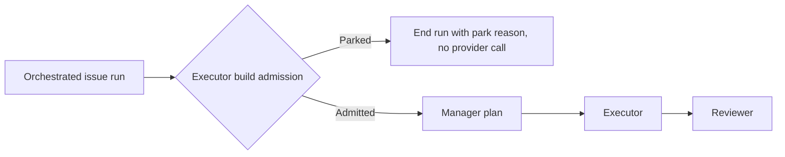

## Summary

An external orchestrated issue run now checks the executor's build admission
once, before the manager's plan call. When the host is below its floor, or a
cargo checkout is short of the floor plus headroom with the trim refused, the
run ends with the park reason and makes no provider call. Part of
stSoftwareAU/NEAT-AI-Discovery#2422.

Version bump: none; this internal worker change does not alter a published
compatibility version.

Run-level outcome, stated plainly: this does **not** let a cargo checkout run at
the reported 58.2–64.3 GB readings. The executor can run `cargo`, so it stays
held to the 46 GB floor plus 25 GB headroom, and the reading is the same one the
executor would have been parked at. What changes is that the run ends before the
manager's paid plan call instead of after it, and the next claim no longer pays
for the plan again.

## Spec

### Intent and Rationale

- On the reported readings the manager was parked before any provider call on
  `main`. An earlier iteration of this branch let the manager start at the floor
  only; review showed that in the only flow that sets the manager role, the
  executor call always follows and is parked at the same reading, so the
  exemption only added a wasted plan call (and a Codex manager can build, so it
  was not safe either). That exemption is removed; `claude_runner.ts` and
  `heavy_build_gate.ts` are unchanged from `main`.
- The check is the executor's own: `parkInFlightBuild(workspaceDir)`, the park
  every build-capable agent already gets in `runClaudeWithTimeout`.

### Essential Design Decisions

- The check runs at the top of `runOrchestratedIssueRun`, before preflight and
  before `runExternalOrchestration`, so nothing is spent and no checkpoint is
  written for a run that cannot proceed.
- A disk-probe error is not treated as free space: `parkInFlightBuild` surfaces
  it as before.
- A checkout with no cargo project is held to the floor only (Issue #4413), as
  before.
- Guards of the existing outcome (an agent call parked as infrastructure): the
  park reason carries `HOST_DISK_PARK_NOTE`, so it is classified as
  infrastructure and not as a repository fast failure or a `failed-once`; the
  gate is a no-op until production arms it. The new path returns the reason as
  the run error exactly as `runClaudeWithTimeout` does.

### Undiscoverable Facts

- The test injects the issue's 58.2 GB reading and an empty fake ephemeral cargo
  root; it does not replay a live fleet run, and the real
  `/var/tmp/vibe-cargo-target` is never read or pruned.
- The reported failure text was
  `manager call failed after 2 attempt(s): ephemeral cargo root over budget (58.2 GB free, floor 46.0 GB + headroom 25.0 GB)`.

## Evidence

Backend worker change.
`worker/deno/tests/orchestration_gate_host_disk_2422_test.ts` drives the real
`runOrchestratedIssueRun` with a fake provider runner and the real
`parkInFlightBuild`. Updated docs: `docs/CONTAINER.md` (the "In-flight builds
stop at the same floor" section).

## Reproduction

- **symptom** — a manager call failed at 58.2–64.3 GB free (trim refused) and
  the run was repeated on the next claim.
- **status** — `verified` — with the new check removed, the 58.2 GB and 30 GB
  tests fail (the run proceeds to provider calls); with it, no provider call is
  made.
- **regression test** —
  `worker/deno/tests/orchestration_gate_host_disk_2422_test.ts`

## Test Plan

- `worker/deno/tests/orchestration_gate_host_disk_2422_test.ts` (3 tests at
  head): cargo checkout at 58.2 GB ends parked with `headroom` and
  `Parked as infrastructure (Issue #4360).` and zero provider calls; host at 30
  GB ends parked with zero calls; positive controls — a cargo checkout at 72 GB
  and a Deno-only checkout at 58.2 GB still run and make provider calls.
- Red check: deleting the `if (park) return ...` line in
  `runOrchestratedIssueRun` makes the 58.2 GB and 30 GB tests fail with
  `the run must end parked`; restored, 3 passed.
- `deno task test:unit` on that file plus
  `tests/orchestration_3642_gate_test.ts` and
  `tests/heavy_build_gate_in_flight_4413_test.ts` (the latter two unchanged from
  `main`) — 43 passed, 0 failed.
- Branch outcomes: park `headroom` → `orchestration_gate_host_disk_2422_test.ts`
  (58.2 GB); park below floor → same file (30 GB); admitted cargo → same file
  (72 GB); non-cargo checkout → same file (Deno-only at 58.2 GB).
- Callers of the changed function: `runOrchestratedIssueRun` is reached through
  `issue_run_gate.ts`; the existing gate tests run with the in-flight gate
  unarmed (a no-op) and still pass.
- Docs checked: `docs/CONTAINER.md` sections on the in-flight park;
  `heavy_build_gate.ts` doc comments are unchanged and still true because that
  file is unchanged.
- `./quality.sh` — not run in this round (budget); CI runs the same checks.
