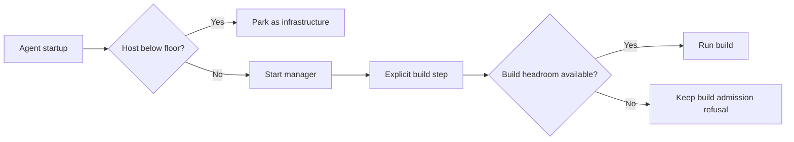

## Summary

Agent startup now checks the host floor without requiring cargo build headroom. Explicit build steps keep their headroom admission, so the reported disk readings no longer turn manager startup into a failed call. Fixes stSoftwareAU/NEAT-AI-Discovery#2422.

Version bump: none; this internal worker change does not alter a published compatibility version.

## Spec

### Intent and Rationale

- The reported 58.2–64.3 GB readings exceeded the 46 GB host floor but were below the 71 GB build reserve; manager startup inherited a build-only refusal and aborted before useful work.
- Agent startup uses the floor-only park already used for active-process monitoring. Build admission remains at explicit build steps.

### Essential Design Decisions

- A host below its floor still parks the agent as infrastructure.
- Disk-probe errors remain failures; the change does not treat an unavailable measurement as safe space.
- Explicit build checks and their pruning protections remain in place.

### Undiscoverable Facts

- The regression test injects the issue's 58.2 GB and 64.3 GB readings; it does not replay a live fleet run.
- The reported failure text was `manager call failed after 2 attempt(s): ephemeral cargo root over budget (58.2 GB free, floor 46.0 GB + headroom 25.0 GB)`.

## Evidence

This is a backend worker change. `worker/deno/tests/heavy_build_gate_in_flight_4413_test.ts` drives the real `runClaudeWithTimeout` entry point with injected disk readings. The regression fails against current `origin/main` production code and passes with the fix. `worker/deno/tests/repo_fast_failure_tracker_test.ts` also verifies that a host-disk stop is not counted as a repository fast failure.

## Reproduction

- **symptom** — a manager call failed at 58.2–64.3 GB free even though the host remained above its 46 GB floor, and the repository received fast-failure tallies.
- **status** — `verified` — the regression failed against `origin/main` production at 58.2 GB and passed after the change.
- **regression test** — `worker/deno/tests/heavy_build_gate_in_flight_4413_test.ts::agent start - a cargo checkout starts at the reported 58.2 and 64.3 GB readings`

## Test Plan

- `deno task test:unit tests/heavy_build_gate_in_flight_4413_test.ts` — passed, 11 tests. The new manager-start test failed against refreshed `origin/main` production (`manager startup must not require build headroom at 58.2 GB`) and passed on this branch. It also covers sufficient space; existing coverage in the same file confirms below-floor startup is still parked. The added measurement-failure case confirms the probe error is surfaced.
- `deno task test:unit tests/repo_fast_failure_tracker_test.ts` — passed, 48 tests, including the host-disk fast-failure classification.
- `deno task test:unit tests/claude_runner_host_disk_4390_test.ts` — passed, 3 tests, preserving the active-process floor stop.
- `deno lint lib/claude_runner.ts lib/heavy_build_gate.ts tests/heavy_build_gate_in_flight_4413_test.ts` from `worker/deno` — passed.
- `deno check lib/claude_runner.ts lib/heavy_build_gate.ts tests/heavy_build_gate_in_flight_4413_test.ts` from `worker/deno` — passed.
- `deno fmt --check lib/claude_runner.ts lib/heavy_build_gate.ts tests/heavy_build_gate_in_flight_4413_test.ts` from `worker/deno` — passed.
- No assertions were removed from existing tests.
- `./quality.sh < /dev/null` — did not complete: the bounded 900-second command exited 124; its last stage line was `deno tests: FAILED (948.8s)`. The full gate remains unverified.
