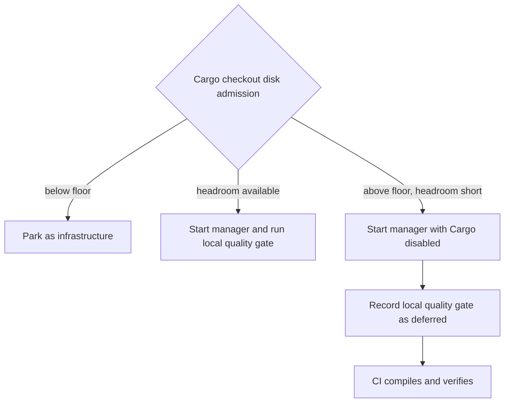

## Summary

Allow the issue manager to start when the host is above its disk floor but
cannot provide Cargo headroom. The manager is instructed to leave Cargo checks
to CI, and the local quality gate records that deferral instead of retrying the
manager. Part of stSoftwareAU/NEAT-AI-Discovery#2423.

## Spec

### Intent and Rationale

- The reported 58.2 GB free space exceeded the 46 GB floor but not the floor
  plus 25 GB Cargo headroom, so the worker's setup guard prevented issue work
  before manager execution.
- Preserve the disk floor and existing worker-managed build guards while
  allowing manager work to proceed without local Cargo verification.

### Essential Design Decisions

- Below-floor runs remain parked as infrastructure.
- Above-floor Cargo headroom shortfalls start the manager with an explicit
  instruction to skip Cargo commands and defer verification to CI.
- The local quality phase records a deferred outcome and continues, avoiding
  futile manager retries and fast-failure tallying for this infrastructure
  condition. Other setup errors remain explicit failures.

### Undiscoverable Facts

- The reporter's log was: `manager call failed after 2 attempt(s): ephemeral
  cargo root over budget (58.2 GB free, floor 46.0 GB + headroom 25.0 GB) —
  pruned 0.0 GB of idle target dirs and 12.9 GB is still short, so cargo builds
  wait for CI (Issue #3178 budget; Issue #4326 skip)`.

## Evidence

Backend worker change; no visual surface changed. The path from disk admission
to CI deferral is:

The regression reproduces the exact logged disk reading at manager admission;
the quality-phase test classifies the exact logged reason.

## Reproduction

- **symptom** — a headroom shortfall above the host floor prevented manager
  startup and retried the issue run.
- **status** — `verified` — the regression test failed against the unfixed
  worker code and passed after the change.
- **regression test** — `worker/deno/tests/claude_runner_host_disk_4390_test.ts::agent setup - a headroom shortfall lets manager work start`

## Test Plan

- `worker/deno/tests/claude_runner_host_disk_4390_test.ts` covers the 58.2 GB
  shortfall, recovery at the exact 71 GB floor-plus-headroom boundary, a
  no-Cargo checkout above the floor, a below-floor refusal, and a disk-probe
  error. The regression failed on base and passed after the fix. Mutations that
  removed the Cargo restriction, swallowed probe errors, disabled the
  below-floor park, or applied the Cargo rule to a no-Cargo checkout each made
  their corresponding assertion fail.
- `worker/deno/tests/quality_gate_attempt_report_test.ts` verifies that the
  logged budget deferral skips the local gate, records `deferred`/`SKIPPED`,
  and continues; forcing the deferral branch off made the test fail.
- `worker/deno/tests/issue_run_stats_comment_test.ts` verifies the deferred-to-CI
  status text; changing it to `failed` made the test fail.
- The seven-file targeted unit suite passed before the final fake-clock edit
  (`229 passed`); the changed manager admission test passed after that edit
  (`6 passed`). The full `./quality.sh` ran the parallel and serial test passes
  successfully, and lint, type check, formatting, Semgrep, Markdown, and other
  available checks passed. The overall gate failed its unit-test time budget:
  `tests/launcher_harness_reclaim_stub_test.ts` (2 tests, 6.89s) and
  `tests/parallel_safety_cap_test.ts` (2 tests, 2.82s) both exceeded the 1.00s
  budget for every test in those files. Running with `DENO_JOBS=4` did not
  change that result. Config integration and Checkov were skipped because their
  required local inputs/tools were unavailable.
- The docs sections read and updated were the host disk admission guidance in
  `docs/CONTAINER.md` and `docs/INTERNALS.md`.
- **Not done:** the full quality gate is still red on the unrelated unit-test
  time-budget classification, so no pull request was created. CI verification
  is pending.
