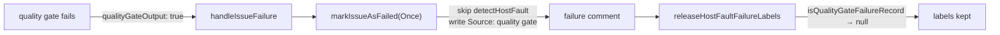

## Summary

Quality-gate failure records are no longer classified as host faults. The
quality gate now passes `qualityGateOutput: true` to `handleIssueFailure`.
With that flag, `markIssueAsFailedOnce` and `markIssueAsFailed` skip
`detectHostFault` and write a `**Source:** quality gate` line straight after
the Category line. The host-fault release sweep recognises that line and never
releases such a record. Before this fix, a failing test whose name or output
mentioned `No space left on device`, `ENOSPC` or `ignoring broken ref` made the
sweep strip `failed-once` / `failed` and post a false "Host fault cleared".
Closes #3445.

## Spec

### Intent and Rationale

- The quality gate's raw output is repository-authored: test names and
  assertion diffs. It cannot carry host output, so host-fault classification
  must not run on it.
- Skipping `detectHostFault` alone was not enough. `classifyFailureRecord`
  still re-reads any unmarked "Automated Processing Failed" body for a
  `clone-corrupt` signature. A quality-gate record that quotes
  `ignoring broken ref` would still be released. The record therefore carries a
  worker-written `**Source:** quality gate` head line, and the sweep returns
  `null` when it sees it. This follows the precedent of the summary-gate
  refusal (`isSummaryGateFailureRecord`).

### Essential Design Decisions

- `isQualityGateFailureRecord` is anchored to the comment head: the heading,
  the Category line, then the Source line. A Source line quoted deeper in the
  error output does not count. Forging the line could only keep a label in
  place, never release one.
- `qualityGateOutput` is optional, and when absent host faults are detected as
  before. Only the quality gate's call site passes repository test output.
  Every other `handleIssueFailure` caller passes a setup, clone or run-level
  reason that can carry host output: `coding_failure_ladder.ts`,
  `planning_processor.ts`, `question_processor.ts` and
  `commands/label_manager.ts`.

### Undiscoverable Facts

- The main-loop path (`planCodingFailure` → `isSetupFault`) also runs
  `detectHostFault`, on the run reason. It is not affected: the quality gate
  sets `failureLadderApplied`, and `planCodingFailure` returns on
  `ladderApplied` before reaching `isSetupFault`
  (`worker/deno/lib/coding_failure_ladder.ts:338`).
- Records already posted before this change still carry their marker. This fix
  covers new records only.

## Evidence

Backend-only change; there is no UI surface.

- Persisted shape: the posted comment gains an additive Source line. Old
  comments without it are read exactly as before (the marker and legacy paths
  are unchanged), so no key bump is needed.
- Callers checked for the new field: `quality_gate_remediation_phase.ts:213`
  passes it. `coding_failure_ladder.ts`, `planning_processor.ts`,
  `question_processor.ts` and `commands/label_manager.ts` do not need it,
  because their messages are not repository test output.

**Docs sweep** — grep: `detectHostFault`, `vibe-host-fault`, "Host fault"
(README.md, docs/ excluding docs/archive/); section:
`docs/INTERNALS.md#-host-fault-failure-labels-release-themselves-issue-2890`;
updated: `docs/INTERNALS.md`; `docs/TROUBLESHOOTING.md:988` — still true
because a host-caused failure comment still carries the Host fault line;
`docs/INTERNALS.md:4846` and `docs/INTERNALS.md:4929` — still true because
`planCodingFailure` is untouched and short-circuits on `ladderApplied` for
quality-gate runs; `docs/audits/security-sweep-2890-host-fault-release.md:64` —
historical audit record, and marker precedence is unchanged.

## Test Plan

- `worker/deno/tests/host_fault_test.ts` — new:
  - `label_failure - markIssueAsFailedOnce never marks quality-gate output as a host fault (Issue #3445)`
  - `label_failure - markIssueAsFailed never marks quality-gate output as a host fault (Issue #3445)`
  - `isQualityGateFailureRecord - recognises only the worker-written head (Issue #3445)`,
    which includes a forged deeper Source line and a 100,000-space hostile
    input.
- `worker/deno/tests/host_fault_release_test.ts` — new:
  `releaseHostFaultFailureLabels - a quality-gate record quoting host-looking test output keeps its labels (Issue #3445)`.
  It feeds real posted bodies, disk-full and broken-ref, first and second
  attempt, to the sweep. A fixture check proves the legacy body match would
  otherwise read them as `clone-corrupt`. `postedRecord` gained an optional
  extra-options parameter.
- `worker/deno/tests/quality_gate_phase_generic_bypass_test.ts` — new:
  `generic bypass - a failing gate hands handleIssueFailure the quality-gate flag (Issue #3445)`.
- No existing assertion was removed or changed.
- `deno test -A` on the three files: 57 passed, 0 failed, on the final head.
- `./quality.sh < /dev/null`: PASSED (with skipped checks: config integration),
  on the committed head.

**Branch outcomes:**

- `worker/deno/lib/label_failure.ts:47` — flag set → no host fault —
  `label_failure - markIssueAsFailedOnce never marks quality-gate output as a host fault (Issue #3445)`
  — ignoring the flag turned 4 tests red.
- `worker/deno/lib/label_failure.ts:47` — flag absent → `detectHostFault` runs
  — `label_failure - markIssueAsFailedOnce marks a host fault in the comment`
  — always returning `null` turned 4 tests red.
- `worker/deno/lib/label_failure.ts:53` — flag set → Source line written —
  `isQualityGateFailureRecord - recognises only the worker-written head (Issue #3445)`
  — returning `""` turned 4 tests red.
- `worker/deno/lib/label_failure.ts:53` — flag absent → no Source line — same
  test — always writing the line turned it red.
- `worker/deno/lib/host_fault_release.ts:143` — quality-gate record → `null`
  (labels kept) —
  `releaseHostFaultFailureLabels - a quality-gate record quoting host-looking test output keeps its labels (Issue #3445)`
  — removing the check turned it red. The non-quality-gate fall-through is
  reached by the existing legacy clone-corrupt release tests.
- `worker/deno/lib/host_fault.ts:196` — true/false —
  `isQualityGateFailureRecord - recognises only the worker-written head (Issue #3445)`
  — covered by the flips above.
- Call site `worker/deno/lib/phases/quality_gate_remediation_phase.ts:213` —
  `generic bypass - a failing gate hands handleIssueFailure the quality-gate flag (Issue #3445)`
  — passing `false` turned it red.

## Pre-PR Security Self-Check

- The new regex is anchored, with no overlapping quantifiers, and has a
  hostile-input test.
- No secrets and no hidden paths are staged.

🤖 Generated with [Claude Code](https://claude.com/claude-code)
