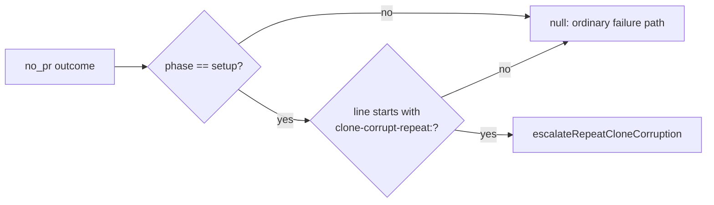

## Summary

Fixed the release path so that it trusts a `clone-corrupt-repeat` payload only when the worker itself wrote it. Before, `releaseClaim` parsed the payload out of every `no_pr` message, whatever phase it came from. Now it calls the new `cloneCorruptRepeatFromOutcome`, which reads only a setup-phase `no_pr` outcome. `CLONE_CORRUPT_REPEAT_RE` is also anchored to the start of a line. As a result, a later phase's message that quotes agent- or repository-controlled text can no longer trigger `escalateRepeatCloneCorruption`, which backs the repository off fleet-wide and escalates to `needs-human`. Closes #3446.

## Spec

### Intent and Rationale

- Failure messages from later phases quote text the agent or the repository controls, such as PR-summary gate refusals and quality-gate output. A well-formed `clone-corrupt-repeat: {...}` line in that text could fake a repeat clone corruption.
- The phase gate is the main defence. The line-start anchor is a second layer: within a setup message, a payload quoted mid-line (for example after `> ` or a prose lead-in) is not read.

### Essential Design Decisions

- The gate lives in a pure helper next to the parser (`worker/deno/lib/corrupt_clone_recovery.ts`), so it can be tested without driving `releaseClaim`. `releaseClaim` calls `runGhCommandRaw` directly, and no test seam is injected there.
- The anchor is a multiline `^`. The worker writes the payload as its own line after a `\n`, and `setup_branch_phase.ts:237` adds `Failed to set up repo <repo>: ` in front of the whole message, so the payload line still starts with the marker. The existing round-trip assertion `parseCloneCorruptRepeat(\`some prose\n${formatted}\nmore prose\`)` still holds.

### Undiscoverable Facts

- The issue run's setup phase is the only place that writes the payload. `recoverCorruptClone`'s cap refusal is reached through `setupRepo` in `workOnIssueSetupBranch` (`lib/phases/setup_branch_phase.ts:229` and its re-setup at `:828`). `issue_worker.ts:508` reports that failure as `phase: "setup"`, and `deriveRunOutcome` (`lib/run_outcome.ts`) copies the reason into `outcome.message` unchanged.

## Evidence

This is a backend-only change. No UI files are touched.

- `worker/deno/tests/broken_clone_test.ts::cloneCorruptRepeatFromOutcome - a completion-phase no_pr outcome quoting a well-formed payload is not a repeat corruption (Issue #3446)`: the message carries a well-formed payload on its own line, so only the phase gate refuses it.
- `worker/deno/tests/broken_clone_test.ts::parseCloneCorruptRepeat - null when the marker is quoted mid-line, not at a line start (Issue #3446)`: this test failed against the unchanged base production code (`FAILED | 22 passed | 1 failed`) and passes after the fix.
- Issue numbers cited as provenance: #3446: Repeat clone-corruption escalation parses its payload from any no_pr failure message, including agent-quoted text.

**Docs sweep** — grep: `clone-corrupt-repeat`, `parseCloneCorruptRepeat`, "rides in the setup error", "inside any message"; section: `docs/CONFIGURATION.md` (clone recovery state, "A second corruption…") and `docs/TROUBLESHOOTING.md` (corrupt clone, "A second corruption…"); updated: `docs/CONFIGURATION.md`, `docs/TROUBLESHOOTING.md`, plus the doc comments on `CLONE_CORRUPT_REPEAT_RE`, `parseCloneCorruptRepeat`, the module doc in `worker/deno/lib/corrupt_clone_recovery.ts`, and the comment above the call in `worker/deno/lib/run_core_production_deps.ts`. Hits left in place: `worker/deno/lib/repo_fast_failure_issue.ts:790` — still true because it is only the dedup key, and its shape is unchanged.

## Test Plan

- Added to `worker/deno/tests/broken_clone_test.ts`:
  - the mid-line-quote refusal test, which also asserts that the line-start form still parses;
  - three tests for `cloneCorruptRepeatFromOutcome`: setup phase gives the payload; completion and execute phases give null; `undefined` and `no_pr_expected` give null.
- Added `worker/deno/tests/clone_corrupt_repeat_growth_3446_test.ts`: a hostile ReDoS case (unterminated `clone-corrupt-repeat: {` lines) using `assertLinearGrowth`. It is registered in `WALL_CLOCK_TEST_FILES` (`worker/deno/lib/parallel_unsafe_test_manifest.ts`) so it runs in the serial pass. `worker/deno/tests/parallel_unsafe_test_manifest_test.ts` requires that registration.
- No assertions were removed from existing tests.
- Ran `deno test -A tests/broken_clone_test.ts tests/clone_corrupt_repeat_growth_3446_test.ts tests/parallel_unsafe_test_manifest_test.ts`: 58 passed, 0 failed. Ran `deno task check:manifests`: passed.
- Ran `./quality.sh < /dev/null` on the final code: `Result: PASSED (with skipped checks)`. Only config integration was skipped; the parallel and serial deno tests passed.
- Entry point checked: `releaseClaim` in `worker/deno/lib/run_core_production_deps.ts` is the only caller of the parse. `parseCloneCorruptRepeat` has no other production caller.

**Branch outcomes:**

- `worker/deno/lib/corrupt_clone_recovery.ts:138`: the outcome is not `no_pr` → null. Reached by `worker/deno/tests/broken_clone_test.ts::cloneCorruptRepeatFromOutcome - null for undefined and non-no_pr outcomes (Issue #3446)`.
- `worker/deno/lib/corrupt_clone_recovery.ts:138`: a `no_pr` outcome from a non-setup phase → null. Reached by `worker/deno/tests/broken_clone_test.ts::cloneCorruptRepeatFromOutcome - a completion-phase no_pr outcome quoting a well-formed payload is not a repeat corruption (Issue #3446)`. Removing `|| outcome.phase !== "setup"` turned it red (26 passed, 1 failed).
- `worker/deno/lib/corrupt_clone_recovery.ts:139`: a setup-phase `no_pr` outcome → the parsed payload. Reached by `worker/deno/tests/broken_clone_test.ts::cloneCorruptRepeatFromOutcome - reads the payload from a setup-phase no_pr outcome (Issue #3446)`.
- `worker/deno/lib/corrupt_clone_recovery.ts:70`: the payload is quoted mid-line → no match. Reached by `worker/deno/tests/broken_clone_test.ts::parseCloneCorruptRepeat - null when the marker is quoted mid-line, not at a line start (Issue #3446)`. Removing the `^`/`"m"` anchor turned it red (26 passed, 1 failed).
- `worker/deno/lib/run_core_production_deps.ts:5066` — exempt (untestable): `releaseClaim` calls `runGhCommandRaw` and `escalateRepeatCloneCorruption` directly, with no injected seam, so no unit test can drive it without real `gh` calls. The behaviour it delegates to is covered by the helper tests above.
