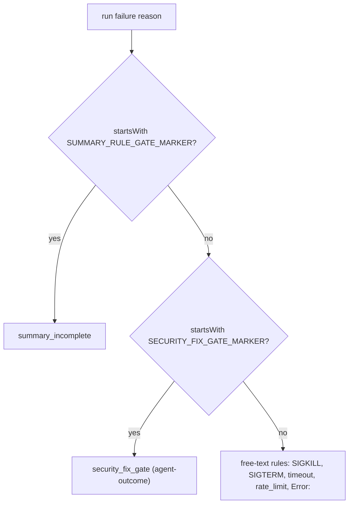

# PR Summary — Issue #3454

## Summary

Closes #3454

When a security-fix gate refusal ends a run, its reason now opens with the
worker-written `SECURITY_FIX_GATE_MARKER`. `detectFailureCategory` checks for it
with `startsWith`, before any free-text rule, and returns the new
`security_fix_gate` category. That category is an `agent-outcome`
(`not_code_fixable`). The pattern copies PR #3440's `SUMMARY_RULE_GATE_MARKER`.

## Spec

### Intent and Rationale

The gate's refusal comment quotes the agent's test declarations from the diff,
for example `Deno.test("rejects TypeError: … within timeout")`. The free-text
rules then read the quoted text as a worker crash, a timeout or a rate limit,
and the worker auto-files a false issue. A prefix that only the worker writes
cannot be imitated by quoted agent text. Requiring it at position 0 means a
marker quoted later in the text has no effect.

### Essential Design Decisions

- **Only the run-ending reason is marked.** That is `reportBlock(…,
  countsAsBlockedRun=true)` in `lib/security_fix_gate_retry.ts`, the second
  block in the same run.
- **The first-block reason in `lib/phases/completion_phase.ts` is not marked.**
  `workOnIssueCompletion` always passes that reason to
  `recoverFromSecurityGateBlock`, which replaces it, so it never ends a run.
- **The retry-launch failure reason is left unmarked on purpose.** A rate limit
  or a spawn failure is still classified on its own text, so a real
  infrastructure fault keeps its category.
- **The new category is handled like `summary_incomplete` everywhere it
  matters:**
  - `classifyCodingFailure` returns `ladder` (a normal attempt).
  - `classifyRunFailure` returns `AGENT_OUTCOME`.
  - `detectHostFault` returns `null`, so quoted `ENOSPC` or clone-failure text
    cannot raise a host fault.

### Undiscoverable Facts

- Residual risk: the launch-failure reason also quotes the block comment, so
  declarations quoted there can still be misread. This trade-off is
  deliberate, so that a genuine launch fault is never hidden.

## Evidence

Cited issues:

- #3454: Security-fix gate refusals that quote an agent test declaration containing `Error:` are classed worker-crash and auto-filed
- #3440: fix(worker): classify summary-gate refusals as summary_incomplete, not worker-crash (#3431)
- #3431: fix(worker): worker-crash — runs releasing with no PR
- #1575: A false security-fix gate block costs a whole run (#1385 lost three attempts)

Docs sweep: section: `docs/security-fix-gate-feedback.md` "The in-run retry
(Issue #1575)" and "Recognising a false block", `docs/INTERNALS.md` (new
security-fix gate marker section), `docs/workflows/issue-processing.md` (new
paragraph); siblings: `summary_incomplete`, `"summary-incomplete"`,
`workflow_gate`. Every switch and list that names those siblings in
`lib/failure_diagnosis.ts` (category union, display union,
`VALID_FAILURE_CATEGORIES`, the infrastructure, display, diagnosis and
oneliner switches) now also names `security_fix_gate`.

Related rules checked: none found. This change adds no rule to a prompt
template or coding standard.

## Test Plan

- [x] TDD: the new tests in `worker/deno/tests/failure_diagnosis_test.ts`,
      `worker/deno/tests/run_outcome_classifier_test.ts`,
      `worker/deno/tests/coding_failure_ladder_test.ts`,
      `worker/deno/tests/host_fault_test.ts` and
      `worker/deno/tests/completion_phase_security_gate_retry_test.ts` fail
      against the base. Targeted run: 129 passed, 0 failed; fmt, lint and
      check are clean.
- [x] Red-checks, each mutation reverted afterwards:

  | Mutation | Result |
  | --- | --- |
  | Remove the detector rule | 3 failed |
  | Change `startsWith` to `includes` | 1 failed (the prefix test) |
  | Remove the ladder early return | 1 failed |
  | Remove the classifier early return | 3 failed |
  | Remove the `host_fault` early return | 1 failed |
  | Remove the `reportBlock` prefix | test (a) failed |
  | Make `reportBlock` always mark | test (c) and the existing "a retry that cannot be launched charges no blocked run" failed |

**Branch outcomes:**

- `worker/deno/lib/failure_diagnosis.ts:324`: marker at position 0 →
  `security_fix_gate`. Reached by
  `worker/deno/tests/failure_diagnosis_test.ts::detectFailureCategory - a marked security-fix gate refusal quoting TypeError and timeout is security_fix_gate (Issue #3454)`.
  Removing the rule turned it red.
- `worker/deno/lib/failure_diagnosis.ts:324`: marker only quoted inside the
  text → falls through to the free-text rules. Reached by
  `worker/deno/tests/failure_diagnosis_test.ts::detectFailureCategory - the security-fix gate marker must be a prefix, not merely included (Issue #3454)`.
  Changing it to `includes` turned it red.
- `worker/deno/lib/coding_failure_ladder.ts:165`, `security_fix_gate`
  operand → `ladder`. Reached by
  `worker/deno/tests/coding_failure_ladder_test.ts::classifyCodingFailure - a marked security-fix gate refusal quoting a timeout and the cycle deadline earns a normal attempt (Issue #3454)`.
  Removing the operand turned it red. The `summary_incomplete` operand is
  covered by the existing #3431 test.
- `worker/deno/lib/run_outcome_classifier.ts:250`: `security_fix_gate` →
  `AGENT_OUTCOME`. Reached by
  `worker/deno/tests/run_outcome_classifier_test.ts::classifyRunFailure - a marked security-fix gate refusal is not_code_fixable and an agent-outcome (Issue #3454)`.
  Removing it turned it red.
- `worker/deno/lib/host_fault.ts:100`: marker prefix → `null`. Reached by
  `worker/deno/tests/host_fault_test.ts::host fault - a marked security-fix gate refusal quoting ENOSPC or a clone failure is never a host fault (Issue #3454)`.
  Removing it turned it red.
- `worker/deno/lib/security_fix_gate_retry.ts:256`, `countsAsBlockedRun` true
  → marked reason. Reached by
  `worker/deno/tests/completion_phase_security_gate_retry_test.ts::completion - a second block quoting TypeError and timeout is marked as the security-fix gate (Issue #3454)`.
  Dropping the prefix turned it red.
- `worker/deno/lib/security_fix_gate_retry.ts:256`, `countsAsBlockedRun` false
  → unmarked reason. Reached by
  `worker/deno/tests/completion_phase_security_gate_retry_test.ts::completion - a launch failure is not marked as the security-fix gate (Issue #3454)`.
  Marking it always turned it red.

Persisted data: none. `security_fix_gate` is a new category value, and no
stored record changes shape.

Quality gate: QUALITY_GATE_RESULT_PLACEHOLDER

## Pre-PR Security Self-Check

- [x] No secrets or hidden files staged.
- [x] No new external input, shell, SQL or path surface. The marker is a
      worker-written constant, and the match is a fixed-prefix `startsWith`
      with no regex.
