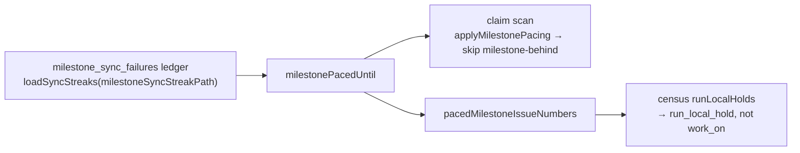

# PR Summary — Issue #3464

## Summary

The idle census now counts an issue whose milestone the persisted pacing ledger holds (`milestone-behind`) as a `run_local_hold`, not as claimable. Before this, NEAT-AI-Snapshot #41, #40 and #22 were counted as claimable on every cycle while the claim scan paced them. That gave a sustained, false `inversion_signal`.

Closes #3464

## Spec

### Intent and Rationale

- The census and the claim scan must agree about the same issue. A gate that the scan applies from persisted state, and that lasts across cycles, has to be modelled in the census.
- `milestone-behind` was classed `run-local` in `CENSUS_SCAN_GATE_COVERAGE`, but its source is the persisted `milestone_sync_failures` ledger. It is not run-local.

### Essential Design Decisions

- The census reuses the scan's own reader (`milestonePacedUntil`) through a new helper, `pacedMilestoneIssueNumbers`. It also reuses the scan's ledger path (`loadSyncStreaks(milestoneSyncStreakPath(config.workDir || workDir))`), so the two cannot drift apart.
- Paced issues join the existing `runLocalHolds` set, following the cooldown precedent from #655. No new census column or reason is added. `milestone-behind` is now classed `modelled`.
- The ledger is loaded once per census pass, not once per repo.

### Undiscoverable Facts

- `lib/idle_detect_diagnostics.ts` (~L1276) and `lib/repo_busy_for_idle_task.ts` (~L571) build their own `runLocalHolds` without the paced-milestone source. They are out of scope for this issue and are noted as possible follow-up work.

## Evidence

- `worker/deno/lib/milestone_presync.ts:251` adds `pacedMilestoneIssueNumbers`.
- `worker/deno/lib/run_core_production_deps.ts:5681-5815` changes `runIdleDecisionCensus` to load the ledger and union paced issues into `runLocalHolds`.
- `worker/deno/lib/idle_decision_census.ts:365` changes `"milestone-behind"` from `"run-local"` to `"modelled"`.
- `worker/deno/tests/idle_census_milestone_paced_wiring_3464_test.ts` is new. It drives the real `createProductionRunCoreDeps` with a stub `gh` and a real ledger file on disk.
- `worker/deno/tests/milestone_presync_test.ts` and `worker/deno/tests/idle_decision_census_test.ts` gain the new cases.

Issue references in the added lines:

- #3464: fix: idle-inversion on stSoftwareAU/NEAT-AI-Snapshot — claimable work the claim scan keeps refusing, sustained across cycles
- #655: fix: idle-inversion on stSoftwareAU/VibeCoder — claimable work the claim scan keeps refusing, sustained across cycles
- #1780: Child issue run syncs the milestone branch inline before cutting its branch, and defers when it cannot
- #622: Add update-mode fields to the .config.json schema with validation and a dynamic default. This appears in an existing sentence of `docs/workflows/issue-processing.md` that this change extends.
- #623: Give the Claude CLI and gh updaters an exact-version install path. It appears in the same existing sentence.

**Docs sweep:** I updated `docs/INTERNALS.md` (around L4607), `docs/workflows/issue-processing.md:443`, and the `idle_decision_census.ts` module and `runLocalHolds` doc comments. They now read "Three sources sustain a streak". The remaining `milestone-behind` hits are still true:

- `worker/deno/lib/find_oldest_issue.ts:501`, `worker/deno/lib/issue_finder_logger.ts:65` and `worker/deno/lib/skip_reason_clearing.ts:100` describe the scan side, which did not change.
- `worker/deno/lib/run_core.ts:2508` covers the child-run deferral, which did not change.
- `milestone_children_gate.ts`, `milestone_partial_rollup.ts`, `pr_auto_merge.ts`, `pr_maintenance.ts` and `docs/MERGE.md` are about the unrelated PR-merge `milestone-behind` reason.
- `docs/IDLE-TASK-FRAMEWORK.md` (L902–1408) does not claim to list every source of the hold set.
- `docs/archive/` and `docs/audits/` are historical.

**Related rules checked:** none. No prompt template or standards rule changed.

## Test Plan

- `deno test` on the 6 touched or related test files: 142 passed. `deno lint` and `deno check` are clean. `claim_path_differential_test.ts` and `skip_reason_clearing_test.ts` also pass.
- `./quality.sh < /dev/null` runs from the repo root before the PR is raised.
- Red checks, one per new test:
  - With the `pacedMilestoneIssueNumbers` union removed from the census `runLocalHolds`, the wiring test failed (`work_on=1 run_local_hold=0 inversion_signal=true`).
  - With `"milestone-behind"` set back to `"run-local"`, the coverage test in `idle_decision_census_test.ts` failed.
  - The helper test cannot run on base, because the base branch has no `pacedMilestoneIssueNumbers` export. With the filter flipped (`!==` → `===`), it failed: it returned `[2, 3]` where `[1, 4]` was expected.
- Removed assertions: none.

Branch outcomes:

- `worker/deno/lib/milestone_presync.ts:259` paced milestone → included. Test: `worker/deno/tests/milestone_presync_test.ts` "pacedMilestoneIssueNumbers - returns only the issues in a paced milestone (Issue #3464)". Flipping the filter went red.
- `worker/deno/lib/milestone_presync.ts:259` unpaced milestone, empty milestone or another repo → excluded. Test: the same test, which checks the M2 and `""` cases and size 0 for `other/repo`. Flipping the filter went red.
- `worker/deno/lib/run_core_production_deps.ts:5810` ledger entry present → the issue is held as `run_local_hold`. Test: `worker/deno/tests/idle_census_milestone_paced_wiring_3464_test.ts` "…holds a paced milestone's issue as run_local_hold…". Removing the union went red.
- `worker/deno/lib/run_core_production_deps.ts:5810` no ledger entry → the issue stays claimable. Test: the same file's "…without a ledger entry the same issue is claimable (Issue #3464 negative control)". This guards over-holding. With the union always holding the issue, the `work_on=1` assertion fails.
- `worker/deno/lib/idle_decision_census.ts:365` coverage is `modelled`. Test: `worker/deno/tests/idle_decision_census_test.ts` "#3464 - the milestone-behind gate is modelled, not silently over-counted". Setting it back to `run-local` went red.

Final state: the branch holds the fix, its docs, the three tests and this summary. No persisted shape changed; the census only reads the existing ledger.
