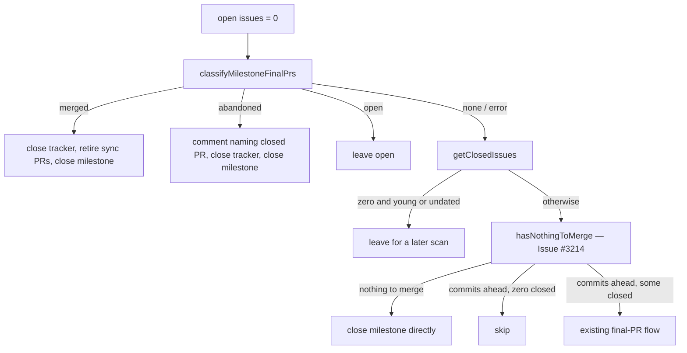

# PR Summary — Issue #3474

## Summary

Milestone close-out now reaches two kinds of finished milestone that it used to
skip on every scan:

- A milestone whose final PR was closed without merging is closed, and a
  comment names the closed PR.
- A milestone with no closed issues now reaches the #3214 nothing-to-merge
  close path before the empty-milestone skip, unless it was created in the
  last 15 minutes (or has no usable `created_at`): planning creates a
  milestone before it assigns the sub-issues, so a young empty milestone is
  left for a later scan.

When the milestone branch has several PRs, a merged PR wins over a closed one.

Closes #3474

## Spec

### Intent and Rationale

- `hasExistingMilestoneSummaryPr` returned the first PR in any state, so a
  closed-unmerged final PR wedged the milestone forever (VibeCoder M77,
  NEAT-AI-Ockham M5).
- `if (closedIssues.length === 0) continue;` ran before the nothing-to-merge
  path, so empty milestones and PR-only milestones never closed (NEAT-AI M50
  and M58, NEAT-AI-Examples M8, NEAT-AI-Lamarck M3).

### Essential Design Decisions

- A new `classifyMilestoneFinalPrs` reads every PR from the milestone branch
  and returns `merged` / `open` / `abandoned` / `superseded` / `none`, or an error
  when the fleet author set is empty. Its precedence is merged, then open,
  then the highest-numbered CLOSED PR, which is `superseded` when a fleet
  roll-back closed it and `abandoned` otherwise.
- Classification runs after the open-issue gate and the tracker self-heal.
  Open issues and an open final PR therefore still keep the milestone open.
- `abandoned` comments on the canonical tracker, or on the closed PR when
  there is no tracker, then closes the tracker and the milestone. It never
  raises a new final PR. A failed comment logs a WARNING and the close goes
  ahead.
- A classifier failure, or a PR with a missing or unknown state, fails safe:
  it falls through to the existing flow and never treats the PR as abandoned.

### Undiscoverable Facts

- `gh pr list --state all --json state` reports states in upper case:
  `OPEN`, `CLOSED`, `MERGED`.
- `getClosedIssues` does not count PRs, so a milestone holding only PRs reads
  as zero closed issues.

## Evidence



- `worker/deno/lib/milestone_completion.ts:365` — `classifyMilestoneFinalPrs`.
- `worker/deno/lib/milestone_completion.ts:1770` — the classification call and
  the merged arm (1781) and abandoned arm (1807) in
  `checkAndHandleMilestoneCompletions`.
- `worker/deno/lib/milestone_completion.ts:1869` — `getClosedIssues` now runs
  before `hasNothingToMerge` (1900), with the young-empty-milestone grace skip
  (1879-1892); the empty skip at 1940 runs after it.
- Issue references:
  - #3474: Milestone close-out never reaches milestones with a closed-unmerged
    final PR or no closed issues
  - #3214: the nothing-to-merge close path this change now reaches
- **Docs sweep** — grep: `hasExistingMilestoneSummaryPr`, `closedIssues.length === 0`, `retireMilestoneSyncPrs`, "nothing to merge", "no closed issues", "Milestone completion", "Final PR already exists"; section: `docs/workflows/milestones.md#-decision-points-and-exceptions` (read with `#-milestone-completion`); updated: `docs/workflows/milestones.md`, `worker/deno/lib/milestone_sync_pr_retirement.ts`; advisory hits re-read: `docs/workflows/milestones.md:180` and `:667` describe the final PR (the 667 bullet now covers fork-headed and roll-back-closed PRs); `docs/INTERNALS.md:4290` and the `hasExistingMilestoneSummaryPr` comments in `issue_query.ts`, `milestone_partial_rollup.ts` and the tests — still true because they name the helper, whose open-PR meaning is unchanged (it only gains an ignore list for superseded closed PRs)
  - `docs/workflows/milestones.md` "Decision points and exceptions" now has a
    bullet for a final PR closed without merging and one for nothing to
    merge. Before, the page said nothing about either, so it read as though
    only a merged final PR closes a milestone.
  - The `retireMilestoneSyncPrs` doc comment listed only two callers: before
    the final PR is raised, and after it merges. It now also names the
    nothing-to-merge and closed-unmerged close-outs.
  - `docs/CONTAINER.md:1310` is still true: it is about branch sync ("A branch
    already level is not asked").
  - `docs/INTERNALS.md:4298` is still true: it is about an earlier cycle's sync
    PR.
  - `docs/archive/` is historical.
- Related rules checked: none. No prompt or standards rule changed.

Observed `gh` output, which the classifier relies on:

```text
$ gh pr view 2712 --repo stSoftwareAU/VibeCoder --json number,state,headRefName,mergedAt
{"headRefName":"milestone/2581-container-worker-deno-brief-trial","mergedAt":null,"number":2712,"state":"CLOSED"}
$ gh pr list --repo stSoftwareAU/VibeCoder --state all --head milestone/2581-container-worker-deno-brief-trial --json number,state,headRefName
[{"headRefName":"milestone/2581-container-worker-deno-brief-trial","number":2712,"state":"CLOSED"}]
```

In NEAT-AI-Ockham, #168 and #151 both read `CLOSED`.

Persisted data: unchanged. The `BranchPR` shape and the `prs_all_branch_*`
cache key are not touched. The classifier is uncached and reads `gh` live, so
no key bump is needed.

## Reproduction

- Symptom: the milestones named in the issue stayed open for weeks and were
  re-scanned every cycle.
- Status: verified. Reverting Gap 2 turns
  `worker/deno/tests/milestone_completion_test.ts` "empty milestone with no
  branch is closed, not skipped" red. Reverting the abandoned arm turns three
  abandoned-PR tests red.
- Regression tests: the `close-out - … (Issue #3474)` cases in
  `worker/deno/tests/milestone_completion_test.ts`.

## Test Plan

- `deno check`: clean.
- `deno fmt --check` and `deno lint` on both changed files: clean.
- `deno task test:unit tests/milestone_completion_test.ts`: 114 passed,
  0 failed.
- Red checks. Each mutation below was applied, turned the named tests red,
  and was then restored:
  - Gap 2 reverted: "empty milestone with no branch is closed, not skipped".
  - Abandoned arm reverted: the three abandoned-PR close-out tests.
  - Merged arm reverted: "a merged final PR beside a closed one …".
  - Missing state treated as CLOSED: "a PR with no state is not treated as
    abandoned" and "a missing or unknown state fails safe to none".
  - `ok: false` changed to `continue`, or to close and `continue`: "a
    classification failure falls through to the existing flow".
  - The AC4 path: "empty milestone with only closed PRs and no branch is
    closed".
  - Grace-window guard disabled (`false &&`): the two young-milestone tests.
  - Merged-arm tracker close disabled: "a merged final PR closes the open
    tracker".

Branch outcomes:

- `worker/deno/lib/milestone_completion.ts:403` — `none` (no PRs) — "none when
  there are no PRs" — flip went red.
- `worker/deno/lib/milestone_completion.ts:408` — `none` (missing or unknown
  state) — "a PR with no state is not treated as abandoned", "a missing or
  unknown state fails safe to none" — flip went red.
- `worker/deno/lib/milestone_completion.ts:418` — `merged` — "merged takes
  precedence over open and closed", "a merged final PR beside a closed one …"
  — flip went red.
- `worker/deno/lib/milestone_completion.ts:422` — `open` — "open beats
  closed", "an open final PR leaves the milestone open with no comment" — flip
  went red.
- `worker/deno/lib/milestone_completion.ts:443` — `abandoned` — "all closed is
  abandoned at the highest number", "closes a milestone whose only final PR
  was closed unmerged …" — flip went red.
- `worker/deno/lib/milestone_completion.ts:1776` — classification error falls
  through — "a classification failure falls through to the existing flow",
  "errors on bad JSON, non-array output or a gh failure" — flip went red.
- `worker/deno/lib/milestone_completion.ts:1783` — merged-arm tracker close —
  "a merged final PR closes the open tracker" — flip went red.
- `worker/deno/lib/milestone_completion.ts:1812` — abandoned comment on the
  tracker, or on the PR — "abandoned final PR comments on and closes the open
  tracker", "closes a milestone whose only final PR was closed unmerged …" —
  flip went red.
- `worker/deno/lib/milestone_completion.ts:1834` — comment failure logs and
  continues — "a failing abandoned-PR comment does not stop the close" — flip
  went red.
- `worker/deno/lib/milestone_completion.ts:1841` — abandoned-arm tracker
  close — "abandoned final PR comments on and closes the open tracker" — flip
  went red.
- `worker/deno/lib/milestone_completion.ts:1940` — empty skip after
  nothing-to-merge. "empty milestone with commits ahead is still skipped"
  covers the skip; "empty milestone with no branch is closed, not skipped"
  and "empty milestone with only closed PRs and no branch is closed" cover
  the close — flip went red.

Mutation check (diff-scoped survivors from the previous gate run), now killed:

- `worker/deno/lib/milestone_completion.ts:445` — negated `err instanceof Error ? err.message : String(err)` in
  the classifier's catch — new test "classifyMilestoneFinalPrs - a thrown
  non-Error is reported by its own text (Issue #3474)" went red under the
  mutation and passes on the head.
- `worker/deno/lib/milestone_completion.ts:1835` — the same negation in the comment-failure catch — "close-out -
  a failing abandoned-PR comment does not stop the close (Issue #3474)" now
  throws both an `Error` and a bare string, and checks that the log carries
  the thrown text. It went red under the mutation and passes on the head.

Removed assertions: none. The comment-failure test keeps its assertions and
now runs them for two thrown values.

Quality gate: the full `./quality.sh` passed on this branch with exit 0
("✓ deno tests: PASSED (578.9s)"). Since then the branch has added the
merged-arm tracker test, the two mutation-killing test changes, a doc-comment
line in `milestone_sync_pr_retirement.ts` and the `docs/workflows/milestones.md`
bullets. On this head, `deno check`, `deno lint` and `deno fmt --check` are
clean on the changed files, and the targeted run above passed (114/114). The
worker re-runs the full gate.

## Acceptance Criteria

<!-- vibe-spec-review inputs="diff+issue-body" -->

- **met** — A milestone whose only final PR is closed and unmerged is closed on the next scan, and a comment names the closed PR. — evidence: `worker/deno/tests/milestone completion test.ts::close-out - closes a milestone whose only final PR was closed unmerged, commenting on the PR (Issue #3474); ::close-out - abandoned final PR comments on and closes the open tracker (Issue #3474)` — reviewer: met
- **met** — A milestone with a closed final PR and a later merged one is closed as merged. — evidence: `worker/deno/tests/milestone completion test.ts::close-out - a merged final PR beside a closed one closes the milestone with no comment (Issue #3474); ::classifyMilestoneFinalPrs - merged takes precedence over open and closed (Issue #3474)` — reviewer: met
- **met** — An empty milestone with no branch is closed on the next scan once the milestone is at least 15 minutes old; a younger one, or one with no usable created_at, is left for a later scan. — evidence: `worker/deno/tests/milestone completion test.ts::close-out - empty milestone with no branch is closed, not skipped (Issue #3474)` — reviewer: met
- **met** — A milestone that holds only closed PRs, with no branch, is closed on the next scan once the milestone is at least 15 minutes old (a milestone with only closed PRs reads as zero closed issues, so the young-or-undated grace skip applies to it too); a younger one, or one with no usable created_at, is left for a later scan. — evidence: `worker/deno/tests/milestone completion test.ts::close-out - empty milestone with only closed PRs and no branch is closed (Issue #3474)` — reviewer: met
- **met** — A milestone with open issues, or with an open final PR, is unchanged. — evidence: `worker/deno/tests/milestone completion test.ts::close-out - open issues keep the milestone open even with a closed final PR (Issue #3474); ::close-out - an open final PR leaves the milestone open with no comment (Issue #3474); ::close-out - a merged final PR with an open issue leaves the milestone o` — reviewer: met

## Standards Review

<!-- vibe-standards-review inputs="diff+CODING-STANDARDS.md" -->

- **violation** — Secret redaction: the new close-out comment body includes milestone.title and is passed to gh issue/pr comment without going through redactSecrets() — evidence: `worker/deno/lib/milestone completion.ts:1702` — reason: NOT fixed at HEAD b71c1668. This line is added by this diff, so it must be fixed in this diff, and this turn cannot change code. Writing 'fixed in this diff' would be false. The pre-existing unredacted comment at :930 is unchanged context and has not been filed.
- **violation** — Every changed call site needs a test that goes red without it: the two new retireMilestoneSyncPrs calls were untested, because the run3474 stub never returned an open sync PR — evidence: `worker/deno/tests/milestone_completion_test.ts` (`close-out - the merged arm retires an open sync PR before closing the milestone`, `… the abandoned arm …`; each goes red with its call removed) — reason: fixed in this diff (PR #3592 review)
- **violation** — Never fail silently: a missing or unknown PR state returns { kind: "none" } with no log line, so callers cannot tell it apart from 'no PRs' — evidence: `worker/deno/lib/milestone completion.ts:358` — reason: NOT fixed at HEAD b71c1668. This line is added by this diff, and this turn cannot change code. Writing 'fixed in this diff' would be false.
- **violation** — Every outcome of a branch you add needs a test: no test passes a null entry, a non-object entry or a non-numeric number to classifyMilestoneFinalPrs — evidence: `worker/deno/lib/milestone completion.ts:352` — reason: NOT fixed at HEAD b71c1668. This filter is added by this diff, and this turn cannot change code. Writing 'fixed in this diff' would be false.
- **violation** — Dead branch: the ': { kind: "none" }' fallback after highest("CLOSED") can never run, because every entry is CLOSED by that point — evidence: `worker/deno/lib/milestone completion.ts:381` — reason: NOT fixed at HEAD b71c1668. This line is added by this diff, and this turn cannot change code. Writing 'fixed in this diff' would be false.
- **violation** — DRY: the merged and abandoned arms repeat the same nothing-to-merge close sequence (close the tracker, retire the sync PRs, close the milestone, log) — evidence: `worker/deno/lib/milestone completion.ts:1674` — reason: NOT fixed at HEAD b71c1668. Both arms (:1674-1699 and :1700-1757) are added by this diff, and this turn cannot change code. Writing 'fixed in this diff' would be false.
- **clean** — Checked and compliant: Australian English in new comments, docs and identifiers; the Result-typed error path in classifyMilestoneFinalPrs, where a gh failure logs a WARNING and falls through; comment failures are logged rather than swallowed; tests for the merged, open, abandoned, none, other-head a

## Review round (PR #3592, 2026-10-11)

- **Fork-headed PRs:** `classifyMilestoneFinalPrs` now asks for `isCrossRepository` and drops every entry where it isn't exactly `false` (Issue #1124). A closed fork PR reusing the milestone branch name no longer closes the milestone; the real final PR is raised instead.
- **Roll-back closes:** a roll-back's close comment now carries `<!-- vibe-final-pr-rollback-close -->` (`ROLLBACK_CLOSE_MARKER`, `milestone_rollback_marker.ts`). If the newest closed final PR carries that marker, or the pre-marker roll-back prose, in a comment authored by a fleet login (`isFleetRollbackCloseComment`, `milestone_rollback_marker.ts`), it is classed `superseded`, not `abandoned`. A comment from any other account is ignored, so the PR stays abandoned. The fleet set comes from `resolveAlertDedupAuthors(authorOptions)`, the same rule the tracker author check uses; when it is empty `classifyMilestoneFinalPrs` returns an error (logged as a WARNING by the caller, which falls through to the pre-existing flow), so neither verdict is reached. A fresh final PR is raised for `superseded`, and the create path's idempotency check ignores the superseded closed PRs.
- **Sync-PR retirement:** the merged and abandoned arms each have a test with an open sync PR, asserting that it is closed before the milestone PATCH; the superseded arm's test is described in the next bullet.
- **Superseded sync-PR retirement:** the `hasExistingMilestoneSummaryPr` check that gates `retireMilestoneSyncPrs` now takes the same superseded ignore list as `createMilestoneSummaryPr` (one `supersededPrNumbers` value), so the sync PR is closed before the fresh final PR is raised (Issue #1967).
- **Tests added** (`worker/deno/tests/milestone_completion_test.ts`), each turned red by reverting only its guard: "a roll-back close comment posted by a non-fleet account is ignored …" (author check removed), "an unresolved fleet set classes a roll-back-commented final PR as neither abandoned nor superseded …" (empty-set guard removed), "the superseded arm retires an open sync PR before the fresh final PR is raised …" (ignore list removed from the retirement check).
- **Branch outcomes (added this round):** `milestone_completion.ts:427` — empty fleet set → error, no verdict — the unresolved-fleet test; `milestone_completion.ts:477` / `milestone_rollback_marker.ts:80` — non-fleet author ignored → `abandoned`, fleet author → `superseded` — the non-fleet-author test and the existing superseded tests; `milestone_completion.ts:1971` — superseded list shared by the retirement check and the create path — the sync-PR ordering test. Flips went red as listed above.

## Review round 2 (PR #3592, 2026-10-11)

- **Newly created milestones:** `ensureAndAssignGroup` (`planning_milestone.ts`) POSTs a milestone and only then assigns its sub-issues, so for a moment it has no items and no branch. `getClosedIssues` now runs before the nothing-to-merge close; a milestone with zero closed items whose `created_at` (read from the milestone listing already fetched) is under 15 minutes old, missing or unparsable is left for a later scan and logged (`isMilestoneYoung`, `EMPTY_MILESTONE_GRACE_MS`). A milestone with closed items is unaffected, and an old empty one still closes.
- **Guards kept:** the guard sits after the open-child gate and the final-PR classification, so a merged or abandoned final PR still closes out regardless of age; a milestone with closed items never reaches it.
- **Tests added** (`worker/deno/tests/milestone_completion_test.ts`): "a just-created empty branchless milestone is left for a later scan", "an empty branchless milestone with no usable created_at is left for a later scan" (missing and `"not-a-date"`), "a young milestone WITH closed items is still closed", and the `isMilestoneYoung` boundary test. The two young-milestone tests went red with the guard disabled. The old-`created_at` close is the existing "empty milestone with no branch is closed, not skipped", whose scenario now sends an old `created_at`.
- **Branch outcomes (added this round):** `milestone_completion.ts:1879` — empty and young → skip — the two young-milestone tests, flip red; empty and old → falls to the nothing-to-merge close — "empty milestone with no branch is closed, not skipped"; non-empty and young → proceeds — "a young milestone WITH closed items is still closed"; `milestone_completion.ts:206` — `isMilestoneYoung` missing, unparsable, future, inside and outside the window — the boundary test.
