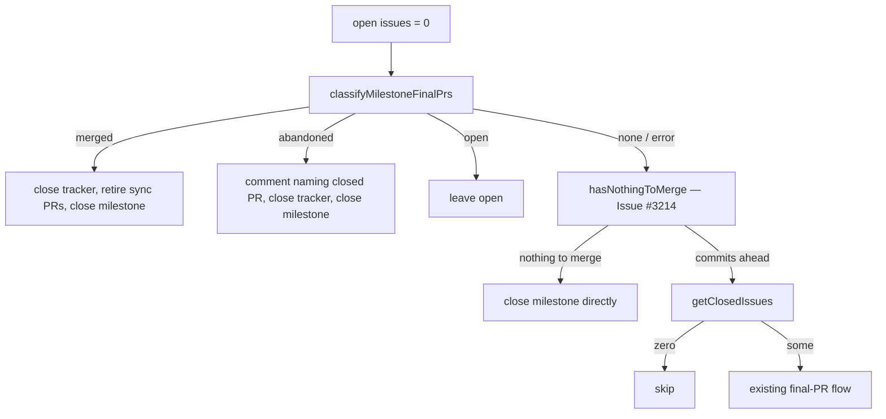

# PR Summary — Issue #3474

## Summary

Milestone close-out now reaches two kinds of finished milestone that it used to
skip on every scan:

- A milestone whose final PR was closed without merging is closed, and a
  comment names the closed PR.
- A milestone with no closed issues now reaches the #3214 nothing-to-merge
  close path before the empty-milestone skip.

When the milestone branch has several PRs, a merged PR wins over a closed one.

Closes #3474

## Spec

### Intent and Rationale

- `hasExistingMilestoneSummaryPr` returned the first PR in any state, so a
  closed-unmerged final PR wedged the milestone forever (VibeCoder M77,
  NEAT-AI-Ockham M5).
- `if (closedIssues.length === 0) continue;` ran before the nothing-to-merge
  path, so empty milestones and PR-only milestones never closed (NEAT-AI M50
  and M58, NEAT-AI-Examples M8, NEAT-AI-Lamarck M3).

### Essential Design Decisions

- A new `classifyMilestoneFinalPrs` reads every PR from the milestone branch
  and returns `merged` / `open` / `abandoned` / `none`. Its precedence is
  merged, then open, then the highest-numbered CLOSED PR.
- Classification runs after the open-issue gate and the tracker self-heal.
  Open issues and an open final PR therefore still keep the milestone open.
- `abandoned` comments on the canonical tracker, or on the closed PR when
  there is no tracker, then closes the tracker and the milestone. It never
  raises a new final PR. A failed comment logs a WARNING and the close goes
  ahead.
- A classifier failure, or a PR with a missing or unknown state, fails safe:
  it falls through to the existing flow and never treats the PR as abandoned.

### Undiscoverable Facts

- `gh pr list --state all --json state` reports states in upper case:
  `OPEN`, `CLOSED`, `MERGED`.
- `getClosedIssues` does not count PRs, so a milestone holding only PRs reads
  as zero closed issues.

## Evidence



- `worker/deno/lib/milestone_completion.ts:324` — `classifyMilestoneFinalPrs`.
- `worker/deno/lib/milestone_completion.ts:1664` — the classification call and
  the merged arm (1674) and abandoned arm (1700) in
  `checkAndHandleMilestoneCompletions`.
- `worker/deno/lib/milestone_completion.ts:1801` — `getClosedIssues` and its
  empty skip now run after `hasNothingToMerge` (1766).
- Issue references:
  - #3474: Milestone close-out never reaches milestones with a closed-unmerged
    final PR or no closed issues
  - #3214: the nothing-to-merge close path this change now reaches
- Docs sweep: grep for `hasExistingMilestoneSummaryPr`,
  `closedIssues.length === 0`, "nothing to merge" and "no closed issues".
  - section: none — no manual documents the close-out order or the
    empty-milestone skip
  - updated: none
  - `docs/CONTAINER.md:1310` is still true: it is about branch sync ("A branch
    already level is not asked").
  - `docs/INTERNALS.md:4298` is still true: it is about an earlier cycle's sync
    PR.
  - `docs/archive/` is historical.
- Related rules checked: none. No prompt or standards rule changed.

Observed `gh` output, which the classifier relies on:

```text
$ gh pr view 2712 --repo stSoftwareAU/VibeCoder --json number,state,headRefName,mergedAt
{"headRefName":"milestone/2581-container-worker-deno-brief-trial","mergedAt":null,"number":2712,"state":"CLOSED"}
$ gh pr list --repo stSoftwareAU/VibeCoder --state all --head milestone/2581-container-worker-deno-brief-trial --json number,state,headRefName
[{"headRefName":"milestone/2581-container-worker-deno-brief-trial","number":2712,"state":"CLOSED"}]
```

In NEAT-AI-Ockham, #168 and #151 both read `CLOSED`.

Persisted data: unchanged. The `BranchPR` shape and the `prs_all_branch_*`
cache key are not touched. The classifier is uncached and reads `gh` live, so
no key bump is needed.

## Reproduction

- Symptom: the milestones named in the issue stayed open for weeks and were
  re-scanned every cycle.
- Status: verified. Reverting Gap 2 turns
  `worker/deno/tests/milestone_completion_test.ts` "empty milestone with no
  branch is closed, not skipped" red. Reverting the abandoned arm turns three
  abandoned-PR tests red.
- Regression tests: the `close-out - … (Issue #3474)` cases in
  `worker/deno/tests/milestone_completion_test.ts`.

## Acceptance Criteria

<!-- vibe-spec-review inputs="diff+issue-body" -->

- A milestone whose only final PR is closed and unmerged is closed on the next
  scan, and a comment names the closed PR. — reviewer: met. Tests: "closes a
  milestone whose only final PR was closed unmerged, commenting on the PR",
  "abandoned final PR comments on and closes the open tracker", "a failing
  abandoned-PR comment does not stop the close".
- A milestone with a closed final PR and a later merged one is closed as
  merged. — reviewer: met. Tests: "a merged final PR beside a closed one
  closes the milestone with no comment", "classifyMilestoneFinalPrs - merged
  takes precedence over open and closed".
- An empty milestone with no branch is closed on the next scan. — reviewer:
  met. Test: "empty milestone with no branch is closed, not skipped".
- A milestone that holds only closed PRs, with no branch, is closed on the
  next scan. — reviewer: met. Test: "empty milestone with only closed PRs and
  no branch is closed".
- A milestone with open issues, or with an open final PR, is unchanged. —
  reviewer: met. Tests: "open issues keep the milestone open even with a
  closed final PR", "an open final PR leaves the milestone open with no
  comment", "a merged final PR with an open issue leaves the milestone open",
  "empty milestone with commits ahead is still skipped".

Every case drives `checkAndHandleMilestoneCompletions`, which wraps
`checkMilestoneCompletion`, with a stubbed `gh`.

## Standards Review

<!-- vibe-standards-review inputs="diff+CODING-STANDARDS.md" -->

- Every outcome of a branch you add needs a test — reviewer: partial —
  reason: fixed by worker/deno/tests/milestone_completion_test.ts "a merged
  final PR closes the open tracker", which went red when that tracker close
  was disabled.
- Optional DRY note: the merged and abandoned close sequences are similar.
  Not taken. They differ in the comment step and the log line, and a shared
  helper would add indirection for two call sites.

## Test Plan

- `deno check`: clean.
- `deno fmt --check` and `deno lint` on both changed files: clean.
- `deno task test:unit tests/milestone_completion_test.ts`: 99 passed,
  0 failed.
- Red checks. Each mutation below was applied, turned the named tests red,
  and was then restored:
  - Gap 2 reverted: "empty milestone with no branch is closed, not skipped".
  - Abandoned arm reverted: the three abandoned-PR close-out tests.
  - Merged arm reverted: "a merged final PR beside a closed one …".
  - Missing state treated as CLOSED: "a PR with no state is not treated as
    abandoned" and "a missing or unknown state fails safe to none".
  - `ok: false` changed to `continue`, or to close and `continue`: "a
    classification failure falls through to the existing flow".
  - The AC4 path: "empty milestone with only closed PRs and no branch is
    closed".
  - Merged-arm tracker close disabled: "a merged final PR closes the open
    tracker".

Branch outcomes:

- `worker/deno/lib/milestone_completion.ts:355` — `none` (no PRs) — "none when
  there are no PRs" — flip went red.
- `worker/deno/lib/milestone_completion.ts:360` — `none` (missing or unknown
  state) — "a PR with no state is not treated as abandoned", "a missing or
  unknown state fails safe to none" — flip went red.
- `worker/deno/lib/milestone_completion.ts:370` — `merged` — "merged takes
  precedence over open and closed", "a merged final PR beside a closed one …"
  — flip went red.
- `worker/deno/lib/milestone_completion.ts:374` — `open` — "open beats
  closed", "an open final PR leaves the milestone open with no comment" — flip
  went red.
- `worker/deno/lib/milestone_completion.ts:380` — `abandoned` — "all closed is
  abandoned at the highest number", "closes a milestone whose only final PR
  was closed unmerged …" — flip went red.
- `worker/deno/lib/milestone_completion.ts:1669` — classification error falls
  through — "a classification failure falls through to the existing flow",
  "errors on bad JSON, non-array output or a gh failure" — flip went red.
- `worker/deno/lib/milestone_completion.ts:1676` — merged-arm tracker close —
  "a merged final PR closes the open tracker" — flip went red.
- `worker/deno/lib/milestone_completion.ts:1707` — abandoned comment on the
  tracker, or on the PR — "abandoned final PR comments on and closes the open
  tracker", "closes a milestone whose only final PR was closed unmerged …" —
  flip went red.
- `worker/deno/lib/milestone_completion.ts:1727` — comment failure logs and
  continues — "a failing abandoned-PR comment does not stop the close" — flip
  went red.
- `worker/deno/lib/milestone_completion.ts:1734` — abandoned-arm tracker
  close — "abandoned final PR comments on and closes the open tracker" — flip
  went red.
- `worker/deno/lib/milestone_completion.ts:1811` — empty skip after
  nothing-to-merge. "empty milestone with commits ahead is still skipped"
  covers the skip; "empty milestone with no branch is closed, not skipped"
  and "empty milestone with only closed PRs and no branch is closed" cover
  the close — flip went red.

Removed assertions: none.

Quality gate: the full `./quality.sh` passed on this branch with exit 0
("✓ deno tests: PASSED (578.9s)"). The last commit adds only the merged-arm
tracker test, and the targeted run above passed on the final head.
