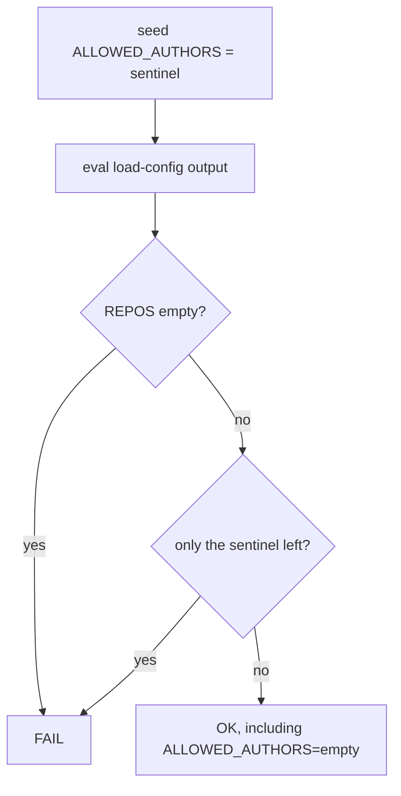

# PR Summary — Issue #3490

## Summary

The quality gate's config smoke test no longer fails on hosts that set no
`allowed_authors`. `ALLOWED_AUTHORS` is seeded with a sentinel before the
load-config output is evaluated, and the test fails only if the sentinel
survives, meaning load-config never assigned the variable. `REPOS` must still
be non-empty.

Closes #3490

## Spec

### Intent and Rationale

- `allowed_authors` has been optional since #1066, so load-config emits
  `ALLOWED_AUTHORS=()` on a host without it. The smoke test treated an empty
  array as "not populated" and blocked the gate on such hosts.
- The real invariant is that load-config assigns the variable, not that it is
  non-empty.

### Essential Design Decisions

- A sentinel seed (`__vibe_unset_sentinel__`) replaces the empty seed. An
  assigned `()` or any real author list overwrites it. A missing assignment
  leaves exactly the sentinel.
- The sentinel check needs both operands. The length test (`-eq 1`) stops
  `set -u` tripping on an empty array, and the value compare avoids rejecting
  a single real author.
- The `REPOS` empty check is unchanged.

### Undiscoverable Facts

- Under `set -u`, bash 3.2 treats `${ALLOWED_AUTHORS[0]}` on an empty array as
  unbound, so the length test has to come first.

## Evidence

- `worker/deno/lib/quality_gate.ts:951` — `configSmokeScript`.
- `worker/deno/lib/quality_gate.ts:962` — the sentinel seed.
- `worker/deno/lib/quality_gate.ts:974` — the sentinel-survives guard.
- `worker/deno/lib/quality_gate.ts:1005` — `runConfigSmokeTest` builds the
  script with `configSmokeScript`.
- Issue references:
  - #3490: Quality-gate config smoke test fails on hosts with no
    allowed_authors (optional since #1066)
  - #1066: allowed_authors is a public-repo security boundary doing double
    duty as the fleet's route to its own issues
- **Docs sweep** — grep: `ALLOWED_AUTHORS`, `runConfigSmokeTest`, "smoke test"; section: the `runConfigSmokeTest` doc comment; siblings: `REPOS`, `ISSUE_LABELS` — none gained a member; updated: none; advisory hits re-read: `worker/deno/tests/load_config_test.ts:435` — still true, it runs its own harness and does not use this script
- Related rules checked: none. No prompt or standards rule changed.

Persisted data: unchanged. Nothing is stored or cached by this change.

## Reproduction

- Symptom: with `allowed_authors` unset, load-config emits
  `ALLOWED_AUTHORS=()` and the smoke test reported a failure, blocking the
  gate.
- Status: verified. The AC1 regression test was observed failing against the
  unfixed base code (restoring the base seed and the `-eq 0` check turned it
  red) and passing after the fix (44 unit tests pass, 0 failed).
- Regression test: `worker/deno/tests/quality_gate_config_smoke_test.ts`
  "configSmokeScript - empty ALLOWED_AUTHORS assigned by load-config passes".

## Acceptance Criteria

<!-- vibe-spec-review inputs="diff+issue-body" -->

- **met** — The smoke test passes when load-config output assigns `ALLOWED_AUTHORS=()` (no `allowed_authors` key). — evidence: `worker/deno/tests/quality_gate_config_smoke_test.ts::configSmokeScript - empty ALLOWED_AUTHORS assigned by load-config passes` — reviewer: met
- **met** — The smoke test fails when load-config output never assigns `ALLOWED_AUTHORS`. — evidence: `worker/deno/tests/quality_gate_config_smoke_test.ts::configSmokeScript - ALLOWED_AUTHORS never assigned fails` — reviewer: met
- **met** — The smoke test still fails when `REPOS` is empty. — evidence: `worker/deno/tests/quality_gate_config_smoke_test.ts::configSmokeScript - empty REPOS fails` — reviewer: met

## Standards Review

<!-- vibe-standards-review inputs="diff+CODING-STANDARDS.md" -->

- **clean** — no material departures from `CODING-STANDARDS.md`.

## Test Plan

- `deno test` over every `tests/quality_gate*_test.ts` file, including the
  new test file: 169 passed, 0 failed (the new test file alone: 6 passed). `deno fmt --check`, `deno lint` and `deno check`: clean.
- Red checks. Each mutation was applied, turned the named test red, and was
  restored:
  - Base seed and `-eq 0` check restored: the empty-ALLOWED_AUTHORS test.
  - Sentinel guard neutralised: "ALLOWED_AUTHORS never assigned fails".
  - `REPOS` check neutralised: "empty REPOS fails".
  - `-eq 1` operand removed: the empty-ALLOWED_AUTHORS test, via `set -u`.
  - Sentinel-compare operand removed: "a single real author passes".
  - `|| true` on the load-config capture swapped to `|| false`: "a failing
    load-config reports a FAIL message instead of aborting silently" (the
    script aborted under `set -e` with no output).

Branch outcomes:

- `worker/deno/lib/quality_gate.ts:966` — `|| true` after a failing load-config — "configSmokeScript - a failing load-config reports a FAIL message instead of aborting silently" — flip went red.
- `worker/deno/lib/quality_gate.ts:970` — `REPOS` empty fails — "configSmokeScript - empty REPOS fails" — flip went red.
- `worker/deno/lib/quality_gate.ts:974` — operand `-eq 1` — "configSmokeScript - empty ALLOWED_AUTHORS assigned by load-config passes" — flip went red.
- `worker/deno/lib/quality_gate.ts:974` — operand sentinel compare — "configSmokeScript - a single real author passes" — flip went red.
- `worker/deno/lib/quality_gate.ts:977` — sentinel survives fails — "configSmokeScript - ALLOWED_AUTHORS never assigned fails" — flip went red.
- `worker/deno/lib/quality_gate.ts:980` — pass — "configSmokeScript - empty ALLOWED_AUTHORS assigned by load-config passes", "configSmokeScript - populated authors pass" — flip went red.

Removed assertions: none.

Quality gate: `timeout 900 ./quality.sh < /dev/null` from the repo root exited 0, "Result: PASSED (with skipped checks)". All checks passed, including deno tests, lint, type check and fmt. The one skip is config integration ("deno or .config.json not available" on this host).
