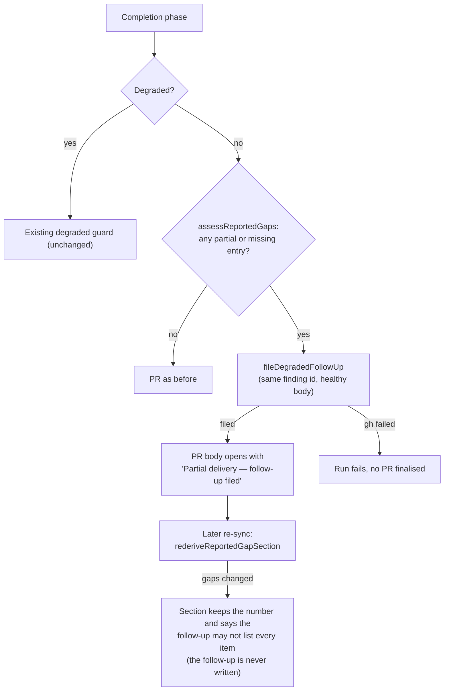

# PR Summary — Issue #3506

## Summary

A healthy (non-degraded) run whose PR summary closed out a criterion as
`partial` or `missing` raised a PR that closed the issue, and nothing tracked
the rest. Before this change, only a degraded run filed a follow-up. Now the
same guard (`applyDegradedDeliveryGuard`, at both of its call sites) files one
`idle-task` follow-up for a healthy run's own `partial` or `missing` closure
entries, or reuses the existing one, keyed on the parent. The PR body then
opens with a `## ⚠️ Partial delivery — follow-up filed` section that links the
follow-up. `unassessed` items still file nothing (#2695). A later PR-body
re-sync re-derives that section. Closes #3506.

## Spec

### Intent and Rationale

- The worker already parses the closure verdict and already files a
  parent-keyed follow-up. The only gap was the degraded-only condition, so the
  fix reuses `assessScopeShortfalls`, `degradedNeedsFollowUp` and
  `fileDegradedFollowUp` rather than adding a second pipeline.
- The PR keeps its closing keyword, as the issue asks. The residue survives
  the merge in the follow-up.

### Essential Design Decisions

- A healthy and a degraded run on the same parent share one follow-up: the
  healthy path uses the same `degraded-follow-up-<N>` finding id. No persisted
  key changes, so existing follow-ups are reused rather than duplicated.
- `assessReportedGaps` keeps only `partial` and `missing` shortfalls. On a
  healthy run, `unassessed` items never file a follow-up and never appear in
  the section.
- Failing to file or update the follow-up fails the run, exactly as on the
  degraded path. Raising the PR anyway would close the issue with the
  residue recorded nowhere.
- On a healthy run whose issue states no criteria, nothing is filed: entries
  are matched to the issue's criteria, and there are none to match.

### Undiscoverable Facts

- A `missing` entry still turns `Closes` into `Part of` (#3177). That rule is
  untouched, so a `missing` gap both keeps the parent open and gets a
  follow-up, as it already did on the degraded path.
- The issue's second "How to verify" bullet (the review-fleet-prs log stops
  recording this kind of finding) can only be observed after deployment, by
  later review rounds. No code in this repository can demonstrate it, so it
  is not scored above.

## Evidence

Backend/CLI change only; no UI files are touched.

- Completion-phase behaviour is tested in
  `worker/deno/tests/completion_phase_degraded_delivery_test.ts`.
- The library is tested in `worker/deno/tests/degraded_delivery_test.ts`.
- The re-sync is tested in `worker/deno/tests/pr_body_sync_test.ts`.
- Fakes: `runCompletion` stubs `gh issue list` as `[]` and `gh issue create`
  as an issue URL. These stand in for `fileFindingOnce`'s real `gh` calls,
  which the existing degraded tests already exercise the same way.
- Cited issues:
  - #3506: A healthy run that closes out a criterion as partial or missing
    still closes the issue with no follow-up (three private fleet PRs).
  - #3177: Missing-core-deliverable rule is prose only.
  - #2695: Skip degraded-run follow-ups unless a criterion is partial or
    missing.
  - #3350: PR body sync carries a stale 'Degraded run' banner forward that no
    fix run can remove.
  - #2562: bug: a degraded (fallback-model) run can close an issue with only
    partial scope delivered.

**Docs sweep** — grep: "healthy run is untouched", "degraded-run guard",
`extractDegradedRunSection`, "Degraded run"; section:
`docs/workflows/issue-processing.md#️-a-degraded-run-never-closes-an-issue-as-complete`;
siblings: `buildDegradedNoFollowUpSection`, `buildDegradedPrSection` — the
leading-section set gained the partial-delivery section, and the re-sync docs
and `pr_body_sync.ts` module doc now name it; the PR #3676 review fix (the re-sync never writes to the follow-up) re-read the `Re-sync` bullet of the same section, the `rederiveReportedGapSection` doc comment, the `pr_body_sync.ts` module doc and the `docs/USAGE.md` re-sync sentence, and rewrote each to the conditions `rederiveReportedGapSection` checks (no gap: dropped with no follow-up call; number unreadable: live section kept; gaps changed: stale-follow-up wording); updated:
`docs/workflows/issue-processing.md`, `docs/USAGE.md`,
`prompts/issue/prompt.md`, plus doc comments in
`worker/deno/lib/degraded_delivery.ts`, `worker/deno/lib/pr_body_sync.ts` and
`worker/deno/lib/phases/completion_phase.ts`. Hits left in place, each still
true because it names the guard, which still runs for degraded runs:
- `CODING-STANDARDS.md:706`, `prompts/coding_guidelines/prompt.md:1425` and
  `prompts/pr_feedback/prompt.md:64` list it as an example guard.
- `docs/workflows/issue-processing.md:2531`–`:2535` (the paragraph "A degraded
  run, or a healthy run with its own `partial`/`missing` gaps … is the
  exception to `summary_incomplete`") and the outcome table below it describe
  the guard's failure handling, which now covers both cases.
- `worker/deno/lib/acceptance_criteria_gate.ts:78` and
  `worker/deno/lib/closure_criterion_match.ts:95` say the guard reads these
  values, which it still does.

## Acceptance Criteria

<!-- vibe-spec-review inputs="diff+issue-body" -->

- **met** — In the completion phase, apply the follow-up half of the degraded-run guard to every run whose closure verdict has a `partial` or `missing` entry, not only to degraded runs; file (or reuse, keyed on the parent issue) one `idle-task` follow-up naming each shortfall, add a PR-body section that points at it; `unassessed` items keep the #2695 rule and file nothing — evidence: `worker/deno/tests/completion_phase_degraded_delivery_test.ts::completion - a healthy run whose summary reports a missing criterion files one follow-up and says so in the PR (Issue #3506)`, `worker/deno/tests/degraded_delivery_test.ts::assessReportedGaps - unassessed items are dropped but an unassigned partial gap is kept (Issue #3506)` — reviewer: met
- **met** — Optionally, have the implementation prompt say this explicitly: a criterion closed out as `partial` or `missing` means a follow-up — evidence: `prompts/issue/prompt.md` ("Every `partial` and `missing` carries a one-line reason" bullet) — reviewer: met
- **met** — Keep the PR's closing keyword, since #520 says a PR that does not close its issue loops — evidence: `worker/deno/tests/completion_phase_degraded_delivery_test.ts::completion - a healthy run whose summary closes out one criterion as partial files exactly one idle-task follow-up (Issue #3506)` (the PR is still raised, status `continue`) — reviewer: met
- **met** — Unit test: a healthy (non-degraded) run whose summary closes out one criterion as `partial` files exactly one `idle-task` follow-up and adds the follow-up section to the PR body — evidence: `worker/deno/tests/completion_phase_degraded_delivery_test.ts::completion - a healthy run whose summary closes out one criterion as partial files exactly one idle-task follow-up (Issue #3506)` — reviewer: met
- **met** — A run where every criterion is `met` files nothing — evidence: `worker/deno/tests/completion_phase_degraded_delivery_test.ts::completion - the same run, healthy and complete, raises the PR with no follow-up`, `worker/deno/tests/degraded_delivery_test.ts::assessReportedGaps - every entry met leaves no shortfall (Issue #3506)` — reviewer: partial — reason: the reviewer saw only the diff and so missed the existing completion-phase test for a healthy all-`met` run. That test is unchanged at the head and passes with this change.
- **unrequested** — the PR-body re-sync re-derives the new section (`rederiveReportedGapSection`, `extractLeadingSection` in `worker/deno/lib/pr_body_sync.ts`) — reviewer: unrequested — reason: without it, a review-fix re-sync would silently drop the section the issue asks for, or keep it once stale (the #3350 lesson)
- **unrequested** — a healthy run fails loud when its follow-up cannot be filed — reviewer: unrequested — reason: the shared guard already does this, and raising the PR would close the issue with the residue recorded nowhere, which is the failure the issue describes
- **unrequested** — a separate healthy-run body in `buildDegradedFollowUpIssue` — reviewer: unrequested — reason: the degraded body says "the run was degraded" and names a fallback model, which would be false for a healthy run

## Standards Review

<!-- vibe-standards-review inputs="diff+CODING-STANDARDS.md" -->

- **violation** — `worker/deno/lib/pr_body_sync.ts` module doc still named only the degraded-run section (raised as optional; treated as a stale doc comment) — evidence: `worker/deno/lib/pr_body_sync.ts:6` — reason: fixed in this diff
- **clean** — Named tests exist. The new tests go red without their change, and negative assertions have the forbidden thing in their fixtures. The failure-reason test asserts the cause (`HTTP 502`). Fail-loud paths are kept. The follow-up number is never read from untrusted bullets. No persisted-shape change. Review-enforced rules checked: Australian English, check where you insert (#3194), prose about the PR's own change, doc comments outside the diff going stale, and behaviour another issue delivers not described as present.

## Test Plan

- `deno task test:unit` from `worker/deno` passed on the final head, after
  the mutation-check tests were added: 27568 passed and 969 passed in its two
  runs, 0 failed. It ran every test file that drives `workOnIssueCompletion`
  or `syncPrBodyFromSummary`, plus `worker/deno/tests/degraded_delivery_test.ts`.
- PR #3676 review push (second round, no follow-up writes from the sync):
  `deno fmt --check`, `deno lint`, `deno check` and `deno task test:unit` over
  `tests/pr_body_sync_test.ts`, `tests/degraded_delivery_test.ts`,
  `tests/completion_phase_degraded_delivery_test.ts`,
  `tests/pr_feedback_processor_test.ts` and `tests/pr_ci_processor_test.ts`
  passed (218 passed, 0 failed); `markdownlint-cli2` passed on the changed
  docs. The full gate was not re-run on this push.
- Earlier head: `./quality.sh < /dev/null` passed (`Result: PASSED (with skipped checks)`;
  `config integration` is skipped as usual). Later commits changed only a doc
  comment, two log messages and test assertions, and the targeted fmt, lint,
  check and test runs passed after each of them. The mutation-check fix changed only
  tests and one manual sentence.
- Added to `worker/deno/tests/degraded_delivery_test.ts` (17 tests; the file
  now has 64): `assessReportedGaps`, the healthy and degraded follow-up
  bodies, `buildReportedGapPrSection`, `rederiveReportedGapSection` (empty
  when met; gaps the section was raised with stay as they are; changed gaps
  keep the number and say the follow-up may not list them; a hostile bullet
  and a 50,000-digit run are not read as a number) and
  `buildReportedGapStaleFollowUpSection` (exact layout and throw).
- Added to `worker/deno/tests/pr_body_sync_test.ts` (8 tests; the file now
  has 47): the section is kept while a gap remains, dropped when every
  criterion is met, logged on drop, not logged when unchanged, and the sync
  fails loud when the issue cannot be read. For the PR #3676 review, three
  tests pin that a sync never writes to the follow-up: changed gaps give the
  stale-follow-up wording and no `gh issue` call other than `view`; an issue
  retitled after approval produces no `gh issue edit` or `gh issue create`;
  and a section already in the stale-follow-up form is re-derived under the
  same number. `syncWithDegradedLive` gained an optional `logger`.
- Red checks for the review fix: restoring the previous `pr_body_sync.ts`
  (which wrote the follow-up) turned the first two review tests red. Making
  `rederiveReportedGapSection` always build the stale wording turned 3 tests
  red ("gaps the section was raised with stay as they are", and two sync
  tests). Dropping the `filed` alternative from the number regex turned
  "a section already marked as possibly stale is re-derived under the same
  follow-up number" red.
- Added to `worker/deno/tests/completion_phase_degraded_delivery_test.ts`:
  - The healthy-`partial` test (exactly one `idle-task` follow-up, with the
    section).
  - The healthy follow-up-failure test (no PR; the reason names
    "partial or missing" and `HTTP 502`).
- Edited existing tests, with the issue requirement that changes each
  expectation:
  - The test "a healthy run is unaffected even when its summary reports a gap"
    is renamed to "a healthy run whose summary reports a missing criterion
    files one follow-up and says so in the PR (Issue #3506)". Its removed
    assertion `assertEquals(outcome.issueCreates.length, 0);` is untrue under
    Proposed change 1: a healthy `missing` entry now files one follow-up. It
    becomes `1`, and every other assertion is kept.
  - "a healthy run blocked by the independent-review gate on an existing-PR
    branch carries no Degraded run section": its other assertions are kept,
    and a section assertion is added. The removed assertion is listed below.
  - "a degraded run whose follow-up cannot be filed raises no PR" gains
    `assertStringIncludes(outcome.reason ?? "", "Degraded run (");` and
    removes nothing.
- Removed from `worker/deno/tests/completion_phase_degraded_delivery_test.ts`: `assertEquals( outcome.issueCreates.length, 0, "a healthy run files no follow-up", );` — #3506 (Proposed change 1) makes a healthy run's own `missing` entry file one follow-up, so "a healthy run files no follow-up" is untrue. The test now asserts `1` with the message "a healthy run's own missing entry files the follow-up before the gate's recovery".
- Added after the mutation check, to pin changed lines no test noticed:
  - `worker/deno/tests/degraded_delivery_test.ts`: "buildDegradedFollowUpIssue
    - the healthy body is laid out exactly, blank lines and headings included
    (Issue #3506)" and "buildReportedGapPrSection - is laid out exactly, blank
    lines included (Issue #3506)" compare the whole string.
  - `worker/deno/tests/pr_body_sync_test.ts`: "sync - logs the dropped
    partial-delivery section with the PR it belongs to (Issue #3506)" and
    "sync - logs no re-derivation when the partial-delivery section is
    unchanged (Issue #3506)". `syncWithDegradedLive` gained an optional
    `logger`.
  - `worker/deno/tests/completion_phase_degraded_delivery_test.ts`:
    "completion - the follow-up log names whether the run was degraded, its
    reason and its shortfall count (Issue #3506)". `runCompletion` now records
    `logger.warn` calls.
  - Each of the 22 listed mutants was applied in turn and its test file run:
    all 22 went red (`degraded_delivery.ts:297`–`315` and `:499`–`505`,
    `completion_phase.ts:896`–`898`, and the re-derivation log call at
    `pr_body_sync.ts:634`–`645`).
    The three test files then passed in full: 127 passed, 0 failed.
- Red checks (each break applied, the tests run, then the code restored):
  - Healthy wiring in `applyDegradedDeliveryGuard`: replacing
    `assessReportedGaps(issueBody, prBody)` with `degradedDelivery` turned 4
    tests red. These were both edited tests, the healthy-`partial` test and
    the healthy failure test.
  - Section choice: rendering `buildDegradedPrSection` for a healthy run
    turned 3 tests red.
  - Failure-reason ternary: forcing `false` turned the degraded failure test
    red, and forcing `true` turned the healthy failure test red.
  - `assessReportedGaps` filter: dropping it turned 2 tests red.
  - `rederiveReportedGapSection`: removing the no-gap early return turned 2
    tests red ("empty when everything is now met" and "sync - drops the
    partial-delivery section …"). Reading the number from the whole section
    turned the hostile-bullet test red.
  - `buildReportedGapPrSection`: removing the throw turned its throw test red.
  - Healthy follow-up body: disabling it turned the healthy-body test red.
  - The reported-gap branch in `pr_body_sync.ts`: removing it turned 2 sync
    tests red.
- Guards kept on the new healthy path: it is the same function at the same
  two call sites, so it keeps the summary-gate ordering, the existing-PR
  naming on failure and the no-finalise-on-failure rule. The existing-PR
  ordering for a healthy run is covered by the edited independent-review-gate
  test.
- Callers checked: `assessReportedGaps` is called by
  `applyDegradedDeliveryGuard` (`completion_phase.ts:853`) and
  `rederiveReportedGapSection` (`degraded_delivery.ts:557`).
  `buildReportedGapPrSection` is called by `applyDegradedDeliveryGuard`
  (`completion_phase.ts:907`) and `rederiveReportedGapSection`
  (`degraded_delivery.ts:565`). `syncPrBodyFromSummary` reaches both only
  through `rederiveReportedGapSection`.
  `REPORTED_GAP_SECTION_HEADING` is used by `buildReportedGapPrSection`,
  `buildReportedGapStaleFollowUpSection` (`degraded_delivery.ts:526`) and
  `syncPrBodyFromSummary`. All are production readers.
- Applied the new prompt sentence to this PR's own diff and summary: each
  `partial` or `missing` entry above carries a reason that says what is left.
  Nothing else was found.

**Branch outcomes:**

- `worker/deno/lib/phases/completion_phase.ts` `verdict = degradedDelivery.degraded ? …` — degraded arm: the existing degraded tests (for example "a degraded run delivering one of two criteria files the residue and says so in the PR"). Healthy arm: "a healthy run whose summary closes out one criterion as partial files exactly one idle-task follow-up (Issue #3506)". Flipping it to always use `degradedDelivery` went red.
- `worker/deno/lib/phases/completion_phase.ts` failure `reason: verdict.degraded ? …` — degraded arm: "a degraded run whose follow-up cannot be filed raises no PR". Healthy arm: "a healthy run whose gap follow-up cannot be filed raises no PR (Issue #3506)". Each forced flip went red.
- `worker/deno/lib/phases/completion_phase.ts` section `verdict.degraded ? buildDegradedPrSection : buildReportedGapPrSection` — the degraded arm is covered by "a degraded run delivering one of two criteria …", and the healthy arm by both edited healthy tests. The flip went red.
- `worker/deno/lib/degraded_delivery.ts` `assessReportedGaps` filter `partial || missing` — kept: "assessReportedGaps - a partial entry is a shortfall …"; dropped: "assessReportedGaps - unassessed items are dropped …". Dropping the filter went red.
- `worker/deno/lib/degraded_delivery.ts` `buildDegradedFollowUpIssue` `!verdict.degraded ? healthy : degraded` — "buildDegradedFollowUpIssue - a healthy verdict gets the reported-gap body …" and "… a degraded verdict keeps the degraded body …". The flip went red.
- `worker/deno/lib/degraded_delivery.ts` `buildReportedGapPrSection` throw: `verdict.degraded` operand and `!degradedNeedsFollowUp` operand — "buildReportedGapPrSection - throws on a degraded verdict or one without a gap" asserts both. Removing the throw went red. The healthy arm is "buildReportedGapPrSection - names the follow-up and the shortfall".
- `worker/deno/lib/degraded_delivery.ts` `rederiveReportedGapSection`:
  - No gap → `""`: "rederiveReportedGapSection - empty when everything is now met". Removing it went red.
  - Number not found → live section kept: "… never reads the number from a hostile shortfall bullet" and "… a long run of digits is not read as a number". Reading from the whole section went red.
  - Number found, live section equals the section built from the current gaps → kept: "… gaps the section was raised with stay as they are". Forcing the stale wording went red.
  - Number found, live section differs → stale-follow-up wording: "… changed gaps keep the number but do not claim the follow-up holds them". Always keeping the live section goes red here.
  - Number read from a stale-wording section (`filed` alternative): "sync - a section already marked as possibly stale is re-derived under the same follow-up number". Dropping the alternative went red.
- `worker/deno/lib/degraded_delivery.ts` `buildReportedGapStaleFollowUpSection` throw (`verdict.degraded` and `!degradedNeedsFollowUp` operands): "buildReportedGapStaleFollowUpSection - throws on a degraded verdict or one without a gap" asserts both; the healthy arm is "… is laid out exactly". Removing the throw went red.
- `worker/deno/lib/pr_body_sync.ts` `liveReportedGap = liveDegraded ? "" : …`, and the re-derive and section-name ternaries:
  - Degraded arm: the existing #3350 sync tests.
  - Reported-gap arm: "sync - re-derives a live partial-delivery section …" and "sync - fails loudly when the issue cannot be read to re-derive the partial-delivery section (Issue #3506)".
  - Removing the reported-gap branch went red.

🤖 Generated with [Claude Code](https://claude.com/claude-code)
