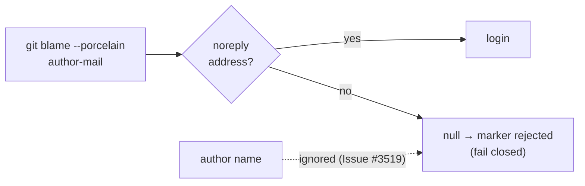

# Suppression-marker blame no longer binds on a self-set author name

## Summary

`loginFromGitIdentity` used to fall back to the git author name when the email
was not a GitHub noreply address, so any contributor who set
`user.name=<allowlisted-login>` with an unrelated email blamed as that login and
could validate a forged `best-practice-ignore … author=<login>` marker.

- **Name fallback dropped.** `loginFromGitIdentity(email)` now derives a login
  only from a `users.noreply.github.com` address and returns `null` otherwise;
  `parseBlamePorcelain` no longer reads the `author ` header.
- **Docs corrected.** The `suppression_identity.ts` module doc, the
  `loginFromGitIdentity` and `hasAwsEmulatorWaiver` doc comments,
  `docs/GITHUB-ACTIONS-AUDIT-SCAN.md` and `docs/GATE-SKIP-DRIFT-SCAN.md` no
  longer claim a fork PR "still blames as the attacker" unconditionally: the
  binding holds only when the merge strategy rewrites authorship (squash merge).
- **Residual risk recorded.** `docs/THREAT-MODEL.md` gains **R15** — the
  binding depends on the merge strategy; accepted because the marker only
  suppresses an advisory finding and fails closed.

Closes #3519

## Spec

### Intent and Rationale

A suppression marker's `author=` must be bound to someone the contributor
cannot impersonate by editing their own git config. The author name is free
text, so it is no evidence of identity; dropping it closes the trivial forgery.
The noreply email is self-set too, so the docs now state the honest limit
instead of claiming the binding is unconditional.

### Essential Design Decisions

- Remove the fallback outright rather than gate it: no caller needs a
  name-derived login, and `null` already fails closed at every caller.
- `loginFromGitIdentity` takes only `email`, so a caller cannot pass a name by
  mistake; both call sites (`suppression_identity.ts:120` and the tests) were
  updated.
- The issue's optional stronger fix — resolve the login from the PR author or a
  verified commit signature — is out of scope here (it needs GitHub API access
  in the blame path); R15 names it as the stronger fix.

### Undiscoverable Facts

- GitHub authors a squash-merge commit as the PR author's GitHub account; the
  contributor's self-set author name and email are discarded. Merge-commit and
  rebase merge keep the contributor's own author fields, so under those
  strategies a noreply email of an allowlisted login can still be forged.

## Evidence

Backend change — no web interface to screenshot.

- `./quality.sh < /dev/null` — exit 0, all checks PASSED (markdownlint,
  `deno lint`, `deno check`, `deno fmt --check`, unit tests); the config
  integration step SKIPPED as usual.
- Targeted: the six test files covering suppression identity, suppression
  comments and the best-practices template — 160 passed, 0 failed.

Docs sweep: grep terms `loginFromGitIdentity`, `still blames as`,
`merging account`, `author name`, `noreply`; section: `docs/THREAT-MODEL.md`
Residual risks table; siblings: "R13", "R14"; files updated:
`worker/deno/lib/suppression_comments.ts`,
`worker/deno/lib/suppression_identity.ts`,
`worker/deno/lib/idle_task_templates/best_practices_template.ts`,
`docs/THREAT-MODEL.md`, `docs/GITHUB-ACTIONS-AUDIT-SCAN.md`,
`docs/GATE-SKIP-DRIFT-SCAN.md`; remaining hits:
`docs/archive/pr-summaries/pr-summary-3389.md:20` — still true because it is an
archived record of what PR #3389 shipped;
`prompts/bash_syntax_audit/prompt.md:125` — still true because it says the
author is never inferred from blame for that audit, which this change does not
touch; `prompts/best_practices/prompt.md:518` — still true for the same reason;
`docs/audits/security-sweep-2880-broken-ref-repair.md:17` — still true because
it concerns a different commit-author check;
`docs/archive/pr-summaries/pr-summary-243.md:15` — still true because it is an
archived record unrelated to blame binding.

## Test Plan

- **Added** `worker/deno/tests/suppression_identity_test.ts` — "findSuppressions
  - a self-set author name of an allowlisted login does not bind (Issue
  #3519)": a real git repo commits the marker as `nigel <attacker@example.com>`
  and asserts `blameFileLineLogins` leaves line 1 unknown, the record is invalid
  with `allowedAuthors: ["nigel"]`, and `isSuppressed` is `false`. Red-check:
  run against the base-branch `suppression_comments.ts` /
  `suppression_identity.ts` it fails (blame returns `"nigel"`); it passes after
  the fix. This is the regression guard for the issue.
- **Replaced** "loginFromGitIdentity - treats a login-shaped author name as the
  login" (asserted `("nigel", "nigel@example.com") → "nigel"` and
  `("Nigel", "dev@example.com") → "nigel"`) with "loginFromGitIdentity - ignores
  a login-shaped author name with an unrelated email (Issue #3519)". The old
  expectation is exactly what the issue requires to be untrue: a name with an
  unrelated email must not bind. Red-check: against the base lib with the
  original two-argument call the new assertion fails (`"nigel"` instead of
  `null`). With the final one-argument call on the base lib it is not red (the
  email lands in the base `name` parameter and is not login-shaped), so the
  real-git test above is the guard that goes red without the change.
- **Unchanged** "extracts a login from a GitHub noreply email", "returns null
  when no login can be derived", the Issue #269 fork-forgery and matching-author
  `findSuppressions` cases and the boundary/shallow-clone blame cases all pass.

**Branch outcomes:**

- `worker/deno/lib/suppression_comments.ts:370` noreply match → login — reached
  by "loginFromGitIdentity - extracts a login from a GitHub noreply email";
  returning `null` unconditionally turns it red.
- `worker/deno/lib/suppression_comments.ts:370` non-noreply email → `null` —
  reached by "loginFromGitIdentity - returns null when no login can be derived",
  "loginFromGitIdentity - ignores a login-shaped author name with an unrelated
  email (Issue #3519)" and "findSuppressions - a self-set author name of an
  allowlisted login does not bind (Issue #3519)"; restoring the name fallback
  turns the real-git test red.
- `worker/deno/lib/suppression_identity.ts:120` missing identity → `""` →
  `null` — reached by "blameFileLineLogins - a shallow clone that cannot be
  deepened leaves boundary lines unknown" and "parseBlamePorcelain - a boundary
  hunk is unknown identity"; existing behaviour, unchanged.

## Pre-PR Security Self-Check

- [x] **Input validation**: the email is matched against an anchored allowlist
      regex; the free-text name is no longer read.
- [x] **Secrets**: none staged; no hidden paths.
- [x] **Injection surface**: no new shell, SQL, filesystem or HTTP calls.
- [x] **Output encoding**: n/a.
- [x] **Authentication/authorisation**: tightens the marker authorisation; it
      fails closed whenever no noreply login is found.
- [x] **Error handling**: unchanged.
- [x] **Dependencies**: none added.
- [x] **Path confinement**: n/a.
