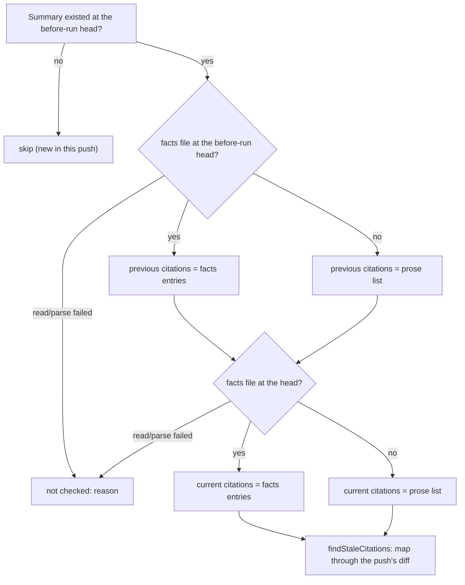

## Summary

The review-fix stale-citation check (Issue #3341) now reads Branch-outcomes
citations from `pr-summary-<N>.facts.json` wherever that file exists. Before
this change, a summary that kept its Branch outcomes only in the facts file
lost its coverage without saying why.

- At each ref (the before-run head through `git ls-tree`/`git show`, and the
  head through `loadPrSummaryFacts`), the facts entries' `path`, `line` and
  `endLine` are that ref's citations. A ref without a facts file still uses
  the prose list.
- When the form changes between refs (prose before, facts now, or the
  reverse), the check compares the two forms.
- A facts file that cannot be read or parsed at either ref is reported as
  `Branch outcomes citations not checked: <reason>`, never as "no citations".

Closes #3536.

## Spec

### Intent and Rationale

- Agents now record Branch outcomes in the facts file (#3534, #3535). A check
  that reads only the prose list would find nothing to check and would report
  a clean result.
- Choosing citations per ref, not per summary, handles the mixed transition
  without needing a special case.

### Essential Design Decisions

- A facts entry's `entry` identity is built by rendering the facts with
  `renderBranchOutcomes` and parsing the result with `parseBranchOutcomes`.
  A prose list that the worker rendered from the same facts therefore compares
  equal to the facts, so the "entry unchanged" signal still works across forms.
- Any read or parse failure of the facts file, at either ref, skips that
  summary and records an unchecked line. It is never treated as "no facts".
- `previousFacts`/`currentFacts` are optional on `CitationCheckInput` and
  `changedFilesCitedBy`. The issue requires `branch_outcome_citations_3341_test.ts`
  to pass untouched, and that file calls both without facts. The one
  production caller, `checkLineCitations`, always passes both.

### Undiscoverable Facts

- None.

## Evidence

Backend only. The changes are covered by
`worker/deno/tests/branch_outcome_citations_facts_3396_test.ts`, which has six
pure tests and six integration tests. The integration tests run against real
temporary git repositories.

**Docs sweep** — grep: `findStaleCitations`, `changedFilesCitedBy`, `branch_outcome_citations`, "line-citation check", "3341", "facts.json"; section: `docs/workflows/pr-feedback.md` item 5 "Deterministic line-citation check (Issue #3341)"; siblings: none — no existing set gained a member; updated: `docs/workflows/pr-feedback.md`, `docs/INTERNALS.md`, and the module and function doc comments in `worker/deno/lib/branch_outcome_citations.ts` and `worker/deno/lib/pr_feedback_drift_check.ts`; `docs/INTERNALS.md:5326` — still true because `pr_summary_facts.ts` itself is unchanged

Provenance numbers cited: #3536: Read branch-outcome citations from the facts
file in the review-fix drift check; #3341: Review-fix pushes leave Branch
outcomes path:line citations at the previous head; #3534: Add a versioned
summary-facts schema, validator and Branch-outcomes renderer; #3535: Render
branch outcomes from the facts file into the PR body and gate on the
structured form; #3396 (in the test file name the issue asks for): Review
learning loop … make summary facts structured data.

## Acceptance Criteria

<!-- vibe-spec-review inputs="diff+issue-body" -->

- **met** — A moved, un-renumbered citation is reported both when both heads use facts and when the previous head used prose and the current head uses facts. — evidence: `worker/deno/tests/branch_outcome_citations_facts_3396_test.ts::runPrFeedbackDriftCheck - facts at both heads with the line moved and not renumbered is reported stale`, `::runPrFeedbackDriftCheck - prose at the before-run head and facts at the head are compared` — reviewer: met
- **met** — A malformed facts file at either ref yields a "not checked" result, not an empty clean result. — evidence: `worker/deno/tests/branch_outcome_citations_facts_3396_test.ts::runPrFeedbackDriftCheck - malformed facts at the before-run head are not checked`, `::runPrFeedbackDriftCheck - malformed facts at the head are not checked, with the parse error` — reviewer: met
- **met** — Prose-only behaviour is unchanged: `branch_outcome_citations_3341_test.ts` passes untouched. — evidence: `worker/deno/tests/branch_outcome_citations_3341_test.ts` is not in the diff and passes; `worker/deno/tests/pr_feedback_drift_check_3341_test.ts` passes — reviewer: met
- **met** — The quality gate passes. — evidence: full `./quality.sh < /dev/null` run, `Result: PASSED (with skipped checks)` (config integration skipped by the gate itself) — reviewer: partial — reason: the reviewer could not run the gate from the diff; it was run here on the implementation commit and passed
- **unrequested** — doc updates in `docs/workflows/pr-feedback.md` and `docs/INTERNALS.md` — reviewer: unrequested — reason: required by the repository's "A Code Change Owes a Docs Change" standard
- **unrequested** — exported `CitationSet` type and `factsCitations` helper, plus the `repoPath` parameter on `checkLineCitations` — reviewer: unrequested — reason: plumbing that the facts read needs; both exports have a production reader

## Standards Review

<!-- vibe-standards-review inputs="diff+CODING-STANDARDS.md" -->

- **violation** — "A new argument or behaviour reaches every caller that needs it": `previousFacts`/`currentFacts` are optional rather than required — evidence: `worker/deno/lib/branch_outcome_citations.ts:375` — reason: required by #3536 — its acceptance criterion says `branch_outcome_citations_3341_test.ts` must pass untouched, and that file calls `findStaleCitations` and `changedFilesCitedBy` without facts. The only production caller, `checkLineCitations` in `worker/deno/lib/pr_feedback_drift_check.ts`, passes both.
- **clean** — Review-enforced rules checked: "Check where you insert" and the `SIMPLE-ON-PURPOSE` marker. Also checked: nothing exists only for a test, named tests exist, every branch in `checkLineCitations` has a test, fail-loud handling, real git in the integration tests, Australian English, and that no existing test assertion was removed or edited.

## Test Plan

- Added `worker/deno/tests/branch_outcome_citations_facts_3396_test.ts`, 12 tests:
  - Pure: facts at both refs, prose then facts, facts win over the same ref's
    prose list, a replaced cited line, `changedFilesCitedBy` from previous
    facts, and `factsCitations` ranges and `noneAdded`.
  - Integration: both heads facts, prose then facts (stale and clean), facts
    malformed at the before-run head, facts malformed at the head, facts
    unreadable at the head, and the facts `ls-tree`/`show` returning 128 or
    `null`.
- `deno test -A tests/branch_outcome_citations_facts_3396_test.ts tests/branch_outcome_citations_3341_test.ts tests/pr_feedback_drift_check_3341_test.ts < /dev/null` from `worker/deno` on the final code: `ok | 85 passed | 0 failed`.
- `./quality.sh < /dev/null`: `Result: PASSED (with skipped checks)`.
- Existing tests: no assertion removed and no expectation edited.
- Red check: making `citationsOf` always read prose turned 7 tests red. These
  were the five pure facts tests, plus both integration tests "facts at both
  heads …" and "prose at the before-run head and facts at the head …".
  Treating a previous-head parse failure as "no facts" turned the
  malformed-before-run test red. Treating a head parse failure the same way
  turned the malformed-head test red.

**Branch outcomes:**

- `worker/deno/lib/branch_outcome_citations.ts:258` — facts given → facts citations / absent → prose list — `worker/deno/tests/branch_outcome_citations_facts_3396_test.ts::findStaleCitations - facts win over the same ref's prose list` (facts side), `worker/deno/tests/branch_outcome_citations_3341_test.ts` (prose side) — forcing prose turned 7 facts tests red
- `worker/deno/lib/branch_outcome_citations.ts:237` — `endLine` given → range / absent → single line — `worker/deno/tests/branch_outcome_citations_facts_3396_test.ts::factsCitations - endLine gives a range; noneAdded gives nothing` — dropping `endLine` fails its `path:3-5` assertion
- `worker/deno/lib/pr_feedback_drift_check.ts:970` — facts `ls-tree` returns `null` (operand 1) / non-zero (operand 2) → not checked — `worker/deno/tests/branch_outcome_citations_facts_3396_test.ts::runPrFeedbackDriftCheck - a failed git read of the facts file at the before-run head is not checked` (ls-tree/null and ls-tree/128 cases)
- `worker/deno/lib/pr_feedback_drift_check.ts:976` — facts present at the before-run head / absent — `::runPrFeedbackDriftCheck - facts at both heads with the line moved and not renumbered is reported stale` (present), `::runPrFeedbackDriftCheck - prose at the before-run head and facts at the head are compared` (absent)
- `worker/deno/lib/pr_feedback_drift_check.ts:981` — facts `show` returns `null` (operand 1) / non-zero (operand 2) → not checked — `::runPrFeedbackDriftCheck - a failed git read of the facts file at the before-run head is not checked` (show/null and show/128 cases)
- `worker/deno/lib/pr_feedback_drift_check.ts:988` — before-run facts do not parse → not checked — `::runPrFeedbackDriftCheck - malformed facts at the before-run head are not checked` — treating it as "no facts" turned it red
- `worker/deno/lib/pr_feedback_drift_check.ts:999` — head facts read error → not checked — `::runPrFeedbackDriftCheck - a facts path that cannot be read at the head is not checked`
- `worker/deno/lib/pr_feedback_drift_check.ts:1003` — head facts present / absent — `::runPrFeedbackDriftCheck - prose at the before-run head and facts at the head are compared` (present), `worker/deno/tests/pr_feedback_drift_check_3341_test.ts` (absent)
- `worker/deno/lib/pr_feedback_drift_check.ts:1005` — head facts do not parse → not checked — `::runPrFeedbackDriftCheck - malformed facts at the head are not checked, with the parse error` — treating it as "no facts" turned it red

🤖 Generated with [Claude Code](https://claude.com/claude-code)
