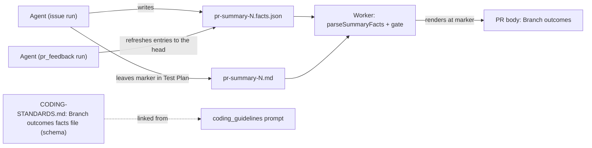

## Summary

The agent is now told to record branch outcomes as structured facts in
`docs/archive/pr-summaries/pr-summary-<N>.facts.json` and to leave the
`vibe-branch-outcomes` marker in the Test Plan for the worker to render.
Before this change, every surface still asked for a hand-written
`Branch outcomes:` list.

- `prompts/issue/prompt.md`: the PR Summary File step tells the agent to write
  the facts file. It gives a tested example, an exempt example and a
  `"noneAdded": true` example, and says the worker blocks PR creation without
  the facts file or the prose line. The skeleton Test Plan carries the marker,
  followed by a facts JSON, in place of the old `**Branch outcomes:**` heading.
  The one-line why is kept.
- `prompts/pr_feedback/prompt.md`: a fix run keeps the facts file true to the
  head. It refreshes the facts entries, or the prose list when the PR has no
  facts file.
- `CODING-STANDARDS.md` and `prompts/coding_guidelines/prompt.md`: the twin
  branch-outcome paragraphs point at the facts file. They stay identical.
- The schema is documented once, in a new `**Branch outcomes facts file.**`
  paragraph in `CODING-STANDARDS.md`. The guidelines only point at it.
- `docs/workflows/issue-processing.md`: the pr_feedback refresh sentence now
  names the facts file.
- `worker/deno/tests/branch_outcomes_record_3147_test.ts`: the pins are
  re-scoped to the new wording. The skeleton pin looks for the marker between
  the skeleton's own `## Test Plan` heading line and its closing fence, so the
  step's marker sentence cannot satisfy it.

Closes #3538.

## Spec

### Intent and Rationale

- The worker already parses and renders the facts file (#3534) and gates on it
  (#3535). The review-fix drift check reads its citations (#3536). Until the
  prompts ask for it, though, agents keep writing prose, and none of that
  machinery is used.
- Documenting the schema once means the parser and the instructions have one
  place to drift from, not two.

### Essential Design Decisions

- The prose `Branch outcomes:` list stays as the documented fallback when there
  is no facts file. The gate still accepts it, so the wording that describes it
  is kept rather than deleted.
- The schema paragraph is restated from `worker/deno/lib/summary_facts.ts`:
  version, the entry fields, the two exempt kinds, the three-word reason, and
  the caps. It also says that a facts file plus a prose list blocks, and that
  the worker renders at the first marker.
- The skeleton keeps a facts JSON next to the marker, so an agent that copies
  the skeleton writes both.

### Undiscoverable Facts

- None.

## Evidence

Documentation and prompt change only. The pins live in
`worker/deno/tests/branch_outcomes_record_3147_test.ts`.



**Docs sweep** — grep: `Branch outcomes:`, "facts.json", "vibe-branch-outcomes", "Branch outcomes: none added", "refresh"; section: `CODING-STANDARDS.md` and `prompts/coding_guidelines/prompt.md` "Test Coverage Expectations" branch-outcome paragraph, `prompts/issue/prompt.md` "PR Summary File", `prompts/pr_feedback/prompt.md` "Making Changes"; siblings: `Branch outcomes: none added`, `` `Branch outcomes:` ``; updated: `CODING-STANDARDS.md`, `prompts/coding_guidelines/prompt.md`, `prompts/issue/prompt.md`, `prompts/pr_feedback/prompt.md`, `docs/workflows/issue-processing.md`, `worker/deno/tests/branch_outcomes_record_3147_test.ts`; `CODING-STANDARDS.md:728`, `prompts/coding_guidelines/prompt.md:1435`, `prompts/issue/prompt.md:1406` and `docs/workflows/issue-processing.md:2068` — still true because the prose list remains the fallback when there is no facts file; `docs/workflows/pr-feedback.md` and `docs/mutation-check.md:11` — still true, they do not describe the record's form

Provenance numbers cited: #3538: Tell the agent to write branch outcomes as
structured facts, and document the format; #3396: Review learning loop: prefer
deterministic checks, retire guidance that doesn't work, and make summary facts
structured data; #3534: Add a versioned summary-facts schema, validator and
Branch-outcomes renderer; #3535: Render branch outcomes from the facts file
into the PR body and gate on the structured form; #3536: Read branch-outcome
citations from the facts file in the review-fix drift check; #3147:
Branch-outcome test rule (#3069) is prose only: fleet PRs still add branches no
test reaches, and review-fix runs repeat it.

## Acceptance Criteria

<!-- vibe-spec-review inputs="diff+issue-body" -->

- **met** — The issue prompt's PR-summary step and skeleton instruct writing the facts file and the marker, and a pin test asserts both. — evidence: `prompts/issue/prompt.md` PR Summary File step and skeleton Test Plan; `worker/deno/tests/branch_outcomes_record_3147_test.ts` step test and "issue prompt skeleton carries the branch-outcomes marker in its Test Plan" — reviewer: met
- **met** — The pr_feedback prompt tells a fix run to keep the facts file true to the head, and a pin test asserts it. — evidence: `prompts/pr_feedback/prompt.md` lines 70 and 89–94; the pr_feedback test in `worker/deno/tests/branch_outcomes_record_3147_test.ts` pins "keeps the facts file true to the head" — reviewer: met
- **met** — The schema is documented once in `CODING-STANDARDS.md` and linked from `prompts/coding_guidelines/prompt.md`. — evidence: `CODING-STANDARDS.md` `**Branch outcomes facts file.**` paragraph; the guidelines twin points at "`CODING-STANDARDS.md` → **Branch outcomes facts file**"; the schema test asserts the guidelines do not restate it — reviewer: met
- **met** — The re-scoped `branch_outcomes_record_3147_test.ts` passes, and the quality gate passes (including the docs and markdown checks). — evidence: 5 passed; `./quality.sh < /dev/null` gave `Result: PASSED (with skipped checks)` — reviewer: met
- **unrequested** — the mutation-check sentence was re-wrapped (whitespace only) in the twin paragraphs and the issue prompt — reviewer: unrequested — reason: the line wrap moved when the facts-file wording was added
- **unrequested** — extra schema details (path charset, 300-character path limit, unknown-key rejection, facts-plus-prose blocks, first-marker rendering) — reviewer: unrequested — reason: they restate what `summary_facts.ts` already enforces, so an agent does not write a file the worker rejects
- **unrequested** — `docs/workflows/issue-processing.md` refresh sentence — reviewer: unrequested — reason: required by "A Code Change Owes a Docs Change"

## Standards Review

<!-- vibe-standards-review inputs="diff+CODING-STANDARDS.md" -->

- **clean** — Checked: identical twin paragraphs, "A Code Change Owes a Docs Change" (including "Every restatement of a rule gives the same answer"), "A new test must go red without its change" with per-phrase drift pins, "An edited expectation must still go red without its guard", Australian English, and that the removed assertion is quoted with its justification.

Related existing rules checked: the twin-paragraph rule between
`CODING-STANDARDS.md` and `prompts/coding_guidelines/prompt.md`; "Every outcome
of a branch you add needs a test that reaches it"; the "A Code Change Owes a
Docs Change" bullets on rules and restatements; and the pr_feedback prompt's
branch-outcomes refresh. Each now agrees with the facts-file form, with prose
as the fallback.

The new rule applied to this PR's own diff: the diff adds no code branch, so
this PR records `"noneAdded": true` in
`docs/archive/pr-summaries/pr-summary-3538.facts.json` and leaves the marker
below. No other content in the diff conflicts with it.

## Test Plan

- `deno test -A tests/branch_outcomes_record_3147_test.ts < /dev/null` from
  `worker/deno`: 5 passed.
- `./quality.sh < /dev/null`: `Result: PASSED (with skipped checks)`. Config
  integration is skipped by the gate itself. Markdownlint on
  `docs/workflows/issue-processing.md` after its later fix: 0 issues.
- Drift pins: each new phrase was run through
  `deno task drift-pins-on-base 3576bae0 <doc> <section> <phrase>...`.
  Absent from the base section: the twin-paragraph pins
  `pr-summary-<N>.facts.json`, the `vibe-branch-outcomes` marker, `noneAdded`
  and `Branch outcomes facts file` (both twin sections); the step pins
  `the worker blocks PR creation without the facts file or that line`,
  `pr-summary-{{ISSUE_NUMBER}}.facts.json`, the marker, `noneAdded`,
  `flipWentRed` and `"kind":"untestable"`; and the pr_feedback pins
  `facts file`, `pr-summary-<N>.facts.json` and
  `keeps the facts file true to the head`. The schema test reads only the new
  `**Branch outcomes facts file.**` paragraph, which base lacks, so on base it
  fails at its first assert. Of its phrases, `flipWentRed`, `testName`,
  `out-of-scope`, `at least 3 words`, `100,000`, `4,000` and
  `With no facts file` are also absent from the base section; `exempt`,
  `untestable` and `blocks` occur elsewhere in the base section, but not in
  the paragraph the test reads.
- Removed test `issue prompt skeleton summary carries a Branch outcomes: example (Issue #3147)`, verbatim:

  ```ts
  const flattened = flat(section(await readRepoDoc("prompts/issue/prompt.md"), "PR Summary File"));
  assert(flattened.includes("**Branch outcomes:**"), "issue prompt skeleton is missing a Branch outcomes: example");
  ```

  Justification: #3538 requires the marker in place of a prose list. The
  replacement test, `issue prompt skeleton carries the branch-outcomes marker
  in its Test Plan, not a Branch outcomes: heading (Issue #3538)`, asserts the
  marker sits between the skeleton's `## Test Plan` heading line and its
  closing fence, and that no `**Branch outcomes:**` heading remains.
- Moved ``assert( text.includes(phrase), `PR Summary File section is missing "${phrase}": ${text}`, );``
  to `worker/deno/tests/branch_outcomes_record_3147_test.ts::issue prompt Test Plan step names the Branch outcomes: list, the facts file and the gate (Issues #3147, #3538)`.
  The assertion is unchanged; only its test was renamed. Its phrase list lost
  `the worker blocks PR creation without that line`, because #3538 makes the
  gate block without the facts file or that line, so the old sentence is
  untrue. The list now carries the new sentence in its place (RC1).
- Moved ``assert( flattened.includes(phrase), `pr_feedback prompt is missing "${phrase}": ${flattened}`, );``
  to `worker/deno/tests/branch_outcomes_record_3147_test.ts::pr_feedback prompt requires re-enumerating every branch a fix commit adds (Issue #3147)`.
  It stays in place: the assertion and the test name are unchanged. Its phrase list only gained
  `facts file`, `pr-summary-<N>.facts.json` and
  `keeps the facts file true to the head`; no phrase was removed.
- Edited expectation: "the worker blocks PR creation without that line" became
  "…without the facts file or that line". Red check RC1: reverting the prompt
  to the old wording turned the step test red (4 passed, 1 failed).
- RC2: restoring `**Branch outcomes:** none added` in the skeleton turned the
  skeleton test red.
- RC3: changing `"kind":"untestable"` to `"kind":"out-of-scope"` in the
  prompt's exempt example turned the step test red.
- RC4: removing the facts clause from `prompts/pr_feedback/prompt.md:70`
  turned the pr_feedback test red.
- RC5: replacing the skeleton's marker line (`prompts/issue/prompt.md:1529`)
  with other text turned the skeleton test red (4 passed, 1 failed: "issue
  prompt skeleton's Test Plan is missing the ... marker").
- All five were restored, and the test went back to 5 passed.

<!-- vibe-branch-outcomes -->

🤖 Generated with [Claude Code](https://claude.com/claude-code)
