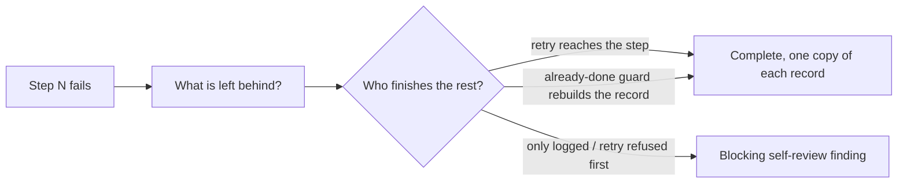

## Summary

Adds the self-review rule **Every step of a multi-write operation has a named
finisher when it fails** to `CODING-STANDARDS.md` and, word for word, to
`prompts/coding_guidelines/prompt.md`. It sits in the test-coverage section,
right after the failure-record-clear rule (#3430) and next to the #3087 and
#3107 rules. The issue prompt's Test Plan self-review checklist now restates
it, and `docs/workflows/issue-processing.md` records why it was added. A new
drift test pins all three surfaces. Closes #3562.

## Spec

### Intent and Rationale

- Fleet PRs wrote multi-write operations for the happy path only. Some let a
  failed bookkeeping write block a safety step or spend a retry. Others left a
  failed step that no retry or scheduled pass ever completes. The rule makes
  the agent walk each step's failure and name its finisher.
- The text is the issue's proposed text. The two clauses added to it are
  covered under Essential Design Decisions.

### Essential Design Decisions

- The rule is a self-review rule backed by a fail-then-finish test, not a
  deterministic gate, because which step is safety-critical is a semantic
  question (the issue's own reasoning).
- **Prefer loud, early failure** says "fail fast at the point of the fault". Read
  literally, that conflicts with "run the safety step, then report the
  bookkeeping error". Both surfaces now settle it: the fail-fast bullet points
  at the new rule, and the new rule says the operation still fails loud once
  the safety step has run.
- **Record that an action ran** says a failure records that it ran, for
  spacing. A clause tells that spacing record apart from a spent counted retry,
  so the new "never spend a counted retry" sentence does not contradict it.

### Undiscoverable Facts

- Two of the three cited cases are in private fleet repositories. Only
  VibeCoder#2909 can be linked.

## Evidence

Purely a documentation and prompt change, plus one drift test. No production
code changes.

Related existing rules checked:

- **Prefer loud, early failure** (`CODING-STANDARDS.md`, coding_guidelines).
  Changed in this diff to point at the new rule.
- **Record that an action ran** (both surfaces). Reconciled in the new rule's
  text.
- **A new path to an existing outcome keeps that outcome's guards** (#3087),
  **Code that deletes or replaces state proves everything it destroys is safe
  to lose** (#3107) and **State recorded on a failure path is cleared on the
  path that recovers** (#3430). These are complementary, with no conflict.
- The API bullet "retry/idempotency where applicable" (`CODING-STANDARDS.md`
  § Choosing assertions) is consistent with the new rule.

I applied the new rule to this PR's own diff. The diff adds no operation with
more than one durable write or side effect, so there are no steps or finishers
to list. Its examples ("rebuilding the identical record from stored state",
"retry the same request, run the next tick") are illustrations only, with no
code to check them against. Every restatement gives the same answer on the
rule's edge case, an "already done" guard turning a retry away: the retry
counts only if it reaches the missing step. Places checked: the rule on both
surfaces, the fail-fast bullet on both, the issue prompt's Test Plan step, the
operator doc paragraph, and this summary.

Provenance cited in the diff:

- #3562: Fleet PRs write multi-step operations for the happy path: a failed
  bookkeeping write blocks the safety step, or no retry ever completes the
  missing step (VibeCoder#2909 and two private fleet PRs).
- #2909 (PR): Why given up, how about fix instead (Issue #2907).

**Docs sweep**: grep: "Prefer loud, early failure", "Record that an action
ran", "retry/idempotency", "multi-write", "finisher\w*"; section:
`CODING-STANDARDS.md#test-coverage-expectations`; siblings: "State recorded on
a failure path is cleared on the path that recovers", "Code that deletes or
replaces state proves everything it destroys"; updated: `CODING-STANDARDS.md`,
`prompts/coding_guidelines/prompt.md`, `prompts/issue/prompt.md`,
`docs/workflows/issue-processing.md`. Hits left in place:

- `CODING-STANDARDS.md:207`: still true, because spacing a failed action is
  unchanged.
- `prompts/coding_guidelines/prompt.md:959`: still true for the same reason.
- `CODING-STANDARDS.md:1236`: still true, because the API retry/idempotency
  bullet is consistent with the new rule.

## Test Plan

- Added `worker/deno/tests/multi_write_finisher_3562_test.ts` (3 tests):
  - Both surfaces carry the rule identically, between the failure-record-clear
    rule and the next rule.
  - The fail-fast bullet on both surfaces points at the rule.
  - The issue prompt's PR Summary File step restates it.
- `deno task test:unit tests/multi_write_finisher_3562_test.ts`: passed, 3
  tests, on the final head.
- Red check: I ran `deno task drift-pins-on-base
  origin/milestone/fleet-guidance-guards-side-effects-and-concurrency` for
  every pinned phrase in each section the test reads: CODING-STANDARDS
  "Test coverage expectations", coding_guidelines "Test Coverage
  Expectations", "Never Fail Silently — Fail Loud" on both, and issue prompt
  "PR Summary File". It reported every pin as `absent on base`, so each pin
  goes red without this change.
- The existing drift tests for the neighbouring rules still pass:
  `failure_record_clear_3430_test.ts`, `new_path_keeps_guards_3087_test.ts`,
  `destructive_state_inventory_3107_test.ts`,
  `coding_guidelines_twin_drift_test.ts` and
  `existing_rule_conflicts_3077_test.ts`. No existing test was edited and no
  assertion was removed.
- `./quality.sh < /dev/null`: PASSED, with `config integration` skipped as
  usual, on the final head.

Branch outcomes: none added

🤖 Generated with [Claude Code](https://claude.com/claude-code)
