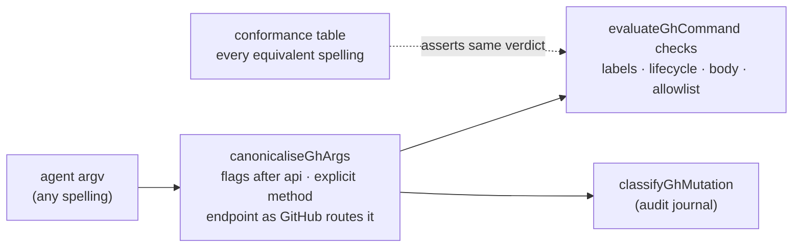

# PR Summary — Issue #3568

## Summary

The agent gh guard now reads one canonical spelling of every `gh api` call,
and a conformance table checks every refusal rule against every spelling `gh`
and GitHub treat as equivalent.

- `worker/deno/lib/gh_argv_canonical.ts` (new): `canonicaliseGhArgs` rewrites
  a `gh api` call into `["api", <endpoint>, "-X", <METHOD>, ...flags]`.
  - Flags before `api` move after it, in their original order, so pflag's
    last-occurrence rule still picks the same value (#3572).
  - `--flag=value` is split into `--flag value`.
  - The method is explicit: the last `-X`/`--method`, else POST when a body is
    given, else GET. POST on the pull and issue update routes is written as
    PATCH, because GitHub routes both to the same handler (#3531).
  - `canonicaliseGhEndpoint` resolves the endpoint as GitHub does: the
    `api.github.com` origin is dropped (any other origin is left as written),
    the query and fragment are dropped (#3518), percent-escapes are decoded
    except `%2F` and `%25`, slashes collapse, and the pull or issue number is
    cut to its leading digits (#3600).
- `evaluateGhCommand` (`gh_guard_decision.ts`) and `classifyGhMutation`
  (`audit_mutation_classifier.ts`) canonicalise first, so the guard and the
  audit journal see the same request. The form is idempotent, so the second
  pass changes nothing.
- One value-flag table: `audit_mutation_classifier.ts`'s `GH_VALUE_FLAGS` is
  now derived from `gh_argv.ts` (`GH_SEPARATED_VALUE_FLAGS`), which adds the
  missing `-p`/`--preview` (#3561).
- `classifyGhApi`'s `noteField` treats a `-F`/`--field` value carrying a gh
  placeholder (`{owner}`, `{repo}`, `{branch}`, `:owner`, …) as unreadable
  when its key is `query`, `operationName`, `name`, `new_name` or a `labels`
  key, because gh fills it after the guard has read it (#3566).
- `worker/deno/tests/support/gh_guard_conformance.ts` (new): generates the
  equivalent spellings of a canonical refused argv. Twelve existing refusal
  rules are registered in `gh_guard_conformance_3568_test.ts`.
- `CODING-STANDARDS.md` **Writing a gate over text**, item 1, is reworded: for
  a guard over another tool's command line, the evasion table comes from that
  tool's parser and the server's routing, checked against the real tool.

## Evidence

Docs sweep — grep: `normaliseGhArgs`, `pflag`, `--hostname`, `GITHUB_API_HOST`,
`PR_LIFECYCLE_REFUSED`, `Writing a gate over text`; section: SECURITY.md
"pflag spellings are normalised first", THREAT-MODEL.md control C14,
CODING-STANDARDS.md "Writing a gate over text"; updated: `SECURITY.md:1807`
(the bullet now describes the canonical form, the conformance table and the
placeholder rule), `docs/THREAT-MODEL.md:191` (C14 names the new module and
tests), `CODING-STANDARDS.md:694-708` (item 1 reworded);
`SECURITY.md:1757` — still true because the host check it describes is
unchanged and now also applies to relocated `--hostname` flags;
`SECURITY.md:1804-1805` — still true because the lifecycle refusals and their
REST spellings are unchanged; `prompts/issue/prompt.md:122-125` — still true
because it points at the section this PR rewords.

Issues cited as provenance: #3518, #3531, #3561, #3566, #3572 (open spelling
issues this PR fixes), #3540 and #3600 (spelling classes, the latter folded
into #3568), #1420 (host check), #1462 and #222 (lifecycle refusals), #2518
(label-definition denylist), #3703 and #3937 (fail-closed targets and bodies),
#3149 (gate-over-text rules).

## Test Plan

- `deno test -A tests/gh_guard_conformance_3568_test.ts
  tests/gh_argv_canonical_3568_test.ts`: 79 passed, 0 failed (46 conformance,
  33 canonicaliser and placeholder).
- Red on `main`: with `main`'s `gh_argv.ts`, `audit_mutation_classifier.ts` and
  `gh_guard_decision.ts`, `gh_guard_conformance_3568_test.ts` gives 15 passed,
  31 failed. Every registered rule let at least one spelling through or refused
  it with a different marker, and every placeholder case was allowed.
- Existing suites: the guard, classifier, lifecycle, argv, pflag, shim, spawn,
  quota-latch, host-check, label and body suites (35 files) give 671 passed,
  0 failed. `gh_pflag_spellings_test.ts` caught a backtracking bug in the
  number rule (`issues/1219` read as `121`); fixed, and the conformance
  journal check now compares verb and target as well as repo.
- `tests/lib_sweep_coverage_test.ts`, `tests/integration_test_manifest_test.ts`,
  `tests/parallel_unsafe_test_manifest_test.ts`,
  `tests/coding_guidelines_twin_drift_test.ts`,
  `tests/text_gate_matcher_3149_test.ts`, `tests/threat_model_docs_test.ts`:
  pass.
- `deno fmt` (TypeScript only), `deno lint`, `deno check` over the touched
  files: pass. `markdownlint-cli2` on the changed Markdown: clean apart from
  `CODING-STANDARDS.md:1071` MD018, which is already on `main`.
- Red runs, each applied alone and restored: the old number regex (21 red);
  `evaluateGhCommand` without the canonicalise call (4 red);
  `classifyGhMutation` without it (12 red).
- Full `./quality.sh` was not run; CI runs it on the PR.

**Branch outcomes:**

- `worker/deno/lib/gh_argv_canonical.ts:206` — root not `api`, vector only
  normalised. Test: `worker/deno/tests/gh_argv_canonical_3568_test.ts::canonicaliseGhArgs - a vector whose root is not api is only normalised`.
- `worker/deno/lib/gh_argv_canonical.ts:93` — `--` makes the rest positional.
  Test: `…::canonicaliseGhArgs - an endpoint after -- is still the endpoint`.
- `worker/deno/lib/gh_argv_canonical.ts:100` — value-taking long flag, split.
  Test: `…::--flag=value splits; a boolean flag is kept as written`.
- `worker/deno/lib/gh_argv_canonical.ts:108` — boolean long flag kept. Same test.
- `worker/deno/lib/gh_argv_canonical.ts:113` — value shorthand takes the next
  token. Test: `…::a value flag's value is never the endpoint (#3561)`.
- `worker/deno/lib/gh_argv_canonical.ts:120` — group ending in a value letter.
  Test: `…::a boolean shorthand group ending in a value letter keeps its value`.
- `worker/deno/lib/gh_argv_canonical.ts:129` — boolean shorthand kept. Test:
  `…::a trailing value flag with no value does not throw` (`-iq` case).
- `worker/deno/lib/gh_argv_canonical.ts:212` — method flags, last wins. Test:
  `…::flags before api move after it, in order, so the last method still wins (#3572)`.
- `worker/deno/lib/gh_argv_canonical.ts:218` — body makes POST the default.
  Test: `…::the method is explicit: GET without a body, POST with one`.
- `worker/deno/lib/gh_argv_canonical.ts:228-230` — POST on an update route is
  PATCH. Tests: `…::POST on a pull or issue update route is PATCH (#3531)`,
  `…::POST elsewhere stays POST`.
- `worker/deno/lib/gh_argv_canonical.ts:166-179` — absolute endpoint: GitHub
  host stripped; other host, other scheme or unparseable URL left as written.
  Tests: `…::GitHub's API origin is dropped in any letter case`, `…::any other
  origin is left as written, so it stays unclassifiable`, `…::the
  {owner}/{repo} placeholder survives an absolute URL`.
- `worker/deno/lib/gh_argv_canonical.ts:184` — query and fragment dropped.
  Test: `…::the query and fragment are dropped (#3518)`.
- `worker/deno/lib/gh_argv_canonical.ts:145-151` — `%2F`/`%25` kept; a
  malformed escape left. Tests: `…::percent-escapes decode, except %2F and %25
  (#3600)`, `…::a malformed escape is left as written`.
- `worker/deno/lib/gh_argv_canonical.ts:186` — GraphQL spellings. Test:
  `…::every spelling of the GraphQL endpoint is graphql`.
- `worker/deno/lib/gh_argv_canonical.ts:189` — number cut to leading digits,
  never shortened. Tests: `…::the number segment is cut to its leading digits
  (#3600)`, `…::a multi-digit number keeps every digit` (red with the old
  regex), `…::only pull and issue numbers are cut`.
- `worker/deno/lib/audit_mutation_classifier.ts:771-772` — placeholder in a
  sensitive magic field is unreadable. Tests:
  `…::classifyGhMutation - a -F <key>= value with a gh placeholder is
  unreadable (#3566)` (six keys), `…::every gh placeholder spelling counts,
  under --field= too`, `…::placeholder text under -f, in other keys, or
  without a placeholder is read as written`.
- `worker/deno/lib/gh_guard_decision.ts:861` and
  `worker/deno/lib/audit_mutation_classifier.ts:910` — canonicalise call
  sites. Tests: `worker/deno/tests/gh_guard_conformance_3568_test.ts` (each
  went red with its call removed).

## Acceptance Criteria

- **met** — A shared, table-driven conformance helper generates each refused
  argv's gh-equivalent spellings and asserts the same refusal. — evidence:
  `worker/deno/tests/support/gh_guard_conformance.ts`,
  `worker/deno/tests/gh_guard_conformance_3568_test.ts`
- **met** — Every existing guard rule is registered. — evidence: twelve
  `GH_GUARD_RULES` entries (PR merge, close, approval; issue close, lock;
  reserved label applied, definition deleted, renamed; off-allowlist write;
  no-repo write; unsanctioned GraphQL; stdin body), plus foreign-host and
  placeholder cases.
- **met** — **Writing a gate over text** item 1 is reworded, not extended with
  a new rule. — evidence: `CODING-STANDARDS.md:694-708`
- **unrequested** — The audit journal check in the conformance test, and the
  `SECURITY.md`/`THREAT-MODEL.md` updates. — reason: the classifier shares the
  canonical form, and the security docs describe this control.

## Not covered

- `pr_base_change_guard.ts` (named in #3518) is not on `main`. It ships with
  milestone PR #3514, and should be registered with the conformance table once
  that lands.
- Path keyword case (`Repos/…/Pulls/…`) and `X-HTTP-Method-Override` headers
  are not canonicalised. Neither has been shown to route on GitHub.
