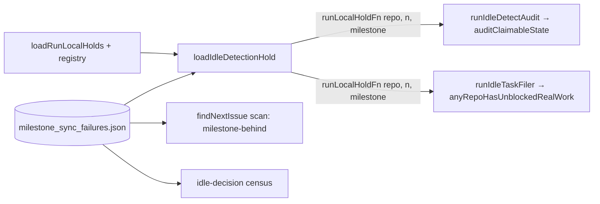

## Summary

The idle-detect audit and the idle-task filer's fleet-wide startable-work gate now hold the issues of a milestone the persisted pacing ledger (`milestone_sync_failures.json`) paces — the same `milestone-behind` skip the claim scan makes. Before this change both counted those issues as claimable, so a paced milestone fired `[idle-detect] ... ALERT mis_classification` every cycle, sent `run_core.ts` down the `audit_found_claimable` path that skips the filer, and let the filer's forced attempt still decline to file. Closes #3587.

## Spec

### Intent and Rationale

- The hold predicate the audit and the filer receive (`runLocalHoldFn`) carried only `(repo, issueNumber)`, so it could not ask the ledger about a milestone. It now also receives the issue's milestone title, which both call sites already had in hand.
- Production builds the predicate once, in a new `loadIdleDetectionHold` beside `loadRunLocalHolds` in `run_core_production_deps.ts`, as the issue suggested: run-local holds (minus claim deferrals, Issue #2405) OR `milestonePacedUntil(ledger, repo, milestone) !== undefined`.

### Essential Design Decisions

- The ledger is read through the scan's own `milestonePacedUntil` and from the scan's own path, `milestoneSyncStreakPath(config.workDir || workDir)`, so the audit, the filer gate, the census and the scan cannot disagree about which milestone is paced.
- A paced issue is reported as `run_local_hold`, exactly as the census (Issue #3464) reports it; no new reason or counter was added.
- The census keeps its own `pacedMilestoneIssueNumbers` read; it was not moved onto the new helper, to keep this change to the two instruments the issue names.

### Undiscoverable Facts

- The filer's per-repo busy check (`[repo-busy-idle-task] ... label=... unblocked=N`) does not take `runLocalHoldFn` and still counts a paced issue in that repo. That gate only skips the paced repo itself, not the fleet; the issue names only the fleet-wide gate, so it is unchanged here.

## Evidence

Backend-only change; verified by tests (below) and the full quality gate.

- The new wiring test drives the real `createProductionRunCoreDeps` with a stub `gh` that mirrors `gh issue list --json <fields>` (returns only the requested fields), modelled on `worker/deno/tests/idle_census_milestone_paced_wiring_3464_test.ts`. To drive the filer through production, the existing `idleDetectGhCommandFn` test override now also reaches the filer's back-fill sweep and its `__testDeps.ghCommandFn`; production leaves it unset, and the filer then uses its default runner (`deps.ghCommandFn ?? defaultGhCommand` in `commands/maybe_file_idle_task.ts`).
- Issue numbers this diff cites as provenance: #3587: Idle-detect audit and fleet-wide idle-filing gate count paced-milestone issues as claimable.

**Docs sweep** — grep: `runLocalHoldFn`, `loadRunLocalHolds`, `milestonePacedUntil`, `pacedMilestoneIssueNumbers`, "do not read the ledger", "census only", `idleDetectGhCommandFn`; section: `docs/IDLE-TASK-FRAMEWORK.md#idle-decision-claimable-work-census` (the run-local hold paragraph), `docs/INTERNALS.md` (milestone pacing loop guard), `docs/workflows/issue-processing.md` (Issue #655 paragraph); siblings: `cooldown`, "processed-issue registry" — every list of the hold's sources in those three docs now names the paced milestone; updated: `docs/IDLE-TASK-FRAMEWORK.md`, `docs/INTERNALS.md`, `docs/workflows/issue-processing.md`, the doc comments on `runLocalHoldFn` in `worker/deno/lib/idle_detect_diagnostics.ts`, `worker/deno/lib/repo_busy_for_idle_task.ts`, `worker/deno/commands/maybe_file_idle_task.ts`, and on `idleDetectGhCommandFn` in `worker/deno/lib/run_core_production_deps.ts`; `docs/IDLE-TASK-FRAMEWORK.md:1003` ("hands the same set to all three readers") — still true because it describes the run-local hold set shared since Issue #655, and the next sentences name the ledger source and its four readers.

## Test Plan

- Added `worker/deno/tests/idle_detect_milestone_paced_wiring_3587_test.ts` (7 tests, production wiring):
  - paced audit → `[idle-detect]` repo line `claimable=0 reason=run_local_hold`, no `ALERT mis_classification`; negative control without a ledger entry → `claimable=1`.
  - paced filer → `[repo-busy-idle-task] repo=… scope=real_work … startable=0`; negative control → `startable=1`; the stub throws on `gh issue create` and both tests assert it was never reached.
  - run-local hold (processed-issue registry, no ledger) → `claimable=0`.
  - ledger read from `config.workDir` when set, and from the factory `workDir` when `config.workDir` is empty.
- Added to `worker/deno/tests/idle_detect_diagnostics_test.ts`: "auditClaimableState - an issue in a paced milestone is held, not counted claimable (Issue #3587)" and its different-milestone control.
- Added to `worker/deno/tests/repo_busy_for_idle_task_test.ts`: "anyRepoHasUnblockedRealWork - a work-on issue in a paced milestone does not count (Issue #3587)" and its different-milestone control.
- No existing test was edited and no assertion was removed.
- Red checks (each change restored after):
  - audit call site: reverting `runIdleDetectAudit` to the old inline hold without the ledger → paced audit test red (`claimable=1 reason=has_claimable`).
  - filer call site: reverting `runIdleTaskFiler` to the old inline hold → paced filer test red (`startable=1`).
  - dropping `i.milestone` at `idle_detect_diagnostics.ts:1345` / `repo_busy_for_idle_task.ts:582` → TS2554 at type check; with `--no-check` the paced-milestone unit test in each file goes red.
  - forcing the hold to `true` → both negative-control tests went red (audit: `claimable=0 reason=run_local_hold`, test line 213; filer: `startable=0`, test line 293).
  - the per-operand flips are recorded in the branch outcomes below.
- Existing tests still reaching their logic: `worker/deno/tests/idle_filing_composition_1050_test.ts`, `worker/deno/tests/idle_filer_gate_wiring_1050_test.ts` and `worker/deno/tests/idle_census_milestone_paced_wiring_3464_test.ts` pass unchanged (2-argument hold stubs stay type-compatible).
- Callers of the widened `runLocalHoldFn` checked: `auditClaimableState` and `anyRepoHasUnblockedRealWork` (both pass `i.milestone`), `maybeFileIdleTaskCommand` (forwards it), and the two production setters (both now `loadIdleDetectionHold`).
- `./quality.sh` — GATE_RESULT_LINE

<!-- vibe-branch-outcomes -->
