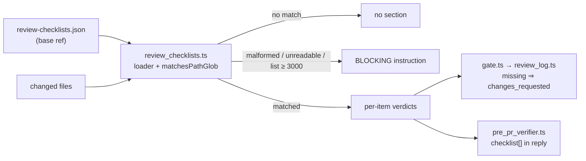

# Repo-owned review checklists reach the fleet reviewer and the pre-PR verifier

## Summary

A repo can declare path-scoped review checklists in `review-checklists.json` at
the PR's base ref. One shared loader feeds them to the fleet PR reviewer
(`gate.ts`) and the pre-PR verifier (#3395). Each checklist whose paths match
the diff gets a per-item verdict: `met`, `missing` or `not applicable`. A
`missing` item makes the fleet outcome `changes_requested`.

- **One loader.** `worker/deno/lib/review_checklists.ts` parses the file, matches
  globs and renders the brief section. Both reviewers call it.
- **Fleet reviewer.** `gate.ts` reads the file from the base ref
  (`repos/{repo}/contents/review-checklists.json?ref={baseRef}`) and lists the
  changed files. `review_log.ts` turns a `missing` item into
  `changes_requested` and renders a "Repository review checklists" section.
- **Pre-PR verifier.** `pre_pr_verifier.ts` adds `REVIEW_CHECKLISTS` to the brief
  (step 7 of `prompts/pr_review_brief/prompt.md`) and requires a `checklist`
  array in the reply.
- **Visible failures.** A malformed or unreadable file, or a changed-file list at
  or above 3000 (`CHECKLIST_FILE_LIST_LIMIT`), renders a BLOCKING instruction into
  the brief. An absent file or no matching path renders nothing.
- **Docs.** `docs/review-checklists.md` documents the location, format and
  path-glob mapping. Pointers sit in `docs/workflows/issue-processing.md` and
  `docs/MODEL-AND-CACHING.md`.

Closes #3594

## Spec

### Intent and Rationale

Repo-specific review rules, such as money or release policy on a path, were only
enforced when a human remembered them. Declaring them next to the code, at the
base ref, lets both automated reviewers check them on every PR. Reading from the
base ref stops a PR from weakening its own checklist.

### Essential Design Decisions

- One loader for both reviewers, so the file format, glob semantics and failure
  rendering cannot drift apart.
- The glob matcher is hand-written DP over tokens with no dynamic `RegExp`. It
  rejects `..`, `//` and a leading `/` on both the glob and the path, and
  normalises a leading `./`.
- A malformed, unreadable or truncated input never reads as "no checklist": it
  renders a BLOCKING instruction and the model must report it.
- An absent file is quiet by design, as documented in `docs/review-checklists.md`.

### Undiscoverable Facts

- `gh api repos/{repo}/contents/…?ref=` returns HTTP 404 for a missing file, and
  the 404 branch in `gate.ts` matches `HTTP 404|Not Found` on the error message.
  Any other failure is reported as unreadable, not absent.
- Refs containing `/` are passed through literally, so a branch such as
  `milestone/x` is read at the right ref.

## Evidence

- `./quality.sh < /dev/null` — PASSED, exit 0 (log `/tmp/q3594b.log`). The config
  integration step was SKIPPED as usual. This run predates the one-test addition
  in "Test Plan"; that test was re-run with its file, `deno lint` and
  `deno fmt --check`.
- Targeted: `review_checklists_3594_test.ts` 22 passed, 0 failed;
  `review_fleet_prs_checklists_3594_test.ts`, `pre_pr_verifier_3395_test.ts` and
  `pr_review_brief_shared_3395_test.ts` passed on the same run.

Docs sweep: grep `review-checklists`, `Repository review checklists`,
`REVIEW_CHECKLISTS`; section: `docs/review-checklists.md` (new), pointers in
`docs/workflows/issue-processing.md` (L1190–1191) and
`docs/MODEL-AND-CACHING.md` (L745–746); siblings: `REVIEW_BRIEF_FIELDS`,
`pr-review-brief` prompt steps 8 and 9, `review-fleet-prs` SKILL.md;
updated: `README.md` docs-table row, `.claude/skills/review-fleet-prs/SKILL.md`,
`prompts/pr_review_brief/prompt.md`. Remaining hits: none found that describe the
old behaviour.

## Acceptance Criteria

<!-- vibe-spec-review inputs="diff+issue-body" -->

- **met** — The location and format are documented, with path globs mapped to checklist items. — evidence: `docs/review-checklists.md`, `worker/deno/lib/review_checklists.ts` `parseReviewChecklists` — reviewer: met
- **met** — A test fixture repo, with a checklist on one path and a diff that touches it, produces a review listing each item with a verdict. — evidence: `worker/deno/tests/review_fleet_prs_checklists_3594_test.ts` (applicable path, reviewBody) — reviewer: met (the reviewer is mocked in the fixture; a live reviewer run is not covered)
- **met** — A diff that doesn't touch the path produces no checklist section. — evidence: `worker/deno/tests/review_fleet_prs_checklists_3594_test.ts` (non-matching or absent file gives empty section) — reviewer: met
- **partial** — A missing or malformed checklist file fails visibly in the review output and is never silently ignored. — evidence: `worker/deno/tests/review_checklists_3594_test.ts` (malformed and unreadable blocking), `worker/deno/tests/review_fleet_prs_checklists_3594_test.ts` (malformed file loud blocking) — reason: the code renders a BLOCKING instruction into the brief, but the code does not emit the finding itself. Visibility depends on the model obeying that instruction. An absent file is quiet by design.

<!-- vibe-standards-review inputs="diff+CODING-STANDARDS.md" -->

- **clean** — No material departures from CODING-STANDARDS.md found by the standards reviewer. Two pre-existing `fmt` and `require-await` lint issues in `review-fleet-prs` are left alone as out of scope.

## Test Plan

Added:
- `worker/deno/tests/review_checklists_3594_test.ts` (22 tests): parse shape and rejections, `matchesPathGlob` cases including evasion and hostile input, loader, `renderChecklistSection`, `parseChecklistVerdicts`, and the unsafe-glob test (`matchesPathGlob: unsafe globs never match a safe path`).
- `worker/deno/tests/review_fleet_prs_checklists_3594_test.ts` (9 tests): gate applicable path, base-ref read with slash refs, non-matching or absent file, malformed file, non-404 failure, changed-file list at limit, `decideOutcome`, `reviewBody`, post path.

Replaced: none.

Removed: none expected; no assertions were removed.

Extended: `worker/deno/tests/pre_pr_verifier_3395_test.ts`, `worker/deno/tests/pr_review_brief_shared_3395_test.ts`.

Branch outcomes:
- `worker/deno/lib/review_checklists.ts:148` path-side guard `hasUnsafeSegment(p)` — covered by evasion test `review_checklists_3594_test.ts` (:122) — flipped (glob check kept alone), went RED.
- `worker/deno/lib/review_checklists.ts:148` glob-side guard `hasUnsafeSegment(glob)` — covered by `matchesPathGlob: unsafe globs never match a safe path` — flipped, went RED.
- `worker/deno/lib/review_checklists.ts:55` `stringList` empty check — covered by parse rejection tests (:36, :66) — flipped, went RED.
- `worker/deno/lib/review_checklists.ts:219` `blockingInstruction` — covered by malformed-file blocking test (:248) — flipped, went RED.
- `.claude/skills/review-fleet-prs/scripts/gate.ts:942` 404 branch — covered by `loadBaseChecklists` non-matching or absent file test (:131) — flipped, went RED.
- `.claude/skills/review-fleet-prs/scripts/gate.ts:974` changed-file limit — covered by limit test (:160) — flipped, went RED.
- `.claude/skills/review-fleet-prs/scripts/review_log.ts:215` missing-item guard — covered by `decideOutcome` (:199) and post path (:232) — flipped, went RED.
- `worker/deno/lib/review_checklists.ts:245` changed-file list unavailable — NOT verified. No flip was run and no test is confirmed to reach it. This is an open gap, not a passed check.

Red-check (each flip applied alone, run from `worker/deno` with `< /dev/null`, then restored with `git checkout -- <file>`):

| Flip | Result |
| --- | --- |
| `review_log.ts:215` guard to `if (false)` | RED, 2 failed (:199, :232) |
| `gate.ts:942` to `if (false) {` | RED, 1 failed (:131) |
| `review_checklists.ts:148` keep only `hasUnsafeSegment(glob)` | RED, 1 failed (:122 evasion) |
| `review_checklists.ts:148` remove `hasUnsafeSegment(glob)` | RED after the added test (unsafe-glob test) |
| `gate.ts:974` to `if (false) return null;` | RED, 1 failed (:160) |
| `review_checklists.ts:219` `blockingInstruction` returns `""` | RED, 1 failed (:248) |
| `review_checklists.ts:55` drop `|| value.length === 0` | RED, 2 failed (:36, :66); also affects `paths`, so not an items-only flip |

Gap closed: the glob-side guard had no test. The added test pins it through
`src**/` against `src`, which matches only because `**/` matches zero
directories. The `..`, `//` and leading `/` globs are literal and cannot match a
safe path anyway, so they pin the outcome without isolating the guard. The
test has a positive control `src/*.ts` against `src/x.ts`.

Verification of the new test: full file 22 passed, 0 failed; `deno lint` and
`deno fmt --check` pass for the file.

Callers and siblings:
- `pre_pr_verifier.ts` (required `reviewChecklists` option and `checklist` in the reply).
- `worker/deno/lib/issue_worker_wiring.ts` mock reply: `checklist: []`.
- `worker/deno/tests/completion_phase_pre_pr_verifier_3395_test.ts`, `review_fleet_prs_log_2678_test.ts`, `review_fleet_prs_needs_human_2927_test.ts`: fixtures given `checklist: []`.
- Deviation: `gate.ts:874` `auditBlocked` push sets `reviewChecklists: ""` and makes no `gh` call. Audit-blocked PRs get no review, so no checklist section is rendered for them. This is intentional.

Self-review: the rule was applied to this PR's own diff. The "Docs sweep" and "Acceptance Criteria" lines were checked against the diff.

Pre-PR Security Self-Check:
- [x] Input validation: `parseReviewChecklists` and `matchesPathGlob` reject `..`, `//` and leading `/`.
- [x] Secrets: no key or token files staged.
- [x] Injection surface: no shell or dynamic `RegExp`; the glob matcher is hand-written DP.
- [x] Output encoding: `plain()` and `inlineSafe()` sanitise rendered text.
- [x] Authorisation: the checklist is read from the base ref, so a PR cannot weaken its own checklist.
- [x] Error handling: non-404 failures are reported with their cause line and not as absent.
- [x] Dependencies: none added.
- [x] Path confinement: the glob guard rejects unsafe segments on both sides, and the test pins the glob side.

## Disclosure of unrequested additions

- `docs/audits/lib-sweep-coverage/top-up-3594.json` is a lib-sweep ledger slice with full SHA `7638942f380cabff8505d3a0a129849f45875937`. It was needed by `lib_sweep_coverage_test.ts` for the new module.
- Docs pointers in `docs/workflows/issue-processing.md` and `docs/MODEL-AND-CACHING.md`, and the `README.md` docs-table row.
- The unsafe-glob test added during the red-check, which is listed above.
