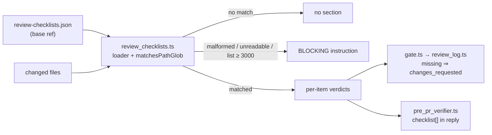

# Repo-owned review checklists reach the fleet reviewer and the pre-PR verifier

## Summary

A repo can declare path-scoped review checklists in `review-checklists.json` at
the PR's base ref. One shared loader feeds them to the fleet PR reviewer
(`gate.ts`) and the pre-PR verifier (#3395). Each checklist whose paths match
the diff gets a per-item verdict: `met`, `missing` or `not applicable`. A
`missing` item makes the fleet outcome `changes_requested`.

- **One loader.** `worker/deno/lib/review_checklists.ts` parses the file,
  matches globs and renders the brief section. Both reviewers call it.
- **Fleet reviewer.** `gate.ts` reads the file from the base ref
  (`repos/{repo}/contents/review-checklists.json?ref={baseRef}`) and lists the
  changed files. `review_log.ts` turns a `missing` item into `changes_requested`
  and renders a "Repository review checklists" section.
- **Pre-PR verifier.** `pre_pr_verifier.ts` adds `REVIEW_CHECKLISTS` to the
  brief (step 7 of `prompts/pr_review_brief/prompt.md`) and requires a
  `checklist` array in the reply.
- **Visible failures.** A malformed or unreadable file, or a changed-file list
  at or above 3000 (`CHECKLIST_FILE_LIST_LIMIT`), renders a BLOCKING instruction
  into the brief. An absent file or no matching path renders nothing.
- **Docs.** `docs/review-checklists.md` documents the location, format and
  path-glob mapping. Pointers sit in `docs/workflows/issue-processing.md` and
  `docs/MODEL-AND-CACHING.md`.

Closes #3594

## Spec

### Intent and Rationale

Repo-specific review rules, such as money or release policy on a path, were only
enforced when a human remembered them. Declaring them next to the code, at the
base ref, lets both automated reviewers check them on every PR. Reading from the
base ref stops a PR from weakening its own checklist.

### Essential Design Decisions

- One loader for both reviewers, so the file format, glob semantics and failure
  rendering cannot drift apart.
- The glob matcher is hand-written DP over tokens with no dynamic `RegExp`. It
  rejects `..`, `//` and a leading `/` on both the glob and the path, and
  normalises a leading `./`.
- A malformed, unreadable or truncated input never reads as "no checklist": it
  renders a BLOCKING instruction and the model must report it.
- An absent file is quiet by design, as documented in
  `docs/review-checklists.md`.

### Undiscoverable Facts

- `gh api repos/{repo}/contents/…?ref=` returns HTTP 404 for a missing file, and
  the 404 branch in `gate.ts` matches `HTTP 404|Not Found` on the error message.
  Any other failure is reported as unreadable, not absent.
- Refs containing `/` are passed through literally, so a branch such as
  `milestone/x` is read at the right ref.

## Evidence

- Targeted, on this head: `deno task test:unit` over the seven touched test
  files (the two new files, `pre_pr_verifier_3395_test.ts`,
  `pr_review_brief_shared_3395_test.ts`,
  `completion_phase_pre_pr_verifier_3395_test.ts`,
  `review_fleet_prs_log_2678_test.ts`,
  `review_fleet_prs_needs_human_2927_test.ts`) — 111 passed, 0 failed.
  `deno lint` and `deno fmt --check` are clean on the new files.
- `./quality.sh < /dev/null` — PASSED, exit 0, with the config integration step
  SKIPPED as usual. This is a historical run: it predates the unsafe-glob test
  and the `:241` red-check, both of which were re-run on this head with their
  test file (22 passed, 0 failed).

Docs sweep: grep `review-checklists`, `REVIEW_CHECKLISTS`,
`Repository review checklists`, `reviewChecklists`; section:
`docs/review-checklists.md` (new); siblings: `testChangeNotes`,
`unrelatedIssues`, `PREVIOUS_FINDINGS` (the existing reply fields and brief
placeholders the new `checklist` field and `{{REVIEW_CHECKLISTS}}` joined);
updated: `README.md:519`, `docs/workflows/issue-processing.md:1193`,
`docs/MODEL-AND-CACHING.md:777`, `.claude/skills/review-fleet-prs/SKILL.md:230`,
`prompts/pr_review_brief/prompt.md:48`. Remaining hits:

- `docs/workflows/issue-processing.md:1191` — still true: lists the reply fields
  and now names the `checklist` array beside `testChangeNotes` and
  `unrelatedIssues`.
- `.claude/skills/review-fleet-prs/SKILL.md:231` — still true: says the value is
  read at the base ref and matched against the changed files, as `gate.ts` does.
- `docs/MODEL-AND-CACHING.md:777` — still true: a pointer only.

## Acceptance Criteria

<!-- vibe-spec-review inputs="diff+issue-body" -->

- **met** — The location and format are documented, with path globs mapped to
  checklist items. — evidence: `docs/review-checklists.md`,
  `worker/deno/lib/review_checklists.ts` `parseReviewChecklists` — reviewer: met
- **met** — A test fixture repo, with a checklist on one path and a diff that
  touches it, produces a review listing each item with a verdict. — evidence:
  `worker/deno/tests/review_fleet_prs_checklists_3594_test.ts` (applicable path,
  `reviewBody`) — reviewer: met — reason: the reviewer model is mocked in the
  fixture; a live reviewer run is not covered.
- **met** — A diff that doesn't touch the path produces no checklist section. —
  evidence: `worker/deno/tests/review_fleet_prs_checklists_3594_test.ts`
  (non-matching or absent file gives an empty section) — reviewer: met
- **partial** — A missing or malformed checklist file fails visibly in the
  review output and is never silently ignored. — evidence:
  `worker/deno/tests/review_checklists_3594_test.ts` (malformed and unreadable
  are blocking), `worker/deno/tests/review_fleet_prs_checklists_3594_test.ts`
  (malformed file is loud and blocking) — reviewer: partial — reason: the code
  renders a BLOCKING instruction into the brief but does not emit the finding
  itself, so visibility depends on the model obeying it. An absent file is quiet
  by design.

## Standards Review

<!-- vibe-standards-review inputs="diff+CODING-STANDARDS.md" -->

- **clean** — Checked: fail loud (malformed, unreadable and truncated inputs
  render BLOCKING), path confinement (`..`, `//` and leading `/` rejected on
  glob and path, with negative tests), branch outcomes (each flipped, see
  below), docs sweep, no test-only members, and regex safety (no dynamic
  `RegExp`). Two pre-existing `fmt` and `require-await` issues in
  `review-fleet-prs` were left alone as out of scope.

## Test Plan

Added:

- `worker/deno/tests/review_checklists_3594_test.ts` (22 tests): parse shape and
  rejections, `matchesPathGlob` cases including evasion and hostile input,
  loader, `renderChecklistSection`, `parseChecklistVerdicts`, and the
  unsafe-glob test.
- `worker/deno/tests/review_fleet_prs_checklists_3594_test.ts` (9 tests): gate
  applicable path, base-ref read with slash refs, non-matching or absent file,
  malformed file, non-404 failure, changed-file list at the limit,
  `decideOutcome`, `reviewBody`, post path.

Replaced: none.

Removed: none; no assertions were removed.

Extended: `worker/deno/tests/pre_pr_verifier_3395_test.ts`,
`worker/deno/tests/pr_review_brief_shared_3395_test.ts`.

Branch outcomes:

- `worker/deno/lib/review_checklists.ts:148` path operand `hasUnsafeSegment(p)`
  true → no match — `worker/deno/tests/review_checklists_3594_test.ts:122` —
  flipped (glob operand kept alone), went RED.
- `worker/deno/lib/review_checklists.ts:148` glob operand
  `hasUnsafeSegment(glob)` true → no match —
  `worker/deno/tests/review_checklists_3594_test.ts:139` — flipped (operand
  removed), went RED.
- `worker/deno/lib/review_checklists.ts:55` empty list → rejected —
  `worker/deno/tests/review_checklists_3594_test.ts:36` and `:66` — flipped,
  went RED.
- `worker/deno/lib/review_checklists.ts:219` malformed or unreadable → BLOCKING
  instruction — `worker/deno/tests/review_checklists_3594_test.ts:261` (asserts
  `:268`, `:275`) — flipped, went RED.
- `worker/deno/lib/review_checklists.ts:241` changed-file list null → "NOT
  checked" BLOCKING section (`:245`) —
  `worker/deno/tests/review_checklists_3594_test.ts:294` — flipped to
  `return "";`, went RED.
- `.claude/skills/review-fleet-prs/scripts/gate.ts:942` HTTP 404 → absent, empty
  section — `worker/deno/tests/review_fleet_prs_checklists_3594_test.ts:131` —
  flipped, went RED.
- `.claude/skills/review-fleet-prs/scripts/gate.ts:942` other error → unreadable
  with cause — `worker/deno/tests/review_fleet_prs_checklists_3594_test.ts:149`
  — reached by the non-404 test.
- `.claude/skills/review-fleet-prs/scripts/gate.ts:974` list at the limit → null
  (not checked) —
  `worker/deno/tests/review_fleet_prs_checklists_3594_test.ts:160` — flipped,
  went RED.
- `.claude/skills/review-fleet-prs/scripts/review_log.ts:215` a `missing` item →
  `changes_requested` —
  `worker/deno/tests/review_fleet_prs_checklists_3594_test.ts:199` and `:232` —
  flipped, went RED.

Red-check (each flip applied alone, run from `worker/deno` with `< /dev/null`,
then restored with `git checkout -- <file>`):

| Flip                                                          | Result                                                                                                                        |
| ------------------------------------------------------------- | ----------------------------------------------------------------------------------------------------------------------------- |
| `review_log.ts:215` guard to `if (false)`                     | RED, 2 failed (`worker/deno/tests/review_fleet_prs_checklists_3594_test.ts:199`, `:232`)                                      |
| `gate.ts:942` to `if (false) {`                               | RED, 1 failed (`worker/deno/tests/review_fleet_prs_checklists_3594_test.ts:131`)                                              |
| `review_checklists.ts:148` keep only `hasUnsafeSegment(glob)` | RED, 1 failed (`worker/deno/tests/review_checklists_3594_test.ts:122`)                                                        |
| `review_checklists.ts:148` remove `hasUnsafeSegment(glob)`    | RED, 1 failed (`worker/deno/tests/review_checklists_3594_test.ts:139`)                                                        |
| `gate.ts:974` to `if (false) return null;`                    | RED, 1 failed (`worker/deno/tests/review_fleet_prs_checklists_3594_test.ts:160`)                                              |
| `review_checklists.ts:219` `blockingInstruction` returns `""` | RED, 1 failed (`worker/deno/tests/review_checklists_3594_test.ts:261`)                                                        |
| `review_checklists.ts:241` null-list branch returns `""`      | RED, 1 failed (`worker/deno/tests/review_checklists_3594_test.ts:294`)                                                        |
| `review_checklists.ts:55` drop `\|\| value.length === 0`      | RED, 2 failed (`worker/deno/tests/review_checklists_3594_test.ts:36`, `:66`); also affects `paths`, so not an items-only flip |

The glob-side guard test pins `src**/` against `src`, which would match only
because `**/` matches zero directories. The `..`, `//` and leading `/` globs are
literal and cannot match a safe path anyway, so they pin the outcome without
isolating the guard. The test has a positive control, `src/*.ts` against
`src/x.ts`.

Callers and siblings:

- `worker/deno/lib/pre_pr_verifier.ts` (required `reviewChecklists` option and
  `checklist` in the reply).
- `worker/deno/lib/issue_worker_wiring.ts` mock reply: `checklist: []`.
- `worker/deno/tests/completion_phase_pre_pr_verifier_3395_test.ts`,
  `worker/deno/tests/review_fleet_prs_log_2678_test.ts`,
  `worker/deno/tests/review_fleet_prs_needs_human_2927_test.ts`: fixtures given
  `checklist: []`.
- Deviation: the `gate.ts:874` `auditBlocked` push sets `reviewChecklists: ""`
  and makes no `gh` call. Audit-blocked PRs get no review, so no checklist
  section is rendered for them. This is intentional.

Self-review: every test path above was checked with `git ls-files` from the repo
root; each docs-sweep hit was re-read at the cited line on this head; each
branch outcome was flipped alone and restored; the Acceptance Criteria were
re-read against the issue body.

Pre-PR Security Self-Check:

- [x] Input validation: `parseReviewChecklists` and `matchesPathGlob` reject
      `..`, `//` and a leading `/`.
- [x] Secrets: no key or token files staged.
- [x] Injection surface: no shell interpolation and no dynamic `RegExp`; the
      glob matcher is hand-written DP.
- [x] Output encoding: `plain()` in `review_log.ts` neutralises markdown and
      mention characters in the posted review; `inlineSafe()` only flattens
      whitespace, swaps backticks and bounds length for text placed inside a
      code span in the brief.
- [x] Authorisation: the checklist is read from the base ref, so a PR cannot
      weaken its own checklist.
- [x] Error handling: non-404 failures are reported with their cause line, not
      as absent.
- [x] Dependencies: none added.
- [x] Path confinement: the guard rejects unsafe segments on both glob and path,
      with negative tests for each side.

## Disclosure of unrequested additions

- `docs/audits/lib-sweep-coverage/top-up-3594.json`, a lib-sweep ledger slice at
  full SHA `7638942f380cabff8505d3a0a129849f45875937`, needed by
  `lib_sweep_coverage_test.ts` for the new module.
- Docs pointers in `docs/workflows/issue-processing.md` and
  `docs/MODEL-AND-CACHING.md`, and the `README.md` docs-table row.
- The unsafe-glob test added during the red-check, listed above.
- The code and test edits were made by executor sub-agents; the lead edited only
  this summary.
