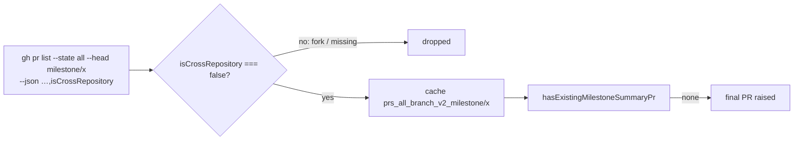

## Summary

The milestone final-PR idempotency check no longer counts fork-headed PRs.
`fetchAllStatePRsByBranch` now asks `gh pr list` for `isCrossRepository` and
drops every row where it is not exactly `false`. A PR from a fork whose branch
reuses the public milestone branch name can therefore no longer make
`hasExistingMilestoneSummaryPr` report an existing final PR, which used to stop
the real final PR from ever being raised. The cache key moves from
`prs_all_branch_<branch>` to `prs_all_branch_v2_<branch>`, so an entry written
before the fix, which may hold fork rows, is never read. Closes #3595.

## Spec

### Intent and Rationale

- `gh pr list --head` matches the ref name only, so the all-state branch lookup returned fork PRs, and the create path took the first one as the milestone's final PR.
- The filter lives in the shared fetcher, not in `hasExistingMilestoneSummaryPr`. Its other caller (`refreshOpenSummaryPrBodyWhileIncomplete`) also stops considering fork rows, and the cached rows are same-repository rows only. This is the same rule `classifyMilestoneFinalPrs` already applies.

### Essential Design Decisions

- Strict `isCrossRepository === false`: a row that is missing the field, or carries `true` or a non-boolean, is dropped (fail closed).
- Persisted shape: **the key was bumped** (`prs_all_branch_v2_`). The old shape is not read. `BranchPR` gains no field, because rows are filtered before caching and no reader needs it. One private helper, `allStateBranchCacheKey`, builds the key for both the fetch and the invalidation.

### Undiscoverable Facts

- The issue cites #1124 for the fork rule, but #1124's title is "Pay down the marker-dedup author manifest", so the new lines cite #3595 only.

## Evidence

Backend-only change. Real-tool check:
`gh pr list --repo stSoftwareAU/VibeCoder --state all --limit 3 --json number,headRefName,isCrossRepository`
returned rows such as `{"headRefName":"issue-3742-…","isCrossRepository":false,"number":3773}`. The field is a boolean present on every row, which is the shape the new fixtures use.

**Docs sweep** — grep: `prs_all_branch`, `fetchAllStatePRsByBranch`, `hasExistingMilestoneSummaryPr`, "cache entry written before", "older cache entry"; section: `docs/workflows/milestones.md#-decision-points-and-exceptions` ("Final PR already exists"); siblings: none — no existing set gained a member (the `--json` field list is not documented as a set); updated: `docs/workflows/milestones.md`, the doc comments on `BranchPR`, `fetchAllStatePRsByBranch`, `hasExistingMilestoneSummaryPr` and `refreshOpenSummaryPrBodyWhileIncomplete`; `worker/deno/lib/issue_query.ts:794` — still true because it describes the `fetchClosedIssuesByMilestone` cache, whose key is unchanged.

Evidence issue numbers: #3595: Milestone final-PR idempotency check counts fork-headed PRs, so a PR from outside the repository can stop the final PR from ever being raised.

## Test Plan

New tests:

- `worker/deno/tests/issue_query_all_state_cache_test.ts::fetchAllStatePRsByBranch - requests isCrossRepository and keeps only rows where it is exactly false (Issue #3595)`. It feeds rows with `false`, `true`, a missing field and `"false"`, and only the `false` row survives. It went red with the `continue` filter commented out.
- `worker/deno/tests/issue_query_all_state_cache_test.ts::fetchAllStatePRsByBranch - an entry under the old cache key is never read (Issue #3595)`. This is the old-shape test: it seeds a fork row under `prs_all_branch_milestone/v1` and asserts a live read and `[]`. It went red with the key set back to `prs_all_branch_${branchName}`.
- `worker/deno/tests/milestone_completion_test.ts::hasExistingMilestoneSummaryPr - a fork-headed PR reusing the milestone branch name is not an existing final PR (Issue #3595)`. A fork row gives `null`, and the same-repository row gives `100` as the positive control. It went red against the unfixed filter.
- `worker/deno/tests/milestone_completion_test.ts::close-out - a fork-headed PR on the milestone branch name does not stop the final PR being raised (Issue #3595)`. With a fork-headed row, `pr create` runs. With a same-repository row (the control), it does not. It went red against the unfixed filter.

Existing tests edited: fixture rows only. `isCrossRepository: false` was added to the mock rows that stand for same-repository PRs, in `worker/deno/tests/issue_query_all_state_cache_test.ts`, `worker/deno/tests/milestone_completion_test.ts`, `worker/deno/tests/milestone_completion_cache_test.ts`, `worker/deno/tests/milestone_summary_pr_auto_merge_test.ts` and `worker/deno/tests/milestone_sync_pr_retirement_test.ts`. Seeded and read cache keys moved from `prs_all_branch_milestone/…` to `prs_all_branch_v2_milestone/…`. No assertion was removed or changed. The removed lines are the old one-line fixture rows (for example `{ number: 1, title: "Summary", headRefName: "milestone/v1" },`), each re-added with the extra field, and the old key strings such as `"prs_all_branch_milestone/v1-0",`.

New precondition: rows now need `isCrossRepository: false`. I re-ran every test file that calls `checkAndHandleMilestoneCompletions`, `createMilestoneSummaryPr` or `hasExistingMilestoneSummaryPr`: 437 passed, 0 failed. Of those, `worker/deno/tests/milestone_sync_pr_retirement_test.ts` needed the fixture field.

Call sites: `hasExistingMilestoneSummaryPr` (create path and sync-retirement check) and `refreshOpenSummaryPrBodyWhileIncomplete` both read the filtered fetcher. The close-out test reaches the create path through `checkAndHandleMilestoneCompletions`.

Full gate: `./quality.sh < /dev/null` passed on this head (exit 0; Deno tests PASSED in 618.6s; only `config integration` skipped, because no `.config.json` exists in the checkout).

<!-- vibe-branch-outcomes -->
