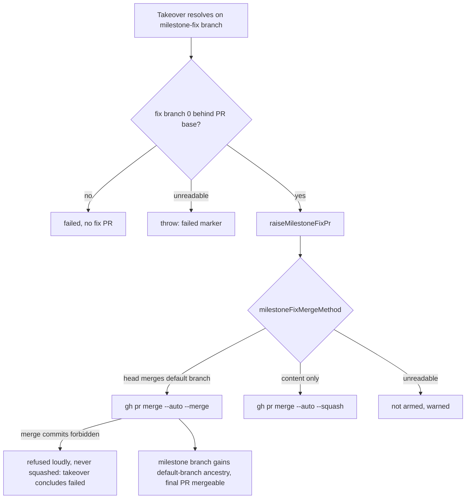

## Summary

Milestone-fix PRs whose head merges the default branch now land as a **merge commit**, not a squash, so the milestone branch takes on the default branch's ancestry and the final PR's merge base moves. Fix PRs that carry only content changes still squash. A repository that forbids merge commits gets a loud refusal naming the setting, never a squash. The conflict takeover raises a fix PR only once the resolved fix branch is 0 commits behind the PR's base, and concludes `failed` (not `resolved`) when the fix PR cannot land because merge commits are refused. Closes #3596. One criterion stays `partial`: the takeover never sees the fix PR land, so the post-landing `behind_by` read the issue asks for is replaced by a check on the fix branch before the PR is raised (see Acceptance Criteria).

## Spec

### Intent and Rationale

- A squash keeps the resolved tree but drops `main`'s ancestry. GitHub computes the final PR's mergeability from the merge base, so the final PR stayed `CONFLICTING` and the takeover resolved the same conflict again (12 fix PRs in a day across #3514, #3553, #3584).
- The method is decided from the head's real ancestry, not passed in by callers. The CI-fix and review-feedback routes may merge the default branch too, and the Auto-Merge sweep and the direct merge can arm a fix PR that creation did not.

### Essential Design Decisions

- `milestoneFixMergeMethod` (`worker/deno/lib/milestone_fix_pr.ts`) reads the default branch, then the head's merge base with it (`compare <default>...<head>`), then whether that merge base is already in the milestone branch (`compare <milestone>...<merge-base>`): `behind`/`identical` → `--squash`, `ahead`/`diverged` → `--merge`, anything else → error.
- All three merge paths for a `milestone-fix/**` head use it: creation arming (`raiseMilestoneFixPr`), `enableAutoMerge` and `directMergePr`. The sweep and direct merge apply it to same-repository heads only; a head whose repository cannot be read fails closed, a confirmed fork squashes as before.
- An unreadable method never guesses: creation leaves the PR unarmed with a warning and a PR comment, the sweep returns `failed`, the direct merge refuses. Unlike the sync PR (Issue #1048), a refused merge commit is never downgraded to a squash, because a squashed fix loops.
- Existing owners are reused: `isSafeRef` (`conflict_fallback_context.ts`), `makeGhDefaultBranchFn` (`milestone_branch_sync.ts`), `isMergeCommitNotAllowed` (`milestone_sync_pr.ts`), and `readCompareBehindBy`, the uncached core extracted from `readMilestoneBehindBy` (`milestone_children_gate.ts`). `getRepoDefaultBranch` was not used: its process and disk cache would answer one test from another's state.

### Undiscoverable Facts

- Observed against the real API: `gh api repos/stSoftwareAU/VibeCoder/compare/main...milestone/milestone-completion-and-fix-pr-correctness --jq '{status,behind_by,mb:.merge_base_commit.sha}'` → `{"status":"ahead","behind_by":0,"mb":"b9188319…"}`; `compare/<milestone>...<sha already in it>` → `{"status":"behind"}`. Branch names containing `/` work unencoded in the compare path. `gh api repos/stSoftwareAU/VibeCoder --jq .allow_merge_commit` → `true`.
- `milestone_fix_pr.ts` and `milestone_branch_sync.ts` now import each other. Each uses the other only inside function bodies, so the cycle loads cleanly whichever module is imported first (both test files pass).

## Evidence

Backend-only change; no UI files are touched.

**Docs sweep** — grep: `--squash`, "auto --squash", "armed with", "milestone-fix", `mergeMethodFlagForHead`, `directMergePr`, "squash\w*"; section: `docs/workflows/milestones.md#the-sync-must-record-the-default-branch-as-an-ancestor`, `docs/workflows/merge-conflicts.md` (conflict takeover bullets and flowchart), `docs/MERGE.md` (milestone-fix pass list); siblings: `sync/milestone-*`, `mergeMethodFlagForHead` (the existing merge-commit deviation the new rule sits beside); updated: `DESIGN-PRINCIPLES.md`, `docs/INTERNALS.md`, `docs/MERGE.md`, `docs/workflows/merge-conflicts.md`, `docs/workflows/milestones.md`; `docs/MERGE.md:370` — still true because that diagram covers PRs targeting the default branch, which a milestone-fix PR never does; `docs/MERGE.md:612` — still true because ordinary issue PRs still arm `--auto --squash`; `docs/INTERNALS.md:4244` (`pr_manager.ts` mention) — pre-existing stale file name, unchanged by this PR.

## Reproduction

- **symptom** — a merged takeover fix PR left the milestone's final PR `CONFLICTING` with a stale merge base, and the next takeover resolved the same conflict again, because the fix PR was armed `gh pr merge --auto --squash` whatever its head carried.
- **status** — `verified` — with the base branch's production files (`git checkout a32fdeaf -- lib/milestone_fix_pr.ts lib/conflict_takeover.ts lib/pr_auto_merge.ts lib/direct_merge.ts`) and the new tests, `deno test -A --no-check` failed 11 tests including the `--merge` arming and refusal tests; with the fix they pass. (`milestone_fix_pr_test.ts` fails to load on base because `milestoneFixMergeMethod` does not exist there; the takeover test exercises the same creation arming and was red on base.)
- **regression test** — `worker/deno/tests/conflict_takeover_test.ts::runConflictTakeover - gated milestone head raises a fix PR, never touches the head` (asserts the takeover's fix PR is armed `--merge`, never `--squash`) and `worker/deno/tests/milestone_fix_pr_test.ts::raiseMilestoneFixPr - a head that merges the default branch is armed with --merge, never --squash (Issue #3596)`

## Acceptance Criteria

<!-- vibe-spec-review inputs="diff+issue-body" -->

- **met** — A milestone-fix PR whose head merges the default branch is armed with `--merge`, and one with only content changes is armed with `--squash`. — evidence: `worker/deno/tests/milestone_fix_pr_test.ts::raiseMilestoneFixPr - a head that merges the default branch is armed with --merge, never --squash (Issue #3596)`, `worker/deno/tests/milestone_fix_pr_test.ts::milestoneFixMergeMethod - an identical merge base is --squash (Issue #3596)`, `worker/deno/tests/merge_method_arming_test.ts` sweep and direct-merge tests — reviewer: met
- **partial** — After such a fix lands, `behind_by` from the default branch to the milestone branch is 0, and the final PR is not re-taken over for the same conflict. — evidence: `worker/deno/tests/conflict_takeover_test.ts::runConflictTakeover - a fix branch still behind its base raises no fix PR (Issue #3596)` — reviewer: partial — reason: the takeover concludes when it raises the fix PR and never observes the landing, so it confirms the fix branch is 0 behind the base before raising; with the merge-commit landing that leaves the milestone branch level, but no code reads the milestone branch after the landing
- **met** — On a repository with `allow_merge_commit: false`, a default-branch-merge fix is refused loudly and never squashed. — evidence: `worker/deno/tests/milestone_fix_pr_test.ts::raiseMilestoneFixPr - a merge refused by a repository that bans merge commits is not squashed (Issue #3596)`, `worker/deno/tests/conflict_takeover_test.ts::runConflictTakeover - a fix PR whose merge commit is refused is failed, not resolved (Issue #3596)`, `worker/deno/tests/merge_method_arming_test.ts::enableAutoMerge - a milestone-fix --merge the repo refuses is not armed, never squashed (Issue #3596)` — reviewer: met
- **unrequested** — the Auto-Merge sweep (`enableAutoMerge`) and `directMergePr` apply the fix-head rule, with `baseRefName` added to the pre-merge gate outcome — reviewer: unrequested — reason: without them a fix PR not armed at creation is later squashed by the sweep or direct merge, breaking "never squashed"
- **unrequested** — fail closed when the merge method or the head's repository cannot be read — reviewer: unrequested — reason: guessing a method would risk exactly the squash the issue forbids
- **unrequested** — `mergeCommitRefusal` on `MilestoneFixPr`, read by the takeover to conclude `failed` — reviewer: unrequested — reason: otherwise the takeover reports `resolved` for a fix PR that can never land
- **unrequested** — reuse refactors (`isSafeRef`, `makeGhDefaultBranchFn` exported; `readCompareBehindBy` extracted) and input validation in `milestoneFixMergeMethod` — reviewer: unrequested — reason: the Standards review required calling the existing owners instead of copies; validation keeps branch names out of untrusted API paths
- **unrequested** — fixture updates in `conflict_1957_replay_test.ts`, `conflict_2028_replay_test.ts`, `conflict_takeover_resolvers_test.ts`, `pr_merge_conflict_milestone_takeover_test.ts`, `pr_auto_merge_test.ts` — reviewer: unrequested — reason: their fakes must answer the new compare reads; no assertion changed
- **unrequested** — docs edits in five files — reviewer: unrequested — reason: the code change owes the docs change (CODING-STANDARDS)

## Standards Review

<!-- vibe-standards-review inputs="diff+CODING-STANDARDS.md" -->

- **violation** — copied private ref validator instead of `isSafeRef` — evidence: `worker/deno/lib/milestone_fix_pr.ts:271` — reason: fixed in this diff
- **violation** — hand-written default-branch read instead of an existing helper — evidence: `worker/deno/lib/milestone_fix_pr.ts:292` — reason: fixed in this diff
- **violation** — re-implemented compare `behind_by` read — evidence: `worker/deno/lib/conflict_takeover.ts:349` — reason: fixed in this diff
- **violation** — a failed `isCrossRepository` read silently routed a same-repository fix head to the squash path — evidence: `worker/deno/lib/pr_auto_merge.ts:1158`, `worker/deno/lib/direct_merge.ts:985` — reason: fixed in this diff
- **clean** — no removed or edited assertions in existing tests; every new export and field has a production reader; Australian English; log levels; failure reasons quote the cause; insertion points; docs owed; each new branch has a test (review-enforced rules checked: "Nothing exists only for a test to read", Australian English, the over-engineering flags, "A named test must exist", branch outcomes). Departure, said out loud: the reviewer also listed the missing post-landing `behind_by` confirmation (`worker/deno/lib/conflict_takeover.ts:564`) as a violation of the KISS floor ("whatever the issue explicitly asks for all stay in"). It is not fixed: the takeover never observes the fix PR landing. It is a requirements gap, not a departure from a documented coding standard, so it is judged on the Spec axis and recorded there as `partial` with what is and is not checked

## Test Plan

- Added tests in `worker/deno/tests/milestone_fix_pr_test.ts`, `worker/deno/tests/merge_method_arming_test.ts`, `worker/deno/tests/conflict_takeover_test.ts`; one assertion added in `worker/deno/tests/direct_merge_test.ts::direct_merge - enforcePreMergeRequirements allows when CI passed and current` (gate reports `baseRefName`; red with `baseRefName` removed from the gate).
- Fixture-only edits (no assertion removed or changed): `worker/deno/tests/conflict_takeover_resolvers_test.ts`, `worker/deno/tests/conflict_1957_replay_test.ts`, `worker/deno/tests/conflict_2028_replay_test.ts`, `worker/deno/tests/pr_merge_conflict_milestone_takeover_test.ts`, `worker/deno/tests/pr_auto_merge_test.ts`. Removed assertions: none.
- Red checks (each mutation restored byte-for-byte): hard-coded `--squash` at creation → the `--merge` tests and the takeover gated test red; a `--squash` retry after refusal → refusal test red; behind check removed or moved after the raise → takeover tests red; each `fixShaped` operand in `directMergePr` removed → its test red; fail-closed guards on unreadable head repository removed → their tests red.
- Base-branch red run: see Reproduction.
- `./quality.sh < /dev/null` on the final code head: `Result: PASSED (with skipped checks)` — `config integration` skipped, every other stage passed.

<!-- vibe-branch-outcomes -->

🤖 Generated with [Claude Code](https://claude.com/claude-code)
