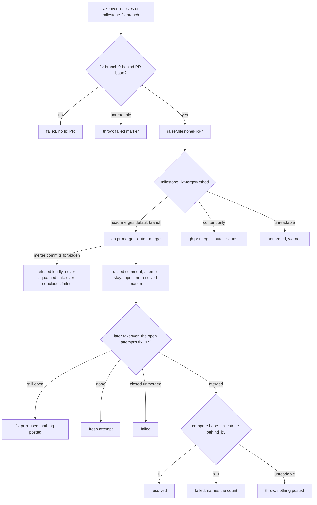

## Summary

Milestone-fix PRs whose head merges the default branch now land as a **merge commit**, not a squash, so the milestone branch takes on the default branch's ancestry and the final PR's merge base moves. Fix PRs that carry only content changes still squash. A repository that forbids merge commits gets a loud refusal naming the setting, never a squash. The conflict takeover raises a fix PR only once the resolved fix branch is 0 commits behind the PR's base, and concludes `failed` (not `resolved`) when the fix PR cannot land because merge commits are refused. Raising a fix PR no longer posts the `resolved` marker: the attempt stays open, and a later takeover concludes it — `resolved` only when the fix PR has merged and `compare <base>...<milestone branch>` reports `behind_by` 0, otherwise `failed` naming the behind count (or naming a fix PR closed without landing). Closes #3596.

## Spec

### Intent and Rationale

- A squash keeps the resolved tree but drops `main`'s ancestry. GitHub computes the final PR's mergeability from the merge base, so the final PR stayed `CONFLICTING` and the takeover resolved the same conflict again (12 fix PRs in a day across #3514, #3553, #3584).
- The method is decided from the head's real ancestry, not passed in by callers. The CI-fix and review-feedback routes may merge the default branch too, and the Auto-Merge sweep and the direct merge can arm a fix PR that creation did not.

### Essential Design Decisions

- `milestoneFixMergeMethod` (`worker/deno/lib/milestone_fix_pr.ts`) reads the default branch, then the head's merge base with it (`compare <default>...<head>`), then whether that merge base is already in the milestone branch (`compare <milestone>...<merge-base>`): `behind`/`identical` → `--squash`, `ahead`/`diverged` → `--merge`, anything else → error.
- All three merge paths for a `milestone-fix/**` head use it: creation arming (`raiseMilestoneFixPr`), `enableAutoMerge` and `directMergePr`. The sweep and direct merge apply it to same-repository heads only; a head whose repository cannot be read fails closed, a confirmed fork squashes as before.
- An unreadable method never guesses: creation leaves the PR unarmed with a warning and a PR comment, the sweep returns `failed`, the direct merge refuses. Unlike the sync PR (Issue #1048), a refused merge commit is never downgraded to a squash, because a squashed fix loops.
- The takeover's `resolved` waits for the landing. `fix-pr-raised` posts a plain comment with no conclusion marker, so the `pass="takeover"` attempt stays open. A later takeover that finds no open fix PR takes the lock and, when the newest trusted marker is that open takeover attempt, reads the fleet's own same-repository PR from that attempt's fix branch (`gh pr list --state all`, `concludePendingFixPr` in `conflict_takeover.ts`). Merged with the head 0 behind its base → `resolved`; merged but behind, or closed unmerged → `failed`, charged once. Both conclusions name the head the open attempt ran against, so the next attempt is due at once on a moved head. A fix PR still open → stands down as `fix-pr-reused`. No PR → a fresh attempt runs as before. An empty, unparsable or unreadable listing, or an unreadable behind count, throws before anything is posted.
- Consequences, said out loud. Until a later takeover runs, the open attempt reads as one disruption in the scan's tally (`parseConflictAttempts`), not a spent attempt; when it is the only one and the head is a `milestone/**` branch, the scan logs it at INFO, not WARN (`pr_merge_conflict_scan.ts`). The takeover runs only on a `CONFLICTING` PR, and a head 0 behind its base cannot conflict, so `resolved` is in practice reached only on a stale `CONFLICTING` verdict. A fix PR that lands and clears the conflict leaves its attempt open, and the fix route therefore no longer resets the shared budget, which the raise-time `resolved` marker used to do. The PR's next conflict concludes that attempt `failed` with the behind count and spends one unit, as the issue asks ("confirm … 0 behind … before it reports `resolved`"), so the budget bounds the loop the issue describes. `docs/workflows/merge-conflicts.md` says so in its budget bullets and its takeover section. A milestone sync whose single attempt-and-conclusion comment lands after the fix PR closes that open attempt with its own verdict, so the tally is unchanged and the takeover has nothing to conclude. The `fixBranch` member of the `fix-pr-raised` outcome had no production reader, so it is removed.
- Existing owners are reused: `isSafeRef` (`conflict_fallback_context.ts`), `makeGhDefaultBranchFn` (`milestone_branch_sync.ts`), `isMergeCommitNotAllowed` (`milestone_sync_pr.ts`), `isFleetFixPrListing` (extracted from `findOpenMilestoneFixPr` in `milestone_fix_pr.ts`, shared with the takeover's fix PR read), and `readCompareBehindBy`, the uncached core extracted from `readMilestoneBehindBy` (`milestone_children_gate.ts`), wrapped once by `branchBehindBase` for both the fix-branch check and the post-landing check. `getRepoDefaultBranch` was not used: its process and disk cache would answer one test from another's state.

### Undiscoverable Facts

- Observed against the real API: `gh api repos/stSoftwareAU/VibeCoder/compare/main...milestone/milestone-completion-and-fix-pr-correctness --jq '{status,behind_by,mb:.merge_base_commit.sha}'` → `{"status":"ahead","behind_by":0,"mb":"b9188319…"}`; `compare/<milestone>...<sha already in it>` → `{"status":"behind"}`. Branch names containing `/` work unencoded in the compare path. `gh api repos/stSoftwareAU/VibeCoder --jq .allow_merge_commit` → `true`.
- `milestone_fix_pr.ts` and `milestone_branch_sync.ts` now import each other. Each uses the other only inside function bodies, so the cycle loads cleanly whichever module is imported first (both test files pass).

## Evidence

Backend-only change; no UI files are touched.

**Docs sweep** — grep: `--squash`, "auto --squash", "armed with", "milestone-fix", `mergeMethodFlagForHead`, `directMergePr`, "squash\w*", `fixBranchBehindBase`, "fix PR was raised", "resolved.*fix PR"; section: `docs/workflows/milestones.md#the-sync-must-record-the-default-branch-as-an-ancestor`, `docs/workflows/merge-conflicts.md` (conflict takeover bullets and flowchart, including the new open-attempt conclusion bullet and the `resolved` conclusion list), `docs/MERGE.md` (milestone-fix pass list); siblings: `sync/milestone-*`, `mergeMethodFlagForHead` (the existing merge-commit deviation the new rule sits beside); updated: `DESIGN-PRINCIPLES.md`, `docs/INTERNALS.md`, `docs/MERGE.md`, `docs/workflows/merge-conflicts.md`, `docs/workflows/milestones.md`; `docs/MERGE.md:370` — still true because that diagram covers PRs targeting the default branch, which a milestone-fix PR never does; `docs/MERGE.md:612` — still true because ordinary issue PRs still arm `--auto --squash`; `docs/INTERNALS.md:4244` (`pr_manager.ts` mention) — pre-existing stale file name, unchanged by this PR.

## Reproduction

- **symptom** — a merged takeover fix PR left the milestone's final PR `CONFLICTING` with a stale merge base, and the next takeover resolved the same conflict again, because the fix PR was armed `gh pr merge --auto --squash` whatever its head carried.
- **status** — `verified` — with the base branch's production files (`git checkout a32fdeaf -- lib/milestone_fix_pr.ts lib/conflict_takeover.ts lib/pr_auto_merge.ts lib/direct_merge.ts`) and the new tests, `deno test -A --no-check` failed 11 tests including the `--merge` arming and refusal tests; with the fix they pass. (`milestone_fix_pr_test.ts` fails to load on base because `milestoneFixMergeMethod` does not exist there; the takeover test exercises the same creation arming and was red on base.)
- **regression test** — `worker/deno/tests/conflict_takeover_test.ts::runConflictTakeover - gated milestone head raises a fix PR, never touches the head` (asserts the takeover's fix PR is armed `--merge`, never `--squash`, and that raising it posts no `resolved` marker), `worker/deno/tests/conflict_takeover_test.ts::runConflictTakeover - a landed fix PR with the milestone branch still behind concludes failed, never resolved (Issue #3596)` and `worker/deno/tests/milestone_fix_pr_test.ts::raiseMilestoneFixPr - a head that merges the default branch is armed with --merge, never --squash (Issue #3596)`

## Acceptance Criteria

<!-- vibe-spec-review inputs="diff+issue-body" -->

- **met** — A milestone-fix PR whose head merges the default branch is armed with `--merge`, and one with only content changes is armed with `--squash`. — evidence: `worker/deno/tests/milestone_fix_pr_test.ts::raiseMilestoneFixPr - a head that merges the default branch is armed with --merge, never --squash (Issue #3596)`, `worker/deno/tests/milestone_fix_pr_test.ts::milestoneFixMergeMethod - an identical merge base is --squash (Issue #3596)`, `worker/deno/tests/merge_method_arming_test.ts` sweep and direct-merge tests — reviewer: met
- **met** — After such a fix lands, `behind_by` from the default branch to the milestone branch is 0, and the final PR is not re-taken over for the same conflict. — evidence: `worker/deno/tests/conflict_takeover_test.ts::runConflictTakeover - a landed fix PR with the milestone branch 0 behind concludes resolved (Issue #3596)`, `worker/deno/tests/conflict_takeover_test.ts::runConflictTakeover - an already-open fix PR is reused, nothing attempted` — reviewer: met (verified against a stubbed `gh`; that `behind_by` is 0 after landing rests on `--merge` plus the pre-raise fix-branch check, and no end-to-end test exists)
- **met** — On a repository with `allow_merge_commit: false`, a default-branch-merge fix is refused loudly and never squashed. — evidence: `worker/deno/tests/milestone_fix_pr_test.ts::raiseMilestoneFixPr - a merge refused by a repository that bans merge commits is not squashed (Issue #3596)`, `worker/deno/tests/conflict_takeover_test.ts::runConflictTakeover - a fix PR whose merge commit is refused is failed, not resolved (Issue #3596)`, `worker/deno/tests/merge_method_arming_test.ts::enableAutoMerge - a milestone-fix --merge the repo refuses is not armed, never squashed (Issue #3596)` — reviewer: met
- **met** — (What Needs to Be Done, third bullet, and Failure Detection) the takeover confirms the milestone branch is 0 behind (`compare … behind_by`) before it reports `resolved`, and a takeover test fails if `resolved` is reported while it is still behind. — evidence: `worker/deno/tests/conflict_takeover_test.ts::runConflictTakeover - a landed fix PR with the milestone branch still behind concludes failed, never resolved (Issue #3596)`, `worker/deno/tests/conflict_takeover_test.ts::runConflictTakeover - gated milestone head raises a fix PR, never touches the head` (raising posts no resolved marker; the attempt reads `open`) — reviewer: met (if the fix PR lands and the final PR goes MERGEABLE, the takeover may never run again, so that open attempt is never concluded, but no false `resolved` can be posted)
- **unrequested** — the pre-raise check that the fix branch is 0 behind the PR's base (failed, no PR raised) — reviewer: unrequested — reason: an early guard against the loop, beyond "after a fix PR lands"; kept
- **unrequested** — `concludePendingFixPr` concludes `failed` for a fix PR closed without landing, stands down while it is still open, and throws without posting on an unreadable listing or count — reviewer: unrequested — reason: needed to close the attempt that is now left open
- **unrequested** — the Auto-Merge sweep (`enableAutoMerge`) and `directMergePr` apply the fix-head rule, with `baseRefName` added to the pre-merge gate outcome — reviewer: unrequested — reason: without them a fix PR not armed at creation is later squashed by the sweep or direct merge, breaking "never squashed"
- **unrequested** — fail closed when the head's same-repository answer cannot be read (`headIsSameRepository` omitted from the gate when unknown) — reviewer: unrequested — reason: an unknown head is never squashed as if it were a fork
- **unrequested** — reuse refactors (`isSafeRef`, `makeGhDefaultBranchFn` exported; `readCompareBehindBy` and `isFleetFixPrListing` extracted) — reviewer: unrequested — reason: plumbing so existing owners are called instead of copies, with no behaviour change; it adds an import between `milestone_fix_pr.ts` and `milestone_branch_sync.ts`/`conflict_fallback_context.ts`
- **unrequested** — the scan logs a lone open takeover attempt on a milestone head at INFO, not WARN (`pr_merge_conflict_scan.ts`) — reviewer: unrequested — reason: the open attempt is now the expected state while a fix PR lands, and the standards review flagged the WARN as noise
- **unrequested** — the `fixBranch` member of the `fix-pr-raised` outcome is removed, and `branchBehindBase` is no longer exported — reviewer: unrequested — reason: neither had a production reader (mutation check and standards review)
- **unrequested** — fixture stubs in `conflict_1957_replay_test.ts`, `conflict_2028_replay_test.ts`, `conflict_takeover_resolvers_test.ts`, `pr_auto_merge_test.ts`, `pr_merge_conflict_milestone_takeover_test.ts`, `gated_head_passes_test.ts` — reviewer: unrequested — reason: they answer the new `compare`/default-branch reads or drop the removed member
- **unrequested** — the changed assertion in `conflict_takeover_test.ts::runConflictTakeover - gated milestone head raises a fix PR, never touches the head` (no longer expects `CONFLICT_RESOLVED_MARKER` on a raised fix PR) — reviewer: unrequested — reason: required by the third bullet, but it changes an existing test's meaning, so it is called out (see Test Plan)
- **unrequested** — docs edits in `DESIGN-PRINCIPLES.md`, `docs/INTERNALS.md`, `docs/MERGE.md`, `docs/workflows/merge-conflicts.md`, `docs/workflows/milestones.md` — reviewer: unrequested — reason: the code change owes the docs change (CODING-STANDARDS)

## Standards Review

<!-- vibe-standards-review inputs="diff+CODING-STANDARDS.md" -->

- **violation** — copied private ref validator instead of `isSafeRef` — evidence: `worker/deno/lib/milestone_fix_pr.ts:282` — reason: fixed in this diff
- **violation** — hand-written default-branch read instead of an existing helper — evidence: `worker/deno/lib/milestone_fix_pr.ts:303` — reason: fixed in this diff
- **violation** — re-implemented compare `behind_by` read — evidence: `worker/deno/lib/conflict_takeover.ts:362` — reason: fixed in this diff
- **violation** — a failed `isCrossRepository` read silently routed a same-repository fix head to the squash path — evidence: `worker/deno/lib/pr_auto_merge.ts:1158`, `worker/deno/lib/direct_merge.ts:985` — reason: fixed in this diff
- **violation** — DRY: `readTakeoverFixPr` copied `findOpenMilestoneFixPr`'s fleet filter — evidence: `worker/deno/lib/milestone_fix_pr.ts:121`, `worker/deno/lib/conflict_takeover.ts:431` — reason: fixed in this diff (`isFleetFixPrListing` extracted and shared)
- **violation** — Fail Loud: an unparsable listing threw a bare SyntaxError and an empty one read as "no fix PR" — evidence: `worker/deno/lib/conflict_takeover.ts:417` — reason: fixed in this diff
- **violation** — the resolved and failed conclusions named different heads for the same attempt — evidence: `worker/deno/lib/conflict_takeover.ts:486` — reason: fixed in this diff
- **violation** — an open attempt whose fix PR was still OPEN ran a fresh attempt onto the same fix branch — evidence: `worker/deno/lib/conflict_takeover.ts:469` — reason: fixed in this diff (stands down as `fix-pr-reused`)
- **violation** — Log Levels: every scan of a PR awaiting its fix PR warned of a disruption, and the first fix also quietened a real disruption on a non-milestone head — evidence: `worker/deno/lib/pr_merge_conflict_scan.ts:1733` — reason: fixed in this diff (INFO only for a lone takeover attempt on a `milestone/**` head)
- **violation** — diagram routed a judged failure to the throw node — evidence: `docs/workflows/merge-conflicts.md` takeover flowchart — reason: fixed in this diff
- **violation** — Nothing exists only for a test to read: the outcome's `fixBranch` and the `branchBehindBase` export — evidence: `worker/deno/lib/conflict_takeover.ts:202`, `worker/deno/lib/conflict_takeover.ts:362` — reason: fixed in this diff (member removed; export dropped, tests go through `runConflictTakeover`)
- **violation** — A Code Change Owes a Docs Change: "every attempt posts a conclusion" and "resolved resets both budgets" went stale for the fix route — evidence: `docs/workflows/merge-conflicts.md` budget bullets — reason: fixed in this diff
- **clean** — no assertions removed from existing tests except the one Test Plan names; every new export and field has a production reader; Australian English; failure reasons quote the cause; fail-closed throws post nothing; the conclusion runs under the lock after the stamp and due checks; attempt numbering (`freshSpent + 1` is the open attempt's number); the fix-branch name is derived the same way on raise and on conclude; each new branch has a test; docs owed. Departures, said out loud, which the reviewer judged documented and acceptable consequences of the issue's explicit rule: (i) on the fix route `resolved` is in practice reached only on a stale `CONFLICTING` verdict, so a landed fix no longer resets the shared budget and the PR's next conflict concludes that attempt `failed`; (j) a milestone sync's single attempt-and-conclusion comment closes the open takeover attempt with its own verdict. The reviewer's other flag, `assertEquals(result.ok, false)` beside `assert(!result.ok, …)` in `merge_method_arming_test.ts`, was withdrawn on re-review: the first kills the mutant that deletes `ok: false`, and the second narrows the type

## Test Plan

- Added tests in `worker/deno/tests/milestone_fix_pr_test.ts`, `worker/deno/tests/merge_method_arming_test.ts`, `worker/deno/tests/conflict_takeover_test.ts` and `worker/deno/tests/direct_merge_test.ts` (`enforcePreMergeRequirements reports the head and whether it is same-repository (Issue #3596)`, `enforcePreMergeRequirements omits the same-repository answer it could not read (Issue #3596)`); one assertion added in `worker/deno/tests/direct_merge_test.ts::direct_merge - enforcePreMergeRequirements allows when CI passed and current` (gate reports `baseRefName`; red with `baseRefName` removed from the gate).
- Takeover conclusion tests (`conflict_takeover_test.ts`, all `(Issue #3596)`): a landed fix PR with the milestone branch still behind concludes failed, never resolved; with it 0 behind concludes resolved; a fix PR closed without landing concludes failed; an unreadable milestone behind count after a landing posts nothing; an unreadable fix PR listing posts nothing; an open attempt with no fleet fix PR of its own runs a fresh attempt; an open attempt whose fix PR is still open stands down, posting nothing; an empty or unparsable fix PR listing for an open attempt names the branch and posts nothing; an open ladder attempt, and an open takeover attempt on a non-milestone head, are not concluded as a fix PR; the raised fix PR names the milestone PR and the pass. In `pr_merge_conflict_scan_test.ts`: `findConflictingPr - an open takeover attempt awaiting its fix PR is logged at info, not warned (Issue #3596)` (milestone head and lone takeover attempt → INFO; a ladder attempt, two disruptions, or a non-milestone head → WARN). `branchBehindBase` is no longer exported: its fractional and negative count tests now go through `runConflictTakeover` (`runConflictTakeover - a fractional behind count rejects with no fix PR, naming the value (Issue #3596)`, `… a negative behind count …`).
- **Changed existing assertion** (required by the issue's Failure Detection, "A takeover test fails if `resolved` is reported while the milestone branch is still behind"): `conflict_takeover_test.ts::runConflictTakeover - gated milestone head raises a fix PR, never touches the head` asserted `CONFLICT_RESOLVED_MARKER` and `pass="takeover"` on the comment posted after the fix PR is raised. Both are removed; it now asserts that comment carries no resolved or failed marker, names the fix PR, and leaves the attempt `open`. No other assertion was removed.
- Strengthened (Issue #3596 tests added on this branch): the three `directMergePr` refusal tests in `merge_method_arming_test.ts` now also `assertEquals(result.ok, false)`, so a result missing `ok` is red.
- Fixture-only edits (no assertion removed or changed): `worker/deno/tests/gated_head_passes_test.ts` (its stubbed `fix-pr-raised` outcome drops the removed `fixBranch` member), `worker/deno/tests/conflict_takeover_resolvers_test.ts`, `worker/deno/tests/conflict_1957_replay_test.ts`, `worker/deno/tests/conflict_2028_replay_test.ts`, `worker/deno/tests/pr_merge_conflict_milestone_takeover_test.ts`, `worker/deno/tests/pr_auto_merge_test.ts`.
- Red checks (each mutation restored byte-for-byte): hard-coded `--squash` at creation → the `--merge` tests and the takeover gated test red; a `--squash` retry after refusal → refusal test red; behind check removed or moved after the raise → takeover tests red; each `fixShaped` operand in `directMergePr` removed → its test red; fail-closed guards on unreadable head repository removed → their tests red.
- Mutation check: the 9 surviving mutants the gate listed are dealt with. Eight now go red — `conflict_takeover.ts` `milestonePrNumber` and `pass` deleted; `direct_merge.ts` `isCrossRepository === false` swapped to `true`, `headRefName` deleted, the `headIsSameRepository` spread negated, and `ok: false` deleted from each of the three milestone-fix refusals. The ninth, `conflict_takeover.ts:601` (the outcome's `fixBranch` deleted), showed a member nothing in production reads, so the member is removed and the line is gone. Sixteen more mutants of the new code were also red: `behindBy === 0` forced true; the MERGED-first preference dropped; the `pass` and `useFixRoute` guard operands dropped; the listing shape check skipped; an empty listing read as `[]`; every fix PR treated as merged; the raised comment swapped for the resolved one; an unreadable behind count read as 0; the `OPEN` stand-down skipped; the `number` check dropped; the resolved conclusion attributed to the current head instead of the attempt's; `isFleetFixPrListing`'s `isCrossRepository` check dropped; and any of the three operands of the scan's awaiting-fix-PR condition (`pass`, the count, `isMilestoneHead`) dropped.
- Base-branch red run: see Reproduction.
- `./quality.sh < /dev/null` on the final tree: `Result: PASSED (with skipped checks)` — `config integration` skipped (deno or `.config.json` not available), every other stage passed.

<!-- vibe-branch-outcomes -->

🤖 Generated with [Claude Code](https://claude.com/claude-code)
