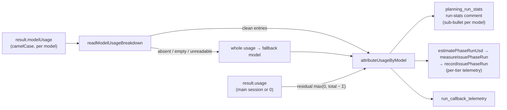

# PR Summary — Issue #3603

## Summary

The issue-run cost estimate now prices every model that served a split run,
not just the Opus manager. On a split run the result `usage` covers only the
main session, or is zero. Each sub-agent model's counts live in the result's
`modelUsage`, and `attributeUsageByModel` used to discard that breakdown
whenever it was larger than the totals.

`attributeUsageByModel` (`worker/deno/lib/cost_estimate.ts`) now trusts any
breakdown it reads cleanly. When the totals are larger than the breakdown on a
counter, the difference (`max(0, total − Σ)`) is charged to the fallback
model. Results:

- the run-stats comment shows one sub-bullet per model, with a total equal to
  their sum;
- Haiku 5.5 is priced through `lookupModelPricing`, which applies the banded
  rates from #3399;
- a multi-model run with no readable `modelUsage` gets
  `sub-agents: not costed`;
- the per-tier fleet telemetry (`measureIssuePhaseRun` →
  `recordIssuePhaseRun`) and the run-callback telemetry use the same figure.

Closes #3603

## Spec

### Intent and Rationale

- The Haiku vs Sonnet sub-agent trial (#3473) compares runs by cost. The cost
  must include the sub-agents being compared, or the trial only measures the
  Opus manager.

### Essential Design Decisions

- **One owner.** The comment, `estimatePhaseRunUsd` and
  `run_callback_telemetry.ts` all attribute usage through
  `attributeUsageByModel`, so they cannot disagree.
- **Trust a clean breakdown; add only a residual.** A breakdown larger than the
  totals is the normal split-run case, so it is no longer discarded. Per
  counter, any amount by which the totals exceed the breakdown goes to the
  fallback model, so no recorded usage is lost.
- **Fall back loudly, not silently.** `readModelUsageBreakdown` rejects an
  absent or empty breakdown, and any entry with a non-numeric counter, rather
  than reading it as zero. The caller then falls back to the whole usage. When
  that invocation served more than one real model (excluding `<synthetic>`),
  the comment adds `sub-agents: not costed` and marks the total
  `(partial — see below)`.
- **Callback telemetry's dominant model.** The dominant model is now the
  largest attributed entry, not `servedModels[0]`, and token sums come from
  the attributed entries.

### Undiscoverable Facts

- `modelUsage` keys its counters in camelCase (`inputTokens`,
  `cacheReadInputTokens`, …), unlike the snake_case result `usage`. Its own
  `costUSD` is ignored: pricing stays with `lookupModelPricing` so that the
  Haiku 5.5 bands apply.
- **Telemetry limitation.** Telemetry records have no not-costed flag. A
  multi-model run with no readable breakdown is recorded at the whole usage
  under the fallback model, and only the comment flags it.
- **No persisted key bumped.** The change alters computed figures only; no
  stored shape changes. As `docs/MODEL-AND-CACHING.md` now states, cost data
  recorded before #3603 is advisor-only.

## Evidence

- #3399: Banded Claude Haiku 5.5 pricing in token_usage (≤100k / >100k prompt tokens)
- #3403: Per-tier issue-run telemetry and PR-body sub-agent tier marker
- #3404: Per-tier PR outcomes and cost per merged PR in fleet telemetry
- #2346: Run-stats comment: split on/off, executor counts and executor Sonnet spend in the run cost
- #3473: Make Haiku the default issue_sub_agent_tier if the Haiku vs Sonnet trial meets #3385's decision rule
- #3385: Adopt Claude Haiku 5.5: pricing tables, trial key for cheaper sub-agent tiers

**Docs sweep** — grep: `attributeUsageByModel`, `modelUsage`, `issue_executor_split`, `sub-agent\w* .*cost\w*`, `breakdown`, `estimatePhaseRunUsd`; section: `docs/MODEL-AND-CACHING.md` run-cost bullets, `docs/CONFIGURATION.md#issue_executor_split`; updated: `docs/CONFIGURATION.md:457`, `docs/MODEL-AND-CACHING.md` (new bullet "A split run's sub-agent tokens are costed at their own model's rates.")

- `docs/MODEL-AND-CACHING.md:2742` ("breakdown reconciles") is about the
  cache-write column and is still true.
- `docs/audits/security-sweep-2757-lib-delta-12d-12f.md:184` is a dated audit
  snapshot and was left unchanged.

## Reproduction

- **Symptom:** a split run that used Opus plus Haiku 5.5 or Sonnet
  sub-agents showed only the Opus cost in the run-stats comment, and fed the
  same figure to the per-tier telemetry.
- **Status:** reproduced with synthetic stream fixtures. The new tests fail
  against base: the base test file fails to import the new exports, and the
  mutation check below shows each new branch going red when its change is
  removed.
- **Regression test:** `worker/deno/tests/planning_run_stats_test.ts`
  "buildPlanningStatsSection - split run with Opus, Haiku 5.5 and Sonnet usage
  shows a sub-bullet per model and a total equal to their sum (Issue #3603)".

## Acceptance Criteria

<!-- vibe-spec-review inputs="diff+issue-body" -->

- **met** — For a split run whose stream records Opus, Haiku 5.5 and Sonnet usage, the comment shows a sub-bullet for each model and a total that is their sum (test with a recorded or synthetic fixture) — evidence: `worker/deno/tests/planning_run_stats_test.ts::buildPlanningStatsSection - split run with Opus, Haiku 5.5 and Sonnet usage shows a sub-bullet per model and a total equal to their sum (Issue #3603)`, `worker/deno/tests/planning_run_stats_test.ts::buildPlanningStatsSection - split run whose result usage is main-session-only gives the same total (Issue #3603)`, `worker/deno/tests/cost_estimate_test.ts::cost_estimate - formatCostEstimateLines renders every model of a split run` — reviewer: met — reason: synthetic fixture only; no recorded split-run stream with a populated `modelUsage` exists in the repo
- **met** — A run on one model is unchanged — evidence: `worker/deno/tests/planning_run_stats_test.ts::buildPlanningStatsSection - a run on one model is unchanged (Issue #3603)` — reviewer: met — reason: covers a breakdown equal to the totals; a one-model run whose `modelUsage` exceeds `tokenUsage` is now priced from the breakdown, not the totals
- **met** — The per-tier fleet telemetry from #3403/#3404 uses the same corrected figure — evidence: `worker/deno/tests/issue_run_stats_comment_test.ts::measureIssuePhaseRun - a split run's spend covers every served model, as the comment does (Issue #3603)`, `worker/deno/tests/phase_run_usd_test.ts::phase_run_usd - prices a split run from modelUsage when tokenUsage is all zero (Issue #3603)` — reviewer: met
- **met** — Price Haiku 5.5 sub-agent usage through `lookupModelPricing("claude-haiku-5-5")` (banded, #3399) — evidence: `worker/deno/lib/cost_estimate.ts` (`estimateRunCost` → `lookupModelPricing`), `worker/deno/tests/cost_estimate_test.ts::cost_estimate - formatCostEstimateLines renders every model of a split run` — reviewer: met — reason: test evidence is indirect (expected figures computed with the same `estimateCost`); no test pins an absolute Haiku dollar figure
- **met** — If sub-agent usage can't be read, the comment says `sub-agents: not costed` — evidence: `worker/deno/tests/planning_run_stats_test.ts::buildPlanningStatsSection - multi-model invocation with no readable modelUsage says sub-agents: not costed (Issue #3603)`, `worker/deno/tests/cost_estimate_test.ts::cost_estimate - formatCostEstimateLines flags sub-agents not costed` — reviewer: met
- **met** — The `docs/CONFIGURATION.md` (`issue_executor_split`) claim that executor tokens are costed separately is made true — evidence: `docs/CONFIGURATION.md:457`, `worker/deno/lib/cost_estimate.ts` — reviewer: met
- **unrequested** — `readModelUsageBreakdown` exported from `worker/deno/lib/cost_estimate.ts` — reviewer: justified — reason: `planning_run_stats` needs the same "is the breakdown readable" check to raise the not-costed flag, and sharing it avoids a second parser
- **unrequested** — Tokens line in `planning_run_stats` and token sums in `run_callback_telemetry` taken from the attributed entries — reviewer: justified — reason: otherwise the token counts would be main-session-only next to a cost that covers every model; it does change what the published `telemetry.*Tokens` fields mean
- **unrequested** — Callback telemetry's dominant `model` is now the largest attributed entry, not `servedModels[0]` (`worker/deno/lib/run_callback_telemetry.ts:100-110`) — reviewer: unjustified — reason: the issue does not ask for it, `effort` is still the advisor's `stats.effort`, so a Haiku-dominated run reports `model=claude-haiku-5-5` with the Opus advisor's effort (breaking #2573's same-call invariant), and `docs/CALLBACKS.md:494-495` was not updated; outstanding, not fixed in this diff
- **unrequested** — `docs/MODEL-AND-CACHING.md` run-cost bullet rewrite — reviewer: justified — reason: the old text described the reconcile-or-discard rule this change removes
- **unrequested** — #2346 test rewritten in `worker/deno/tests/cost_estimate_test.ts` ("discards a breakdown claiming more than the run recorded" → "trusts a breakdown exceeding the run totals without a residual") — reviewer: justified — reason: the discard rule is exactly what dropped sub-agent usage; the trade-off is that an inflated but readable breakdown is now trusted
- **unrequested** — per-counter residual clamped at zero, the `formatCostEstimateLines` options parameter, and `modelUsage` added to `TelemetrySource` — reviewer: justified — reason: the mechanisms that trusting a larger breakdown, the not-costed flag and the corrected callback cost need
- Residual risk the reviewer noted: an invocation with `modelUsage` but no `tokenUsage` is still skipped everywhere.

## Standards Review

<!-- vibe-standards-review inputs="diff+CODING-STANDARDS.md" -->

- **violation** — A Code Change Owes a Docs Change: `telemetry.model` now means the largest per-model entry, but `docs/CALLBACKS.md` still says "Served model of the invocation with the biggest token total" — evidence: `worker/deno/lib/run_callback_telemetry.ts:100-110`, `docs/CALLBACKS.md:494-495`, `docs/CALLBACKS.md:548-556` — reason: not fixed in this diff — outstanding (this pass is limited to the PR summary)
- **violation** — A Contract a Deployed Extension Reads Is Additive-Only: `VIBECODER_MODEL` / `VIBECODER_EFFORT` change meaning, and `effort: stats.effort` can now pair a sub-agent model with the advisor's effort, so the comment "`model` and `effort` can never describe two calls" is false — evidence: `worker/deno/lib/run_callback_telemetry.ts:110` — reason: not fixed in this diff — outstanding
- **violation** — Never Fail Silently: a multi-model run with no readable breakdown is recorded in callback and per-tier telemetry as a full figure with no flag, while `docs/CONFIGURATION.md:457` does not say the not-costed flag is comment-only — evidence: `worker/deno/lib/run_callback_telemetry.ts:88-93`, `docs/CONFIGURATION.md:457` — reason: not fixed in this diff — limitation documented under Undiscoverable Facts above
- **violation** (low) — A new behaviour reaches every caller: `formatCostEstimateLines` options default to `{}`, turning the flag off by default — evidence: `worker/deno/lib/cost_estimate.ts:335` — reason: not fixed in this diff — the only production caller (`planning_run_stats.ts:726`) passes it explicitly
- **violation** (low) — DRY: the not-costed message is written twice, and the four-counter token sum is hand-written again alongside `mergeUsageByModel` — evidence: `worker/deno/lib/cost_estimate.ts:343`, `worker/deno/lib/cost_estimate.ts:374`, `worker/deno/lib/planning_run_stats.ts:667-676`, `worker/deno/lib/run_callback_telemetry.ts:101-106` — reason: not fixed in this diff
- **clean** — Australian spelling; KISS (no new dependencies or abstractions); Deno/TypeScript placement and strict typing; tests call real code with fixtures, every new branch is reached, and negative tests carry the forbidden value; split-run tests at each call site; no persisted shape changed; `docs/MODEL-AND-CACHING.md`, `docs/CONFIGURATION.md` and source doc comments updated

## Test Plan

- `./quality.sh < /dev/null`: **PASSED** on `0db2daab`. The "config
  integration" step was SKIPPED because no deno or `.config.json` was
  available.
- Named tests are tracked (`git ls-files`, run from the repo root):
  - `worker/deno/tests/cost_estimate_test.ts`
  - `worker/deno/tests/issue_run_stats_comment_test.ts`
  - `worker/deno/tests/phase_run_usd_test.ts`
  - `worker/deno/tests/planning_run_stats_test.ts`
  - `worker/deno/tests/run_callback_telemetry_test.ts`
- Removed from `worker/deno/tests/cost_estimate_test.ts`: `assertEquals( attributeUsageByModel( usage(100, 0), { "claude-sonnet-5": { input_tokens: 999 } }, "claude-opus-5", ), [{ model: "claude-opus-5", usage: usage(100, 0) }], );` — #3603 requires the comment to cost every model of a split run, whose `usage` covers only the main session, so a breakdown larger than the totals must be trusted rather than discarded; the old expectation (charge only the fallback model) is now untrue. The test is renamed "…trusts a breakdown exceeding the run totals without a residual" and now expects `[{ model: "claude-sonnet-5", usage: usage(999, 0) }]`.
- Branch outcomes:
  - `worker/deno/lib/cost_estimate.ts:128` — unreadable counter →
    `undefined`. Test: "readModelUsageBreakdown rejects absent, empty and
    unreadable breakdowns" and "attributeUsageByModel never fabricates a zero
    for an unusable counter". Flip (read as 0) went red.
  - `worker/deno/lib/cost_estimate.ts:183` — empty breakdown → `undefined`.
    Test: "readModelUsageBreakdown rejects absent, empty and unreadable
    breakdowns". Flip (return `[]`) went red.
  - `worker/deno/lib/cost_estimate.ts:242` — per-counter residual clamped at
    0. Tests: "trusts a breakdown exceeding the run totals without a
    residual", "prices all models when the totals are zero", "adds a residual
    only for counters where totals exceed the breakdown", the phase_run_usd
    split test, the AC1 and main-session-only planning tests, and the
    telemetry zero and main-session tests. Flip (remove clamps) went red.
  - `worker/deno/lib/cost_estimate.ts:247` — non-zero residual appended /
    zero residual omitted. Tests: "attributes any shortfall rather than
    losing it" and "adds a residual only for counters where totals exceed the
    breakdown". Flip (never append) went red.
  - `worker/deno/lib/cost_estimate.ts:339` — not-costed flag on / off. Tests:
    "formatCostEstimateLines flags sub-agents not costed" and the planning
    not-costed test. Flip (`false`) went red.
  - `worker/deno/lib/cost_estimate.ts:343` — nothing priced and not costed →
    a single not-costed heading. Test: "formatCostEstimateLines flags
    sub-agents not costed". Covered by the `:339` flip, which went red.
  - `worker/deno/lib/cost_estimate.ts:349` — `(partial — see below)` suffix.
    Tests: "marks unknown pricing rather than $0", the flag test and the
    planning not-costed test. Flip (drop suffix) went red.
  - `worker/deno/lib/planning_run_stats.ts:626` — `<synthetic>` excluded from
    the model count. Test: the planning not-costed test. Flip (remove filter)
    went red.
  - `worker/deno/lib/planning_run_stats.ts:629` — more than one real model →
    not costed; one model → unflagged. Tests: the planning not-costed test
    and "…a run on one model is unchanged". Flip (`> 0`) went red.
  - `worker/deno/lib/planning_run_stats.ts:726` — the flag is passed to the
    formatter. Test: the planning not-costed test. Flip (pass `{}`) went red.
  - `worker/deno/lib/run_callback_telemetry.ts:88` — the breakdown feeds the
    attribution. Tests: the three new telemetry tests. Flip (pass
    `undefined`) went red.
  - `worker/deno/lib/run_callback_telemetry.ts:107` — largest entry wins, and
    ties go to invocation order. Test: "an equal-token tie is broken
    deterministically by invocation order". Flip (`>=`) went red.
  - `worker/deno/lib/cost_estimate.ts:218` — attribution used rather than
    `whole`. Tests: the AC3 measureIssuePhaseRun test and three #2346 tests.
    Flip (always return `whole`) went red.
