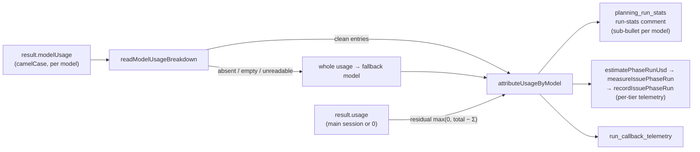

# PR Summary — Issue #3603

## Summary

The issue-run cost estimate now prices every model that served a split run,
not just the Opus manager. On a split run the result `usage` covers only the
main session, or is zero. Each sub-agent model's counts live in the result's
`modelUsage`, and `attributeUsageByModel` used to discard that breakdown
whenever it was larger than the totals.

`attributeUsageByModel` (`worker/deno/lib/cost_estimate.ts`) now trusts any
breakdown it reads cleanly. When the totals are larger than the breakdown on a
counter, the difference (`max(0, total − Σ)`) is charged to the fallback
model. Results:

- the run-stats comment shows one sub-bullet per model, with a total equal to
  their sum;
- Haiku 5.5 is priced through `lookupModelPricing`, which applies the banded
  rates from #3399;
- a multi-model run with no readable `modelUsage` gets
  `sub-agents: not costed`;
- the per-tier fleet telemetry (`measureIssuePhaseRun` →
  `recordIssuePhaseRun`) and the run-callback telemetry use the same figure.

Closes #3603

## Spec

### Intent and Rationale

- The Haiku vs Sonnet sub-agent trial (#3473) compares runs by cost. The cost
  must include the sub-agents being compared, or the trial only measures the
  Opus manager.

### Essential Design Decisions

- **One owner.** The comment, `estimatePhaseRunUsd` and
  `run_callback_telemetry.ts` all attribute usage through
  `attributeUsageByModel`, so they cannot disagree.
- **Trust a clean breakdown; add only a residual.** A breakdown larger than the
  totals is the normal split-run case, so it is no longer discarded. Per
  counter, any amount by which the totals exceed the breakdown goes to the
  fallback model, so no recorded usage is lost.
- **Fall back loudly, not silently.** `readModelUsageBreakdown` rejects an
  absent or empty breakdown, and any entry with a non-numeric counter, rather
  than reading it as zero. The caller then falls back to the whole usage. When
  that invocation served more than one real model (excluding `<synthetic>`),
  the comment adds `sub-agents: not costed` and marks the total
  `(partial — see below)`.
- **Callback telemetry's dominant model.** The dominant model is now the
  largest attributed entry, not `servedModels[0]`, and token sums come from
  the attributed entries.

### Undiscoverable Facts

- `modelUsage` keys its counters in camelCase (`inputTokens`,
  `cacheReadInputTokens`, …), unlike the snake_case result `usage`. Its own
  `costUSD` is ignored: pricing stays with `lookupModelPricing` so that the
  Haiku 5.5 bands apply.
- **Telemetry limitation.** Telemetry records have no not-costed flag. A
  multi-model run with no readable breakdown is recorded at the whole usage
  under the fallback model, and only the comment flags it.
- **No persisted key bumped.** The change alters computed figures only; no
  stored shape changes. As `docs/MODEL-AND-CACHING.md` now states, cost data
  recorded before #3603 is advisor-only.

## Evidence

- #3399: Banded Claude Haiku 5.5 pricing in token_usage (≤100k / >100k prompt tokens)
- #3403: Per-tier issue-run telemetry and PR-body sub-agent tier marker
- #3404: Per-tier PR outcomes and cost per merged PR in fleet telemetry
- #2346: Run-stats comment: split on/off, executor counts and executor Sonnet spend in the run cost
- #3473: Make Haiku the default issue_sub_agent_tier if the Haiku vs Sonnet trial meets #3385's decision rule
- #3385: Adopt Claude Haiku 5.5: pricing tables, trial key for cheaper sub-agent tiers

**Docs sweep** — grep: `attributeUsageByModel`, `modelUsage`, `issue_executor_split`, `sub-agent\w* .*cost\w*`, `breakdown`, `estimatePhaseRunUsd`; section: `docs/MODEL-AND-CACHING.md` run-cost bullets, `docs/CONFIGURATION.md#issue_executor_split`; updated: `docs/CONFIGURATION.md:457`, `docs/MODEL-AND-CACHING.md` (new bullet "A split run's sub-agent tokens are costed at their own model's rates.")

- `docs/MODEL-AND-CACHING.md:2742` ("breakdown reconciles") is about the
  cache-write column and is still true.
- `docs/audits/security-sweep-2757-lib-delta-12d-12f.md:184` is a dated audit
  snapshot and was left unchanged.

## Reproduction

- **Symptom:** a split run that used Opus plus Haiku 5.5 or Sonnet
  sub-agents showed only the Opus cost in the run-stats comment, and fed the
  same figure to the per-tier telemetry.
- **Status:** reproduced with synthetic stream fixtures. The new tests fail
  against base: the base test file fails to import the new exports, and the
  mutation check below shows each new branch going red when its change is
  removed.
- **Regression test:** `worker/deno/tests/planning_run_stats_test.ts`
  "buildPlanningStatsSection - split run with Opus, Haiku 5.5 and Sonnet usage
  shows a sub-bullet per model and a total equal to their sum (Issue #3603)".

## Acceptance Criteria

<!-- vibe-spec-review inputs="diff+issue-body" -->

- [x] "For a split run whose stream records Opus, Haiku 5.5 and Sonnet usage,
  the comment shows a sub-bullet for each model and a total that is their sum
  (test with a recorded or synthetic fixture)."
  - reviewer: met. Tested with a synthetic fixture
    (`planning_run_stats_test.ts`, the AC1 test, plus the main-session-only
    variant).
- [x] "A run on one model is unchanged."
  - reviewer: met. Tested in `planning_run_stats_test.ts` "…a run on one model
    is unchanged (Issue #3603)".
- [x] "The per-tier fleet telemetry from #3403/#3404 uses the same corrected
  figure."
  - reviewer: met. Tested in `issue_run_stats_comment_test.ts`
    "measureIssuePhaseRun - a split run's spend covers every served model, as
    the comment does (Issue #3603)" and `phase_run_usd_test.ts`.
- [x] Issue asks: `sub-agents: not costed` when usage is unreadable; Haiku 5.5
  priced via `lookupModelPricing`; `docs/CONFIGURATION.md` claim made true.
  - reviewer: met.
- unrequested:
  - the `readModelUsageBreakdown` export;
  - token sums taken from the attributed entries;
  - callback telemetry's dominant model is now the largest entry;
  - the docs rewrites;
  - the replaced #2346 test.
  - reviewer: justified. The dominant-model change visibly alters the
    callback `model` field, and the reviewer judged it mostly justified.
- Residual risks the reviewer noted:
  - an inflated but readable breakdown is now trusted;
  - a run with `modelUsage` but no `tokenUsage` is still skipped.

## Standards Review

<!-- vibe-standards-review inputs="diff+CODING-STANDARDS.md" -->

- reviewer: no violations.
- Optional note: the `formatCostEstimateLines` options default to `{}`, but
  its only production caller passes the flag explicitly. Kept as is: the
  option is an additive flag, not a behaviour that must reach every caller.

## Test Plan

- `./quality.sh < /dev/null`: **PASSED** on `0db2daab`. The "config
  integration" step was SKIPPED because no deno or `.config.json` was
  available.
- Named tests are tracked (`git ls-files`, run from the repo root):
  - `worker/deno/tests/cost_estimate_test.ts`
  - `worker/deno/tests/issue_run_stats_comment_test.ts`
  - `worker/deno/tests/phase_run_usd_test.ts`
  - `worker/deno/tests/planning_run_stats_test.ts`
  - `worker/deno/tests/run_callback_telemetry_test.ts`
- **Removed assertion:** `cost_estimate_test.ts` "…discards a breakdown
  claiming more than the run recorded" (it expected
  `[{model:"claude-opus-5", usage: usage(100,0)}]`). It is rewritten as
  "…trusts a breakdown exceeding the run totals without a residual"
  (`[{model:"claude-sonnet-5", usage: usage(999,0)}]`), because a breakdown
  larger than the totals is the normal split-run case this issue fixes.
- Branch outcomes:
  - `worker/deno/lib/cost_estimate.ts:128` — unreadable counter →
    `undefined`. Test: "readModelUsageBreakdown rejects absent, empty and
    unreadable breakdowns" and "attributeUsageByModel never fabricates a zero
    for an unusable counter". Flip (read as 0) went red.
  - `worker/deno/lib/cost_estimate.ts:183` — empty breakdown → `undefined`.
    Test: "readModelUsageBreakdown rejects absent, empty and unreadable
    breakdowns". Flip (return `[]`) went red.
  - `worker/deno/lib/cost_estimate.ts:242` — per-counter residual clamped at
    0. Tests: "trusts a breakdown exceeding the run totals without a
    residual", "prices all models when the totals are zero", "adds a residual
    only for counters where totals exceed the breakdown", the phase_run_usd
    split test, the AC1 and main-session-only planning tests, and the
    telemetry zero and main-session tests. Flip (remove clamps) went red.
  - `worker/deno/lib/cost_estimate.ts:247` — non-zero residual appended /
    zero residual omitted. Tests: "attributes any shortfall rather than
    losing it" and "adds a residual only for counters where totals exceed the
    breakdown". Flip (never append) went red.
  - `worker/deno/lib/cost_estimate.ts:339` — not-costed flag on / off. Tests:
    "formatCostEstimateLines flags sub-agents not costed" and the planning
    not-costed test. Flip (`false`) went red.
  - `worker/deno/lib/cost_estimate.ts:343` — nothing priced and not costed →
    a single not-costed heading. Test: "formatCostEstimateLines flags
    sub-agents not costed". Covered by the `:339` flip, which went red.
  - `worker/deno/lib/cost_estimate.ts:349` — `(partial — see below)` suffix.
    Tests: "marks unknown pricing rather than $0", the flag test and the
    planning not-costed test. Flip (drop suffix) went red.
  - `worker/deno/lib/planning_run_stats.ts:626` — `<synthetic>` excluded from
    the model count. Test: the planning not-costed test. Flip (remove filter)
    went red.
  - `worker/deno/lib/planning_run_stats.ts:629` — more than one real model →
    not costed; one model → unflagged. Tests: the planning not-costed test
    and "…a run on one model is unchanged". Flip (`> 0`) went red.
  - `worker/deno/lib/planning_run_stats.ts:726` — the flag is passed to the
    formatter. Test: the planning not-costed test. Flip (pass `{}`) went red.
  - `worker/deno/lib/run_callback_telemetry.ts:88` — the breakdown feeds the
    attribution. Tests: the three new telemetry tests. Flip (pass
    `undefined`) went red.
  - `worker/deno/lib/run_callback_telemetry.ts:107` — largest entry wins, and
    ties go to invocation order. Test: "an equal-token tie is broken
    deterministically by invocation order". Flip (`>=`) went red.
  - `worker/deno/lib/cost_estimate.ts:218` — attribution used rather than
    `whole`. Tests: the AC3 measureIssuePhaseRun test and three #2346 tests.
    Flip (always return `whole`) went red.
