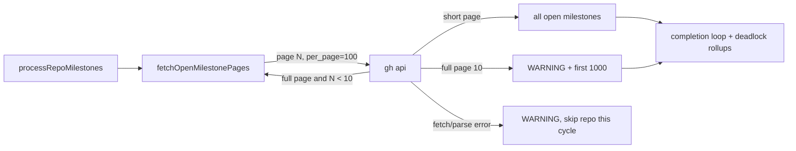

## Summary

The milestone-completion scan (`processRepoMilestones` in `worker/deno/lib/milestone_completion.ts`) listed milestones with a bare `gh api repos/<repo>/milestones`. GitHub returns 30 milestones per page by default, so on a repository with more than 30 open milestones, any milestone past the first page got no tracker and no final PR, was never closed, and was absent from the `openMilestones` list that `raiseDeadlockPartialRollups` receives.

The scan now calls a new helper, `fetchOpenMilestonePages` (`worker/deno/lib/open_milestone_pages.ts`). It requests `repos/<repo>/milestones?state=open&per_page=100&page=N` and stops at the first page with fewer than 100 milestones. It reads at most 10 pages. If the 10th page is also full, it logs a `WARNING` naming the repository and returns the 1,000 milestones it read. A listing that fails used to return silently; it now logs `WARNING: could not list open milestones for <repo> — skipping milestone check: <cause>`. Closes #3609.

## Spec

### Intent and Rationale

- The default page of 30 left every later open milestone out of completion and out of deadlock detection, and nothing logged that they were missing. Paging the list fixes both, because both read the same `milestones` array.
- The helper follows the bounded-page pattern in `worker/deno/lib/issue_comment_pages.ts`: explicit pages of 100, stop on a short page, hard cap. Unlike that module, hitting the cap logs a warning instead of throwing, as the issue asks. The scan can still handle the first 1,000 milestones, and the truncation shows in the log.

### Essential Design Decisions

- A page that fails to fetch or parse throws, and the scan skips the repository for this cycle after logging the cause. It never processes part of a list that broke midway.
- At the cap, the 1,000 milestones already read are processed. A warning is better here than throwing, because throwing would leave all of them unhandled.

### Undiscoverable Facts

- GitHub's list-milestones endpoint defaults to `state=open`, 30 per page, sorted by `due_on` ascending, and `per_page` is capped at 100. These figures come from the issue and GitHub's REST documentation for "List milestones". No live repository with more than 30 open milestones was available to observe.

## Evidence

Backend-only change, so there are no screenshots.

- `worker/deno/tests/open_milestone_pages_3609_test.ts::checkAndHandleMilestoneCompletions - processes a milestone on the second page of open milestones (Issue #3609)`: page 1 holds 100 filler milestones and page 2 holds `v2.0`. The test asserts that one summary PR is raised and that its title contains `v2.0`. With the call site in `milestone_completion.ts` reverted to the base version, it fails with `0 vs 1`.
- The unit tests for `fetchOpenMilestonePages` cover page arguments, a single short page, multiple pages in order, the cap (exactly 10 requests and one `WARNING`), an empty body, a non-array body, and a failure on page 2.
- 13 existing stubs matched the list call with `endsWith("/milestones")` or `/\/milestones$/`. They now match `/\/milestones(\?|$)/`, which accepts both the old URL and the paged one. The data each stub returns is unchanged.
- `docs/audits/lib-sweep-coverage/top-up-3609.json` adds the new module to a sweep slice, which `worker/deno/tests/lib_sweep_coverage_test.ts` requires.

**Docs sweep** — grep: `repos/${repo}/milestones`, `repos/<repo>/milestones`, "List open milestones", "open milestones", "milestone completion"; section: `docs/workflows/milestones.md#-milestone-completion`; siblings: none — no existing set gained a member; updated: `docs/workflows/milestones.md` (one paragraph on paging, the 1,000 bound and the warning); `docs/GH-API-OPTIMISATION.md:241` — still true because it describes the milestone branch sync's listing, which this change does not touch; `worker/deno/lib/milestone_health.ts:425`, `worker/deno/lib/milestone_branch_sync.ts:1112`, `worker/deno/lib/idle_task_milestone.ts:96` — still true because they are separate listers this issue leaves alone.

## Test Plan

- Added `worker/deno/tests/open_milestone_pages_3609_test.ts`, 9 tests. Result: `ok | 9 passed | 0 failed`.
- Red checks:
  - Reverting only the `processRepoMilestones` call site turns two tests red: the second-page test (`0 vs 1`) and the failed-listing test.
  - Removing only the cap `log(...)` turns the cap test red (0 warnings, expected 1).
- Edited stub matchers in `worker/deno/tests/milestone_completion_test.ts` (12), `worker/deno/tests/milestone_completion_cache_test.ts`, `worker/deno/tests/milestone_tracker_identity_test.ts` and `worker/deno/tests/milestone_sync_pr_retirement_test.ts`. Only the URL-matching condition changed; no assertion was removed or changed. Result: `milestone_completion_test.ts` plus the new file gave `148 passed | 0 failed`, and the other three files gave `39 passed | 0 failed`.
- `./quality.sh < /dev/null`, run on the final code: `Result: PASSED (with skipped checks)`. Only `config integration` was skipped, which is that check's normal state on this host. An earlier run failed on `lib_sweep_coverage_test.ts` because the new module was unclaimed; `top-up-3609.json` fixed that. The only commit after the passing gate run edits a doc comment in the new test file; that file was re-run afterwards (`9 passed | 0 failed`).
- Callers checked: `processRepoMilestones` is the only caller of `fetchOpenMilestonePages`. `raiseDeadlockPartialRollups` receives `milestones.map((m) => m.title)` from the same paged array.

<!-- vibe-branch-outcomes -->

🤖 Generated with [Claude Code](https://claude.com/claude-code)
