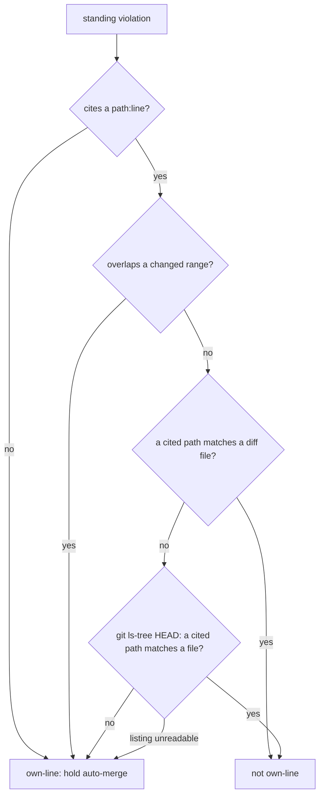

## Summary

The #3382 standing-violation guard now fails closed when a standing
violation's cited path resolves to nothing. `ownLineStandingViolations`
counts a standing violation as on the branch's own lines when none of its
cited paths matches a file in the diff or a file at `HEAD`, the same as the
no-citation case it already failed closed on. `citedLocations` also keeps a
backticked path with spaces whole, so
`` `worker/deno/lib/run callback telemetry.ts:100-112` `` stays unplaceable
instead of shrinking to `telemetry.ts`, a tail that could match a real file.
The issue prompt now asks for the repo-relative path exactly as
`git diff --name-only` prints it. Closes #3613.

## Spec

### Intent and Rationale

- PR #3611 was raised with three outstanding own-line violations, all citing a
  path with its underscores rewritten as spaces. `LOCATION_RE` kept only the
  tail `telemetry.ts`, which matched no diff file, so the guard armed
  auto-merge and added no `standing-violation` label.
- Failing closed on an unplaceable path gives the same answer as the existing
  no-citation rule. A citation of a real file that the diff leaves unchanged
  keeps today's answer (not own-line), so a genuine `pre-existing` breach is
  not held.

### Essential Design Decisions

- The HEAD listing (`git ls-tree -r -z --name-only HEAD`) is read only when
  some standing violation cites a location and none of its citations names a
  diff file. When that listing fails, every standing violation is returned
  with `notChecked` set (fail closed), as for an unreadable diff.
- `headFiles` is a required parameter of `ownLineStandingViolations`, so no
  caller can drop the new rule by omission. Paths match the diff and `HEAD`
  by the same exact-or-suffix rule (`pathMatches`).
- A spaced path is joined only inside an open backtick span whose prefix is
  path characters and spaces. A prefix with `:` or `,` (two citations in one
  span) is not joined.
- The Standards reviewer agent's own system prompt
  (`issue_executor_agents.ts`) is unchanged, because a fixture pins it byte
  for byte. The reviewer still gets the literal-path instruction, because the
  issue prompt's reviewer brief now tells the advisor to ask for it.

### Undiscoverable Facts

- The issue's reproduction ran the real `pr-summary-3603.md` and PR #3611's
  diff against `main`. `ownLineStandingViolations` returned 0 even though the
  diff changed `run_callback_telemetry.ts` lines 81-114, which covers every
  cited range.

## Evidence

This is a backend change with no UI. Tests:

- `worker/deno/tests/standing_violation_routing_test.ts::ownLineStandingViolations - a path rewritten with spaces fails closed (Issue #3613)`
  is the issue's regression test (evidence
  `` `worker/deno/lib/run callback telemetry.ts:100-112` ``, diff changing
  `worker/deno/lib/run_callback_telemetry.ts` 81-114). It passes with a head
  set that also contains `worker/deno/lib/telemetry.ts`, so the old tail
  cannot match by accident.
- With the base branch's `standing_violation_routing.ts` restored and the new
  tests kept, the run gave `FAILED | 8 passed | 4 failed`: the spaced-path
  `citedLocations` test, placement rules (`missing.ts`), the rewritten-path
  test and the HEAD-listing test. All 12 pass on the head.
- Observed real tool: `git ls-tree -r -z --name-only HEAD` prints
  NUL-separated repo-relative paths (4758 here). On a bad ref it prints
  `fatal: Not a valid object name …` to stderr. The stub returns the same
  shape, and its failure case asserts that the stderr cause reaches
  `notChecked`.

**Docs sweep** — grep: `ownLineStandingViolations`, `citedLocations`,
`findOwnLineStandingViolations`, `standing-violation`, "cannot place",
"own lines", "names no `path:line`"; section:
`docs/workflows/issue-processing.md#-the-in-run-recovery-from-a-summary-rule-block`
(the **Issue #3382.** paragraph); siblings: "names no `path:line`", "the diff
cannot be read" — the existing fail-closed cases, which that paragraph lists
and which now name the new case beside them; updated:
`docs/workflows/issue-processing.md`, `prompts/issue/prompt.md`, the module
header and doc comments in `worker/deno/lib/standing_violation_routing.ts`;
`README.md:564` — still true because the label is still applied for a
violation standing on the branch's own lines, and an unplaceable one is
treated as one of those; `docs/MERGE.md:665` and
`docs/workflows/pr-feedback.md:728` — still true because they describe the
sweep honouring the label, which is unchanged; `docs/INTERNALS.md:5564` —
still true because the module's role is unchanged;
`worker/deno/lib/phases/completion_phase.ts:3136` (the "could not be placed
against the diff" log) — still true because a failed HEAD listing is a case
where the violations could not be placed.

Related existing rules checked for the prompt change: the "Every `violation`
names evidence and one of two reasons" bullet and the Standards reviewer
brief in `prompts/issue/prompt.md`, and `REVIEW_BLOCK_TEMPLATE`
(`lib/foo.ts:42`, a valid repo-relative path). None conflicts. I applied the
new literal-path rule to this PR's own diff: every `path:line` this summary
cites is written as `git diff --name-only` prints it, and nothing needed
fixing.

Issue numbers the diff adds as provenance: #3613: Standing-violation guard
(#3382) fails open when a violation's cited path matches no file, so a
self-flagged breach still auto-merges.

## Test Plan

- `worker/deno/tests/standing_violation_routing_test.ts`:
  - added: `citedLocations - a backticked path with spaces is reported whole (Issue #3613)`
  - added: `citedLocations - separate backticked paths are not joined (Issue #3613)`
  - added: `ownLineStandingViolations - a path rewritten with spaces fails closed (Issue #3613)`
  - added: `findOwnLineStandingViolations - unplaceable path checks the HEAD listing (Issue #3613)`
    covers a real unchanged file at HEAD, a missing path, `ls-tree` exiting
    128, `ls-tree` rejecting, a diff-only citation (no listing read) and an
    uncited violation (no listing read)
  - edited: `ownLineStandingViolations - placement rules` now passes the
    required `headFiles` set, which contains `foo.ts` and `other.ts`. It gains
    the `missing.ts` (fails closed), `foo.ts:40`, `lib/foo.ts:40` and
    `lib/other.ts:12` cases. It removes no assertion, and the existing
    "not in diff" assertion still pins that a citation of a real, unchanged
    file is not own-line.
  - extended: `citedLocations - hostile input returns promptly` gains a
    roughly 1,800-character spaced prefix that reaches the prefix regex.
- `worker/deno/tests/standing_violation_3613_test.ts` (new) is a drift test
  pinning two phrases in the issue prompt's "Independent Review Before the PR"
  section. `deno task drift-pins-on-base` reported both phrases absent on base
  (`exactly as \`git diff --name-only\` prints it, in backticks, never
  reworded`; `with no prose rewording (no spaces for underscores, no
  shortened directory)`). Removing each prompt sentence turned the test red.
- Red checks for the new guard: making the fail-closed operand `false`
  turned 3 tests red, and disabling the backtick join turned 2 red. Deleting
  the suffix-match operand turned placement rules red, and forcing the
  `needsHead` `cited.length > 0` operand true turned the HEAD-listing test
  red. Each change was then restored.
- No existing test stops at the new precondition: the "routing against a
  diff" test is unedited and still asserts its `git` call counts, because
  every citation there names a diff file, so the HEAD listing is not read.
- `deno task test:unit tests/standing_violation_routing_test.ts tests/standing_violation_3613_test.ts tests/standing_violation_3196_test.ts tests/issue_reviewer_agents_2575_test.ts tests/issue_executor_agents_test.ts`
  passed on the head.
- `./quality.sh < /dev/null` passed (config integration skipped, as it is
  for every local run).

<!-- vibe-branch-outcomes -->
