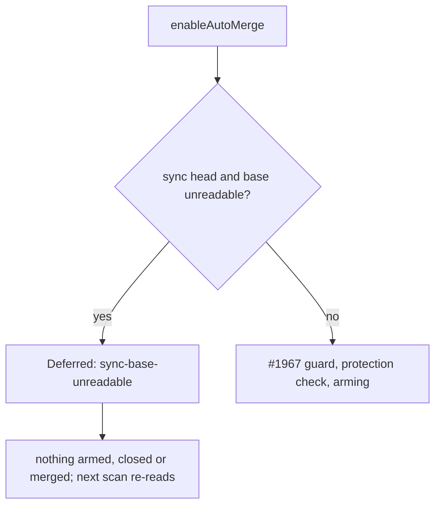

enableAutoMerge defers a milestone-sync PR whose base could not be read

Closes #3614

## Summary

`enableAutoMerge` (`worker/deno/lib/pr_auto_merge.ts`) now defers a milestone-sync head whose base could not be read, instead of arming it with `--auto`. An unreadable base is an empty `baseRefName` after a failed `gh pr view`. Before, that empty value skipped the #1967 retargeted-sync guard, so a sync PR that GitHub had retargeted onto the default branch could be armed and merged. The deferral value is `sync-base-unreadable`. The existing mapping in `worker/deno/lib/pr_maintenance.ts` classifies it as `milestone_route_unreadable`. Nothing is disarmed, closed or merged, and the next scan reads the base again.

## Spec

### Intent and Rationale

- The #1967 guard only runs when the base was read, so a failed read let the one PR it exists to stop go through. A base that cannot be compared with the default branch is a hold, not a pass.

### Essential Design Decisions

- The deferral reuses the existing `sync-base-unreadable` value rather than adding a union member. The classifier, the docs and the other two deferrals of that value (default branch unreadable, fork head) already treat it as "not armed, re-read next scan".
- The guard sits after the base read and the #3433 milestone-fix checks, and before the #1967 guard and the protection and direct-merge block. Neither `--auto` nor a direct merge can run on this path.
- Non-sync heads keep the old behaviour: an empty base still falls through for them.

### Undiscoverable Facts

- Callers that do not pass `baseRefName` rely on the internal read, so a failed read reaches this guard: `worker/deno/lib/pr_ci_processor.ts:2136`, `worker/deno/commands/pr_maintenance.ts:613`, and `worker/deno/commands/pr_manager.ts` for `enable-auto-merge` (line 256) and `finalise-pr` (line 289).

## Evidence

Backend-only change, so there are no screenshots.

- Regression test `enableAutoMerge - a sync head whose base cannot be read is deferred, never armed (Issue #3614)`: with the guard removed it fails (actual `enabled`, `--auto` issued; expected `deferred`). With the guard it passes.
- Operand `isMilestoneSyncBranch(...)` forced true: 6 tests in `worker/deno/tests/pr_auto_merge_test.ts` fail, all non-sync heads with no base (for example `pr_auto_merge - enableAutoMerge returns NotAllowed for unprotected branch`).
- Operand `!baseRefName` forced true: 5 tests fail, 4 in `worker/deno/tests/pr_auto_merge_sync_pr_retarget_test.ts` (for example `enableAutoMerge - a sync PR still targeting its milestone branch is armed as before (Issue #1967)`) and 1 in `worker/deno/tests/pr_auto_merge_test.ts` (`pr_auto_merge - the milestone sync PR is still armed while its base is behind (Issue #1779)`).
- Callers checked: `pr_ci_processor.ts:2136`, `pr_maintenance.ts:613` and `pr_manager.ts:256` and `:289` all reach the guard, because it lives in the single chokepoint `enableAutoMerge`.
- Applied the rules to this PR's own diff: nothing found.
- Guards kept on the new path: it returns before arming, so the #1967 guard, the protection check and the direct-merge gate are not bypassed. They are not reached, and no side effect occurs.

**Docs sweep** — grep: `grep -rn "sync-base-unreadable"`; section: docs/MERGE.md retargeted-sync paragraph, docs/INTERNALS.md matching paragraph, pr_auto_merge.ts deferral doc comment; siblings: `fix-base-unreadable`, `milestone-behind` — no set gained a member, the change reuses an existing deferral value; updated: docs/MERGE.md:508, docs/INTERNALS.md:4330, worker/deno/lib/pr_auto_merge.ts:464; still true: worker/deno/lib/pr_maintenance.ts:2036 (classifier mapping), worker/deno/lib/pr_auto_merge.ts:999 and :1029 (existing default-branch-unreadable and fork-head deferrals)

## Test Plan

- `deno test -A tests/pr_auto_merge_sync_pr_retarget_test.ts tests/pr_auto_merge_test.ts < /dev/null` from `worker/deno`: `ok | 71 passed | 0 failed`.
- Red check: removing the whole guard turns the #3614 test red (actual `enabled`, expected `deferred`).
- operand `isMilestoneSyncBranch(...)` forced true → 6 failed (`pr_auto_merge_test.ts`), restored → all pass.
- operand `!baseRefName` forced true → 5 failed, restored → all pass.

<!-- vibe-branch-outcomes -->

🤖 Generated with [Claude Code](https://claude.com/claude-code)
