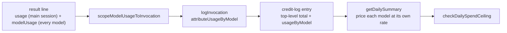

## Summary

The daily credit log, and so the daily spend ceiling and the daily credit
summary, now count a split `issue` run's sub-agent tokens, each priced at its
own model's rate. `logInvocation` takes the invocation's `modelUsage`
breakdown, splits it with the shared `attributeUsageByModel`, records each
model's share in a new `usageByModel` field and writes the top-level token
counters as the total across all models. `getDailySummary` prices each share
at its own model's rate. `claude_runner.ts` passes `runStats.modelUsage`, which
is already scoped to this invocation. Closes #3616.

## Spec

### Intent and Rationale

- On a split run the CLI's `result.usage` covers only the advisor session, so executor and reviewer tokens never reached the credit log, and the ceiling under-measured real spend.
- One entry per invocation with a new `usageByModel` field, rather than one entry per model. Several entries per invocation would inflate `totalInvocations`, `byWorker` and `byPhase`, and with them the invocation-count share the per-worker ceiling uses.

### Essential Design Decisions

- The top-level counters are the whole invocation's total across all models, so `totalTokens`, `tokensByPhase` and the daily prompt-cache hit rate include sub-agents. `tokensByModel`, `estimatedCostByModel` and `estimatedCostByPhase` come from `usageByModel`.
- Persisted shape: the change **reads the old shape** rather than bumping a key. An entry without `usageByModel`, with one that does not read cleanly, or with one stored as an array, is charged whole to its `model` from the top-level counters, so no spend is lost.
- `byModel`, the invocation counts, `modelEffortByPhase` and fallback transitions stay keyed on the billed `model`, so `tokensByModel` can name a sub-agent model that `byModel` does not.
- Attribution goes through `attributeUsageByModel` and `readModelUsageBreakdown` in `cost_estimate.ts`; nothing is copied. Any residual of the totals over the breakdown goes on the billed model.

### Undiscoverable Facts

- Credit logs written before this change count the advisor session only. A rolled-back worker reading new entries charges the full top-level total at the billed (advisor) model's rate, which over-estimates rather than drops the sub-agent tokens.

## Evidence

Backend-only change; there is no UI surface.

- `worker/deno/tests/credit_tracker_split_usage_3616_test.ts::credit_tracker - split invocation: the ceiling sees the Sonnet sub-agent spend (Issue #3616)` covers the issue's requested test. It logs an invocation whose `usage` is main-session-only and whose `modelUsage` carries Opus and Sonnet. It then asserts `tokensByModel[SONNET]`, the cross-model `totalTokens`, a total and per-phase cost equal to the Opus cost plus the Sonnet cost, and that `checkDailySpendCeiling` reports `exceeded` against a ceiling between the Opus-only cost and the full cost.
- `worker/deno/tests/credit_tracker_split_usage_3616_test.ts::claude_runner - a split run's sub-agent tokens reach the credit log (Issue #3616)` covers the `claude_runner.ts` call site through the real `runClaudeWithTimeout` path with a stub agent.
- Load-bearing fakes: none. The tests use the real `logInvocation`/`getDailySummary`/`checkDailySpendCeiling` against a temp directory. The runner test's stub prints a result line with `modelUsage` keyed by model id with camelCase counters, the shape `readModelUsageBreakdown` reads and `claude_runner_resumed_model_usage_3603_test.ts` already uses.
- `#3616: Daily spend ceiling and credit log omit sub-agent spend on split issue runs` is the only issue number this diff adds as provenance.

**Docs sweep** — grep: `tokensByModel`, `estimatedCostByModel`, `logInvocation`, "credit log", "spend ceiling"; section: `docs/MODEL-AND-CACHING.md#credit-logging`, `docs/CONFIGURATION.md#-daily-spend-ceiling`; siblings: `fallbackFrom`, `cacheReadTokens`; updated: `docs/MODEL-AND-CACHING.md` (field table gains `usageByModel`, top-level counters described as the cross-model total, daily-summary pricing, the split-run costing bullet), `docs/CONFIGURATION.md` (spend-ceiling estimate includes sub-agent tokens), doc comments in `worker/deno/lib/credit_tracker.ts`; `docs/MODEL-AND-CACHING.md:1259` — still true because fallback recording is unchanged; `worker/deno/lib/spend_ceiling.ts:42` — still true because it describes the log's creation, which is unchanged; `worker/deno/lib/context_budget.ts:363` — still true because it describes the append's symlink refusal, which is unchanged

## Test Plan

- Added `worker/deno/tests/credit_tracker_split_usage_3616_test.ts` (9 tests): split invocation priced per model and seen by the ceiling; residual charged to the billed model; no `modelUsage` leaves the entry shape unchanged; an old-shape entry priced whole at its model; an unreadable `usageByModel` falls back to the whole entry; an unreadable `modelUsage` passed to `logInvocation` falls back to the whole entry; a `usageByModel` array is not read as model ids; `modelUsage` with no `tokenUsage` writes no counters; the runner-level call-site test.
- Red checks: removing the `modelUsage` argument from the `claude_runner.ts` `logInvocation` call turned the runner test red (`undefined` vs `9000`). Making `entryUsageByModel` ignore `usageByModel` turned the split-invocation test red (`tokensByModel[SONNET]` undefined). Dropping the `Array.isArray` guard turned the array test red (key `"0"` where `claude-opus-5-5` was expected). Deleting the `&& modelUsage` operand and the `tokenUsage &&` operand: results are in the branch-outcomes facts file.
- No existing test was edited, and no assertion was removed.
- Related suites, `deno test -A --frozen --lock=deno.lock` from `worker/deno`: `tests/credit_tracker_split_usage_3616_test.ts`, `tests/credit_tracker_test.ts`, `tests/unpriced_spend_3870_test.ts`, `tests/spend_ceiling_3684_test.ts`, `tests/agent_provider_per_invocation_test.ts`, `tests/claude_runner_test.ts`, `tests/credit_summary_command_test.ts`, `tests/credit_log_symlink_1239_test.ts`. All passed.
- `./quality.sh < /dev/null` passed on the final head (config integration is skipped in this environment).
- Fields added to non-test code: `LogInvocationOptions.modelUsage` is set by `claude_runner.ts`, and `InvocationEntry.usageByModel` is read by `getDailySummary` via `entryUsageByModel`.

<!-- vibe-branch-outcomes -->

🤖 Generated with [Claude Code](https://claude.com/claude-code)
