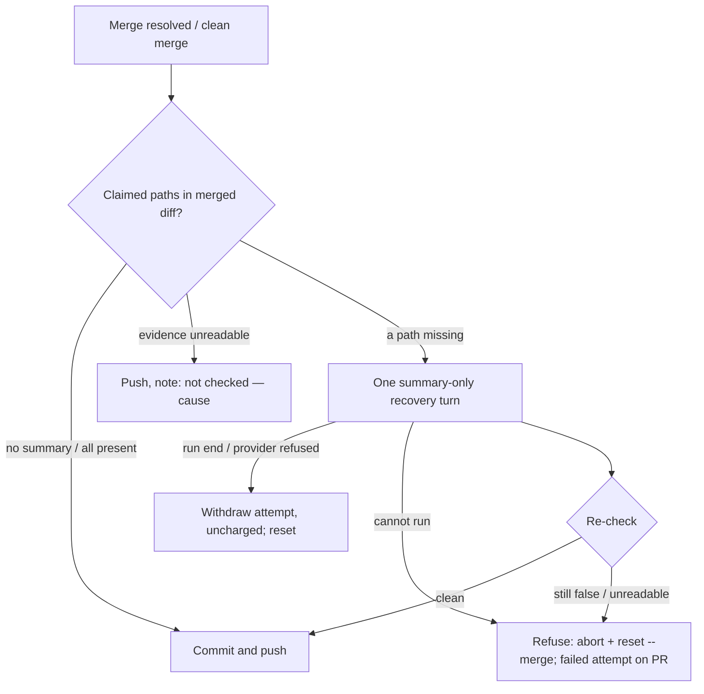

# PR Summary — Issue #3617

## Summary

The merge-conflict pass now checks a PR summary against the merged diff before it pushes. When the base branch already carries part of a PR's change, that part drops out of the PR's diff, but the summary kept claiming it (GRQ-validation#904 and a private fleet PR). Two checks now catch this:

- **In the merge-conflict pass.** After the merge is resolved, or the clean merge is made, the worker reads the paths each changed PR summary claims and compares them with the merged tree. Those paths are the quoted paths after `updated:` in the Docs sweep line, and the path that opens each item under a Changes-style heading. Any claimed path the merged tree does not change gets one recovery turn. That turn may rewrite only the summary. If the summary is still false afterwards, the push is refused, the local merge is reset, and the failure is recorded on the PR.
- **In the docs-sweep gate.** `validateDocsSweep` now flags a quoted `updated:` path that the branch's diff does not change.

Closes #3617.

## Spec

### Intent and Rationale

- Step 5 of the merge-conflict prompt was not enough on its own: the private fleet PR of 2026-10-11 broke it. A deterministic check before the push is the only point at which a false summary can still be kept out of the PR body.
- The check stays deterministic, comparing claimed paths with changed paths. It makes no model call. The fleet failures were whole files dropping out of the diff, and a path comparison catches exactly that.

### Essential Design Decisions

- The changed set is the working tree against `origin/<base>` plus untracked files, which is what `git add -A` commits. It therefore includes staged resolutions as well as unstaged recovery edits.
- **Unreadable evidence.** When the first check cannot read its evidence, it reports `not checked — <cause>` on the resolved comment and in the log, and the push still goes ahead. When the claim was already found false, an unreadable re-check refuses the push, so the gate fails closed.
- **Refused or cut-short gate.** The worker runs `git merge --abort` and then `git reset --merge` back to the pre-merge head. Otherwise the next pass would find the base already merged in and take the stale-verdict nudge push, publishing the false summary anyway.
- **No reuse of `recoverFromSummaryRuleBlock`.** The recovery turn copies that helper's shape (one turn, then a re-check) but does not call it. That helper takes the issue run's `IssueContext`/`PhaseState`, and its prompt tells the agent to commit. The merge pass's contract is that the agent only stages and the worker writes the merge commit.

### Undiscoverable Facts

- The trusted triage comment on #3617 asked for `not checked` to be reported explicitly when the evidence cannot be read. That is why an unreadable first check proceeds with a stated reason rather than blocking the PR.

## Evidence

Backend/worker change; no UI files are touched.

- `worker/deno/lib/merge_summary_claim_check.ts` contains the check (`checkMergedSummaryClaims`), the fenced recovery prompt and the gate (`gateMergedSummaryClaims`).
- `worker/deno/lib/summary_claimed_paths.ts` contains the pure extraction of claimed paths. Its scans are linear, and `assertLinearGrowth` tests guard that.
- `worker/deno/lib/pr_merge_conflict_processor.ts` wires the gate into `resolveConflict` before `commitAndPushPending` and adds `restoreBeforeMerge`.
- `worker/deno/lib/merge_conflict_agent.ts` adds `promptOverride`, so the recovery turn runs under the same bounds and outcome classification as the resolution agent.
- `worker/deno/lib/docs_sweep_gate.ts` adds rule 9: an `updated:` path must be in `changedFiles`.
- `messageOf` is now exported from `worker/deno/lib/repo_loop_quota_stop.ts` instead of being copied, and `firstStderrLine` is shared with `restoreBeforeMerge`.
- **Real git behaviour.** The tests in `worker/deno/tests/merge_summary_claim_check_test.ts` run real `git` in a temporary repository:
  - The base lands the same doc edit, and `git merge` drops `docs/x.md` from `git diff --name-only origin/main`.
  - A conflicted merge is checked on its staged resolution.
  - An unresolvable base ref surfaces git's own first stderr line (`fatal: bad revision …`).
- Issue numbers this diff cites:
  - #3617: Merge-conflict pass pushes PR summaries that claim changes the base merge absorbed: no claim check runs after it (GRQ-validation#904 and a private fleet PR).
  - #3027: Re-derive PR summaries from the final head diff (#3015).
  - GRQ-validation#904: chore: routine version bump (0.1.40 -> 0.1.41 / dashboard 1.1.119 -> 1.1.120).

**Docs sweep** — grep: `validateDocsSweep`, `updated:`, "Keep the PR summary true", `restoreBeforeMerge`, `messageOf`, "git reported no output"; section: `docs/workflows/merge-conflicts.md#-the-summarys-claims-are-checked-against-the-merged-diff-issue-3617`; siblings: `siblings:`, `buildStageTimingSection`, `summary_claim_check.ts`; updated: `docs/workflows/merge-conflicts.md`, `docs/workflows/issue-processing.md`, `docs/workflows/pr-feedback.md`, `docs/INTERNALS.md`, `CODING-STANDARDS.md`, `prompts/issue/prompt.md`, `prompts/merge_conflict/prompt.md`; `worker/deno/lib/pr_merge_conflict_processor.ts:1945` — still true because that "git reported no output" fallback belongs to a different push-failure path this change does not touch

## Acceptance Criteria

<!-- vibe-spec-review inputs="diff+issue-body" -->

- **met** — Deterministic check after the merge-conflict pass: compare the summary's claimed paths with the merged diff; give a missing path one recovery turn on the same `recoverFromSummaryRuleBlock` shape; refuse the push if the claim is still false; record the failure on the PR — evidence: `worker/deno/tests/pr_merge_conflict_processor_test.ts::processMergeConflict - a recovery turn that leaves the false claim refuses the push and restores the head (Issue #3617)`, `worker/deno/tests/merge_summary_claim_check_test.ts::gateMergedSummaryClaims - a claim still false after the recovery turn refuses (Issue #3617)` — reviewer: met — reason: the reviewer flagged that `recoverFromSummaryRuleBlock` itself is not called; it is bound to the issue run's `IssueContext`/`PhaseState` and its prompt tells the agent to commit, which breaks the merge pass's staging-only contract, so the same shape (one turn, then a re-check) is implemented for the merge pass
- **met** — Check `updated:` paths against the diff in `validateDocsSweep`: a path after `updated:` that is not in `changedFiles` is a finding, and a path cited only as evidence is not — evidence: `worker/deno/tests/docs_sweep_gate_test.ts::validateDocsSweep - an updated: path the base branch absorbed is named as unbacked`, `worker/deno/tests/docs_sweep_gate_test.ts::validateDocsSweep - a path cited only as evidence is not an updated: problem` — reviewer: met — reason: the reviewer noted that a docs-only diff is not checked, because the gate is not applicable there; rule 9 applies only where the gate applies, as `docs/workflows/issue-processing.md` states
- **met** — Tests: a fixture where the base side already carries a file from the summary's `updated:` list; the check flags it after the merge and passes once the summary drops the claim — evidence: `worker/deno/tests/merge_summary_claim_check_test.ts::checkMergedSummaryClaims - a claim the merged base already carries is false, the backed one is not (Issue #3617)`, `worker/deno/tests/merge_summary_claim_check_test.ts::checkMergedSummaryClaims - rewriting the false claim out of the summary makes it clean (Issue #3617)` — reviewer: met
- **unrequested** — `promptOverride` on `runMergeConflictAgent` — reviewer: unrequested — reason: the recovery turn needs its own prompt under the resolution agent's bounds
- **unrequested** — the resolved comment's summary-claim note and the not-checked route — reviewer: unrequested — reason: the trusted triage comment asked for `not checked` to be reported explicitly
- **unrequested** — the prompt lines in `prompts/issue/prompt.md` and `prompts/merge_conflict/prompt.md`, the `buildDocsSweepGateComment` instruction, and the doc and `INTERNALS.md` rows — reviewer: unrequested — reason: a code change owes a docs change, and the agents have to know what the new checks enforce
- **unrequested** — the lib-sweep top-up record, the wall-clock manifest entry, and the `describeNames` generalisation — reviewer: unrequested — reason: repository bookkeeping for new modules and growth tests, plus a shared renderer for the new message

## Standards Review

<!-- vibe-standards-review inputs="diff+CODING-STANDARDS.md" -->

- **violation** — Never fail silently: an unreadable first check proceeds — evidence: `worker/deno/lib/merge_summary_claim_check.ts:420` — reason: required by #3617 — the trusted triage comment on #3617 requires `not checked` to be reported explicitly rather than blocking, and **Writing a gate over text** allows input that cannot be checked to be "reported as not checked, never a clean pass"; the route logs a warning and writes `not checked — <cause>` on the PR, and a false claim whose re-check is unreadable still refuses
- **violation** — Call the existing owner: a private `messageOf` was copied — evidence: `worker/deno/lib/merge_summary_claim_check.ts:128` — reason: fixed in this diff (the owner in `repo_loop_quota_stop.ts` is exported and imported)
- **violation** — Call the existing owner: the first-stderr-line logic was re-implemented — evidence: `worker/deno/lib/pr_merge_conflict_processor.ts:523` — reason: fixed in this diff (`firstStderrLine` is exported and reused)
- **clean** — Review-enforced rules checked:
  - Australian English.
  - No assertion is removed from an existing test.
  - Nothing exists only for a test to read.
  - Every named test exists.
  - No source-grep tests.
  - No fixed `/tmp` paths.
  - No shallow-history assumptions.
  - New preconditions do not stop existing tests short.
  - No stub of another repository's binary that is more permissive than the real one.
  - No workflow changes.
  - Optional, not chased: `git merge --abort` in `restoreBeforeMerge` deliberately ignores its exit. The checked `reset --merge` that follows it is what restores the head.

## Test Plan

- Added `worker/deno/tests/merge_summary_claim_check_test.ts` and `worker/deno/tests/summary_claimed_paths_test.ts`.
- Extended `worker/deno/tests/docs_sweep_gate_test.ts` and `worker/deno/tests/pr_merge_conflict_processor_test.ts`.
- Edited the fixture input of `worker/deno/tests/prompt_docs_sweep_siblings_3371_test.ts`, which now passes `changedFiles: ["worker/deno/lib/x.ts", "docs/workflows/retries.md"]`. The documented example lists that doc after `updated:`. No assertion was removed and no expected value changed.
- Edited existing tests (fixture inputs only):
  - `docs_sweep_gate_test.ts`: one `changedFiles` list gains the doc its example names.
  - The processor stub writes summaries under a created directory.
  - The `a recovery turn that leaves the false claim…` test gained a recording logger, plus an assertion that a successful reset logs no error.
  - No assertion was removed from any existing test.
- **Red checks.** Each new test was seen red with only its guarded code broken; see the facts file. These include:
  - the singular "it" wording;
  - the `ls-files` failure;
  - the summary size cap;
  - the provider-refused recovery turn;
  - the failed reset, and its error log.
- Two conditions were removed as redundant because flipping each left the suite green: `line.present &&` in `validateDocsSweep`, and a duplicate `summaries.length === 0` return in `checkMergedSummaryClaims`.
- Targeted run on the final head: `deno task test:unit tests/merge_summary_claim_check_test.ts tests/summary_claimed_paths_test.ts tests/docs_sweep_gate_test.ts tests/pr_merge_conflict_processor_test.ts tests/prompt_docs_sweep_siblings_3371_test.ts tests/merge_conflict_agent_test.ts tests/repo_loop_quota_stop_test.ts` passed.

<!-- vibe-branch-outcomes -->
