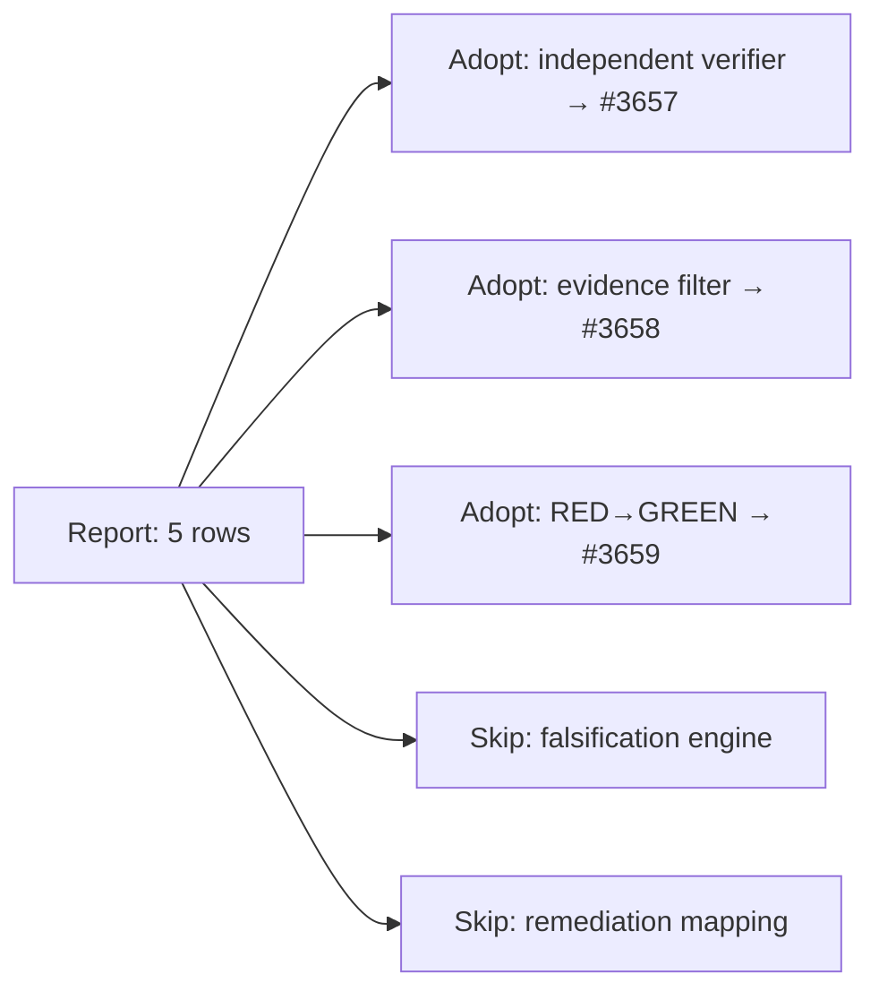

## Summary

Adds `docs/security/vulnhunter-methodology-evaluation.md`, a written evaluation of five VulnHunter defensive techniques against VibeCoder's security-fix gate, whole-tree sweep and code-scanning feed. It also adds an index row in `docs/security/README.md` and a source row in `docs/REFERENCES.md`. There are no worker code changes. The verdicts are three adopts, each with one filed follow-up (#3657, #3658, #3659), and two skips. Offensive techniques are listed under "Deliberately excluded". Closes #3623.

## Spec

### Intent and Rationale

- The grill-me rounds on #3623 settled on a report, not code: five rows, each reading VulnHunter does → VibeCoder has today → gap → adopt/skip, judged against #3512 and #3615.
- Each adopt removes a place where a run grades its own security claim:
  - the `TRIGGER_CLOSED` prose regex (#3657);
  - 10-character `falsePositives` reasons with no cited defence (#3658);
  - fail-before/pass-after accepted from summary prose (#3659).
- The falsification engine is skipped. In VibeCoder an "eliminated" verdict would silence a finding no human sees. The useful part, "an elimination must cite evidence", is adopted in row 3 instead.

### Essential Design Decisions

- No row claims to close #3512 or #3615 outright. Both are fleet-wide, and these techniques act on the three security surfaces only. Each follow-up states how its new check fails closed, so it does not add a #3615 instance.
- VulnHunter is cited at a pinned commit (`b91b81e6`) and VibeCoder at base `dd497e46`, so the `file:line` citations stay checkable.

### Undiscoverable Facts

- Older code comments in this repo cite #3657, #3658 and #3659 from an earlier tracker, for example `security_scanner.ts:82`. The report says so, because the numbers now name the follow-ups filed in this run.
- The sweep's PR job (`.github/workflows/security-tree-sweep.yml`) reads the baseline from the PR's own checkout. That is why a 10-character `falsePositives` entry can turn a PR's own sweep green, which is the #3658 gap.

## Evidence

Docs-only change, with no CLI or UI surface. Every VibeCoder `file:line` citation was checked against head by both reviewers. VulnHunter citations were checked against a clone at `b91b81e6`.

Follow-up issues filed in this run, after a dedup search for "trigger-closed", "security fix independent verifier", "falsePositives baseline reason evidence", "discrimination evidence" and "VulnHunter" found no open match:

- #3657: Security-fix gate: replace the agent-written trigger-closed prose with an independent read-only verifier verdict
- #3658: Security tree sweep: falsePositives baseline entries must cite the eliminating defence as a resolvable path:line
- #3659: Security-fix gate: execute the named test against base production files and require red→green (discrimination evidence)

Other issue numbers the diff cites, each viewed with `gh issue view` in this run:

- #3512: Fleet PRs silently edit, loosen or delete an unrelated failing check to turn the gate green
- #3613: Standing-violation guard (#3382) fails open when a violation's cited path matches no file
- #3615: Fleet guards skip themselves when their input read fails
- #3623: Evaluate what VibeCoder can adopt from VulnHunter's security methodology

**Docs sweep** — grep: `VulnHunter`, "docs/security/", `ghostcommit-canary-tests`, `cloudflare-security-audit-gap-analysis`; section: `docs/security/README.md` (report index) and `docs/REFERENCES.md` (security sources table); siblings: `cloudflare-security-audit-gap-analysis`, `ghostcommit-canary-tests`, "visa/visa-vulnerability-agentic-harness"; updated: `docs/security/README.md`, `docs/REFERENCES.md`. Hits left in place: `worker/deno/tests/readme_docs_reachability_test.ts:11` is still true, because "the four `docs/security/` reports" describes the Issue #3598 set that was orphaned before; `SECURITY.md:44` is still true, because it links one specific report, not a list.

## Acceptance Criteria

<!-- vibe-spec-review inputs="diff+issue-body" -->

- **met** — Deliverable: one Markdown report under `docs/` (e.g. `docs/security/`), landed via a normal PR — no worker code changes. — evidence: `docs/security/vulnhunter-methodology-evaluation.md` — reviewer: met
- **met** — Surfaces compared: `worker/deno/lib/security_fix_gate.ts`, `worker/deno/lib/security_tree_sweep.ts`, `worker/deno/lib/alert_feeds/code_scanning_alerts.ts` only. — evidence: `docs/security/vulnhunter-methodology-evaluation.md` "Sources compared" — reviewer: met
- **met** — Exactly five technique rows: falsification engine, independent verifier, evidence/capability filter, evidence-backed remediation mapping, test-first RED→GREEN. — evidence: `docs/security/vulnhunter-methodology-evaluation.md` sections 1–5 — reviewer: met
- **met** — Each row reads: what VulnHunter does → what VibeCoder has today → gap → adopt/skip with rationale. — evidence: `docs/security/vulnhunter-methodology-evaluation.md` per-row headings — reviewer: met
- **met** — Each row cites at least one named VibeCoder function (file:line) in the three files and the VulnHunter source file or doc section the technique comes from. — evidence: `docs/security/vulnhunter-methodology-evaluation.md`; citations checked against head and the VulnHunter clone — reviewer: met
- **met** — Each row's verdict states whether adopting it closes #3512 (check-gaming) or #3615 (fail-open guards), or neither. — evidence: `docs/security/vulnhunter-methodology-evaluation.md` "Verdicts at a glance" and each verdict — reviewer: met
- **met** — Offensive techniques (PoC generation, exploit validation, measured-impact PoCs) appear only in a "Deliberately excluded" section, one line each, no rows. — evidence: `docs/security/vulnhunter-methodology-evaluation.md` "Deliberately excluded" — reviewer: met
- **met** — Each adopt verdict produces exactly one filed follow-up issue, linked from its row in the report. — evidence: #3657, #3658 and #3659, linked from rows 2, 3 and 5 — reviewer: met
- **unrequested** — `docs/security/README.md` index row — reviewer: unrequested — reason: `worker/deno/tests/readme_docs_reachability_test.ts` requires the security index to list every report
- **unrequested** — `docs/REFERENCES.md` VulnHunter row — reviewer: unrequested — reason: that page credits every external source a security analysis is built on; the sibling Cloudflare, Anthropic and Visa analyses each have a row
- **unrequested** — "Verdicts at a glance" table, Mermaid diagram and pinned-commit provenance — reviewer: unrequested — reason: presentation aids that keep the five rows and their citations checkable, as the repo's Visual Documentation standard asks
- **unrequested** — the paragraph noting that older code comments reuse #3657–#3659 — reviewer: unrequested — reason: added after the first Standards review mistook those comments for the follow-ups

## Standards Review

<!-- vibe-standards-review inputs="diff+CODING-STANDARDS.md" -->

- **violation** — An issue number cited as provenance is one you looked up (the first review read #3657–#3659 as clashing with older code comments) — evidence: `docs/security/vulnhunter-methodology-evaluation.md:48` — reason: fixed in this diff (follow-ups linked by full URL and title; the older-comment reuse is stated)
- **violation** — Absolute claim without backing code ("the sweep is deterministic by design", although its worker-scan source is Claude-driven) — evidence: `docs/security/vulnhunter-methodology-evaluation.md:99` — reason: fixed in this diff (scoped to deduplication, classification and report, citing `security_tree_sweep.ts:28-31`)
- **clean** — The final re-review found no violations. It checked file:line citations against head in all three files, absolute words and closed lists, behaviour of other issues not described as present (diagram labelled "planned"), issue-number provenance, "A named test must exist" (no test named), and Australian English. No test assertions were removed or changed.

## Test Plan

- No tests added or changed. This is a docs-only diff.
- `deno test --allow-read --allow-env tests/readme_docs_reachability_test.ts` (from `worker/deno`): 3 passed, 0 failed on the final head. This includes "the security index lists every docs/security report", which covers the new report.
- `deno test -A` on `worker/deno/tests/references_doc_test.ts`, `references_refresh_command_test.ts`, `references_refresh_test.ts` and `references_source_probe_test.ts`: 16, 8, 24 and 19 passed, 0 failed, on the final head.
- `npx --no-install markdownlint-cli2` over the repo's configured globs: 0 issues on the final head.
- `deno run -A mod.ts check-mermaid --script-dir <repo>`: PASSED (1298 files, 1255 blocks) after the review-fix commit. The later `docs/REFERENCES.md` commit adds no Mermaid block.
- `./quality.sh < /dev/null`: exit 0, run on commit `c52c230f`. The later two commits are docs-only, and their markdownlint, mermaid and docs tests were re-run as listed above.

**Branch outcomes:** none added
