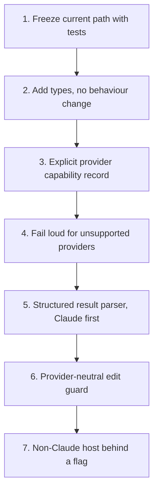

# PR Summary — Issue #3641

Closes #3641

## Summary

Documents the current manager-worker path and a provider-neutral target contract in `docs/MANAGER-WORKER-CONTRACT.md`, and adds a contract test that pins what the worker hands the Claude CLI today. No runtime behaviour or default changes. The branch also carries two WIP checkpoint commits (`80b7d4fb`, `c2b926dd`): their code hunks are comment-only, and their other hunks are cross-links to the new contract doc. A later commit finishes those comment fixes in `worker/deno/lib/phases/execute_phase.ts` and `worker/deno/lib/execute_claude_phase.ts`, and corrects the same stale wording in `docs/CONFIGURATION.md` (`issue_executor_split` row).

## Spec

### Intent and Rationale

The issue asks for an audit of the current advisor/executor path and a target manager-worker contract before any provider-neutral refactor. The aim is that a refactor cannot change the Claude `--agents` path, the default behaviour or unattended self-healing without a test failing.

### Essential Design Decisions

- Documentation first, no behaviour change. The target contract (sections 4, 5 and 6 of the doc) is marked as target and is not implemented here.
- The current path is pinned by tests that call the real functions (`worker/deno/tests/manager_worker_contract_3641_test.ts`), not by greps of source text.
- The known gap is recorded, not fixed: Codex, Gemini and DeepSeek do not carry `agents` or `settingsJson`, and the fail-loud invariant is a follow-up.
- Astra and Sol availability is a per-host prerequisite (CLI installed, account entitled), checked before use and never assumed (doc section 2).

### Undiscoverable Facts

- The advisor/executor block is not gated on provider. `isIssueExecutorSplitEnabled` takes the phase, repo and host config only (`worker/deno/lib/issue_executor_split.ts:42-59`). Its only provider gate is the Claude `PreToolUse` hook (`worker/deno/lib/claude_runner.ts:1211`). So the split prompt block renders on Codex, Gemini and DeepSeek, while those providers drop `agents` (Codex, Gemini) or `settingsJson` (DeepSeek) without an error (`worker/deno/lib/agent_provider.ts:1120-1132` for DeepSeek).
- Setting `issue_executor_split: false` and `issue_reviewer_agents: false` does not remove `--agents`. The explorer definition is still added on the default `haiku` tier (`worker/deno/lib/issue_executor_agents.ts:420-434`). A full rollback also needs `issue_sub_agent_tier: "sonnet"`.
- Session resume is filtered by provider (`worker/deno/lib/session_resume.ts:233-247`): a record tagged with another `providerId` is dropped. Legacy records with no `providerId` are accepted only for claude and deepseek.

## Evidence

Rollout order from the contract (section 9):

Step 1 is this PR. Steps 2 to 7 are not started.

**Docs sweep** — grep: `issue_executor_split`, `issue_reviewer_agents`, `agent_id`, "Sonnet by default", "Off — the default", "off by default until", "default: false"; section: `docs/MANAGER-WORKER-CONTRACT.md` (section 3 audit, section 6 permissions, section 7 compatibility matrix, section 8 rollout), `docs/CONFIGURATION.md#issue_executor_split`; siblings: `issueExecutorSplit`, `issueReviewerAgents`, `issueSubAgentTier` (the three existing switches the contract documents; no new switch is added); updated: `docs/MANAGER-WORKER-CONTRACT.md` (the edit-guard sentences now name the advisor run-record exception, `issue_executor_enforcement.ts:142-145`; line citations into the two edited phase files moved with the comment fixes), `docs/CONFIGURATION.md` (`issue_executor_split` row: off still passes `--agents` for the reviewers or the Haiku-tier explorer, and the guard allows the advisor's own run-record files). Hits read and left unchanged because they hold at the head: `docs/MODEL-AND-CACHING.md:334`, `:600`, `:674-675`, `:818-820`, `:838`, `:1713`, `docs/CONFIGURATION.md:489-490`, `:4597`, `docs/CUSTOM-PROMPTS.md:271`. The "default: false" hits left in `worker/deno/lib/execute_claude_phase.ts` are other features (Graft, CodeGraph, RTK). Hits under `docs/archive/pr-summaries/*` and `docs/audits/*` are historical and are left unchanged.

## Acceptance Criteria

<!-- vibe-spec-review inputs="diff+issue-body" -->

- **partial** — Audit current provider adapters, prompts, tools, hooks, session persistence, review gates and per-host configuration. — evidence: `docs/MANAGER-WORKER-CONTRACT.md` section 3 (adapters, tools, hooks, prompt templates, per-host flags) and section 5 (session persistence); review gates are covered only as the reviewer sub-agents and the `issue_reviewer_agents` flag; the PR-level review gate (`worker/deno/lib/pr_review_claim_lease.ts`) has one bullet in section 5 and is not audited — reviewer: partial
- **met** — Specify role contracts (manager, executor, reviewer), the task envelope and structured result, with retries, cancellation, timeouts, leases and recovery. — evidence: `docs/MANAGER-WORKER-CONTRACT.md` section 4, "Role contracts" and "Task envelope and structured result" — reviewer: met
- **met** — Define permissions: manager read-only, executor scoped workspace, no recursive delegation, no credential leakage between providers. — evidence: `docs/MANAGER-WORKER-CONTRACT.md` section 6 (manager read-only; no recursive delegation, with `Agent` disallowed at `worker/deno/lib/issue_executor_agents.ts:114`, `:214` and `:349`; executor `workspaceDir` scoping; per-provider credential isolation) — note: met as documentation; workspace scoping and non-Claude delegation enforcement remain targets, not implemented — reviewer: met
- **partial** — Define feature-flagged rollout, compatibility matrix and rollback; no unsupported provider silently gets Claude `--agents`. — evidence: `docs/MANAGER-WORKER-CONTRACT.md` sections 7 and 8 — reason: the matrix and rollback are documented, but Codex, Gemini and DeepSeek drop `agents` or `settingsJson` silently, and the fail-loud invariant is a target, not implemented (section 8) — reviewer: partial
- **met** — Explicitly distinguish vendor, provider CLI, model and subscription entitlement; Astra and Sol availability is a prerequisite to validate, not an assumption. — evidence: `docs/MANAGER-WORKER-CONTRACT.md` section 2, "Host-validated prerequisite" — reviewer: met
- **met** — Document existing vs target behaviour and incremental implementation order. — evidence: `docs/MANAGER-WORKER-CONTRACT.md` section 3 (existing), sections 4 and 5 (target), section 9 (order) — reviewer: met
- **met** — Contract fixtures and compatibility tests protect the current Claude path. — evidence: `worker/deno/tests/manager_worker_contract_3641_test.ts` (10 tests, all passing) — reviewer: met
- **met** — No default routing changes; no disruption to running hosts. — evidence: `docs/MANAGER-WORKER-CONTRACT.md` section 8, "No default change"; the code hunks are comment-only — reviewer: met
- **unrequested** — README docs-table row and see-also lines in `docs/MODEL-AND-CACHING.md` and `docs/PROVIDER-PARITY.md`. — reviewer: unrequested — reason: justified; these link the new contract doc from the README index and the two manuals it relates to
- **unrequested** — Comment-only stale-wording fixes in `worker/deno/lib/agent_provider.ts`, `worker/deno/lib/claude_runner.ts`, `worker/deno/lib/config_defaults.ts`, `worker/deno/lib/issue_sub_agent_tier.ts`, `worker/deno/lib/execute_claude_phase.ts`, `worker/deno/lib/phases/execute_phase.ts` and `worker/deno/commands/execute_claude_phase.ts`, carried by commits `80b7d4fb` and `c2b926dd` and finished by the follow-up commit (the split comment over `isIssueExecutorSplitEnabled` in `phases/execute_phase.ts`, and the `issueExecutorSplit` and `issueReviewerAgents` option docs in `execute_claude_phase.ts`). — reviewer: unrequested — reason: justified; the comments described the split as opt-in, but it has been on by default since Issue #2812, and no code path changes
- **unrequested** — `docs/CONFIGURATION.md` `issue_executor_split` row corrected: with the split off, `--agents` is still passed for the reviewers or the Haiku-tier explorer, and the edit guard lets the advisor write its own run-record files. — evidence: `worker/deno/lib/issue_executor_agents.ts:424-434`, `worker/deno/lib/issue_executor_enforcement.ts:142-145` — reviewer: unrequested — reason: justified; the row contradicted the head code and the contract doc, and correcting it is part of documenting the existing behaviour

## Standards Review

<!-- vibe-standards-review inputs="diff+CODING-STANDARDS.md" -->

- **clean** — Verdict: approve. Australian English in the new doc and test; the code hunks are comments only, so no added branch; no workflow change; the test calls real functions and reads no source text; no new dependency files in the diff. Part A corrected the contract doc's stale line citations to the current code before this PR.

## Test Plan

- `worker/deno/tests/manager_worker_contract_3641_test.ts`: 10 `Deno.test` cases, all named `#3641 contract — ...`. They call the real `resolveAgentProvider`, `buildIssueRunAgents` and `OPERATIONAL_DEFAULTS`, and cover the Claude `--agents` and `--settings` argv, the DeepSeek strip with one warning, the silent Codex and Gemini drop (the known gap), the provider registry and the issue-phase defaults. Run with `deno test --allow-all tests/manager_worker_contract_3641_test.ts`: 10 passed, 0 failed.
- Red checks (each break applied alone, test run, then restored with `git checkout`):
  - haiku-tier payload pins the agent names, models and efforts: `worker/deno/lib/issue_executor_agents.ts:62` executor effort `high` → `medium` → red
  - every agent on both tiers denies recursive delegation (Agent): `worker/deno/lib/issue_executor_agents.ts:114` `["Agent"]` → `[]` → red
  - reviewers and explorer are read-only; the executor keeps Edit, Write and Bash: `worker/deno/lib/issue_executor_agents.ts:208` `Edit` added to reviewer tools → red
  - issue-phase switch defaults are split on, tier haiku, reviewers on: `worker/deno/lib/config_defaults.ts:515` `issueSubAgentTier` `"haiku"` → `"sonnet"` → red
  - manager issue-phase defaults are sonnet at high effort: `worker/deno/lib/config_defaults.ts:849` `DEFAULT_CLAUDE_EFFORT_ISSUE` `"high"` → `"medium"` → red
  - all switches off: undefined on sonnet, explorer-only on haiku: `worker/deno/lib/issue_executor_agents.ts:425` `return undefined;` → `return {};` → red
  - Claude emits --agents (parseable, carries executor) and --settings: `worker/deno/lib/agent_provider.ts:618` `--agents` push removed → red
  - DeepSeek strips --agents and --settings and warns once per invocation: `worker/deno/lib/agent_provider.ts:1121` agents warning removed → red
  - Codex and Gemini drop agents and settings silently (known gap): `worker/deno/lib/agent_provider.ts:990` Gemini argv appends `--agents` → red
  - the provider registry holds exactly claude, codex, gemini and deepseek: `worker/deno/lib/agent_provider.ts:1158` DeepSeek registry entry removed → red
- `markdownlint-cli2` on `docs/MANAGER-WORKER-CONTRACT.md`: 0 issues.
- <!-- vibe-branch-outcomes -->

## Follow-ups (out of scope)

1. Fail loud when the split is on for a provider that cannot carry the field: Codex and Gemini (`agents`) and DeepSeek (`settingsJson`). This is the section 8 invariant.
2. Remove the duplicate `--settings` emit in `buildClaudeCliArgs` (`worker/deno/lib/agent_provider.ts:622-623` and `:638-639`).
3. Remove the `?? "sonnet"` fallback at `worker/deno/lib/execute_claude_phase.ts:1291`.
4. Gate the advisor block on provider capability. `isIssueExecutorSplitEnabled` takes no provider argument, so the block renders on Codex, Gemini and DeepSeek.

**Pre-PR security self-check.** The change touches documentation, comments and one test file; the code hunks are comment-only. No secrets are added and no new dependencies are introduced (the diff has no `deno.json`, `deno.lock` or package changes).

🤖 Generated with [Claude Code](https://claude.com/claude-code)
