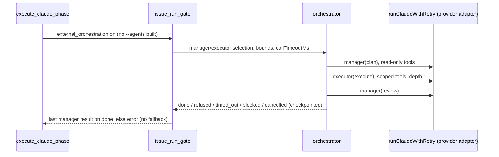

## Summary

Adds an opt-in external, provider-neutral manager–worker orchestrator for
`issue`-phase runs. It sits behind `external_orchestration`, which defaults to
`false`. Off, nothing changes. On, the `execute-claude-phase` path skips the Claude-native `--agents`
and runs a checkpointed plan → execute → review handoff. Each role call goes
through the existing provider adapters (`runClaudeWithRetry` with
`agentProvider` pinned). The manager and executor are selected independently
by provider, model and effort. A role moved to another provider keeps only the
model and effort its override names; the rest is left to that provider's own
phase routing, so a DeepSeek executor is never sent a Claude model name. An
unsupported provider or capability, missing tool support, an auth failure,
quota exhaustion and metered billing each fail closed, and nothing falls back
to a metered API. Closes #3642.

Some of the work is still partial (see Acceptance Criteria below):

- An executor edits the shared checkout at concurrency 1. Each executor does not get its own git worktree.
- Branch ownership is recorded on the envelope but not enforced.
- Only the `execute-claude-phase` command path (`worker/deno/lib/execute_claude_phase.ts`) honours the switch. The fleet loop's issue phase (`worker/deno/lib/phases/execute_phase.ts`) does not read it yet and still builds `--agents`.
- Only `claude` and `deepseek` can actually run a role today. Codex and Gemini are refused for missing compaction and missing denied-tool enforcement.

## Spec

### Intent and Rationale

- The contract from #3641 (`docs/MANAGER-WORKER-CONTRACT.md`) needed an implementation that does not depend on Claude's `--agents` flag. Wrapping the existing runner and adapters reuses their retry, credential and transcript handling instead of adding a new spawn path.
- The orchestrator (`worker/deno/lib/orchestration/orchestrator.ts`) is pure orchestration over an injected `invoke`. The gate (`issue_run_gate.ts`) is the only place it meets the runner. That keeps the state machine testable with no provider CLI.

### Essential Design Decisions

- **Fail closed.** These are refused, never worked around:
  - an unsupported capability or missing denied-tool enforcement;
  - an auth failure or quota exhaustion;
  - a stale lease;
  - metered billing, or a too-wide concurrency;
  - a switch that is on with no orchestrator wired.
  
  Model fallback is forced off for every role call.
- **No retry for an abandoned call.** A call that gives no answer within `callTimeoutMs` (the race timer won) is never retried, because the original may still be editing the checkout. The gate sets `callTimeoutMs` to `runnerCallBudgetMs`: each attempt's `timeoutSeconds` plus twice its `killAfterSeconds`, plus every retry's full wait, plus 60 s. That budget does not count progress extensions, which are on by default and move an attempt's hard deadline past `timeoutSeconds` (`claude_runner.ts:1653-1656`). A call extended past the budget is therefore abandoned and ends the run `timed_out`. A provider-*reported* timeout still retries.
- **Stable lease and idempotency keys.** The lease is `issue-<N>`, and each step has an idempotency key over (issue, role, attempt, prompt). A restart after an interrupted run resumes under the same lease without re-invoking a completed step. That holds even when the lease has lapsed: the lease id is stable per issue, so the holder that let it lapse cannot be a live one, and the run takes the checkpoint over. A checkpoint that ended `released`, `refused`, `blocked`, `timed_out` or `cancelled` is not resumed; the next run starts afresh. So a quota refusal, an empty plan or a used-up invocation budget cannot wedge the issue. A lease that lapses between calls inside one run is still refused `stale_lease`.
- **Scoped tools.** Every role is denied both dispatch tools, `Task` and `Agent`. The manager is also denied `Edit`, `MultiEdit`, `Write`, `NotebookEdit` and `Bash`. The envelope's allow-list is not handed to the runner, so the denial list is what scopes each role.
- **Checkpoints beside the work volume.** The gate checkpoints into `resolveAgentStateDir(workDir)/orchestration/<encodeURIComponent(repo)>`, beside the work volume rather than inside the clone's parent, so `nukeWorkDir` cannot wipe them.
- **Configuration-only rollback.** Set `external_orchestration: false` or remove the key. The quality, review and merge gates are untouched.

### Undiscoverable Facts

- Owner comment on the issue (2026-10-16, #3473/#3801): the default to preserve is a Sonnet manager with Haiku sub-agents. The orchestrated defaults match that: the manager is `claude`/`ISSUE_EXECUTOR_MODEL`/`high`, and the executor is `claude`/`HAIKU_ISSUE_EXECUTOR_MODEL`/`HAIKU_ISSUE_EXECUTOR_EFFORT`.
- The real runner allows a 4 h hard timeout plus rate-limit waits (`claude_runner.ts` defaults, now exported as `DEFAULT_CLAUDE_TIMEOUT_SECONDS` and its siblings). The orchestrator's built-in 10-minute default would have abandoned and retried every long executor call.

## Evidence

Backend and CLI only: there is no UI file in the diff.

- The full gate `./quality.sh < /dev/null` passed on commit `e4b054e7`. Every check passed; `config integration` was skipped by the gate itself. The final commit changes production code again, in `orchestrator.ts`, `issue_run_gate.ts`, `types.ts`, `checkpoint.ts` (a comment only) and `execute_claude_phase.ts`, to fix the pre-PR verifier's findings. The worker re-runs the full gate on it. The tests run on the final head are listed in the Test Plan.
- The fakes stand in for `runClaudeWithRetry` (`worker/deno/lib/claude_runner.ts`). The property relied on is that a call resolves to a `ClaudeRunResult` carrying `exitCode`, `agentFailure.category`, `usageLimit` and `invocationStats`. The gate maps those onto auth, quota, timeout and error.

**Docs sweep** — grep: `external_orchestration`, `CALL_TIMEOUT_MS`, `callTimeoutMs`, `runnerCallBudgetMs`, "retr\w* an `error`", `stale_lease`, `recovering`, `resolveAgentStateDir`, `orchestrator.ts:`, `issue_run_gate.ts:`, `types.ts:`, `execute_claude_phase.ts:1`; section: `docs/MANAGER-WORKER-CONTRACT.md#8-rollout-and-safeguards`, `docs/CONFIGURATION.md` (the `external_orchestration` rows); siblings: `issue_executor_split`, `issue_reviewer_agents`; updated: `docs/MANAGER-WORKER-CONTRACT.md` (the state machine, Stale lease, Resume or start afresh, Bounds, Checkpoints and permissions passages, and every moved line citation), `docs/CONFIGURATION.md`, `docs/MODEL-AND-CACHING.md`, `worker/deno/lib/orchestration/types.ts` (the `maxRetries` doc and the transition-table doc), `worker/deno/lib/orchestration/issue_run_gate.ts` (the `runnerCallBudgetMs` doc), `worker/deno/lib/orchestration/checkpoint.ts` (the `saveCheckpoint` doc); `docs/MANAGER-WORKER-CONTRACT.md:354` — still true because it states the orchestrator's own `CALL_TIMEOUT_MS` default and then says the gate overrides it with `runnerCallBudgetMs`.

Issue numbers cited:

- #3642: Implement external provider-neutral orchestration behind an opt-in feature flag.
- #3641: Document provider-neutral manager–worker contract and migration safeguards.
- #3473 and #3801 are cited from the owner's comment on this issue.

## Acceptance Criteria

<!-- vibe-spec-review inputs="diff+issue-body" -->

- **partial** — Unit/integration tests for same-provider and cross-provider handoffs, interruptions and recovery — evidence: `worker/deno/tests/orchestration_3642_orchestrator_test.ts::a completed cross-provider handoff runs the executor on deepseek and the manager on claude`, `::an interrupted run resumes under the same lease without repeating the plan` — reviewer: partial — reason: interruption is tested only for a same-provider crash during the executor call (not during plan or review, nor a `done` checkpoint left before `released`). The cross-provider tests pass only because the fake env sets no `DEEPSEEK_API_KEY`; with a real key DeepSeek classifies as `metered` and is refused.
- **met** — Feature flag defaults off; current Claude regression suite unchanged — evidence: `worker/deno/tests/external_orchestration_3642_config_test.ts::external orchestration config - the switch defaults off with no settings (Issue #3642)`, `worker/deno/tests/external_orchestration_3642_phase_test.ts::external orchestration - the switch off keeps the native call and its sub-agents (Issue #3642)` — reviewer: met
- **met** — Rollback is configuration-only — evidence: `worker/deno/tests/external_orchestration_3642_phase_test.ts::external orchestration - the switch absent is the same as off (Issue #3642)` — reviewer: met
- **partial** — Add orchestrator-owned manager/worker invocation and handoff; use existing provider adapters where possible rather than Claude-only --agents for cross-provider work. — evidence: `worker/deno/lib/orchestration/issue_run_gate.ts:153-175`, `worker/deno/tests/orchestration_3642_gate_test.ts::orchestration gate - default selection uses the Sonnet manager and Haiku executor, never --agents or fallback (Issue #3642)` — reviewer: partial — reason: cross-provider work cannot run in practice (Codex and Gemini are refused for denied-tool enforcement, DeepSeek is refused as metered once its key is set), and a non-empty manager review always ends the run `done`, so the handoff cannot send work back.
- **met** — Manager and executor selectable independently by provider/model/effort; keep Claude-native --agents as default and supported fast path. — evidence: `worker/deno/tests/orchestration_3642_gate_test.ts::orchestration gate - a provider-only override leaves that role's model and effort to the provider (Issue #3642)`, `::orchestration gate - per-role overrides replace the defaults (Issue #3642)` — reviewer: met
- **partial** — Scope execution tools, worktrees, secrets, concurrent edits and branch ownership; bound retries, delegation depth, concurrency and spend; persist checkpoints and idempotency keys for unattended restart. — evidence: `worker/deno/tests/orchestration_3642_orchestrator_test.ts::an invocation budget stops the run before the next call`, `::a delegation depth of zero refuses before any call`, `worker/deno/tests/orchestration_3642_gate_test.ts::orchestration gate - every role call denies sub-agent dispatch, and the manager every editing tool (Issue #3642)` — reviewer: partial — reason: no per-executor worktree; branch ownership is not enforced; secrets rely only on the existing adapter env isolation and checkpoint redaction; `max_invocations` counts `runClaudeWithRetry` calls, each of which may spawn several CLI attempts; `max_cost_usd` applies only to priced usage; `isCancelled` is not wired in the gate.
- **partial** — Fail closed on unsupported capabilities, quota exhaustion, authentication failure, stale lease and missing tool support; never silently switch to metered APIs. — evidence: `worker/deno/tests/orchestration_3642_gate_test.ts::orchestration gate - an auth failure refuses with no fallback call (Issue #3642)`, `::orchestration gate - a rate-limit failure is a quota refusal with no retry (Issue #3642)`, `worker/deno/tests/orchestration_3642_orchestrator_test.ts::metered billing refuses an orchestrated run before any call`, `worker/deno/tests/orchestration_3642_contracts_test.ts::a manager on a provider without compaction is refused as unsupported_capability` — reviewer: partial — reason: auth, quota, metered billing, capability and tool support fail closed, but `stale_lease` is effectively unreachable in production: the heartbeat is renewed after every call and checked straight after, it is not renewed during a call, and the stable `issue-<N>` lease gives no mutual exclusion between two workers.
- **met** — Keep quality/review/merge gates unchanged. — evidence: no gate module in `git diff --name-only`; `worker/deno/lib/execute_claude_phase.ts:1645` only changes how `claudeResult` is produced — reviewer: met
- **unrequested** — Rewrite of `docs/MANAGER-WORKER-CONTRACT.md` beyond the new key: the state machine, refreshed line citations, and the Codex credential wording — reviewer: unrequested — reason: the contract doc described the orchestrator as "not implemented"; landing it made those sections false, so they had to change with it.
- **unrequested** — Unknown-key rejection and per-key validation for `external_orchestration_settings` — reviewer: unrequested — reason: the settings are a new trust boundary, so they are validated at load and fail loud rather than being half-applied.
- **unrequested** — Credential redaction of provider error text in reasons and checkpoints — reviewer: unrequested — reason: provider stderr can carry a token, and the checkpoint persists on disk, which the secrets requirement covers.
- **unrequested** — Old-version checkpoint handling, and ended or released checkpoints starting afresh — reviewer: unrequested — reason: needed for a safe unattended restart, so an old or finished checkpoint is never replayed.
- **unrequested** — The four `DEFAULT_*` runner constants exported from `worker/deno/lib/claude_runner.ts` — reviewer: unrequested — reason: lets `runnerCallBudgetMs` reuse the runner's own defaults; no behaviour change.
- **unrequested** — `docs/audits/lib-sweep-coverage/top-up-3642.json` and the `docs/MODEL-AND-CACHING.md` rollback row — reviewer: unrequested — reason: the lib-sweep ledger entry the new `lib/` modules need, and documentation of the configuration-only rollback.

## Standards Review

<!-- vibe-standards-review inputs="diff+CODING-STANDARDS.md" -->

- **violation** — A new behaviour reaches every caller that needs it; a code change owes a docs change — evidence: `worker/deno/lib/phases/execute_phase.ts:745`, `:1081` — reason: not fixed in this diff. The fleet loop's issue phase never reads `externalOrchestration`, so it still builds `--agents` and calls the runner directly; only the `execute-claude-phase` command honours the switch, while `docs/CONFIGURATION.md` and `docs/MANAGER-WORKER-CONTRACT.md:533-534` describe it as covering every `issue`-phase run.
- **violation** — Every changed call site needs a test that goes red without it — evidence: `worker/deno/commands/execute_claude_phase.ts:180-184` — reason: not fixed in this diff; no test drives the command with `config.externalOrchestration*`.
- **violation** — Never fail silently — evidence: `worker/deno/lib/execute_claude_phase.ts:919`, `worker/deno/lib/orchestration/orchestrator.ts:254` — reason: not fixed in this diff; production wires no `log`, so ignored-checkpoint, lease-takeover and fresh-start messages are dropped.
- **violation** — Nothing exists only for a test to read — evidence: `worker/deno/lib/orchestration/orchestrator.ts:98`, `:102`, `:119-125` — reason: not fixed in this diff; `isCancelled` and `leaseTtlMs` are set, and `resumed`, `invocations`, `costUsd` and `managerOutput` are read, only by tests.
- **violation** — Comment accuracy and DRY — evidence: `worker/deno/lib/orchestration/issue_run_gate.ts:53-59` — reason: not fixed in this diff; the comment says `high` has no shared constant, but `DEFAULT_CLAUDE_EFFORT_ISSUE` exists at `worker/deno/lib/config_defaults.ts:861`.
- **violation** — DRY (single source of truth) — evidence: `worker/deno/lib/config.ts:1332-1337`, `worker/deno/lib/orchestration/capabilities.ts:29-34`, `worker/deno/lib/orchestration/issue_run_gate.ts:44-49` — reason: not fixed in this diff; the four-provider list is copied three times.
- **violation** — Config defaults live in `config_defaults.ts` — evidence: `worker/deno/lib/config_defaults.ts:533`, `worker/deno/lib/config.ts:1355` — reason: not fixed in this diff; `OPERATIONAL_DEFAULTS.externalOrchestrationSettings` is never read and `{}` is hard-coded instead.
- **violation** — Doc line citations — evidence: `docs/MANAGER-WORKER-CONTRACT.md`, `docs/CONFIGURATION.md` — reason: fixed in this diff (`issue_run_gate.ts:228-235`, `orchestrator.ts:378-392`).
- **clean** — Australian spelling; `deno lint` and `deno fmt --check` on every changed TypeScript file; the 3642 tests, `config_unknown_keys_test.ts` and `manager_worker_contract_3641_test.ts` pass; no assertion on the merge base removed or weakened; no test greps source; tests use their own temporary directories; provider error text is redacted before the reason and the checkpoint; the checkpoint key is versioned and its path segments are encoded; config validation fails loud and names the key. The reviewer's notes (not violations): `max_invocations` does not bound CLI spawns; `ROLE_REQUIRED_CAPABILITIES[role] ?? {}` is never taken; several contract fields are unread; the `createDefaultDeps` wiring test only checks the type; the call watchdog uses a raw `setTimeout`; a resume that finds the review already recorded returns `done` as an error; and `...input.claudeOptions` carries `sessionResumeState` and `systemPrompt` into every role call.

## Test Plan

- Ran `timeout 900 deno test -A tests/external_orchestration_3642_config_test.ts tests/external_orchestration_3642_phase_test.ts tests/orchestration_3642_contracts_test.ts tests/orchestration_3642_gate_test.ts tests/orchestration_3642_orchestrator_test.ts tests/config_unknown_keys_test.ts tests/lib_sweep_coverage_test.ts tests/manager_worker_contract_3641_test.ts tests/config_docs_consistency_test.ts tests/timeout_docs_consistency_test.ts tests/model_routing_docs_test.ts` from `worker/deno` on the final tree, with type-checking on: `ok | 190 passed | 0 failed`.
- Ran `deno test --no-check -A tests/execute_claude_phase_command_test.ts tests/execute_phase_*_test.ts tests/issue_executor_split_test.ts`: `ok | 109 passed | 0 failed`. `deno lint` and `deno fmt --check` are clean on every changed TypeScript file.
- Mutation-check baseline: the gate reported that the 338 test files importing a mutated module failed before any mutation, but it keeps no output, so the failing test is not named. I re-ran that exact command (`deno test --no-check -A <the 338 files>` from `worker/deno`) three times. The first run used the worker's environment, and the other two used `buildUntrustedCommandEnv` with `clearEnv`, as the mutation runner's child does; the last of them ran on the final tree. All three gave `ok | 4742 passed | 0 failed | 1 ignored`. The failure did not reproduce here, so no code was changed for it.
- Added:
  - `worker/deno/tests/orchestration_3642_orchestrator_test.ts`
  - `worker/deno/tests/orchestration_3642_gate_test.ts`
  - `worker/deno/tests/orchestration_3642_contracts_test.ts`
  - `worker/deno/tests/external_orchestration_3642_config_test.ts`
  - `worker/deno/tests/external_orchestration_3642_phase_test.ts`
- Extended `worker/deno/tests/config_unknown_keys_test.ts` with three tests and the import they need. No assertion that exists on the base branch was removed or edited.
- Tests added in the final commit, each red-checked against its production line, with every production file restored afterwards (the breaks are recorded in the facts file):
  - `a run that ended timed_out is not resumed: the next run on the same lease starts afresh`, `a quota refusal does not wedge the issue: a run past the lease ttl starts afresh and completes` and `an empty plan does not wedge the issue: the next run asks the manager again`. Resuming every unreleased checkpoint again (`existing.state !== "released"`) turned all three red.
  - `a lapsed checkpoint under the run's own lease is taken over and renewed, not refused`: restoring the resume-time `stale_lease` refusal turned it red.
  - `a lease that lapses between calls refuses the next call as stale_lease and leaves the heartbeat unrenewed`: `if (false)` on the between-calls lapse check, or `persist(true)` at the refusal, turned it red.
  - `orchestration gate - every role call denies sub-agent dispatch, and the manager every editing tool (Issue #3642)`: dropping `Agent` from the dispatch tools turned it and the orchestrator's `handoff` test red.
  - `orchestration gate - a provider-only override leaves that role's model and effort to the provider (Issue #3642)`: inheriting the Claude default model again turned it red (model `haiku`).
  - `orchestration gate - checkpoints sit beside the work volume, scoped by repository, not inside it (Issue #3642)`: resolving the root from `workspaceDir` again turned it red.
  - `orchestration gate - a quota refusal does not wedge the issue: a run past the lease ttl completes (Issue #3642)`: two gate runs 16 and 32 minutes after a quota refusal both complete; resuming ended checkpoints again turned it red.
  - `orchestration gate - a work directory that names no directory refuses the run before any call (Issue #3642)`: `if (false)` on the `stateRoot` guard turned it red.
- The interrupted-run tests (`an interrupted run resumes under the same lease without repeating the plan` and `orchestration gate - a resumed run reuses the completed manager plan (Issue #3642)`) now leave the checkpoint exactly as a worker that died mid-call would leave it. They copy the file during the executor call and write it back afterwards, because an ended run no longer resumes.
- Refusal tests assert the specific refusal kind or message. Each one carries a positive control with only the probed value made legal, for example the valid `callTimeoutMs`, the `max_retries: 0` load and the provider override that also names a model.
- Entry points checked:
  - `worker/deno/commands/execute_claude_phase.ts` threading the two config values: no test drives the command with them, so dropping those lines leaves the suite green (recorded under Standards Review);
  - `executeClaudePhaseBody` passing `workDir` and `repo` to the gate, covered by `external orchestration - the switch on routes the run to the orchestrator and not the native call (Issue #3642)`;
  - `createDefaultDeps` wiring the gate, covered by the `createDefaultDeps` test;
  - `runOrchestratedIssueRun` passing `callTimeoutMs`, covered by the `runnerCallBudgetMs` tests. The wiring line itself has no slow-runner test, because a slow-runner test would need to wait beyond the 60 s grace.
- New path to an existing outcome: the orchestrated branch replaces only the `runClaudeWithRetry` call. Every guard after it in `executeClaudePhaseBody` (result handling, quality, review and merge gates) still runs unchanged on its `claudeResult`.
- Persistent record: the checkpoint is released when a run finishes `done`, and a later run starts afresh. That is covered by `orchestration gate - a later run for the same issue starts afresh after a completed run (Issue #3642)`. A checkpoint that ended any other way also starts afresh, covered by the three wedge tests above.

<!-- vibe-branch-outcomes -->
