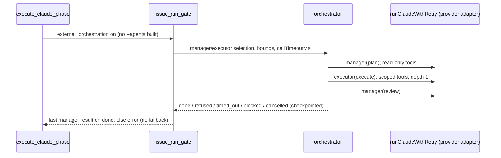

## Summary

Adds an opt-in external, provider-neutral manager–worker orchestrator for
`issue`-phase runs. It sits behind `external_orchestration`, which defaults to
`false`. Off, nothing changes. On, the phase skips the Claude-native `--agents`
and runs a checkpointed plan → execute → review handoff. Each role call goes
through the existing provider adapters (`runClaudeWithRetry` with
`agentProvider` pinned). The manager and executor are selected independently
by provider, model and effort. Every unsupported or unsafe condition fails
closed, and nothing falls back to a metered API. Closes #3642.

Some of the work is still partial (see Acceptance Criteria below):

- An executor edits the shared checkout at concurrency 1. Each executor does not get its own git worktree.
- Branch ownership is recorded on the envelope but not enforced.
- Only `claude` and `deepseek` can actually run a role today. Codex and Gemini are refused for missing compaction and missing denied-tool enforcement.

## Spec

### Intent and Rationale

- The contract from #3641 (`docs/MANAGER-WORKER-CONTRACT.md`) needed an implementation that does not depend on Claude's `--agents` flag. Wrapping the existing runner and adapters reuses their retry, credential and transcript handling instead of adding a new spawn path.
- The orchestrator (`worker/deno/lib/orchestration/orchestrator.ts`) is pure orchestration over an injected `invoke`. The gate (`issue_run_gate.ts`) is the only place it meets the runner. That keeps the state machine testable with no provider CLI.

### Essential Design Decisions

- **Fail closed.** These are refused, never worked around:
  - an unsupported capability or missing denied-tool enforcement;
  - an auth failure or quota exhaustion;
  - a stale lease;
  - metered billing, or a too-wide concurrency;
  - a switch that is on with no orchestrator wired.
  
  Model fallback is forced off for every role call.
- **No retry for an abandoned call.** A call that gives no answer within `callTimeoutMs` (the race timer won) is never retried, because the original may still be editing the checkout. The gate sets `callTimeoutMs` to `runnerCallBudgetMs`, the runner's own worst case plus 60 s. A provider-*reported* timeout still retries.
- **Stable lease and idempotency keys.** The lease is `issue-<N>`, and each step has an idempotency key over (issue, role, attempt, prompt). A restart under the same lease resumes without re-invoking a completed step. A released checkpoint starts afresh.
- **Configuration-only rollback.** Set `external_orchestration: false` or remove the key. The quality, review and merge gates are untouched.

### Undiscoverable Facts

- Owner comment on the issue (2026-10-16, #3473/#3801): the default to preserve is a Sonnet manager with Haiku sub-agents. The orchestrated defaults match that: the manager is `claude`/`ISSUE_EXECUTOR_MODEL`/`high`, and the executor is `claude`/`HAIKU_ISSUE_EXECUTOR_MODEL`/`HAIKU_ISSUE_EXECUTOR_EFFORT`.
- The real runner allows a 4 h hard timeout plus rate-limit waits (`claude_runner.ts` defaults, now exported as `DEFAULT_CLAUDE_TIMEOUT_SECONDS` and its siblings). The orchestrator's built-in 10-minute default would have abandoned and retried every long executor call.

## Evidence

Backend and CLI only: there is no UI file in the diff.

- The full gate `./quality.sh < /dev/null` passed on commit `e4b054e7`. Every check passed; `config integration` was skipped by the gate itself. Later commits add tests only, plus the facts file. Those test files were run on the final head (see Test Plan).
- The fakes stand in for `runClaudeWithRetry` (`worker/deno/lib/claude_runner.ts`). The property relied on is that a call resolves to a `ClaudeRunResult` carrying `exitCode`, `agentFailure.category`, `usageLimit` and `invocationStats`. The gate maps those onto auth, quota, timeout and error.

**Docs sweep** — grep: `external_orchestration`, `CALL_TIMEOUT_MS`, `callTimeoutMs`, "retr\w* an `error`", `orchestrator.ts:`, `issue_run_gate.ts:`; section: `docs/MANAGER-WORKER-CONTRACT.md#8-rollout-and-safeguards`, `docs/CONFIGURATION.md` (the `external_orchestration` rows); siblings: `issue_executor_split`, `issue_reviewer_agents`; updated: `docs/MANAGER-WORKER-CONTRACT.md`, `docs/CONFIGURATION.md`, `docs/MODEL-AND-CACHING.md`, `worker/deno/lib/orchestration/types.ts` (the `maxRetries` doc); `docs/MANAGER-WORKER-CONTRACT.md:349` — still true because it states the orchestrator's own `CALL_TIMEOUT_MS` default and then says the gate overrides it with `runnerCallBudgetMs`.

Issue numbers cited:

- #3642: Implement external provider-neutral orchestration behind an opt-in feature flag.
- #3641: Document provider-neutral manager–worker contract and migration safeguards.
- #3473 and #3801 are cited from the owner's comment on this issue.

## Acceptance Criteria

<!-- vibe-spec-review inputs="diff+issue-body" -->

- **partial** — Unit/integration tests for same-provider and cross-provider handoffs, interruptions and recovery — evidence: `worker/deno/tests/orchestration_3642_orchestrator_test.ts::handoff: manager plans, executor carries out, manager reviews`, `::an interrupted run resumes under the same lease without repeating the plan`, `::a completed cross-provider handoff runs the executor on deepseek and the manager on claude`, `worker/deno/tests/orchestration_3642_gate_test.ts::orchestration gate - a resumed run reuses the completed manager plan (Issue #3642)` — reviewer: partial — reason: the only cross-provider handoff covered is a claude manager with a deepseek executor, and it runs on a fake invoker; no test drives the real runner, and Codex and Gemini are refused, not handed off.
- **met** — Feature flag defaults off; current Claude regression suite unchanged — evidence: `worker/deno/tests/external_orchestration_3642_config_test.ts::external orchestration config - the switch defaults off with no settings (Issue #3642)`, `worker/deno/tests/external_orchestration_3642_phase_test.ts::external orchestration - the switch off keeps the native call and its sub-agents (Issue #3642)` — reviewer: met
- **met** — Rollback is configuration-only — evidence: `worker/deno/tests/external_orchestration_3642_phase_test.ts::external orchestration - the switch absent is the same as off (Issue #3642)`, `docs/CONFIGURATION.md` — reviewer: met
- **partial** — Add orchestrator-owned manager/worker invocation and handoff; use existing provider adapters where possible rather than Claude-only --agents for cross-provider work. — evidence: `worker/deno/lib/orchestration/orchestrator.ts`, `worker/deno/lib/orchestration/issue_run_gate.ts` — reviewer: partial — reason: the handoff runs through the existing adapters, but only `claude` and `deepseek` can run a role; Codex and Gemini executors cannot enforce denied tools, and their managers cannot compact.
- **met** — Manager and executor selectable independently by provider/model/effort; keep Claude-native --agents as default and supported fast path. — evidence: `worker/deno/tests/orchestration_3642_gate_test.ts::orchestration gate - per-role overrides replace the defaults (Issue #3642)` — reviewer: met
- **partial** — Scope execution tools, worktrees, secrets, concurrent edits and branch ownership; bound retries, delegation depth, concurrency and spend; persist checkpoints and idempotency keys for unattended restart. — evidence: `worker/deno/lib/orchestration/checkpoint.ts`, `worker/deno/tests/orchestration_3642_orchestrator_test.ts::a cost cap stops the run once spend reaches it`, `::an abandoned call is not retried and ends the run timed_out` — reviewer: partial — reason: tools, bounds, checkpoints and idempotency keys are done; there is no per-executor worktree, branch ownership is recorded but not enforced, concurrent edits are handled only by forcing concurrency to 1, and `max_cost_usd` applies only to calls whose usage can be priced.
- **met** — Fail closed on unsupported capabilities, quota exhaustion, authentication failure, stale lease and missing tool support; never silently switch to metered APIs. — evidence: `worker/deno/tests/orchestration_3642_orchestrator_test.ts::a stale lease refuses resume and leaves the heartbeat unrenewed`, `::metered billing refuses an orchestrated run before any call`, `worker/deno/tests/orchestration_3642_gate_test.ts::orchestration gate - an auth failure refuses with no fallback call (Issue #3642)` — reviewer: met
- **met** — Keep quality/review/merge gates unchanged. — evidence: no gate module in `git diff --name-only` — reviewer: met
- **unrequested** — Rewrite of `docs/MANAGER-WORKER-CONTRACT.md` beyond the new key: the state machine, refreshed line citations, and the Codex credential wording — reviewer: unrequested — reason: the contract doc described the orchestrator as "not implemented"; landing it made those sections false, so they had to change with it.
- **unrequested** — Unknown-key rejection and per-key validation for `external_orchestration_settings` — reviewer: unrequested — reason: the settings are a new trust boundary, so they are validated at load and fail loud rather than being half-applied.
- **unrequested** — Credential redaction of provider error text in reasons and checkpoints — reviewer: unrequested — reason: provider stderr can carry a token, and the checkpoint persists on disk, which the secrets requirement covers.
- **unrequested** — Old-version checkpoint handling and released-checkpoint-starts-afresh semantics — reviewer: unrequested — reason: needed for a safe unattended restart, so an old or finished checkpoint is never replayed.

## Standards Review

<!-- vibe-standards-review inputs="diff+CODING-STANDARDS.md" -->

- **clean** — The reviewer found no violation. It checked:
  - Australian spelling;
  - that every named test exists;
  - that no test greps source;
  - fail-loud checkpoint load and save, and config errors that name the key;
  - redaction before the refusal and checkpoint sinks;
  - defaults reused from existing constants;
  - checkpoint path confinement (`encodeURIComponent(issueId)`);
  - a new persisted key (`orchestration-checkpoint-v1`), so there is no old shape to read;
  - that no existing test assertion is removed or changed.
  
  It did not run two review-enforced checks: the changed-call-site check on `worker/deno/commands/execute_claude_phase.ts` and the test-only-member `git grep` check. Both were done here: `orchestration gate - createDefaultDeps wires runExternalOrchestratedIssueRun (Issue #3642)` covers the wiring. `runnerCallBudgetMs` and the four `DEFAULT_*` runner constants each have production readers (`issue_run_gate.ts` and `claude_runner.ts`). Its optional note was that a timed-out call could be retried beside a still-running original. That is fixed in this diff (`worker/deno/lib/orchestration/orchestrator.ts:575`).

## Test Plan

- Ran `timeout 600 deno task test:unit tests/external_orchestration_3642_config_test.ts tests/external_orchestration_3642_phase_test.ts tests/orchestration_3642_contracts_test.ts tests/orchestration_3642_gate_test.ts tests/orchestration_3642_orchestrator_test.ts tests/config_unknown_keys_test.ts tests/lib_sweep_coverage_test.ts tests/manager_worker_contract_3641_test.ts` from `worker/deno` on the final head. It passed; the result is recorded below the list.
- Added:
  - `worker/deno/tests/orchestration_3642_orchestrator_test.ts`
  - `worker/deno/tests/orchestration_3642_gate_test.ts`
  - `worker/deno/tests/orchestration_3642_contracts_test.ts`
  - `worker/deno/tests/external_orchestration_3642_config_test.ts`
  - `worker/deno/tests/external_orchestration_3642_phase_test.ts`
- Extended `worker/deno/tests/config_unknown_keys_test.ts` with three tests and the import they need. No assertion was removed or edited.
- Each new test was red-checked against its production line, and every production file was restored afterwards. The recorded break for each outcome is in the facts file. Highlights:
  - Abandoned-call test: making abandoned calls retry gave 3 executor calls where 1 was expected, so the test went red.
  - Compaction-refusal test: `if (false && …)` on `capabilities.ts:148` turned it red.
  - Other-lease test: treating any lease as the same lease turned `resumed` true, so the test went red.
- Refusal tests assert the specific refusal kind or message. Each one carries a positive control with only the probed value made legal, for example the valid `callTimeoutMs` and the `max_retries: 0` load.
- Entry points checked:
  - `worker/deno/commands/execute_claude_phase.ts` threading the two config values, covered by the phase tests that set the options;
  - `createDefaultDeps` wiring the gate, covered by the `createDefaultDeps` test;
  - `runOrchestratedIssueRun` passing `callTimeoutMs`, covered by the `runnerCallBudgetMs` tests. The wiring line itself has no slow-runner test, because a slow-runner test would need to wait beyond the 60 s grace.
- New path to an existing outcome: the orchestrated branch replaces only the `runClaudeWithRetry` call. Every guard after it in `executeClaudePhaseBody` (result handling, quality, review and merge gates) still runs unchanged on its `claudeResult`.
- Persistent record: the checkpoint is released when a run finishes `done`, and a later run starts afresh. That is covered by `orchestration gate - a later run for the same issue starts afresh after a completed run (Issue #3642)`.

<!-- vibe-branch-outcomes -->
